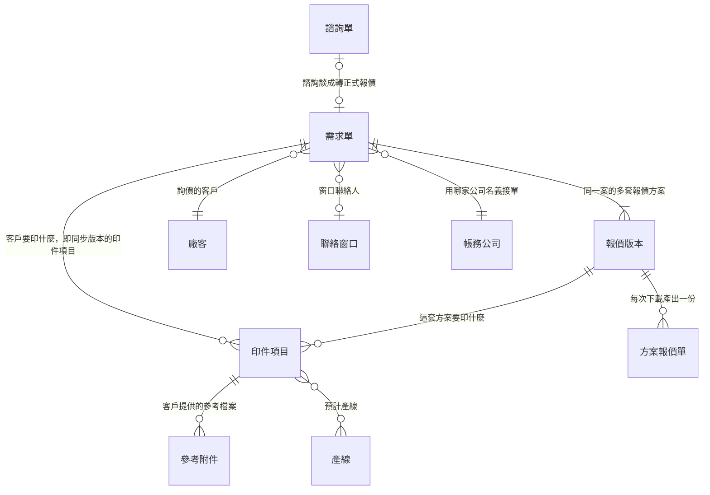
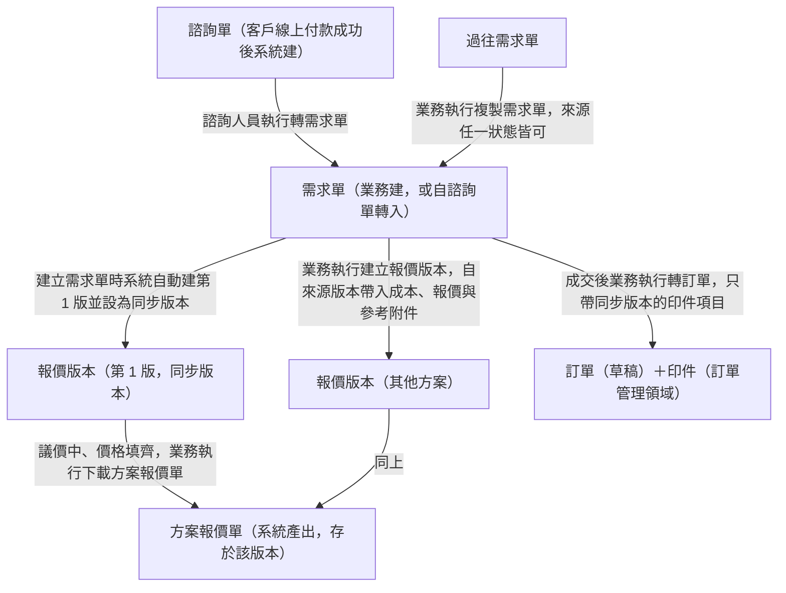
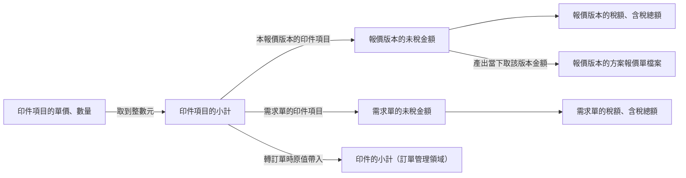
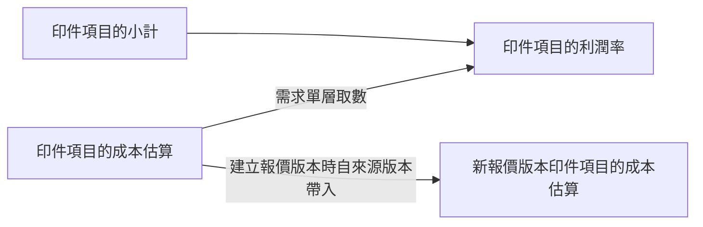

讀完這張卡，你會知道：

- 售前領域每個實體跟誰相連（本卡是領域視角：**關聯的唯一正本**在 [[ERP 資料結構總覽]]，本卡 § 四只列關聯標題）
- 一筆生意在成交之前，需求單、報價版本與方案報價單依什麼順序產生、誰觸發誰建立
- 單價、小計與金額怎麼從印件項目流到報價版本、需求單，成交時又怎麼流進訂單
- 本卡不放什麼：實體定義（各卡一句話定位）、欄位表（各實體卡）、狀態列舉與轉換（各狀態機卡）——接縫處只標狀態名＋連結，不重畫

## 一、結構視圖（ER 圖＋基數）

主檔層（圖上以單一節點呈現，不展開內部）：[[產線]]、[[廠客]] 與其聯絡窗口、[[帳務]] 的帳務公司。[[人員]] 對需求單的指派（接單業務、評估印務主管、分享成員）圖上省略，逐條列在 [[ERP 資料結構總覽]] 關聯明細。報價紀錄與活動紀錄屬實作規格，不入圖（見 [[需求單]] 範圍外）。

## 二、單據流視圖（產生順序與觸發）

- 建立第 1 版的時點涵蓋建立需求單、複製需求單與諮詢單轉需求單（做法見 [[需求單恆有報價版本]]）。
- 複製需求單時新單只帶來源單同步版本的印件項目，成為新單的第 1 版（範圍見 [[複製需求單帶入範圍]]）。
- 成交時怎麼選定報價版本見 [[成交版本即同步版本]]；轉訂單之後的單據流見 [[訂單領域資料結構總覽]] § 二。
- 方案報價單與訂單階段的報價單是兩種文件：方案報價單在本領域由系統產出（[[方案報價單取報價版本內容]]），報價單在訂單審核通過後產出（[[報價單取訂單當前內容]]）。
- 刪除報價版本後，該版本與旗下印件項目、方案報價單的處理見 [[刪除報價版本連帶刪除項目與檔案]]。
- 各單據的狀態怎麼轉不在本卡：[[需求單狀態]]、[[諮詢單狀態]]。報價版本沒有自己的狀態機，可改與鎖定跟著 [[需求單狀態]]。

## 三、資料流視圖（值的推導鏈）

### 金額鏈（印件項目向上收斂）

- 單價與小計的算式正本在 [[需求單]] § 印件項目；報價版本的金額算式正本在 [[報價版本]] § 金額。
- 需求單印件項目與同步版本的印件項目雙向同步，需求單的未稅金額因此等於同步版本的未稅金額（[[同步版本與需求單雙向同步]]）。
- 報價版本只計印件金額，折扣、運費與其他費用在訂單上填（[[報價版本只計印件金額]]、[[折扣只記在訂單]]）。
- 轉訂單之後的金額鏈見 [[訂單領域資料結構總覽]] § 三；小計原值帶入的做法見 [[報價邏輯]]。

### 成本鏈（成本估算到利潤率）

- 利潤率的算式正本在 [[生產績效指標]]；報價版本層不另設利潤率（見 [[報價版本]] 範圍外）。
- 新建報價版本帶入成本估算與單價的做法見 [[新建報價版本帶入成本與報價]]。
- 送印務評估與評估完成的檢查涵蓋全部報價版本的印件項目，條件正本在 [[需求單狀態]]。

## 四、本領域關聯

基數、方向、業務意義與建立時機見 [[ERP 資料結構總覽]] 下列標題：

- [[ERP 資料結構總覽#諮詢單與需求單]]
- [[ERP 資料結構總覽#需求單與印件項目]]
- [[ERP 資料結構總覽#需求單與報價版本]]
- [[ERP 資料結構總覽#報價版本與印件項目]]
- [[ERP 資料結構總覽#報價版本與方案報價單]]
- [[ERP 資料結構總覽#印件項目與產線]]
- [[ERP 資料結構總覽#印件項目與參考附件]]
- [[ERP 資料結構總覽#需求單與廠客]]
- [[ERP 資料結構總覽#需求單與聯絡窗口]]
- [[ERP 資料結構總覽#需求單與人員（接單業務）]]
- [[ERP 資料結構總覽#需求單與人員（評估印務主管）]]
- [[ERP 資料結構總覽#需求單與人員（分享成員）]]
- [[ERP 資料結構總覽#需求單與帳務 的帳務公司]]

## 五、跨領域接口

| 邊界實體 | 方向 | 說明 |
|---------|------|------|
| [[需求單]] → [[訂單]] | 售前 → 訂單管理 | 成交轉出（[[ERP 資料結構總覽#需求單與訂單]]）；只帶同步版本的印件項目，逐筆建立 [[印件]]。訂單側見 [[訂單領域資料結構總覽]] |
| [[諮詢單]] → [[訂單]] | 售前 → 訂單管理 | 收尾建立諮詢訂單（[[ERP 資料結構總覽#諮詢單與訂單]]） |
| [[諮詢單]] → [[帳務]] 的款項紀錄 | 售前 → 款項與發票 | 諮詢費款項先綁諮詢單，收尾或成交時轉移至訂單（[[ERP 資料結構總覽#諮詢單與帳務 的款項紀錄]]） |
| 印件項目的參考附件 → [[訂單]] 的其他附件 | 售前 → 訂單管理 | 成交轉入（[[ERP 資料結構總覽#訂單與其他附件]]） |

## 六、維護規則

- 本卡是售前領域的視角：關聯的唯一正本在 [[ERP 資料結構總覽]]，領域內部的單據流與資料流細節以本卡為準。動任何實體的關聯時先改 [[ERP 資料結構總覽]]，再改本卡，實體卡的「關鍵關聯」段只寫鍵（`wiki-amend` 落點表強制檢查此順序）。
- 一條關聯橫跨兩個領域時，正本在 [[ERP 資料結構總覽]]，領域視角畫在該關聯業務主場的領域總覽。需求單與訂單、諮詢單與訂單由本卡出發、訂單側承接於 [[訂單領域資料結構總覽]]。
- 設計案帶來的關聯變動：`erp-plan` 設計收件的必含段①附「總覽差異」小節，落卡時照差異改。
- 每次修改追加 wiki/log.md，逐卡點名。

## 範圍外

- 實體定義與一句話定位：見 [[ERP 詞彙表]]；為什麼要有它見各實體卡（[[需求單]]、[[報價版本]]、[[諮詢單]]）。
- 欄位表與各欄可否修改：見各實體卡的欄位段。
- 狀態列舉與狀態轉換條件：見 [[需求單狀態]]、[[諮詢單狀態]]。
- 計算公式本體：金額見 [[需求單]]、[[報價版本]] 欄位表，做法見 [[報價邏輯]]；利潤率見 [[生產績效指標]]。
- 介面版面與操作動線：見 Prototype。
- 待確認事項：見 `08-open-questions/`，本卡不收未決內容。

## 相關卡

- 實體正本：[[需求單]]、[[報價版本]]、[[諮詢單]]、[[訂單]]、[[廠客]]、[[產線]]、[[人員]]、[[帳務]]
- 規則正本：[[報價邏輯]]、[[需求單恆有報價版本]]、[[同步版本與需求單雙向同步]]、[[同步版本不可停止]]、[[刪除報價版本連帶刪除項目與檔案]]、[[方案報價單取報價版本內容]]、[[成交版本即同步版本]]、[[新建報價版本帶入成本與報價]]、[[報價版本只計印件金額]]、[[複製需求單帶入範圍]]、[[諮詢收尾規則]]；流程群組：[[線下接單流程群組]]、[[諮詢服務流程群組]]
- 狀態機：[[需求單狀態]]、[[諮詢單狀態]]
- 鄰域總覽：[[訂單領域資料結構總覽]]
- 檢索入口：[[erp_index]]、[[business-domain-taxonomy]]
