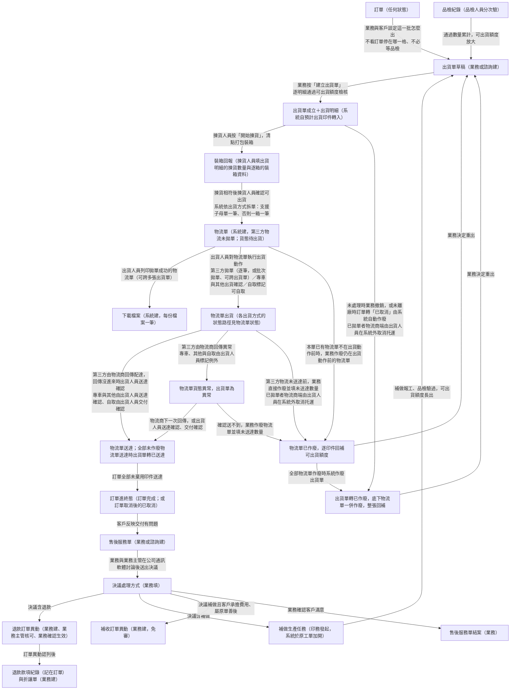
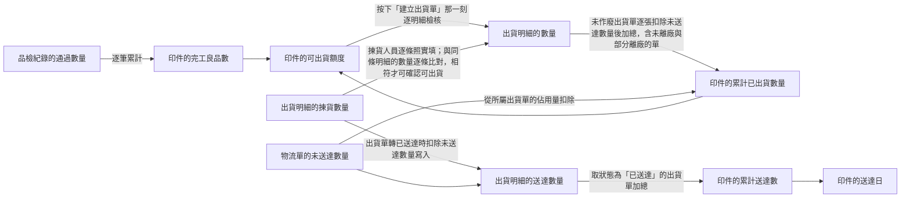
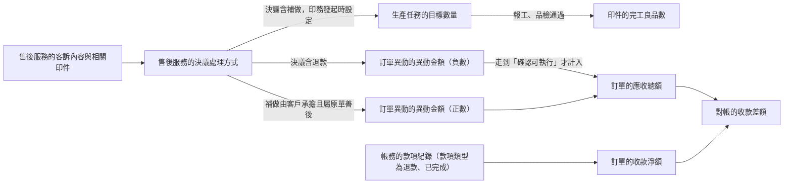

讀完這張卡，你會知道：

- 貨做完之後，出貨側與售後側的單據依什麼順序產生、誰觸發誰建立
- 數量與金額的值怎麼從一個欄位流到下一個欄位，在哪裡收斂
- 履約與售後領域跟其他領域在哪些單據交棒
- 本卡不放什麼：實體關聯與基數（唯一正本在 [[ERP 資料結構總覽]]）、實體定義（[[ERP 詞彙表]]）、欄位表（各實體卡）、狀態列舉與轉換（各狀態機卡）——接縫處只標狀態名與連結，不重畫

## 一、單據流視圖（產生順序與觸發）

- 出貨單草稿在訂單任何狀態都建得出來（轉換條件正本見 [[出貨單狀態]]）。
- 出貨鏈與售後鏈是兩段各自獨立的流程，交會點是：訂單進終態是售後受理的前提（[[建單限訂單終態]]），補做驗過後回到建出貨單這一步。
- 客戶趁客訴處理追加的新生意另開新訂單，不掛售後服務單、也不在原訂單內建訂單異動（[[訂單異動規則]]）。
- 出貨單作廢的來路見 [[出貨單狀態]] 已作廢列。出貨單的異常由物流單計算，沒有人工標記的動作。
- 出貨單在已確認之後的狀態取未作廢物流單的最落後處境，計算規則見 [[出貨單狀態]]；物流單的狀態路徑見 [[物流單狀態]]。
- 物流單在確認可出貨時產生；確認的條件見 [[出貨單狀態]]。
- [[下載檔案]] 由列印物流單產生，每份檔案一筆；產哪幾份、各收哪幾筆見 [[下載檔案]]。下載檔案與出貨單、物流單的狀態各走各的，不互相推進。
- 退款金流的後段在本圖之外：業務主管每月彙整待退款報表交 [[會計]]，會計依報表執行金流，業務回頭掛匯款證明並把退款款項標成「已完成」（[[現金流出把關]]、[[帳務清單規則]]）。
- 例外移置不成單，見 [[暫存區為系統站點]]、[[ERP 詞彙表#例外移置]]。
- 各單據的狀態怎麼轉不在本卡：[[出貨單狀態]]、[[物流單狀態]]、[[下載檔案狀態]]、[[售後服務狀態]]、[[印件印製狀態]]、[[訂單狀態]]、[[訂單異動狀態]]、[[款項狀態]]、[[折讓單狀態]]。

- 出貨單成立那一步推進印件與訂單的「出貨中」，範圍見 [[印件印製狀態]]、[[訂單狀態]]。

## 二、資料流視圖（值的推導鏈）

### 數量鏈（品檢通過向下放行、出貨事實向上累計）

- 揀貨數量與數量不符時擋下確認可出貨的轉換條件，正本見 [[出貨單狀態]]；本卡只畫兩數逐條比對。
- 守恆底線見 [[待驗量不為負]]、[[出貨不超過可出貨額度]]、[[送達不超過出貨]]。
- 可出貨額度、額度回補與印件層缺口的算式本體在 [[印件]] 欄位表與 [[齊套邏輯]]，本卡只畫值流到哪、不複寫算式。
- 額度檢核的時點見 [[出貨單狀態]] 草稿 → 未處理列；改出貨明細數量的增量檢核見 [[出貨單狀態]] § 各狀態可改內容。
- 額度回補的入口（作廢物流單、作廢出貨單、送達時填未送達數量）與異常不回補，正本見 [[齊套邏輯]]。
- 有兩個都叫「已出貨」的數，口徑不同：[[印件]] 的累計已出貨數量是被出貨單佔用的量；已離廠量只算全數離廠的出貨單。兩者都是衍生值，算式見 [[印件]]。
- [[印件]] 的待驗量與完成數屬生產側，算式正本見 [[印件]] 欄位表與 [[齊套邏輯]]，值流見 [[生產領域資料結構總覽]]。
- 短出結案時 [[印件]] 的購買數量與累計已出貨數量都原樣保留、不下修，差異看得見（正本 [[齊套邏輯]]）。
- 本領域沒有日期流向北極星指標：印件準時完工率比對 [[印件]] 的完工日與印件內部完成日，兩者都不取出貨單據的日期（日期鏈見 [[訂單領域資料結構總覽]] § 三）。
- 本領域流向訂單側的是出貨事實：出貨單是否全數離廠，決定印件算不算已出貨，供 [[訂單]] 的訂單預計交貨日期與逾期標示判定（判定正本見 [[訂單]]，集合詞見 [[出貨單狀態]]）。
- [[出貨單]] 的出貨單預計出貨日不進任何比對（是什麼見 [[ERP 詞彙表#出貨單預計出貨日]]）。

- 預計出貨印件的預設數量算式見 [[出貨單]] 預計出貨印件欄，已排出去的量不會再被排一次。

### 售後鏈（客訴受理向下分流、金額向上認列）

- 決議只記到單頭層級，補做數量的載體見 [[補做對象與數量在發起補做時才設定]]。
- 補做走完整生產與出貨鏈（[[補做走完整生產與出貨鏈]]）；補做產出高於購買數量時的處理見 [[售後補做量不記負缺口]]。
- 補做期間對象印件的印製維度見 [[只補做、不另建印件]]。
- 補做收費見 [[補做收費依錢的性質分流]]、[[補做收不收費不設欄位判斷]]。
- 退款的認列時點與核可的裁量範圍正本在 [[訂單異動規則]] 與 [[現金流出把關]]：主管核可只裁可不可以退，應收總額在業務執行「確認生效」那一刻才減去。
- 折讓單只掛發票、不關聯退款款項，退款款項與折讓單只在對帳總額層對齊（正本 [[付款發票邏輯]]）。
- 訂單進終態後明細金額一律鎖定，金額增減只剩售後服務單內的訂單異動一條路（正本 [[明細時點分界]]）。
- 結案與未完結下游項目的關係見 [[售後服務狀態]] 處理中 → 已結案列。

- 退款款項不掛售後服務單，見 [[ERP 資料結構總覽]] § 1-2 明示不建關聯；錢退好沒由對帳的收款差額盯住（[[對帳一致性]]）。

## 三、跨領域接口

| 邊界實體 | 方向 | 說明 |
|---------|------|------|
| [[訂單]] | 訂單管理 → 履約與售後 | 出貨單與售後服務都掛在訂單底下；訂單轉「已取消」時向下連鎖處置出貨單與物流單（範圍見 [[出貨單狀態]]）。訂單自身的關聯見 [[訂單領域資料結構總覽]] |
| [[印件]] | 訂單管理與生產執行 → 履約與售後 | 出貨明細、預計出貨印件與售後服務的相關印件都指向印件；印件對訂單的關聯見 [[訂單領域資料結構總覽]]，對工單與生產任務的關聯見 [[生產領域資料結構總覽]] |
| [[印件]] 的印件預計交期 | 訂單管理 ↔ 履約與售後 | 印件預計交期在訂單管理側壓定；履約側回饋出貨單是否全數離廠，由 [[訂單]] 判定訂單預計交貨日期與逾期標示（判定正本見 [[訂單]]）；印件預計交期的欄位正本見 [[印件]] |
| 窗口聯絡人 | 訂單管理 → 履約與售後 | 出貨單收件資訊的預設值來源；訂單對窗口聯絡人的關聯見 [[訂單領域資料結構總覽]] |
| [[帳務]] 的帳務公司 | 款項與發票 → 履約與售後 | 出貨單成立時記下所屬訂單當時的帳務公司，保密代寄＝否時寄件資訊取該公司的寄件人設定；帳務公司欄位正本見 [[帳務]] 帳務公司子表 |
| [[品檢紀錄]] | 生產執行 → 履約與售後 | 通過數量累計成 [[印件]] 的完工良品數，進而決定可出貨額度。品檢紀錄自身的關聯見 [[生產領域資料結構總覽]] |
| [[生產任務]] | 履約與售後 → 生產執行 | 售後決議補做後回到生產，由 [[印務]] 於原印件發起、系統經工單異動在原工單加開補做生產任務；補做不另開工單、不另建印件 |
| [[訂單異動]] | 履約與售後 → 款項與發票 | 售後服務單內建立的退款與補收都走訂單異動；訂單異動對訂單、對款項紀錄的關聯正本在 [[訂單異動]] 與 [[帳務]] 卡，款項與發票領域尚無總覽卡 |
| [[帳務]] 的款項紀錄與折讓單 | 履約與售後 → 款項與發票 | 售後退款認列後由業務建退款款項紀錄與折讓單；折讓單只掛發票 |
| [[審稿輪次]] | 履約與售後 → 印前審稿 | 售後補做不另建印件，原印件的稿件與審稿輪次都不動。印前審稿領域尚無總覽卡 |

## 四、維護規則

- 本卡是履約與售後領域的視角：關聯的唯一正本在 [[ERP 資料結構總覽]]，本卡只承載領域內部的單據流與資料流；撰寫與維護規則見 [[規範 - 資料結構總覽]]。

## 範圍外

- 實體是什麼：見 [[ERP 詞彙表]]；各實體卡（[[出貨單]]、[[物流單]]、[[下載檔案]]、[[售後服務單]]、[[印件]]、[[品檢紀錄]]、[[訂單異動]]、[[帳務]]）。
- 欄位表與各欄可否修改：見各實體卡的欄位段。出貨單的裝箱回報（出貨明細的揀貨數量、裝箱資料子表）是欄位群，不是獨立單據，欄位正本見 [[出貨單]]；出貨動作與送達的結果記在 [[物流單]]（狀態、送達時間、歷程紀錄），欄位正本見 [[物流單]]。
- 狀態列舉與狀態轉換條件：見 [[出貨單狀態]]、[[物流單狀態]]、[[下載檔案狀態]]、[[售後服務狀態]]、[[印件印製狀態]]、[[訂單狀態]]、[[訂單異動狀態]]、[[款項狀態]]、[[折讓單狀態]]。
- 計算公式本體：可出貨額度、額度回補、守恆鏈、印件層缺口、短出結案與補做量的缺口帳分界見 [[齊套邏輯]]；退款送審、補收免主管核可與應收總額認列見 [[訂單異動規則]]；售後受理、決議、補做與結案見 [[售後服務規則]]；折讓與發票處置見 [[付款發票邏輯]]；對帳判準見 [[對帳一致性]]。
- 實體之間的關聯、基數與方向，含明示不建關聯 → [[ERP 資料結構總覽]]。
- 介面版面與操作動線：見 Prototype。
- 未決議題：見 `08-open-questions/`，本卡不收未決內容。

## 相關卡

- 實體正本：[[出貨單]]、[[物流單]]、[[下載檔案]]、[[售後服務單]]、[[印件]]、[[品檢紀錄]]、[[訂單]]、[[訂單異動]]、[[帳務]]、[[生產任務]]、[[人員]]
- 規則正本：[[EC 物流串接約束]]、[[工作天規則]]（工作天算法）、[[齊套邏輯]]、[[生產數量一致性]]、[[售後服務規則]]、[[訂單異動規則]]、[[生產單據分工規則]]、[[明細時點分界]]、[[現金流出把關]]、[[付款發票邏輯]]、[[對帳一致性]]、[[帳務清單規則]]
- 狀態機：[[出貨單狀態]]、[[物流單狀態]]、[[下載檔案狀態]]、[[售後服務狀態]]、[[印件印製狀態]]、[[訂單狀態]]、[[訂單異動狀態]]、[[款項狀態]]、[[折讓單狀態]]
- 業務情境：[[出貨與送達]]、[[售後受理與決議]]、[[品檢通過入庫]]、[[QC不通過補生產]]
- 角色：[[業務]]、[[諮詢]]、[[業務主管]]、[[揀貨人員]]、[[出貨人員]]、[[品檢人員]]、[[印務]]、[[會計]]、[[廠務]]
- 鄰域總覽：[[訂單領域資料結構總覽]]、[[生產領域資料結構總覽]]
- 關聯正本：[[ERP 資料結構總覽]]
- 檢索入口：[[erp_index]]、[[business-domain-taxonomy]]
