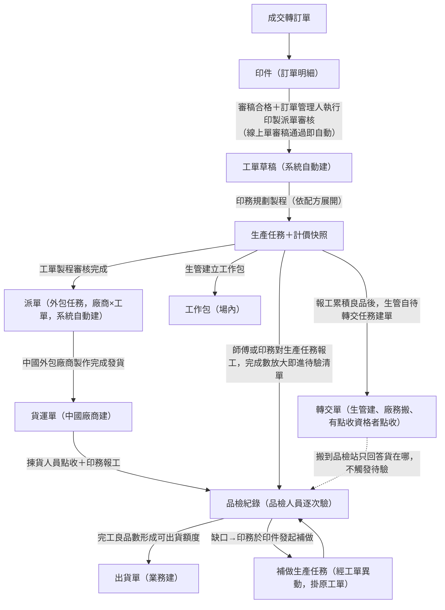
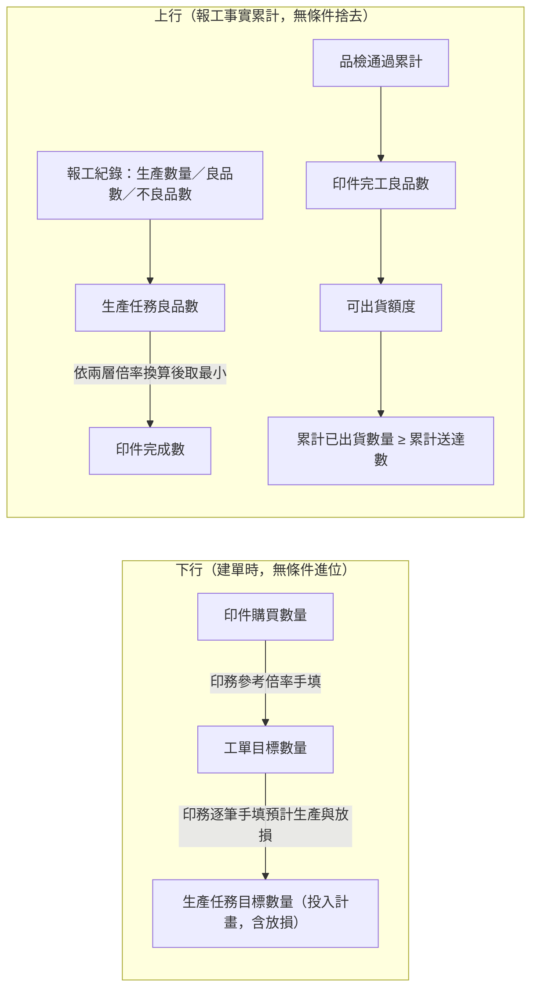
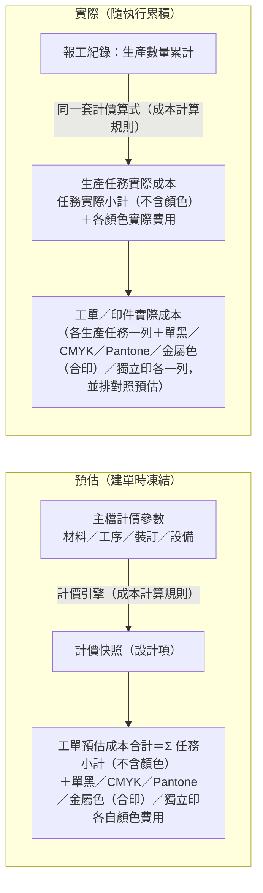

讀完這張卡，你會知道：

- 一筆生意跑下來，生產側的單據依什麼順序產生、誰觸發誰建立
- 數量與成本的值怎麼從一個欄位流到下一個欄位，在哪裡收斂
- 生產領域跟其他領域在哪些單據交棒
- 本卡不放什麼：實體關聯與基數（唯一正本在 [[ERP 資料結構總覽]]）、實體定義（[[ERP 詞彙表]]）、欄位表（各實體卡）、狀態列舉與轉換（各狀態機卡）——接縫處只標狀態名＋連結，不重畫

## 一、單據流視圖（產生順序與觸發）

- 派單與工單為**兩條獨立資料流**：交會只有兩點——建立（製程審核完成）與收尾（貨回廠後印務對生產任務報工）。派單進程不推進生產任務狀態（正本 [[生產任務狀態]]）。
- 售後補做：售後服務單決議補做後不建新印件、不建新工單——由 [[印務]] 在原印件上發起補做，經工單異動於原工單加開補做生產任務（與品檢缺口補做同一條路，補做來源欄掛該張售後服務單）。
- 打樣 NG-製程問題：系統於同一印件自動建新打樣工單重跑；NG-稿件問題：棄用原印件、複製新印件重走審稿（[[打樣流程]]）。
- 各單據的狀態怎麼轉不在本卡：[[工單狀態]]／[[生產任務狀態]]／[[生產任務轉交狀態]]／[[生產任務交付狀態]]／[[派單狀態]]／[[印件審稿狀態]]／[[印件印製狀態]]／[[轉交單狀態]]／[[出貨單狀態]]。

## 二、資料流視圖（值的推導鏈）

### 數量鏈（下行規劃 → 上行收斂）

- 守恆底線見 [[生產數量一致性#待驗量不為負]]、[[生產數量一致性#出貨不超過可出貨額度]]、[[生產數量一致性#送達不超過出貨]]；印件層缺口的算式見 [[印件]] § 生產與出貨進度。
- 外包任務：產出數量同樣＝報工累計——[[印務]] 報工，回廠點收數量欄為對照憑據；到料放行只看前置的點收量（[[工序相依性規則]]）。
- 良品取數與到料量：轉交可申請上限＝**良品數**（工序之間只流轉良品）− 搬運量（算式正本見 [[生產任務]]），完成數同樣以良品數為基數（[[三個數同取良品]]）；需轉交的前置，下游到料量取前置的**點收量**（各明細點收紀錄合計，含同一明細的多筆點收紀錄與修正後的值）、不比對站點（點收數量修正的下限見 [[工序相依性規則]]）；不需轉交的前置，下游到料量取前置報工的累計良品（規則正本見 [[工序相依性規則]]）。生產任務轉報廢時的數量處理見 [[報廢任務成本留數量除]]。
- 各任務的預計生產與放損由印務手填、系統不預填也不倒推（正本見 [[數量換算規則]]）；放損怎麼間接進入計價見 [[成本計算規則]] § 計價引擎計算框架。
- 排除規則（哪些量不計入哪些彙總）正本在 [[齊套邏輯]]、[[生產績效指標]]、[[數量換算規則]]，本卡不複寫。

### 成本鏈

- 材料費的數量輸入多一段換算：材料型任務的備料張要換算成供應商原料張數（算式正本 [[成本計算規則]]）；工序費與設備費取各任務自己的目標數量、不換算。
- 實際成本與預估同一組欄位（任務小計（不含顏色）與單黑、CMYK、Pantone、金屬色（合印）、獨立印各自的顏色費用）、同一套算式，差別只在數量改取有效報工的生產數量累計；平版設備側的實際值只取階梯價，不含開機費、也不攤回。外包工序的實際成本怎麼算見 [[PT-073-外包工序實際成本的計算方式]]。耗料細帳的 [[物料消耗記錄]] 為庫存模組啟用後的掛點。
- 計價公式正本 [[成本計算規則]]（已對 sensation-api 計價引擎全項核對）；指標推導正本 [[生產績效指標]]。

## 三、跨領域接口

| 邊界實體 | 方向 | 說明 |
|---------|------|------|
| 訂單 | 售前／訂單管理 → 生產 | 成交轉訂單時產生印件；生產側只讀訂單，取消由訂單向下連鎖 |
| 審稿輪次 | 審稿 → 生產 | 審稿合格＋已確認可製作是工單建立的前置；改稿不影響已建工單鎖定的檔案 |
| 出貨單 | 生產 → 履約 | 完工良品數形成可出貨額度後交棒出貨；出貨單對訂單與印件的關聯正本見 [[履約與售後資料結構總覽]] |
| 訂單異動／售後服務 | 帳務／售後 ↔ 生產 | 補收退款走訂單異動（帳務領域）；售後服務單決議補做後回到生產，於原工單加開補做生產任務 |
| 計價快照・預估成本 | 生產 → 帳務 | 利潤率與成本達成率的成本面取自生產側實際成本彙總 |

## 四、維護規則

- 本卡是生產領域的視角：關聯的唯一正本在 [[ERP 資料結構總覽]]，本卡只承載領域內部的單據流與資料流；動任何實體的關聯時改 [[ERP 資料結構總覽]]，實體卡關鍵關聯段只寫鍵與該卡標題連結（`wiki-amend` 落點表強制檢查）。
- 領域內新增實體或關聯經 `erp-plan` 設計時，必含段①附「總覽差異」；`erp-audit` 5-2 以本卡為比對基準。
- 名詞與基數紀律：實體名與各卡完全一致、禁簡稱；禁「N 個」式彙稱（[[稽核誤判記錄]] § 一）。

## 範圍外

- 各實體是什麼、有哪些欄位 → 各實體卡（[[工單]]、[[生產任務]]、[[印件]]、[[派單]]、[[轉交單]]、[[貨運單]]、[[報工紀錄]]、[[品檢紀錄]] 等）
- 狀態有哪些值、什麼條件下怎麼轉 → 各狀態機卡（[[工單狀態]]、[[生產任務狀態]]、[[生產任務轉交狀態]]、[[生產任務交付狀態]]、[[派單狀態]]、[[印件審稿狀態]]、[[印件印製狀態]]、[[轉交單狀態]]）；本卡接縫處只標狀態名與連結
- 數量與成本的公式本體、守恆與排除規則 → 規則卡（[[齊套邏輯]]、[[數量換算規則]]、[[成本計算規則]]、[[報工規則]]）；本卡只畫值流到哪、不複寫算式
- 實體之間的關聯、基數與方向 → [[ERP 資料結構總覽]]
- 介面長什麼樣、操作怎麼走 → 屬實作層，本知識庫不承載

## 相關卡

- 規則正本：[[生產數量一致性]]、[[齊套邏輯]]、[[數量換算規則]]、[[工序相依性規則]]、[[成本計算規則]]、[[配方展開規則]]、[[供應商報價規則]]、[[報工規則]]、[[生產單據分工規則]]、[[生產績效指標]]、[[訂單異動規則]]（印件日期變動後重算並同步工單的規則）、[[工作天規則]]（工作天加減的算法正本）
- 狀態機：[[工單狀態]]、[[生產任務狀態]]、[[生產任務轉交狀態]]、[[生產任務交付狀態]]、[[派單狀態]]、[[印件審稿狀態]]、[[印件印製狀態]]、[[轉交單狀態]]、[[出貨單狀態]]
- 承接方主檔：[[廠客]]（台灣外包）、[[中國供應商帳號]]（中國外包）
- 關聯正本：[[ERP 資料結構總覽]]
- OQ：[[PT-073-外包工序實際成本的計算方式]]
- 檢索入口：[[erp_index]]、[[business-domain-taxonomy]]
