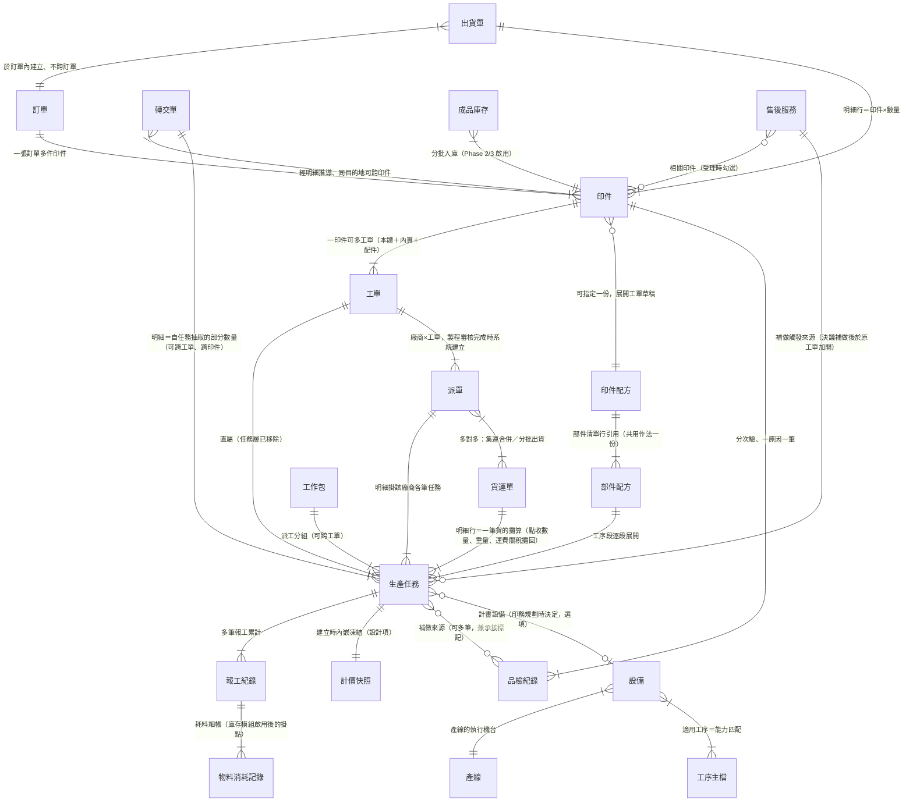
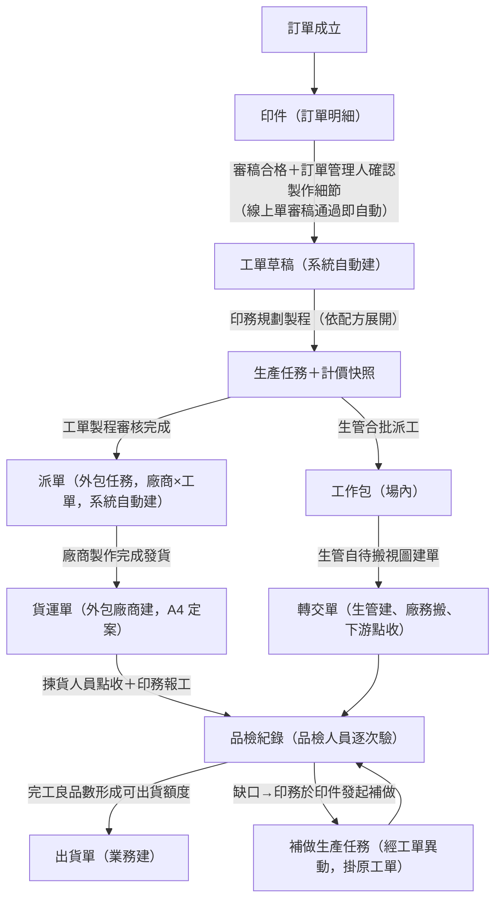
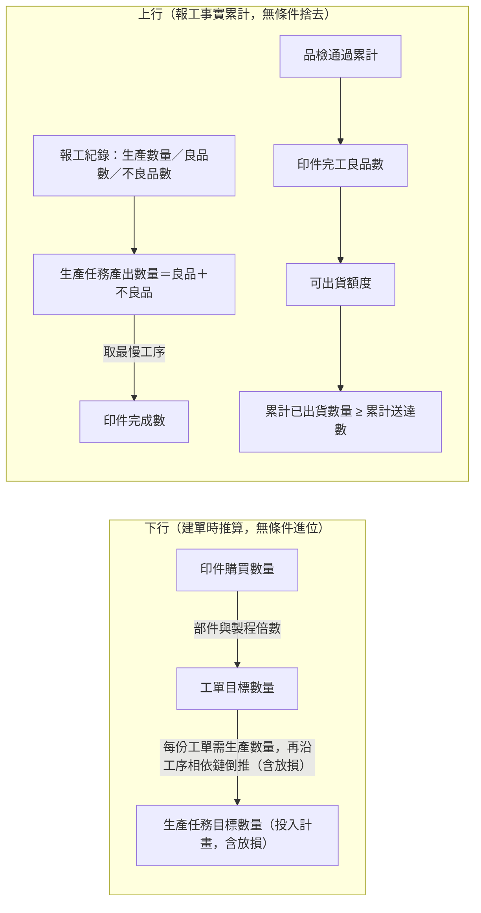
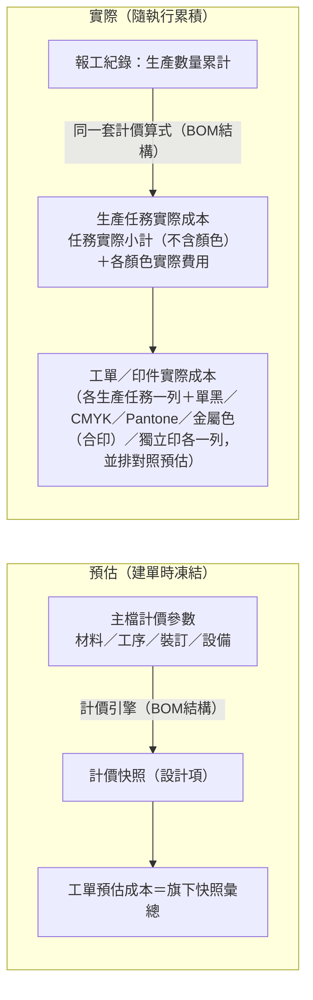

# 範例 - 資料結構總覽

> [!info] 本卡為撰寫示範，不與來源卡保持同步，不是任何領域的正本
> 本卡示範此卡型的合規寫法，內容取材自 [[生產領域資料結構總覽]]，不與其保持同步、不揹商業正確性。用途：撰寫資料結構總覽卡時對照合規樣貌、稽核時當通過樣本。生產領域結構的現行內容一律以 [[生產領域資料結構總覽]] 為準。本卡只在撰寫方式變化時更新，與 [[規範 - 資料結構總覽]]（規範）、[[範本 - 資料結構總覽]]（骨架）同一次 commit。維護規則見 [[卡片撰寫共用規範]] § 一。對照重點：三視圖各自的職責與深度、關聯明細表五欄的填法、as-is 標注、名詞逐字一致。

## frontmatter（快照）

```yaml
type: structure-overview
tags:
  - 領域/生產執行
source:
  - "各實體卡（05-entities/）、狀態機卡（06-state-machines/）、規則卡（04-business-logic/）三源互盲抽取交叉比對（2026-08-05）"
  - "Miles 裁決紀錄：A1-A4／B1-B10 見 wiki/log.md 2026-08-05 條目"
status: active
last-reviewed: 2026-08-27
```

## 正文（快照）

讀完這張卡，你會知道：

- 生產領域每個實體跟誰相連、基數是什麼（本卡是領域視角：**關聯的唯一正本**在 [[ERP 資料結構總覽]]，基數與方向以該卡為準；各實體卡的「關鍵關聯」段是視角摘要）
- 一筆生意跑下來，生產側的單據依什麼順序產生、誰觸發誰建立
- 數量與成本的值怎麼從一個欄位流到下一個欄位，在哪裡收斂
- 本卡不放什麼：實體定義（各卡一句話定位）、欄位表（各實體卡）、狀態列舉與轉換（各狀態機卡）——接縫處只標狀態名＋連結，不重畫

## 一、結構視圖（ER 圖＋基數）



主檔層（計價與展開來源，圖上省略）：部件配方工序段各選一項——[[工序主檔]]（群組→工序，帶工序廠商）／[[品項主檔]]（群組→材料→規格→計價子表列，規格下另掛備料規格）／[[裝訂主檔]]（單層；裝訂廠商為設計新增欄位）；印刷計價參數掛 [[設備]]，工序照自身計價方法計工序費；工序型生產任務的任務小計算式正本見 [[成本計算規則]] § 計價引擎計算框架。執行方（自有／外包）＝各主檔承作廠商 → 展開帶出 [[生產任務]]「廠商類別」（A1 定案）。急件記在 [[印件]] 自己的「是否急件」欄，不引用 [[急件主檔]]。

## 二、單據流視圖（產生順序與觸發）



- 派單與工單為**兩條獨立資料流**（B1 定案）：交會只有兩點——建立（製程審核完成）與收尾（貨回場後印務依點收結果對生產任務報工）。派單在途進程推進生產任務的粗狀態（已送集運商／運送中，映射正本 [[生產任務狀態]]）。
- 售後補做：售後服務單決議補做後不建新印件、不建新工單——由 [[印務]] 在原印件上發起補做，經工單異動於原工單加開補做生產任務（與品檢缺口補做同一條路，補做來源欄掛該張售後服務單）。
- 打樣 NG-製程問題：系統於同一印件自動建新打樣工單重跑；NG-稿件問題：棄用原印件、複製新印件重走審稿（[[打樣流程]]）。
- 各單據的狀態怎麼轉不在本卡：[[工單狀態]]／[[生產任務狀態]]／[[派單狀態]]／[[印件印製狀態]]／[[轉交單狀態]]／[[出貨單狀態]]。

## 三、資料流視圖（值的推導鏈）

### 數量鏈（下行規劃 → 上行收斂）



- 守恆底線（正本 [[齊套邏輯]]）：產出數量 ≥ 良品數 ≥ 完工良品數 ≥ 累計已出貨數量 ≥ 累計送達數；印件層缺口＝購買數量 − 完工良品數。
- 外發任務：產出數量同樣＝報工累計——[[印務]] 依揀貨點收結果報工，點收數量欄為對照憑據；到料放行看轉交單已點收量或前置已報工量（[[工序相依性規則]]）。
- 良品取數與到料量：可轉交上限取**累計良品數**（工序之間只流轉良品）減未作廢轉交明細的佔用，與完成數取產出數量是兩個並存的算法；需轉交的前置，下游到料量掛轉交單**已點收**的量、不比對站點，並且只增不減；不需轉交的前置，下游到料量取前置報工的累計良品（規則正本見 [[工序相依性規則]]）。生產任務轉報廢時，其產出數量與良品數自印件層累計排除（成本留、數量除，規則見 [[齊套邏輯]]）。
- 放損的數量算法（沿工序相依鏈倒推、落在各生產任務的目標數量）正本見 [[數量換算規則]]；放損怎麼間接進入計價見 [[成本計算規則]] § 計價引擎計算框架。
- 排除規則（哪些量不計入哪些彙總）正本在 [[齊套邏輯]]、[[生產績效指標]]、[[數量換算規則]]，本卡不複寫。

### 成本鏈



- 實際成本與預估同一組欄位（任務小計（不含顏色）與單黑、CMYK、Pantone、金屬色（合印）、獨立印各自的顏色費用）、同一套算式，差別只在數量改取有效報工的生產數量累計；平版設備側的實際值只取階梯價，不含開機費、也不攤回。外包報價、運費與關稅不進這些欄位。耗料細帳的 [[物料消耗記錄]] 為庫存模組啟用後的掛點。
- 計價公式正本 [[成本計算規則]]（已對 sensation-api 計價引擎全項核對）；指標推導正本 [[生產績效指標]]。

## 四、本領域關聯

關聯的基數、方向與說明見 [[ERP 資料結構總覽]] 下列標題：

- [[ERP 資料結構總覽#訂單與印件]]
- [[ERP 資料結構總覽#印件與工單]]
- [[ERP 資料結構總覽#印件與印件配方]]
- [[ERP 資料結構總覽#工單與生產任務]]
- [[ERP 資料結構總覽#生產任務與生產任務]]
- [[ERP 資料結構總覽#生產任務與報工紀錄]]
- [[ERP 資料結構總覽#報工紀錄與物料消耗記錄]]
- [[ERP 資料結構總覽#生產任務與計價快照]]
- [[ERP 資料結構總覽#生產任務與設備]]
- [[ERP 資料結構總覽#生產任務與人員]]
- [[ERP 資料結構總覽#工單與派單]]
- [[ERP 資料結構總覽#派單與生產任務]]
- [[ERP 資料結構總覽#派單與印件]]
- [[ERP 資料結構總覽#派單與貨運單]]
- [[ERP 資料結構總覽#貨運單與生產任務]]
- [[ERP 資料結構總覽#貨運單與關稅單據]]
- [[ERP 資料結構總覽#轉交單與印件]]
- [[ERP 資料結構總覽#轉交單與生產任務]]
- [[ERP 資料結構總覽#品檢紀錄與印件]]
- [[ERP 資料結構總覽#品檢紀錄與轉交單]]
- [[ERP 資料結構總覽#工作包與生產任務]]
- [[ERP 資料結構總覽#工作包與人員]]
- [[ERP 資料結構總覽#設備與產線]]
- [[ERP 資料結構總覽#人員與產線]]
- [[ERP 資料結構總覽#設備與工序主檔]]
- [[ERP 資料結構總覽#印件與產線]]
- [[ERP 資料結構總覽#訂單與出貨單]]
- [[ERP 資料結構總覽#成品庫存與印件]]
- [[ERP 資料結構總覽#售後服務與印件]]
- [[ERP 資料結構總覽#售後服務與生產任務]]
- [[ERP 資料結構總覽#印件與原印件]]

## 五、跨領域接口

| 邊界實體 | 方向 | 說明 |
|---------|------|------|
| 訂單 | 售前／訂單管理 → 生產 | 訂單成立產生印件；生產側只讀訂單，取消由訂單向下連鎖 |
| 審稿輪次 | 審稿 → 生產 | 審稿合格＋已確認可製作是工單建立的前置；改稿不影響已建工單鎖定的檔案 |
| 出貨單 | 生產 → 履約 | 完工良品數形成可出貨額度後交棒出貨；出貨與送達的流程歸履約領域 |
| 訂單異動／售後服務 | 帳務／售後 ↔ 生產 | 補收退款走訂單異動（帳務領域）；售後服務單決議補做後回到生產，於原工單加開補做生產任務 |
| 計價快照・預估成本 | 生產 → 帳務 | 利潤率與成本達成率的成本面取自生產側實際成本彙總 |

## 六、維護規則

- 本卡是生產領域的視角：關聯的唯一正本在 [[ERP 資料結構總覽]]，領域內部的單據流與資料流細節以本卡為準；動任何實體的關聯時先改 [[ERP 資料結構總覽]]、再改本卡，實體卡只改視角摘要（`wiki-amend` 落點表強制檢查）。
- 領域內新增實體或關聯經 `erp-plan` 設計時，必含段①附「總覽差異」；`erp-audit` 5-2 以本卡為比對基準。
- 名詞與基數紀律：實體名與各卡完全一致、禁簡稱；禁「N 個」式彙稱（[[稽核誤判記錄]] § 一）。

## 範圍外

- 各實體是什麼、有哪些欄位 → 各實體卡（[[工單]]、[[生產任務]]、[[印件]]、[[派單]]、[[轉交單]]、[[貨運單]]、[[報工紀錄]]、[[品檢紀錄]] 等）
- 狀態有哪些值、什麼條件下怎麼轉 → 各狀態機卡（[[工單狀態]]、[[生產任務狀態]]、[[派單狀態]]、[[印件印製狀態]]、[[轉交單狀態]]）；本卡接縫處只標狀態名與連結
- 數量與成本的公式本體、守恆與排除規則 → 規則卡（[[齊套邏輯]]、[[數量換算規則]]、[[報工規則]]）；本卡只畫值流到哪、不複寫算式
- 介面長什麼樣、操作怎麼走 → 屬實作層，本知識庫不承載

## 相關卡

- 規則正本：[[齊套邏輯]]、[[數量換算規則]]、[[工序相依性規則]]、[[成本計算規則]]、[[配方展開規則]]、[[供應商報價規則]]、[[報工規則]]、[[印件生產流程]]、[[生產績效指標]]
- 狀態機：[[工單狀態]]、[[生產任務狀態]]、[[派單狀態]]、[[印件印製狀態]]、[[轉交單狀態]]、[[出貨單狀態]]
- 檢索入口：[[erp_index]]、[[business-domain-taxonomy]]
