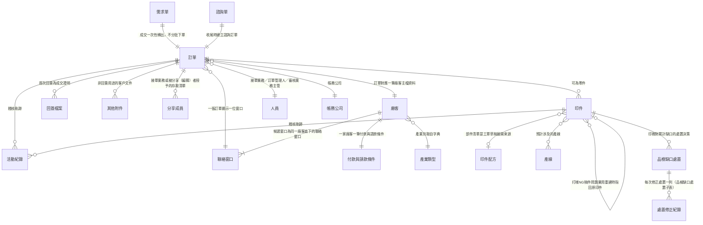
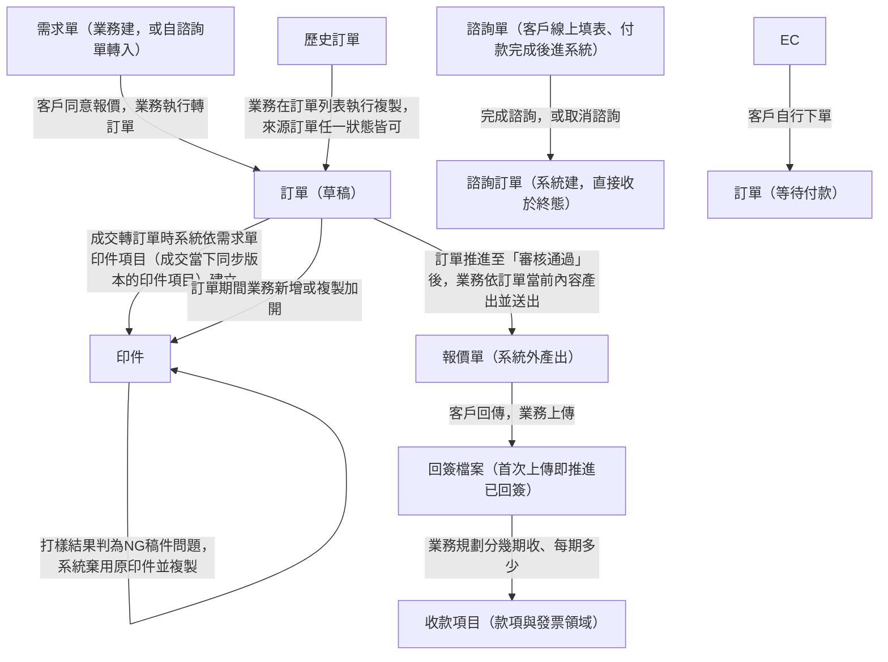
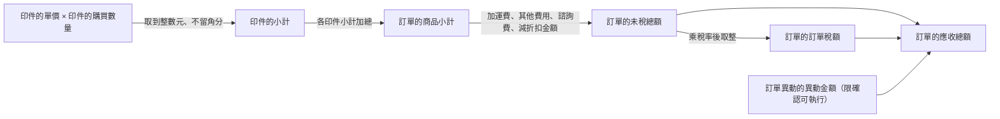
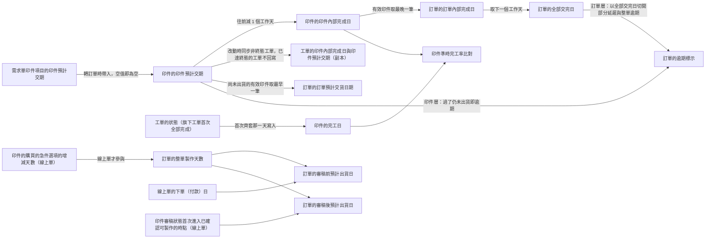
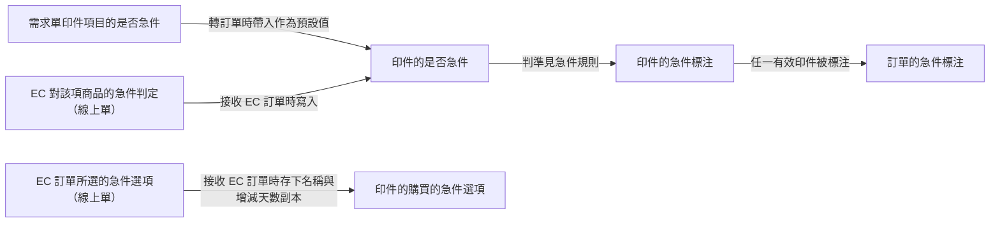
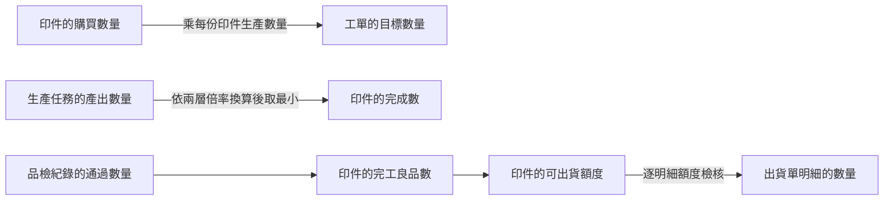

讀完這張卡，你會知道：

- 訂單領域每個實體跟誰相連（本卡是領域視角：**關聯的唯一正本**在 [[ERP 資料結構總覽]]，本卡 § 四只列關聯標題）
- 一筆生意成交之後，訂單側的單據依什麼順序產生、誰觸發誰建立
- 金額、數量與日期的值怎麼從一個欄位流到下一個欄位，在哪裡收斂
- 本卡不放什麼：實體定義（各卡一句話定位）、欄位表（各實體卡）、狀態列舉與轉換（各狀態機卡）——接縫處只標狀態名＋連結，不重畫

## 一、結構視圖（ER 圖＋基數）

主檔層（圖上以單一節點呈現，不展開內部）：[[印件配方]]、[[產線]]、[[帳務]]的帳務公司。[[廠客]]為客戶與廠商共用的主檔，其聯絡窗口、付款與請款條件、產業類型三組附屬資料在本圖展開，欄位正本見該卡。這些主檔的內部結構各歸其所屬領域，本卡只畫訂單與印件對它們的引用方向。

## 二、單據流視圖（產生順序與觸發）

- 圖上不畫狀態轉換，訂單自「草稿」到「審核通過」的推進條件見 [[訂單狀態]]。額外費用明細為[[訂單]]的子表，基數見 [[ERP 資料結構總覽#訂單與額外費用明細]]。
- 三條錢線各走各的：[[訂單異動]]、[[帳務]]的發票與收款項目與款項紀錄、[[出貨單]]，彼此不互相觸發，交會點只在[[訂單]]的金額欄位與可出貨額度。
- 特殊建立路徑：複製建單帶入來源原值、不帶工單與生產任務與稿件檔案與來源活動紀錄（[[訂單複製建單]]）；諮詢取消時[[訂單異動]]與訂單取消的先後見 [[諮詢收尾規則]]；訂單進終態後要動金額的路徑見 [[訂單異動規則]]。
- 各單據的狀態怎麼轉不在本卡：[[訂單狀態]]、[[印件審稿狀態]]、[[印件印製狀態]]。

## 三、資料流視圖（值的推導鏈）

### 金額鏈（明細向上收斂）

- 小計怎麼定案見 [[報價邏輯]]。
- 哪些[[訂單異動]]計入應收總額見 [[訂單異動規則]]。
- 三方對帳底線見 [[對帳一致性]]。
- 印件層的金額分攤見 [[一式總價由業務分攤]]。

### 日期鏈（線下單由印件預計交期往前推導，線上單由訂單層推算）

- 線下單日期鏈的起點是業務填的日期，在需求單印件項目的「印件預計交期」逐列填寫、無單頭欄位預填（欄位正本見 [[需求單]]）。需求單不帶急件標注；轉訂單時帶入成為印件的印件預計交期。
- 複製出的新印件（打樣 NG 棄用重建、複製建單、複製加開）各欄帶入與重設的正本在 [[印件複製規則]]；訂單期間空白新增印件的預設與留空在 [[印件]] 欄位表，本卡不複寫。
- 印件的是否急件不接在日期鏈上；線上單只有印件的購買的急件選項的增減天數參與整單製作天數（見 [[急件規則]]）。
- 線上單的整單製作天數與審稿前、審稿後預計出貨日由訂單層推算，算式、輸入與適用的訂單類型正本在 [[訂單]] 欄位表。
- 訂單預計交貨日期與逾期標示看印件「尚未出貨」，取自出貨單是否全數離廠（定義與判定見 [[訂單]] 欄位表，集合詞見 [[出貨單狀態]]）。
- 印件的完工日由生產側寫入（欄位正本見 [[印件]]），與印件內部完成日比對得出印件準時完工率（算式正本見 [[北極星指標]]）；本鏈其餘日期不參與這個比對。
- 印件內部完成日的推導算式與各欄的空值顯示正本在 [[印件]] 與 [[訂單]] 欄位表，人工改動後的重算與同步正本在 [[訂單異動規則]]，本卡不複寫算式。
- [[印件]] 的「客戶指定收件日」由業務或諮詢逐件填寫，不接在本鏈上、不參與任何推導；它與印件預計交期的比對見 [[印件]] 欄位表。
- 本鏈所有「下一個工作天」與「往前減 1 個工作天」都跳過非工作日，算法為跨鏈參照，正本見 [[工作天規則]]。
- 「預計出貨日」只指兩處欄位：[[出貨單]] 的「出貨單預計出貨日」與 [[訂單]] 的「審稿前預計出貨日」「審稿後預計出貨日」。印件層的客戶承諾日一律叫「印件預計交期」，不與預計出貨日混用。定義各在正本卡，本卡不複寫。

### 急件鏈（是否急件與購買的急件選項的來源）

- 印件的是否急件與購買的急件選項的帶入與預設值，正本在 [[印件]] 欄位表；複製時的處理正本在 [[印件複製規則]]，本卡不複寫。
- 急件標注的判準與往工單、生產任務、轉交單明細、出貨單明細的傳遞範圍，正本在 [[急件規則]]；購買的急件選項的增減天數怎麼參與線上單整單製作天數，見本卡日期鏈與 [[訂單]] 欄位表。
- [[急件主檔]] 不接在本鏈上：購買的急件選項是副本，不引用主檔。

### 數量鏈（購買數量向下展開、產出向上收斂）

- 守恆底線見 [[生產數量一致性#待驗量不為負]]、[[生產數量一致性#出貨不超過可出貨額度]]、[[生產數量一致性#送達不超過出貨]]。
- 排除規則（轉報廢的任務其產出數量與良品數自印件層累計排除、成本仍以報工數結算）正本在 [[齊套邏輯]]，本卡不複寫。
- 工單建立後訂單側加量回不回寫既有工單，見 [[工單]] 欄位表。

## 四、本領域關聯

基數、方向、業務意義與建立時機見 [[ERP 資料結構總覽]] 下列標題：

- [[ERP 資料結構總覽#需求單與訂單]]
- [[ERP 資料結構總覽#諮詢單與訂單]]
- [[ERP 資料結構總覽#訂單與印件]]
- [[ERP 資料結構總覽#訂單與額外費用明細]]
- [[ERP 資料結構總覽#訂單與回簽檔案]]
- [[ERP 資料結構總覽#訂單與其他附件]]
- [[ERP 資料結構總覽#訂單與活動紀錄]]
- [[ERP 資料結構總覽#訂單與分享成員]]
- [[ERP 資料結構總覽#訂單與廠客]]
- [[ERP 資料結構總覽#訂單與聯絡窗口]]
- [[ERP 資料結構總覽#廠客與聯絡窗口]]
- [[ERP 資料結構總覽#廠客與付款與請款條件]]
- [[ERP 資料結構總覽#廠客與產業類型]]
- [[ERP 資料結構總覽#廠客與帳務 的帳務公司]]
- [[ERP 資料結構總覽#廠客與人員]]
- [[ERP 資料結構總覽#聯絡窗口與人員]]
- [[ERP 資料結構總覽#訂單與人員（接單業務）]]
- [[ERP 資料結構總覽#訂單與人員（訂單管理人）]]
- [[ERP 資料結構總覽#訂單與人員（審核業務主管）]]
- [[ERP 資料結構總覽#訂單與帳務 的帳務公司]]
- [[ERP 資料結構總覽#印件與原印件]]
- [[ERP 資料結構總覽#印件與印件配方]]
- [[ERP 資料結構總覽#印件與產線]]
- [[ERP 資料結構總覽#印件與人員]]
- [[ERP 資料結構總覽#印件與品檢缺口處置]]
- [[ERP 資料結構總覽#品檢缺口處置與處置修正紀錄]]
- [[ERP 資料結構總覽#印件與活動紀錄]]

## 五、跨領域接口

| 邊界實體 | 方向 | 說明 |
|---|---|---|
| [[需求單]] | 售前 → 訂單管理 | 成交轉出訂單（[[ERP 資料結構總覽#需求單與訂單]]）；需求單印件項目（成交當下同步版本的印件項目）逐筆帶入[[印件]]。售前側見 [[售前領域資料結構總覽]] |
| [[諮詢單]] | 售前 → 訂單管理 | 收尾時建立諮詢訂單（[[ERP 資料結構總覽#諮詢單與訂單]]） |
| [[工單]] | 訂單管理 → 生產執行 | [[印件]]的印製狀態推進至「製程已確認」時產生工單草稿（[[ERP 資料結構總覽#印件與工單]]）。生產側關聯見 [[生產領域資料結構總覽]] |
| [[工單]] | 生產執行 → 訂單管理 | 旗下工單首次全部完成那一天寫入 [[印件]] 的完工日（欄位正本見 [[印件]]） |
| [[審稿輪次]] | 訂單管理 → 印前審稿 | 每次上傳稿件建一輪；[[印件]]另以當前合格輪次指向最新合格的一輪（[[ERP 資料結構總覽#印件與審稿輪次（每次上傳稿件建一輪）]]、[[ERP 資料結構總覽#印件與審稿輪次（當前合格輪次）]]）。印前審稿領域尚無總覽卡 |
| [[出貨單]] | 訂單管理 ↔ 履約與售後 | 支援分批出貨（[[ERP 資料結構總覽#訂單與出貨單]]）；出貨單經出貨明細連到印件。出貨單是否全數離廠回饋訂單的訂單預計交貨日期與逾期標示。關聯正本見 [[履約與售後資料結構總覽]] |
| [[售後服務]] | 訂單管理 → 履約與售後 | [[ERP 資料結構總覽#訂單與售後服務]]；建單前提見 [[訂單]] OP-ORD-007 |
| [[訂單異動]] | 訂單管理 → 款項與發票 | [[ERP 資料結構總覽#訂單與訂單異動]]；訂單進終態後的路徑見 [[訂單異動規則]] |
| [[帳務]] | 訂單管理 → 款項與發票 | [[ERP 資料結構總覽#訂單與帳務 的發票]]、[[ERP 資料結構總覽#訂單與帳務 的收款項目]]、[[ERP 資料結構總覽#訂單與帳務 的款項紀錄]]。款項與發票領域尚無總覽卡 |
| [[品檢紀錄]] | 生產執行 → 訂單管理 | 通過數量累計成[[印件]]的完工良品數，進而決定可出貨額度 |

## 六、維護規則

- 本卡是訂單領域的視角：關聯的唯一正本在 [[ERP 資料結構總覽]]，領域內部的單據流與資料流細節以本卡為準。動任何實體的關聯時先改 [[ERP 資料結構總覽]]，再改本卡，實體卡的「關鍵關聯」段只寫鍵（`wiki-amend` 落點表強制檢查此順序）。
- 一條關聯橫跨兩個領域時，正本在 [[ERP 資料結構總覽]]，領域視角畫在該關聯業務主場的領域總覽。訂單與印件、訂單與其附屬子表歸本卡；印件與工單、印件與生產任務歸 [[生產領域資料結構總覽]]。
- 設計案帶來的關聯變動：`erp-plan` 設計收件的必含段①附「總覽差異」小節，落卡時照差異改。
- 每次修改追加 wiki/log.md，逐卡點名。

## 範圍外

- 實體定義與一句話定位：見各實體卡（[[訂單]]、[[印件]]、[[需求單]] 等）。
- 欄位表與各欄可否修改：見各實體卡的欄位段；明細鎖定的時點分界見 [[明細時點分界]]。
- 狀態列舉與狀態轉換條件：見 [[訂單狀態]]、[[印件審稿狀態]]、[[印件印製狀態]]。
- 計算公式本體：金額見 [[報價邏輯]] 與 [[對帳一致性]]，數量見 [[齊套邏輯]] 與 [[數量換算規則]]，成本見 [[成本計算規則]]。
- 介面版面與操作動線：見 Prototype。
- 待確認事項：見 `08-open-questions/`，本卡不收未決內容。

## 相關卡

- 實體正本：[[訂單]]、[[印件]]、[[需求單]]、[[諮詢單]]、[[訂單異動]]、[[急件主檔]]、[[人員]]、[[帳務]]、[[廠客]]
- 規則正本：[[報價邏輯]]、[[對帳一致性]]、[[訂單異動規則]]、[[明細時點分界]]、[[印件拆分規範]]、[[齊套邏輯]]、[[工作天規則]]、[[跨訂單作業清單]]、[[北極星指標]]（印件準時完工率的算式）；流程群組：[[線下接單流程群組]]
- 狀態機：[[訂單狀態]]、[[印件審稿狀態]]、[[印件印製狀態]]
- 鄰域總覽：[[售前領域資料結構總覽]]、[[生產領域資料結構總覽]]
- 檢索入口：[[erp_index]]、[[business-domain-taxonomy]]
