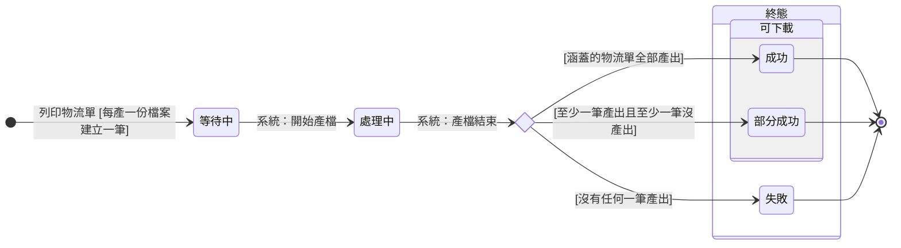

讀完這張卡，你會知道：

- 認識 [[下載檔案]] 的狀態機：從列印物流單時系統建立這一筆，到產檔結束收在成功、部分成功或失敗
- 看懂各狀態代表這份列印檔產到哪裡、能不能下載
- 掌握每個轉換由哪個操作或系統事件觸發、要滿足什麼條件
- 理解為什麼部分成功也能下載、失敗為什麼不重試而是重新列印

## 狀態列舉（正本）

> 本段是下載檔案狀態的唯一正本。狀態的新增與修改是商業決策，直接在此卡維護。

| 狀態 | 說明 | 對應營運需求 |
|------|------|------------|
| 等待中 | 初始；列印物流單時系統每產一份檔案就建立一筆下載檔案，即進入；還沒開始產檔 | 列印物流單當下就留下紀錄，產檔在背景進行，不必在原地等 |
| 處理中 | 系統開始產檔後進入 | 看得出這份檔案已開始產、還沒結束 |
| 成功 | 終態；涵蓋的物流單全部產出；可下載 | 整份檔案可直接拿去列印張貼 |
| 部分成功 | 終態；至少一筆產出、至少一筆沒產出；可下載；沒產出的物流單逐筆列在異常內容（欄位見 [[下載檔案]]） | 產出的部分先拿去用，失敗的那幾筆看異常內容另行處理 |
| 失敗 | 終態；沒有任何一筆產出；不可下載；失敗原因列在異常內容 | 明確知道這份檔案沒產出來，要重新列印 |

## 狀態機圖（UML）

- 記法：實心圓為初始點、雙圈為終止點、轉換標籤採「觸發操作名稱 [轉換條件]」格式，系統推進寫「系統：業務事件」。產檔結束時落入哪一格看產出結果，畫成選擇節點。
- 複合狀態為可被他卡引用的集合詞（成員以本圖為正本）：「終態」＝產檔已結束、這一筆不再變動的處境；「可下載」＝產檔已結束且有產出、可以下載檔案的處境，屬終態。
- 銜接：本卡的建立由 [[下載檔案]] OP-DLF-003 列印物流單觸發；產檔時物流單的處境（已刪除、已作廢）見 [[物流單狀態]]。

## 轉換條件與觸發事件

| 轉換 | 觸發操作 | 條件 |
|------|---------|------|
| （建立）→ 等待中 | [[下載檔案]] OP-DLF-003 列印物流單 | 每產一份檔案建立一筆下載檔案；產哪幾份、各收哪幾筆以列印物流單當下為準（見 [[下載檔案]] 檔案類型欄、物流單筆數欄） |
| 等待中 → 處理中 | 系統：開始產檔 | — |
| 處理中 → 成功 | 系統：產檔結束 | 涵蓋的物流單全部產出 |
| 處理中 → 部分成功 | 系統：產檔結束 | 至少一筆產出，且至少一筆沒產出；沒產出的物流單逐筆寫入異常內容 |
| 處理中 → 失敗 | 系統：產檔結束 | 沒有任何一筆產出；沒產出的物流單逐筆寫入異常內容 |

> 哪些物流單算沒產出（已刪除、已作廢、產檔出錯）、缺物流商標籤者照常產出，以及物流單筆數與產出筆數、異常內容行數的檢核，正本見 [[下載檔案]] 異常內容欄。

## 關鍵轉換的營運動機

- 部分成功也可下載 → 動機：一次列印常涵蓋多筆物流單，少數幾筆出錯就整份不給，產出的部分也拿不到；異常內容逐筆列出，失敗的那幾筆看得到、可以另外處理 → 例子：勾 10 筆物流單列印，其中 SH-2026-0901-003 在產檔前被作廢，這份物流單列印為部分成功，異常內容寫「SH-2026-0901-003：物流單已作廢」，其餘 9 筆照常下載。
- 失敗為終態、不設重試 → 動機：列印物流單當下已決定這份檔案收哪幾筆；重新列印產生新的一筆，依新的勾選重新決定內容，舊紀錄保留可查 → 例子：一份順豐托運總表產檔失敗，重新列印後下載中心多一筆新的紀錄，失敗的那一筆仍留著。

## 與其他狀態機的關係

- 物流單：列印物流單不改 [[物流單狀態]]；開始產檔時已因撤回確認可出貨而刪除、或已作廢的物流單不產出，影響本卡落入部分成功或失敗。
- 出貨單：本卡與 [[出貨單狀態]] 無直接連動，經物流單關聯。

## 範圍外

- 誰在什麼範圍能列印物流單 → [[出貨活動清單]]；下載檔案 → [[輸出活動清單]]；檢視下載中心 → [[出貨與售後檢視活動清單]]
- 列印檔收哪幾筆物流單、各份檔案的內容 → [[下載檔案]]、[[物流單]]
- 下載檔案的欄位（檔案類型、物流單筆數、建立人、異常內容）→ [[下載檔案]]（欄位正本）
- 下載檔案的刪除與過期清除 → 不設保存期限，本卡無刪除轉換
- 產檔完成或失敗的通知 → 不設計，結果看下載中心
- **產檔的排程與處理方式**：存在但屬後端實作，不在本卡

## 相關卡

- 流程：[[出貨與交付流程群組]]（列印物流單屬階段 1 出貨）、[[單據存取流程群組]]（下載屬輸出、檢視下載中心屬檢視）
- 活動清單：[[出貨活動清單]]（列印物流單）、[[輸出活動清單]]（下載檔案）、[[出貨與售後檢視活動清單]]（檢視下載中心）
- 實體：[[下載檔案]]（本狀態機依附的主實體與操作登記處）、[[物流單]]（列印的對象）
- 狀態機：[[物流單狀態]]（產檔時物流單的處境）
