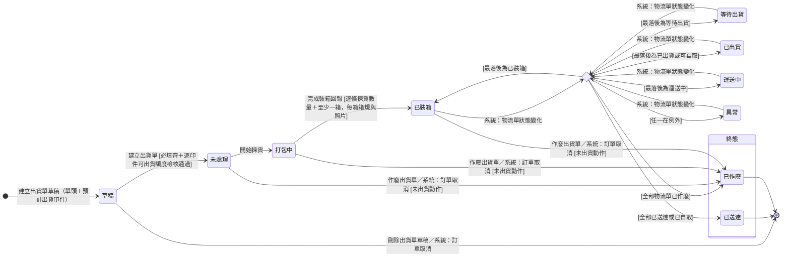

讀完這張卡，你會知道：

- 認識 [[出貨單]] 狀態機涵蓋的生命週期：從在訂單中先建草稿排這一批的出貨計畫、再選定要出的印件與數量建立出貨單（同訂單多個印件可合成一張，不跨訂單），到揀貨裝箱、交由物流單出貨，最後收在送達或作廢
- 看懂出貨單有哪幾種處境，以及已裝箱之後為什麼改由底下的物流單算出來
- 掌握每個轉換由哪些操作或物流單的變化觸發、要滿足什麼條件才推得動
- 分辨「未出貨動作」「部分離廠」「全數離廠」這幾個集合詞，以及各自能做什麼
- 知道異常為什麼不是終態、不回補額度

## 狀態列舉（正本）

> 本段是出貨單狀態的唯一正本。狀態的新增與修改是商業決策，直接在此卡維護。揀貨段設打包中／已裝箱兩態；已裝箱之後的狀態依底下未作廢的 [[物流單]] 計算（規則見下方「依物流單計算」）。

| 狀態 | 說明 | 對應營運需求 |
|------|------|------------|
| 草稿 | 初始；排好的出貨計畫，只有單頭與預計出貨印件，不佔可出貨額度、不進揀貨與出貨的待處理清單、也不推進印件與訂單 | 出貨計畫與出貨指令分開，客戶談定的日期與收件資訊當下就記得下來，不必等品檢結果 |
| 未處理 | 建立出貨單、出貨明細通過可出貨額度檢核後進入；還沒有人開始揀貨 | 出貨指令與處理進度分開，「還沒人動」看得出來 |
| 打包中 | 開始揀貨後進入；清點、打包、裝箱進行中 | 隨時看得到倉庫已經在處理這張單 |
| 已裝箱 | 完成裝箱回報後進入，系統同時依出貨方式產生物流單；之後依物流單計算，最落後的物流單仍在已裝箱（含出貨動作失敗）時停在這一格 | 揀貨與出貨的交棒點明確，裝箱證據留在單上 |
| 等待出貨 | 依物流單計算；最落後的物流單在等待出貨 | 第三方物流已拋單、等物流商收件 |
| 已出貨 | 依物流單計算；最落後的物流單在已出貨或可自取 | 這一批的貨都已交出或可自取 |
| 運送中 | 依物流單計算；最落後的物流單在運送中 | 在途與到貨分開看，客戶問「到哪了」答得出來 |
| 異常 | 依物流單計算；任一未作廢物流單在「例外」（集合詞見 [[物流單狀態]]）即為異常，優先於其他計算結果；非終態，例外解除或該物流單作廢後重算；具體例外名稱只看物流單 | 一筆出了狀況，整張單要讓人一眼看到；不寫具體例外名稱，多筆例外時才不會讀錯 |
| 已送達 | 終態；至少一筆未作廢物流單、且全部未作廢物流單已送達或已自取；轉入時寫入出貨明細的送達數量（欄位見 [[出貨單]]） | 印件與訂單完成判定的依據 |
| 已作廢 | 終態；來路有人工作廢（理由必填）、全部物流單作廢、訂單轉「已取消」的連鎖作廢（後兩者不要求理由）；系統記下轉入時間 | 建錯或客戶取消不留無效單據，額度回算；訂單取消時自動收掉還沒做出貨動作的單，倉庫不會照著一張已作廢訂單的指令繼續出貨 |

**出貨方式**（欄位，不拆出貨單的狀態路徑；選項與屬性見 [[出貨單]]）：各出貨方式經過哪些狀態看物流單（見 [[物流單狀態]]），本單取其最落後。自取、專車配送、其他不經等待出貨與運送中。

### 集合詞

> 本段是下列集合詞的正本。集合詞依出貨動作與 [[物流單]] 離廠時間判定，不依狀態名，同一狀態可能落在不同集合詞（例：已裝箱可能是未出貨動作，也可能是部分離廠），所以不畫成狀態圖上的複合狀態。各集合詞互斥，涵蓋草稿以外的全部未作廢出貨單。出貨動作＝拋單、出貨確認或標記可自取。

| 集合詞 | 定義 | 對應營運需求 |
|-------|------|------------|
| 未出貨動作 | 本單從未執行過出貨動作：未處理、打包中，以及已裝箱且從未執行過出貨動作 | 貨還沒交出去，可整張撤銷、可改明細與裝箱資料 |
| 部分離廠 | 已執行過出貨動作，但仍有未作廢物流單沒有離廠時間；出貨動作全部失敗也屬此類 | 已有貨交出或已送出過指令，不能整張撤銷，只能逐筆處理 |
| 全數離廠 | 全部未作廢物流單都有離廠時間；本單有實際出貨日 | 這一批全部離開公司，交期的準時與否以此判定 |

## 狀態機圖（UML）

- 記法：實心圓為初始點、雙圈為終止點、轉換標籤採「觸發操作名稱 [轉換條件]」格式，系統推進寫「系統：業務事件」。已裝箱之後的推進是歸納型轉換：物流單一有變化就重算，畫成選擇節點，落入哪一格依下方「依物流單計算」。
- 複合狀態「終態」＝出貨單已收束的處境，為可被他卡引用的集合詞（成員以本圖為正本）。未出貨動作、部分離廠、全數離廠這幾個集合詞依出貨動作與離廠時間判定，不畫成複合狀態（定義見上方「集合詞」）。
- 草稿不是出貨指令，出口是刪除，涵蓋人工刪除與訂單取消連鎖的系統刪除（見轉換表兩列）。

## 轉換條件與觸發事件

| 轉換 | 觸發操作 | 條件 |
|------|---------|------|
| （建立）→ 草稿 | [[訂單]] OP-ORD-001 建立出貨單草稿 | 填單頭並調整預計出貨印件；不可跨訂單；**訂單處於任何狀態（含終態）都建得出來**，不以訂單狀態或印件的印製維度另設把關（排這一批怎麼出是與客戶談出來的，跟單子當下停在哪一格無關）；出貨單預計出貨日必填；預計出貨印件由系統預設帶入，可移除、可加回（帶入範圍與預設數量的算法見 [[出貨單]]）；本步不檢核可出貨額度——額度要等品檢通過才長得出來 |
| 草稿 → 未處理 | [[出貨單]] OP-SHP-003 建立出貨單 | 必填齊備（出貨單預計出貨日、出貨方式、收件人、收件地址，且至少一條預計出貨印件的數量大於 0）；印製維度為「已棄用」的印件**不出現在可選清單**（已棄用即不再交付，見 [[印件印製狀態]]；額度算式沒有棄用歸零機制，不排除就會讓已取消訂單的既有良品被誤出）。每條明細數量不得超過該印件可出貨額度（算式見 [[印件]] 可出貨額度欄，回補規則見 [[齊套邏輯]]）。額度檢核以**執行建立出貨單的那一刻**的最新額度計（畫面上顯示的額度只是參考值，開著草稿的期間額度可能被別張單吃掉，也可能因別張單作廢或物流單作廢而回補）；額度不足時**整張單擋下**、**不做部分成立**（不自動把數量砍到額度內、不讓通過檢核的明細先成立），擋下只告知「可出貨額度不足，出貨單未成立」。通過檢核即把預計出貨印件轉為出貨明細；建立那一刻預計出貨印件中印製維度已轉「已棄用」者由系統自動移除並提示，移除後沒有任何一條數量大於 0 時以必填檢核擋下。新建時直接執行建立出貨單，系統先成草稿、同一動作立刻走本列，不另設直達未處理的路徑。成立時記下所屬訂單當時的帳務公司，供寄件資訊取用（欄位見 [[出貨單]]）。**本單屬「未出貨動作」期間以 [[出貨單]] OP-SHP-001 編輯出貨單修改出貨明細數量時重跑同一套檢核，但基準是「當下額度＋本單原明細已佔用的量」**（增量檢核）——不把本單自己吃掉的量先還回來算，連往下改數量都會被自己的佔用擋死，揀貨數量與明細不符時「改明細對齊揀貨數量」這條處置就走不通 |
| 草稿 → 刪除 | [[出貨單]] OP-SHP-002 刪除出貨單草稿 | 草稿唯一的出口是刪除、不走作廢（沒有出貨明細、沒佔額度，既沒有要回補的量也沒有要留的作廢紀錄）；不要求填理由；刪除後不再出現在清單上，紀錄留存供追溯 |
| 草稿 → 刪除（訂單取消連鎖） | 系統：所屬訂單轉「已取消」（見 [[訂單狀態]]） | 不要求人工填理由；已離開草稿的單改依下方兩列的作廢規則處理 |
| 未處理 → 打包中 | [[出貨單]] OP-SHP-004 開始揀貨 | 揀貨指令進入處理 |
| 打包中 → 已裝箱 | [[出貨單]] OP-SHP-005 完成裝箱回報 | 逐條明細回報揀貨數量；至少一箱，每箱回報箱規與至少一張裝箱照片（欄位見 [[出貨單]] § 裝箱資料）；系統同時依出貨方式產生物流單（拆單表見 [[出貨單]]，物流單轉換見 [[物流單狀態]]）；揀貨數量與明細數量不符時照實填、不自行判定，現場通知（處置先後見 [[出貨與送達]]），系統不設異常回報功能。處置走既有路徑：以 [[出貨單]] OP-SHP-001 編輯出貨單改出貨明細數量對齊揀貨數量後照常推進本單（未出到的量留在額度裡、之後另建單補出），或以 [[出貨單]] OP-SHP-012 作廢出貨單後重建（已裝箱者現場拆箱歸位、額度自動回補）。**不另設打包階段的異常態**。揀貨不符的判準與放行規則見下方「揀貨不符與裝箱回報修正」 |
| 已裝箱／等待出貨／已出貨／運送中／異常 → 依物流單重算 | [[出貨單]] OP-SHP-016 批次出貨動作、[[物流單]] OP-SHP-007 拋單、[[物流單]] OP-SHP-008 出貨確認、[[物流單]] OP-SHP-017 標記可自取、[[物流單]] OP-SHP-019 重新同步、[[物流單]] OP-SHP-020 標記例外、[[物流單]] OP-SHP-010 送達確認、[[物流單]] OP-SHP-009 交付確認、[[物流單]] OP-SHP-021 作廢物流單、系統：物流商回傳 | 本單任一未作廢物流單的狀態改變、或有物流單作廢時重算；揀貨相符是出貨動作的前提（見下方「揀貨不符與裝箱回報修正」）；物流單各自的轉換條件見 [[物流單狀態]] |
| 依物流單重算 → 已裝箱 | 系統：重算結果 | 沒有物流單在「例外」，未作廢物流單最落後為已裝箱（最落後順序見 [[物流單狀態]] § 推進規則） |
| 依物流單重算 → 等待出貨 | 系統：重算結果 | 沒有物流單在「例外」，最落後為等待出貨 |
| 依物流單重算 → 已出貨 | 系統：重算結果 | 沒有物流單在「例外」，最落後為已出貨或可自取 |
| 依物流單重算 → 運送中 | 系統：重算結果 | 沒有物流單在「例外」，最落後為運送中 |
| 依物流單重算 → 異常 | 系統：重算結果 | 任一未作廢物流單在「例外」；額度照常佔用、不回補（見 [[齊套邏輯]]） |
| 依物流單重算 → 已送達 | 系統：重算結果 | 至少一筆未作廢物流單，且全部未作廢物流單已送達或已自取；系統寫入出貨明細的送達數量（算式見 [[出貨單]]） |
| 依物流單重算 → 已作廢 | 系統：最後一筆未作廢物流單作廢 | 不要求理由；最後一筆的未送達數量由系統預填、回補不重複（見 [[齊套邏輯]]） |
| 未處理／打包中／已裝箱 → 已作廢 | [[出貨單]] OP-SHP-012 作廢出貨單 | 本單屬「未出貨動作」；理由必填；底下全部物流單同時作廢、不填未送達數量（物流單轉換見 [[物流單狀態]]）；已裝箱者現場拆箱歸位；整張明細數量逐印件回補可出貨額度（見 [[齊套邏輯]]） |
| 未處理／打包中／已裝箱 → 已作廢（訂單取消連鎖） | 系統：所屬訂單轉「已取消」（見 [[訂單狀態]]） | 本單屬「未出貨動作」；作廢原因自動記「訂單取消」、不要求人工填；其餘處置與人工作廢相同。部分離廠與全數離廠的出貨單不在此列，處置見 [[訂單狀態]] 取消連鎖 |

### 依物流單計算

> 本段是出貨單在已裝箱之後的狀態計算規則正本。

- **計算來源**：只看未作廢的 [[物流單]]；已作廢物流單保留可查，不參與計算。
- **最落後**：取未作廢物流單在最落後順序上最落後的狀態（順序見 [[物流單狀態]] § 推進規則）；可自取視同已出貨。
- **異常優先**：任一未作廢物流單在「例外」時，本單為異常，不論其他物流單在哪一格。
- **已送達**：至少一筆未作廢物流單，且全部未作廢物流單已送達或已自取；轉入後為終態，不再重算。
- **全部作廢**：未作廢物流單筆數歸零時，本單轉已作廢。
- **實際出貨日**：全部未作廢物流單都有離廠時間時才有值（算法見 [[出貨單]] 實際出貨日欄）。

### 揀貨不符與裝箱回報修正

> 本段是揀貨不符的判準與放行規則的正本，也是裝箱回報修正的規則正本。兩者都不是狀態轉換，不改出貨單狀態。

- **揀貨不符的判準**：任一條出貨明細的揀貨數量不等於數量，即為揀貨不符。
- **放行規則**：不符未解除前，系統擋下 [[出貨單]] OP-SHP-016 批次出貨動作，以及本單物流單的 [[物流單]] OP-SHP-007 拋單、OP-SHP-008 出貨確認與 OP-SHP-017 標記可自取。兩數相符即放行，不另設確認關卡。
- **解除方式**：以 [[出貨單]] OP-SHP-001 編輯出貨單改出貨明細數量、對齊揀貨數量；或以 [[出貨單]] OP-SHP-006 裝箱回報修正修正揀貨數量。兩者都只在本單屬「未出貨動作」時可做。
- **各操作只改自己承載的欄位**：編輯出貨單改明細數量，裝箱回報修正改揀貨數量與裝箱資料。責任原則見 [[報工紀錄]] § 修正與作廢；誰能執行各操作見 [[出貨活動清單]]。
- **瑕疵或找不到的量**：照實填揀貨數量，處置在系統外協調，結果以既有動作落回（規則見 [[齊套邏輯]] § 數量帳的守恆底線與正本歸屬）。
- **裝箱回報修正**：只在本單屬「未出貨動作」時可執行，不改狀態。可修正明細的揀貨數量，以及逐箱新增、修改（箱規、裝箱照片、裝箱備註）、刪除；至少保留一箱；修正原因必填；修正前的值與照片留在裝箱回報修正紀錄（欄位見 [[出貨單]]）。新增或刪除箱時系統依拆單表調整物流單（見 [[出貨單]] § 裝箱資料）。修正過即視為已修正，定義見 [[報工紀錄]] § 修正與作廢。
- **出貨動作後全部鎖住**：執行過出貨動作後，揀貨數量與全部裝箱資料都不能再修正，含出貨動作失敗的物流單與已作廢物流單的箱；裝錯改走作廢物流單（過程見 [[出貨與送達]]）。

## 關鍵轉換的營運動機

- 先草稿再出貨單 → 動機：與客戶談定這一批大概哪天出、送到哪的當下，不記下來就散在通訊軟體裡；能不能真的出貨要等品檢結果，兩件事之間的時間差就是草稿存在的理由。草稿不進倉庫的清單，倉庫才不會照著一張還沒算過帳的計畫去揀貨 → 例子：客戶講定 9 月 10 日要到貨，先把日期與收件資訊記在草稿上；品檢過了 495 本之後，同一張草稿直接建立成出貨單。
- 出貨單即揀貨指令 → 動機：成品完成最終品檢即入庫（可出貨）暫存、不另設成品倉的庫存管理，決定出多少才建單、揀貨依單裝箱——倉庫從出貨單就知道今天包哪些、怎麼包（有指定裝箱方式就照指定，沒指定就依公版箱規判斷），不靠口頭交代 → 例子：專輯手工完成、最終品檢通過入庫；三天後客戶說可出，建出貨單後依單裝箱出貨。
- 揀貨段兩態納入狀態鏈、回報記在出貨單上 → 動機：出貨單的一生就是這批貨的一生（開單 → 裝箱 → 出門 → 到貨），裝箱回報是「裝好了」的證據、直接留在同一張單上，一張單看得到全部經過；品檢回報（通過多少）與裝箱回報（裝了幾箱共多少個）拆成兩段，不再混發（現況混發造成出問題難定位）→ 例子：品檢回報通過 609 入庫；建單出 609；開始揀貨（打包中）、裝 1 箱馬克杯箱、揀貨數量 609 附照片（已裝箱）；發車（已出貨）。
- 一印件多張出貨單（分批） → 動機：客戶急要先出一部分是常態；每批一張單、各自獨立追蹤送達 → 例子：名片 1000 已入庫 580，先出 580（出貨單 A 運送中），餘量入庫後再出（出貨單 B）。
- 已裝箱之後取物流單的最落後 → 動機：一張出貨單常分成多筆托運；取最落後，還有貨沒交出時整張單不會顯示已出貨 → 例子：7-11 交貨便 3 箱分成三筆物流單，兩筆已到店、一筆還在等待出貨，出貨單顯示等待出貨。
- 異常由物流單計算、非終態、不回補 → 動機：例外常常只是物流商資料沒同步，貨不一定沒送到；整張收掉再重出，可能讓已送到的貨又出一次。確定送不到的那一筆才作廢、填未送達數量 → 例子：順豐一筆物流單回傳例外，出貨單轉異常；隔天重新同步恢復為運送中，出貨單跟著回到運送中。
- 出貨動作後裝箱資料全部鎖住 → 動機：部分箱子已交給物流商，再改箱子會讓系統記錄與物流商手上的包裹對不上 → 例子：4 箱拋單時 3 箱成功、1 箱失敗，失敗的那一筆只能再拋單或作廢，不能改它的箱規。

## 與其他狀態機的關係

- 已裝箱之後的計算來源：[[物流單狀態]]。本單作廢時底下物流單一併作廢；最後一筆物流單作廢時本單轉已作廢。
- 出貨額度的上游：[[品檢紀錄]] 通過數量 → 印件的完工良品數 → 可出貨額度（多工單印件不另設取小規則——品檢驗的是工序依賴圖終點的完成品，多工單天然已齊，見 [[齊套邏輯]]）。
- 印件層收尾：哪些出貨單先排除、異常出貨單怎麼算，判定正本見 [[印件印製狀態]] 出貨中 → 已送達列。
- 訂單層收尾：全部未棄用印件已送達 → [[訂單狀態]] 系統自動轉「訂單完成」；完成與發票、收款脫鉤（錢由對帳差額警示追、完成後客訴走 [[售後服務狀態]]）。訂單收於終態不影響本卡建單——只要還有額度就建得出來（見上方建立列）。
- 印件與訂單轉「出貨中」的起點：含該印件出貨明細的首張出貨單由「草稿」轉「未處理」時該印件的印製維度推進，該訂單的首張走這條弧時訂單推進，兩者皆自「製作中」或「製作完成」進入（草稿本身不觸發；轉換正本見 [[印件印製狀態]]、[[訂單狀態]]）。
- 訂單取消時本層依集合詞分流：草稿由系統刪除，未出貨動作的出貨單由系統作廢並回補額度，部分離廠與全數離廠的處置見 [[訂單狀態]] 取消連鎖。
- 異常出貨單照常佔用可出貨額度、不計入印件累計送達數（見 [[齊套邏輯]]、[[印件]]）；送不到的那一筆以作廢物流單收掉，要重出就建新出貨單。

## 範圍外

- **可出貨額度的計算**：系統會自動計算——本卡只承諾此行為，算式正本在 [[印件]] 可出貨額度欄、回補規則見 [[齊套邏輯]]，實作時勿自行發明
- 誰在什麼範圍能做上表的各個操作 → [[出貨活動清單]]；檢視與下載物流單檔案 → [[出貨與售後檢視活動清單]]、[[輸出活動清單]]
- 每一筆托運的狀態、回傳處理與作廢開放狀態 → [[物流單狀態]]
- 揀貨回報與裝箱資料的欄位定義 → [[出貨單]]（欄位正本）；現場作業細節（點收順序、封箱）→ [[揀貨人員]]
- 運費的帳不做（訂單通常已先收運費）；箱數與箱規的留存供每月與第三方物流對帳（雙方箱數認知比對），對帳機制屬後續設計
- 例外的原因分類與理賠 → 不設計，具體例外名稱只留在 [[物流單]]
- 實際出貨日與首張出貨單認定在物流單重試或作廢後的變動 → [[SHP-024-實際出貨日取最晚離廠後的判定穩定性]]

## 相關卡

- 規則：[[齊套邏輯]]（齊套判定與回補規則）、[[印件生產流程]]、[[工序相依性規則]]（分次驗、隨驗隨入庫支援分批出貨）
- 流程：[[出貨與交付流程群組]]（階段 1 出貨）
- 活動清單：[[出貨活動清單]]（觸發各轉換的活動）
- 實體：[[出貨單]]（本狀態機依附的主實體與操作登記處）、[[物流單]]（逐筆托運操作的登記處）、[[訂單]]（建立出貨單草稿的登記處）
- 狀態機：[[物流單狀態]]（已裝箱之後的計算來源）、[[印件印製狀態]]（送達的彙整層）、[[訂單狀態]]（完成的觸發與取消連鎖）、[[生產任務狀態]]（完工良品數的上游）
- 已拍板決議（封存，供追溯）：[[SHP-005-分批出貨觸發節點]]（分批建單逐明細檢核）、[[SHP-007-揀貨裝箱回報載體與出貨單狀態顆粒度]]（裝箱回報記在出貨單上、揀貨段兩態）
