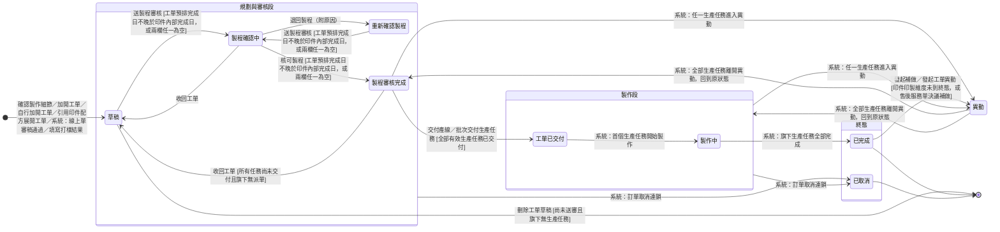

讀完這張卡，你會知道：

- 認識 [[工單]]（WorkOrderStatus）狀態機涵蓋的生命週期：生產排程的基本單位從製程規劃、主管審核、交付產線，走到旗下生產任務全部收工
- 看懂工單有哪些處境、每一格代表球在規劃端、審核端還是現場手上
- 掌握每個轉換由哪個操作或系統事件觸發、要滿足什麼條件才推得動
- 理解為什麼前半段的規劃與審核靠人手動推進、後半段的交付與製作由底層報工自動往上反映
- 知道製程填錯與客戶改需求各走哪一條修正路徑，不必作廢重建

## 狀態列舉（正本）

> 本段是工單狀態的唯一正本。狀態的新增與修改是商業決策，直接在此卡維護。

### 規劃與審核段

| 狀態 | 說明 | 對應營運需求 |
|------|------|------------|
| 草稿 | 初始；系統自動產生或加開，分派後（自行加開者即時）由負責人填寫製程。尚未送審且旗下無 [[生產任務]] 的空草稿得刪除，刪除不影響所屬 [[印件]] 的印製維度 | 製程規劃定稿前的編輯空間；誤確認製作細節或誤加開留下的空草稿可移除，不讓假待辦長期掛在待分派清單上 |
| 製程確認中 | 製程填完、送審中 | 製程出門前有主管把關，標示球在審核端 |
| 重新確認製程 | 製程審核退回要求修改，改完可重新提交 | 給規劃者修正機會、不作廢重建 |
| 製程審核完成 | 製程已核可，等待交付產線 | 核可後才能進產線，把關點明確 |

### 製作段（由底層自動向上反映）

| 狀態 | 說明 | 對應營運需求 |
|------|------|------------|
| 工單已交付 | **全部**有效生產任務交付產線後觸發（取最落後：不含已作廢、報廢的生產任務皆已交付）| 標示整單已進工廠排程、下游才看得到 |
| 製作中 | 至少一個生產任務已開始製作（報工觸發） | 現場一動工、工單即反映，不靠人工回填 |
| 異動 | 生產任務有異動處理中時，工單鏡像顯示為異動；全部處理完自動回到原狀態 | 讓上層一眼看出這張工單正有變更在處理，異動期間完成度照算、生產不中斷 |

### 終態

| 狀態 | 說明 | 對應營運需求 |
|------|------|------------|
| 已完成 | 終態；旗下生產任務全部完成（含補做任務，系統自動——工單管製作帳，品質與可出貨帳歸印件層 [[品檢紀錄]]） | 製作收斂即完成，品質缺口由印件層品檢帳承接、不擋工單收尾 |
| 已取消 | 終態；訂單取消時由上而下連鎖轉入 | 已取消訂單的工單不再佔用生產資源 |

## 狀態機圖（UML）

依 UML 狀態機圖記法繪製：實心圓為初始點、雙圈為終止點、轉換標籤採「觸發事件 [轉換條件]」格式。「異動」是生產任務層驅動的**鏡像狀態**——工單在「製程審核完成」或製作段時，任一生產任務進入異動相關狀態即顯示異動、全部離開後**回到進入前的原狀態**（圖上以進出兩條弧表達，回去的目標依進入時的狀態而定）。「訂單取消」的連鎖自兩個段落複合狀態邊界出發，適用其內全部子狀態；空草稿刪除後工單不存在，圖上畫成直接結束。複合狀態「終態」＝工單已收束的處境（可被規則句引用的集合詞，成員以本圖為正本）；「『終態』以外的任何狀態」即涵蓋規劃與審核段、製作段與異動。

## 轉換條件與觸發事件

| 轉換 | 觸發操作 | 條件 |
|------|---------|------|
| （建立）→ 草稿 | [[印件]] OP-PI-012 確認製作細節、[[印件]] OP-PI-013 加開工單、[[印件]] OP-PI-025 自行加開工單、[[印件]] OP-PI-014 引用印件配方展開工單、[[印件]] OP-PI-010 填寫打樣結果、系統：線上單印件審稿通過 | 依 [[工單]] § 建立來源 的分流建立：確認製作細節、印製維度推進至「製程已確認」時系統自動建第一張空草稿；打樣結果填為 NG-製程問題時於同一印件建新打樣工單；線上單審稿通過即自動建立並帶入生產任務；外包大貨 NG 補印以加開工單或自行加開工單開新工單；其餘建立來源見 [[工單]] § 建立來源。分派後主責移交負責人；自行加開的工單負責人固定為加開者、不經分派；一張工單對應一位負責人 |
| 草稿 → （刪除） | [[工單]] OP-WO-008 刪除工單草稿 | 尚未送審且旗下無生產任務；刪除不影響所屬印件的印製維度 |
| 草稿 → 製程確認中 | [[工單]] OP-WO-003 送製程審核 | 自行加開的工單，送審時須指定工單審核主管（欄位見 [[工單]]）。排程條件：工單預排完成日不晚於印件內部完成日（兩欄見 [[工單]]）；工單預排完成日為空或印件內部完成日為空時不比對、不擋。不符即擋下，打樣 NG 重打、外包大貨 NG 補印、加印等晚期才建的工單一樣適用 |
| 製程確認中 → 重新確認製程 | [[工單]] OP-WO-005 退回製程 | 附退回原因 |
| 重新確認製程 → 製程確認中 | [[工單]] OP-WO-003 送製程審核 | 排程條件同「草稿 → 製程確認中」 |
| 製程確認中 → 製程審核完成 | [[工單]] OP-WO-004 核可製程 | 排程條件同「草稿 → 製程確認中」，核可當下重新比對一次；不符即擋下核可，改走退回製程 |
| 製程確認中／製程審核完成 → 草稿 | [[工單]] OP-WO-006 收回工單 | 須填寫收回原因。製程確認中：審核尚未開始；製程審核完成：所有生產任務尚未交付**且旗下無 [[派單]]**。已有生產任務交付、或旗下已有派單（工單含外包或中國廠商生產任務時，派單於製程審核完成當下由系統自動建立）則不可收回，改走異動流程 |
| 製程審核完成 → 工單已交付 | [[生產任務]] OP-TSK-003 交付產線、[[工單]] OP-WO-007 批次交付生產任務 | 旗下有效生產任務（不含已作廢、報廢）的交付時間皆有值才推進（交付時間見 [[生產任務]]，任務層進度見 [[生產任務交付狀態]]）——各負責廠商都收到、下游才看得到 |
| 工單已交付 → 製作中 | 系統：首個生產任務開始製作（向上反映） | 異動結束回到製程審核完成後，若已有生產任務在製作中，新任務交付時直接進製作中 |
| 製作中 → 已完成 | 系統：旗下生產任務全部完成（含補做生產任務） | 判定正本見 [[齊套邏輯]]；進入本態時系統寫入工單實際完成日（欄位見 [[工單]]）|
| 已完成 → 異動 | [[印件]] OP-PI-020 發起補做、[[工單]] OP-WO-009 發起工單異動 | 經工單異動加開補做生產任務，補做重開的唯一入口，放行分兩類：**一般補做**（品檢缺口）在所屬印件印製維度已到終態（已送達／已棄用）時擋下（邊界依據 [[PT-034-工單補做重開守衛邊界]]）；**[[售後服務]] 單決議「補做」觸發者例外放行**，穿越印件印製終態重開原工單，對象印件維持「已送達」（[[印件印製狀態]]）、補做活動全在工單層（規則正本見 [[售後服務規則]]）。異動處理完回「製作中」續走 |
| 製程審核完成或製作段任一狀態 → 異動 | 系統：任一生產任務進入異動相關狀態 | 異動期間完成度照算、現場照常生產 |
| 異動 → 原狀態 | 系統：全部生產任務離開異動相關狀態 | 回到進入異動前的狀態 |
| 「終態」以外的任何狀態 → 已取消 | 系統：訂單取消，由上而下連鎖 | 連鎖細節見 [[訂單狀態]]；印件棄用時亦一律轉此態，見 [[印件印製狀態]] |
| 「終態」以外的任何狀態 → 已完成 | [[印件]] OP-PI-023 短出結案 | 印件層結案（客戶同意少收、不再補做）時由上而下批次連動，旗下未完成工單一次推此態、其下生產任務一併推完成，已報工數不動；工單實際完成日同樣取進入本態的時間；判定與動機見 [[印件印製狀態]] |

## 關鍵轉換的營運動機

- 交付產線（製程審核完成 → 工單已交付）→ 動機：「交付產線」是把生產任務放行給製作方的責任轉移動作——自有工廠由現場確認接收、外包與中國廠商＝[[派單]] 發送給廠商；可逐任務交付、也可自工單層批次，全部任務交付後工單才轉「工單已交付」。日常溝通與單據上以「交付產線」稱之，與對客戶的實體交貨（[[出貨單狀態]]）、[[派單狀態]] 的狀態值「已交付工單」是三個不同所指 → 例子：一張工單三筆生產任務，印刷（自有）先交付、現場接收開始排程，燙金（外包）交付即派單發送；三筆都交付後工單轉「工單已交付」。
- 前手動、後自動的分界 → 動機：規劃審核段是人在定製程、要主管把關；交付之後進度事實在現場報工，系統自動往上反映才不會「現場做到哪、系統顯示對不上」→ 例子：ORD-2026-0512 的工單交付後，第一筆報工一進系統，工單自動從「工單已交付」變「製作中」，沒有人手動改任何狀態。
- 製作中 → 已完成（生產任務收斂自動）→ 動機：工單管製作帳——所有工序（含補做）都收工才算完成；能不能出貨看印件層品檢帳（[[品檢紀錄]]），兩本帳脫鉤→ 例子：目標 1,000 份的工單三筆生產任務全部完成即轉「已完成」；品檢刷掉 20 份時發起補做，工單經異動加開補做生產任務重開（轉換見上表「已完成 → 異動」），補做生產任務完成後再次轉「已完成」。
- 已完成 → 異動的兩類放行 → 動機：一般補做擋在印件印製終態，是不讓已鎖定的出貨帳被回頭翻動；[[售後服務]] 單決議觸發的補做例外放行，是因為重做的本來就是同一件貨——責任與決議留痕在售後服務單、補做成本歸戶原 [[印件]]，比另建一件印件更算得清品質成本，出貨則靠可出貨額度長出來承接 → 例子：ORD-2026-0470 的名片已送達，客戶反映 100 份裁切不良，售後服務單決議補做，在該印件發起補做、原工單重開加開 100 份的補做生產任務，印件狀態全程維持「已送達」。
- 收回路徑 → 動機：送審後發現製程填錯，給一條收回重做的路，不必作廢重開、不留無效單據 → 例子：送審後發現漏排一道上光工序，收回工單補上後重新送審。
- 收回的窗口止於派單建立 → 動機：[[派單]] 是對外的協作單據，一經建立就已在派單管理頁上被看見；工單收回回草稿而派單留在外面，就出現「工單說還在規劃、派單說在等發稿」兩個真相。因此工單旗下只要已有派單，修正一律改走異動，讓對外那張單也跟著被處理 → 例子：全客製工單含一筆中國廠壓紋任務，主管核可當下系統已建派單；事後發現色數填錯，此時收回不可用，改由生產任務發起異動修正。

## 與其他狀態機的關係

- 工單的製作段進度由下層自動向上反映：[[生產任務狀態]] 報工 → 工單（任務層已移除）。本卡只接收結果，多層傳遞的完整鏈路見 [[印件印製狀態]]。
- 異動由生產任務的異動往上鏡像（發起與把關見 [[工單]] 異動紀錄），工單不自行進出異動。
- 工單做齊的數量往上彙整到 [[印件印製狀態]] 的印製維度，再反映到 [[訂單狀態]]。
- 交付以生產任務為單位記錄：可逐筆交付，也可在工單一次交付旗下全部生產任務；自有工廠任務交付後由現場確認接收，任務層的未交付、已交付、已接收見 [[生產任務交付狀態]]。本卡只看有效生產任務的交付時間是否到齊。
- 一張工單只對應一位負責人；改派於全生命週期皆可執行（含製作中），留異動紀錄、不改工單狀態，不需退回「重新確認製程」（操作與欄位規則見 [[工單]]）。

## 範圍外

- **完成判定與數量彙整的計算細節**（生產任務怎麼算全完成、多任務怎麼彙整）：系統會自動判定——本卡只承諾此行為，計算公式屬 [[齊套邏輯]] 與 [[數量換算規則]]（規則正本），實作時勿自行發明
- 工單底下生產任務自身的流轉 → 走 [[生產任務狀態]]
- 打樣工單與大貨工單的業務分流 → 見 [[打樣流程]]／[[印件生產流程]]
- 派工排程的安排方式 → 屬排程規劃，不在本卡

## 相關卡

- 規則：[[齊套邏輯]]（已完成自動推進的判定正本）、[[數量換算規則]]、[[印件生產流程]]（單據層級結構）、[[打樣流程]]（打樣工單分流）、[[售後服務規則]]（售後決議觸發補做的規則正本）
- 實體：[[工單]]（本狀態機依附的主實體）、[[派單]]（製程審核完成時自動建立，其存在即收回路徑的把關條件）、[[售後服務]]（例外放行的觸發單據）
- 狀態機：[[生產任務狀態]]（由下往上反映進度）、[[生產任務交付狀態]]（任務層交付進度，交付時間到齊即推進工單已交付）、[[印件印製狀態]]（數量往上彙整）、[[訂單狀態]]（取消連鎖來源）、[[售後服務狀態]]（決議補做的來源單據進度）
- 活動清單：[[工單產生與分派活動清單]]（建立、刪除空草稿）、[[製程規劃活動清單]]（送審、核可、退回、收回、交付、工單異動的發起、確認與核可）、[[品檢活動清單]]（發起補做）、[[製作與報工活動清單]]（短出結案）
