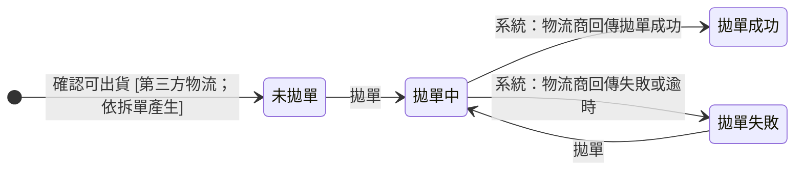
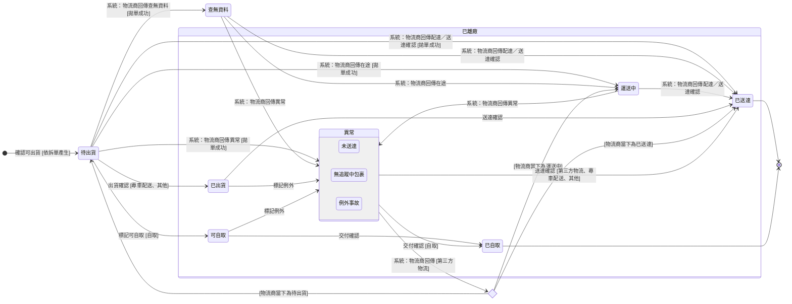
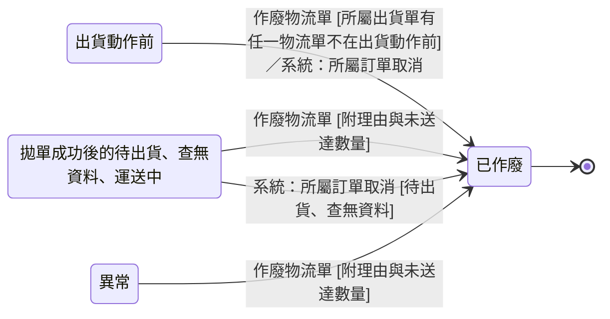

讀完這張卡，你會知道：

- 認識 [[物流單]] 的狀態機：從所屬出貨單確認可出貨時產生，到這一筆托運送達、自取或作廢
- 看懂物流單的狀態分拋單狀態與貨態兩個欄位，各出貨方式各經過哪些值、哪些貨態算「已離廠」，以及「異常」怎麼進、怎麼出
- 掌握每個轉換由哪個操作或物流商回傳觸發、要滿足什麼條件
- 說出物流商回傳與人工確認衝突時以誰為準，以及哪些處境可以作廢
- 理解所屬出貨單為什麼取物流單的最落後處境

## 狀態列舉（正本）

> 本段是物流單狀態的唯一正本。狀態的新增與修改是商業決策，直接在此卡維護。物流單的狀態分拋單狀態與貨態兩個欄位（欄位見 [[物流單]]）。

### 拋單狀態

只有第三方物流（順豐、新竹物流、7-11 交貨便、全家）有拋單狀態；專車配送、其他、自取不填。

| 狀態 | 說明 | 對應營運需求 |
|------|------|------------|
| 未拋單 | 初始；所屬出貨單確認可出貨時系統產生本單即進入 | 數量鎖定後才產生物流單，物流單與箱子對得上 |
| 拋單中 | 拋單送出、等物流商回應 | 看得出這一筆已送出、還沒有結果 |
| 拋單成功 | 物流商回傳物流單號後進入 | 這一筆已交到物流商系統，之後的進度看貨態 |
| 拋單失敗 | 物流商回傳失敗，或等不到回應而逾時後進入；記下拋單失敗原因（欄位見 [[物流單]]）；可再次拋單 | 失敗的那一筆與原因留在單上，排除原因後再拋 |

### 貨態

| 狀態 | 說明 | 對應營運需求 |
|------|------|------------|
| 待出貨 | 初始；物流單產生即進入；第三方物流拋單成功後仍在這一格，等物流商收件 | 貨還在廠內 |
| 已出貨 | 只有專車配送與其他；出貨確認後進入 | 貨已交出、已發車 |
| 可自取 | 只有自取；標記可自取後進入 | 客戶可以到廠取貨；自取的貨從這一格起算已離廠 |
| 運送中 | 只有第三方物流；物流商回傳在途後進入 | 在途與到貨分開看，客戶問「到哪了」答得出來 |
| 查無資料 | 只有第三方物流；物流商回傳查不到這一筆時進入；不覆蓋原本的貨態（見下方推進規則） | 看得出物流商那一端還查不到這一筆 |
| 異常 | 第三方物流由物流商回傳進入；專車配送、其他、自取由標記例外進入 | 這一筆出了狀況，先停下確認貨況 |
| 未送達 | 「異常」之一；名稱沿用 EC 物流狀態 | 同上 |
| 無追蹤中包裹 | 「異常」之一；名稱沿用 EC 物流狀態 | 同上 |
| 例外事故 | 「異常」之一；名稱沿用 EC 物流狀態 | 同上 |
| 已送達 | 終態；第三方物流的配達回傳或送達確認（回傳沒進來時的備援），或專車配送與其他的送達確認 | 這一筆的交付事實；所屬出貨單收尾的依據 |
| 已自取 | 終態；只有自取；交付確認後進入 | 客戶到廠拿走的交付事實 |

### 作廢

| 狀態 | 說明 | 對應營運需求 |
|------|------|------------|
| 已作廢 | 終態；這一筆托運撤銷，理由與未送達數量記在 [[物流單]] | 送不出或送不到的那一筆收掉，沒送到的量回到額度 |

### 各出貨方式經過的狀態

出貨方式看「有外部物流單號」屬性分流（屬性見 [[出貨單]] § 出貨方式（系統設定））。

| 出貨方式 | 拋單狀態 | 貨態 |
|---------|---------|------|
| 第三方物流（順豐、新竹物流、7-11 交貨便、全家） | 未拋單 → 拋單中 → 拋單成功；失敗時拋單中 → 拋單失敗，再拋回到拋單中 | 待出貨 → 運送中 → 已送達；拋單成功後才推進 |
| 專車配送、其他 | 不填 | 待出貨 → 已出貨 → 已送達 |
| 自取 | 不填 | 待出貨 → 可自取 → 已自取 |

## 狀態機圖（UML）

- 記法：實心圓為初始點、雙圈為終止點、轉換標籤採「觸發操作名稱 [轉換條件]」格式，系統推進寫「系統：業務事件」。拋單狀態、貨態、作廢各畫一張圖；第三方物流由物流商回傳推進、送達確認為備援。離開「異常」回到物流商當下貨態的弧畫成選擇節點，落入哪一格看物流商回傳。
- 複合狀態為可被他卡引用的集合詞（成員以貨態圖為正本）：「已離廠」＝這一筆貨已交出或已擺出待取、離開公司的處境，含其後的異常與交付；「異常」＝這一筆出了狀況、停下確認貨況的處境，屬已離廠。終態以終止點標示、不畫成複合狀態，因為已送達與已自取同屬已離廠。
- 作廢圖的來源格是處境，不是單一欄位的值：「出貨動作前」的定義見下方推進規則的最落後順序；所屬 [[出貨單狀態]] 在已確認之後依本卡計算。

拋單狀態（只有第三方物流）：

貨態：

作廢：

## 轉換條件與觸發事件

### 拋單狀態

| 轉換 | 觸發操作 | 條件 |
|------|---------|------|
| （產生）→ 未拋單 | [[出貨單]] OP-SHP-023 確認可出貨 | 第三方物流；系統依所屬出貨單出貨方式的「支援子母單」屬性產生（拆單表見 [[出貨單]] § 裝箱資料）；揀貨相符在確認可出貨把關（見 [[出貨單狀態]] § 揀貨不符與裝箱回報修正）；貨態同時為待出貨 |
| 未拋單／拋單失敗 → 拋單中 | [[物流單]] OP-SHP-007 拋單 | 逐筆拋單，或批次拋單（見 [[物流單]] § 操作），各筆結果獨立；出貨方式有外部物流單號；所屬訂單不在「已取消」（見 [[訂單狀態]] 取消連鎖）；每次拋單系統產生新的我方自編單號傳給物流商（欄位見 [[物流單]]） |
| 拋單中 → 拋單成功 | 系統：物流商回傳拋單成功 | 物流商回傳的物流單號與子單號寫入（欄位見 [[物流單]]）；貨態仍為待出貨 |
| 拋單中 → 拋單失敗 | 系統：物流商回傳失敗或逾時 | 送出後等不到物流商回應而逾時也算失敗；記下拋單失敗原因（欄位見 [[物流單]]）；再執行一次拋單即重拋，不另設重試操作；逾時後物流商才建單的情況見 [[EC 物流串接約束]] 規則表「重複建單」 |

### 貨態

| 轉換 | 觸發操作 | 條件 |
|------|---------|------|
| （產生）→ 待出貨 | [[出貨單]] OP-SHP-023 確認可出貨 | 全部出貨方式；產生方式同上方拋單狀態的產生列 |
| 待出貨 → 已出貨 | [[物流單]] OP-SHP-008 出貨確認 | 出貨方式為專車配送或其他；所屬訂單不在「已取消」 |
| 待出貨 → 可自取 | [[物流單]] OP-SHP-017 標記可自取 | 出貨方式為自取；所屬訂單不在「已取消」 |
| 待出貨／查無資料 → 運送中 | 系統：物流商回傳在途 | 第三方物流，拋單成功後；7-11 交貨便與全家的到店也落在運送中（見下方「與 EC 物流狀態的對映」） |
| 待出貨 → 查無資料 | 系統：物流商回傳查無資料 | 第三方物流，拋單成功後；查無資料不覆蓋原本的貨態（見下方推進規則） |
| 待出貨／查無資料／運送中 → 已送達 | 系統：物流商回傳配達 | 第三方物流，拋單成功後；配達只認簽收或取件完成，到店不算；回傳依下方推進規則只往前走，可越過中間狀態 |
| 待出貨／查無資料／運送中 → 已送達 | [[物流單]] OP-SHP-010 送達確認 | 第三方物流，拋單成功後，配達回傳沒進來時補上；可選填逐印件未送達數量（回補見 [[齊套邏輯]]）；與物流商回傳同時到時依下方先寫入者成立 |
| 已出貨 → 已送達 | [[物流單]] OP-SHP-010 送達確認 | 出貨方式為專車配送或其他；可選填逐印件未送達數量 |
| 可自取 → 已自取 | [[物流單]] OP-SHP-009 交付確認 | 出貨方式為自取；可選填逐印件未送達數量 |
| 待出貨／查無資料／運送中 → 異常 | 系統：物流商回傳異常 | 第三方物流，拋單成功後；第三方物流不開放人工標記例外 |
| 已出貨／可自取 → 異常 | [[物流單]] OP-SHP-020 標記例外 | 出貨方式為專車配送、其他或自取；理由必填（欄位見 [[物流單]]） |
| 異常 → 物流商當下貨態（待出貨、運送中或已送達） | 系統：物流商回傳 | 第三方物流 |
| 異常 → 已送達 | [[物流單]] OP-SHP-010 送達確認 | 出貨方式為第三方物流、專車配送或其他；未送達數量同上 |
| 異常 → 已自取 | [[物流單]] OP-SHP-009 交付確認 | 出貨方式為自取；未送達數量同上 |

### 作廢

| 轉換 | 觸發操作 | 條件 |
|------|---------|------|
| 異常 → 已作廢 | [[物流單]] OP-SHP-021 作廢物流單 | 理由必填；逐印件填未送達數量（上限、系統預填與回補見 [[齊套邏輯]] § 出貨額度回補與退回實物）；作廢前先在系統外確認貨況（過程見 [[出貨與送達]]） |
| 拋單成功後的待出貨／查無資料／運送中 → 已作廢 | [[物流單]] OP-SHP-021 作廢物流單 | 第三方物流；理由與未送達數量同上；系統不向物流商取消，物流商端的取消托運、攔截或退回在系統外處理（過程見 [[出貨與送達]]） |
| 出貨動作前 → 已作廢 | [[物流單]] OP-SHP-021 作廢物流單 | 所屬出貨單有任一物流單（含已作廢者）不在出貨動作前；物流商端無需處理；理由與未送達數量同上 |
| 出貨動作前／拋單成功後的待出貨／查無資料 → 已作廢（訂單取消連鎖） | 系統：所屬訂單轉「已取消」 | 所屬出貨單屬「未離廠」（集合詞見 [[出貨單狀態]]），整張作廢時底下物流單一併作廢；不要求理由、不填未送達數量（整張明細回補見 [[齊套邏輯]]）；已拋單者的托運在物流商端於系統外取消 |

> 未送達數量的上限、其餘物流單都已作廢時的系統預填與回補規則見 [[齊套邏輯]]；所屬出貨單依本卡計算的規則見 [[出貨單狀態]]。

### 推進規則

> 本段是物流單狀態推進順序與回傳處理的規則正本。

**最落後順序**（位置 1 最落後；所屬出貨單取未作廢物流單在此順序上最落後的位置，見 [[出貨單狀態]]）：

| 位置 | 物流單的處境 |
|------|------------|
| 1 出貨動作前 | 第三方物流：拋單狀態為未拋單、拋單中或拋單失敗；專車配送、其他、自取：貨態為待出貨 |
| 2 | 第三方物流：拋單成功，且貨態為待出貨或查無資料 |
| 3 | 貨態為已出貨或可自取 |
| 4 | 貨態為運送中 |
| 5 | 貨態為已送達或已自取 |

| 規則 | 內容 |
|------|------|
| 拋單成功才推進貨態 | 第三方物流的貨態在拋單成功之後才依物流商回傳推進 |
| 只往前 | 物流商回傳只讓貨態往最落後順序的後方走；倒退的回傳不改貨態，只寫所屬出貨單的歷程。唯一例外：在「異常」時，物流商回傳可讓本單回到物流商當下的貨態 |
| 查無資料不覆蓋 | 物流商回傳查無資料時，不覆蓋原本的貨態：本單貨態已是運送中、異常或已送達時維持原貨態 |
| 終態不動 | 已送達、已自取、已作廢收到任何回傳都不改狀態，只寫所屬出貨單的歷程 |
| 先寫入者成立 | 人工確認與物流商回傳同時到，以先寫入者為準；後到者只寫歷程 |
| 以物流商最近一次回傳為準 | 第三方物流的貨態以物流商最近一次回傳為準，不另設延遲顯示 |

### 作廢的開放狀態

| 處境 | 可否作廢 | 物流商端 |
|------|---------|---------|
| 出貨動作前 | 所屬出貨單有任一物流單（含已作廢者）不在出貨動作前時可；全部物流單都在出貨動作前時不單筆作廢 | 無需處理 |
| 拋單成功後的待出貨、查無資料、運送中 | 可（只有第三方物流會在這幾格） | 系統不取消；取消托運、攔截或退回在系統外處理 |
| 「異常」的任一處境 | 可 | 系統不動；作廢前先確認貨況 |
| 已出貨、可自取 | 不可，先標記例外 | — |
| 已送達、已自取 | 不可 | — |

### 與 EC 物流狀態的對映

- 第三方物流各家的原始貨態對映到本卡的貨態；回傳的取得機制、頻率與貨態值對應屬後端串接，本卡只承諾依物流商回傳推進。
- 物流商回傳中「已登記追蹤」一類訊息不對映任何貨態、不推進本單。
- 7-11 交貨便、全家：到店對映運送中，取貨對映已送達。
- 支援子母單的物流單只看主單貨態，子單不回傳狀態（外部限制見 [[EC 物流串接約束]]）。
- 自取、專車配送、其他沒有物流商回傳，只經上表的操作推進。

## 關鍵轉換的營運動機

- （產生）→ 未拋單、待出貨 → 動機：數量在確認可出貨時鎖定後才產生物流單，物流單與箱子對得上，物流單不必隨裝箱回報修正頻繁增刪；出貨單確認可出貨之後的狀態全由物流單算 → 例子：順豐 6 箱完成裝箱回報後還能修正裝箱資料；確認可出貨的當下才產生一筆物流單，拋單狀態為未拋單、貨態為待出貨。
- 進入「異常」不回補、作廢才回補 → 動機：異常常常只是物流商資料沒同步，貨不一定沒送到；先停下確認，確定送不到才作廢 → 例子：物流商回傳例外事故，隔天資料恢復為運送中，這一筆照常走到已送達。
- 第三方物流在拋單成功後的待出貨、運送中可直接作廢 → 動機：第三方物流的貨態只由物流商回傳推進，系統不開放人工標記例外，也不串接向物流商取消；撤回或攔截一律在物流商端以人工處理，作廢只記下這一筆不再交付 → 例子：順豐已收件後客戶要撤回，物流商端攔截退回後，這一筆直接作廢、填未送達數量。
- 已出貨、可自取不可直接作廢 → 動機：貨已交到司機手上或擺出待取，直接作廢會讓系統顯示撤銷、貨卻還在外面；先標記例外停下確認，再決定作廢或送達確認 → 例子：專車已發車後客戶要撤回，先標記例外，貨載回後才作廢。
- 第三方物流的送達以物流商回傳為主、人工為備援 → 動機：配達是物流商手上的事實，由它回傳比人工查詢再回填準確；備援讓回傳沒進來的物流單不會卡在待出貨或運送中 → 例子：順豐回傳配達後，這一筆當天就收在已送達。
- 拋單失敗記下原因、不另設重試 → 動機：拋單成功才算把這一筆交給物流商；失敗原因留在單上，排除原因後再拋一次就是重送，不必多一個重試動作 → 例子：物流商回傳系統維護中，這一筆拋單失敗、記下原因；隔天再拋一次成功，這一筆隔天才拋單成功。
- 已送達不可作廢 → 動機：轉已送達時所屬出貨單的送達數量已寫入；作廢已送達的物流單會讓送達數量回頭改 → 例子：已送達後才發現少一箱，不作廢這一筆，處理路徑見 [[SHP-023-第三方物流部分送達與誤報配達的處理路徑]]。

## 與其他狀態機的關係

- 所屬出貨單：確認可出貨時產生本卡物流單；之後 [[出貨單狀態]] 依本卡計算（最落後、異常、全部送達、全部作廢的計算規則正本在該卡）。
- 所屬訂單轉「已取消」而連鎖作廢所屬出貨單時，本卡出貨動作前與拋單成功後待出貨、查無資料的物流單一併作廢；所屬出貨單屬部分離廠或全數離廠的處置見 [[訂單狀態]] 取消連鎖。
- 未送達數量回補可出貨額度，見 [[齊套邏輯]]；送達數量寫入所屬出貨明細，見 [[出貨單]]。
- 列印物流單不改本卡狀態；產檔結果見 [[下載檔案狀態]]。

## 範圍外

- 誰在什麼範圍能做上表的各個操作、列印物流單 → [[出貨活動清單]]；下載物流單檔案 → [[輸出活動清單]]
- 物流單的欄位（拋單失敗原因、例外理由、作廢理由、未送達數量）→ [[物流單]]（欄位正本）
- 物流單的事件紀錄 → 記在所屬 [[出貨單]] 的歷程紀錄
- 物流商端的限制（子單不回傳狀態、新竹物流子母單未串接）→ [[EC 物流串接約束]]
- **物流商原始貨態怎麼對映到本卡貨態、回傳的取得機制與頻率**：存在但屬後端串接的實作，不在本卡
- 第三方物流已送達後發現少送、物流商誤報配達、作廢後物流商又回傳已送達 → [[SHP-023-第三方物流部分送達與誤報配達的處理路徑]]
- 已拋單或在途的貨要撤回時，在物流商端取消托運、攔截或退回、確認貨況 → 系統外作業，過程見 [[出貨與送達]]
- 異常的原因分類與理賠 → 不設計，異常的細分名稱沿用 EC 物流狀態
- 拋單逾時後物流商才建單、拋單等待期間單據被作廢而物流商端已建單 → [[EC 物流串接約束]] 規則表「重複建單」

## 相關卡

- 規則：[[齊套邏輯]]（未送達數量的回補）、[[EC 物流串接約束]]（物流商端限制）
- 流程：[[出貨與交付流程群組]]（階段 1 出貨）、[[出貨與送達]]（物流單從裝箱到送達的過程）
- 活動清單：[[出貨活動清單]]（觸發各轉換的活動）
- 實體：[[物流單]]（本狀態機依附的主實體與操作登記處）、[[出貨單]]（產生物流單的確認可出貨的登記處）
- 狀態機：[[出貨單狀態]]（依本卡計算）、[[訂單狀態]]（取消連鎖）、[[下載檔案狀態]]（列印物流單的產檔結果）
- OQ：[[SHP-023-第三方物流部分送達與誤報配達的處理路徑]]
