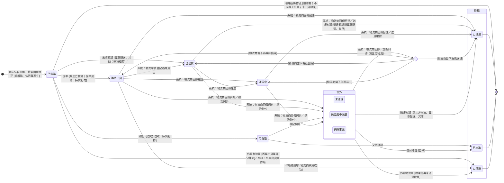

讀完這張卡，你會知道：

- 認識 [[物流單]] 的狀態機：從完成裝箱回報時產生，到這一筆托運送達、自取或作廢
- 看懂各出貨方式各經過哪些狀態，以及「例外」怎麼進、怎麼出
- 掌握每個轉換由哪個操作或物流商回傳觸發、要滿足什麼條件
- 說出物流商回傳與人工確認衝突時以誰為準，以及哪些狀態可以作廢
- 理解所屬出貨單為什麼取物流單的最落後狀態

## 狀態列舉（正本）

> 本段是物流單狀態的唯一正本。狀態的新增與修改是商業決策，直接在此卡維護。狀態名沿用 EC 物流狀態。

| 狀態 | 說明 | 對應營運需求 |
|------|------|------------|
| 已裝箱 | 初始；完成裝箱回報時系統產生本單即進入；拋單失敗時本單不推進、仍在這一格，不記失敗原因 | 物流單從裝箱那一刻就存在，出貨單已裝箱之後只有一套推進規則 |
| 等待出貨 | 只有第三方物流；拋單成功、物流商回傳物流單號後進入；這一筆的離廠時間在此寫入 | 已交到物流商系統、等收件；這一格物流商端還能取消 |
| 已出貨 | 第三方物流的物流單號登記到追蹤服務成功後進入；專車配送與其他經出貨確認進入，離廠時間在此寫入 | 貨已交出，開始可追蹤或已發車 |
| 可自取 | 只有自取；標記可自取後進入，離廠時間在此寫入 | 客戶可以到廠取貨；自取的離廠錨點 |
| 運送中 | 只有第三方物流；物流商回傳在途後進入 | 在途與到貨分開看，客戶問「到哪了」答得出來 |
| 未送達 | 「例外」之一；名稱沿用 EC 物流狀態 | 這一筆出了狀況，先停下確認貨況 |
| 無追蹤中包裹 | 「例外」之一；名稱沿用 EC 物流狀態 | 同上 |
| 例外事故 | 「例外」之一；名稱沿用 EC 物流狀態 | 同上 |
| 已送達 | 終態；第三方物流的配達回傳或送達確認，或專車配送與其他的送達確認 | 這一筆的交付事實；所屬出貨單收尾的依據 |
| 已自取 | 終態；只有自取；交付確認後進入 | 客戶到廠拿走的交付事實 |
| 已作廢 | 終態；這一筆托運撤銷，理由與未送達數量記在 [[物流單]] | 送不出或送不到的那一筆收掉，沒送到的量回到額度 |

### 各出貨方式經過的狀態

出貨方式看「有外部物流單號」屬性分流（屬性見 [[出貨單]] § 出貨方式（系統設定））。

| 出貨方式 | 經過的狀態 |
|---------|-----------|
| 第三方物流（順豐、新竹物流、7-11 交貨便、全家） | 已裝箱 → 等待出貨 → 已出貨 → 運送中 → 已送達 |
| 專車配送、其他 | 已裝箱 → 已出貨 → 已送達 |
| 自取 | 已裝箱 → 可自取 → 已自取 |

## 狀態機圖（UML）

- 記法：實心圓為初始點、雙圈為終止點、轉換標籤採「觸發操作名稱 [轉換條件]」格式，系統推進寫「系統：業務事件」；第三方物流由物流商回傳推進、人工確認為備援。
- 複合狀態為可被他卡引用的集合詞（成員以本圖為正本）：「例外」＝這一筆出了狀況、停下確認貨況的處境；「終態」＝這一筆托運已收束的處境。離開「例外」回到物流商當下狀態的弧畫成選擇節點，落入哪一格看同步結果。
- 銜接：所屬 [[出貨單狀態]] 在已裝箱之後依本卡計算；所屬出貨單作廢時，已裝箱的物流單一併作廢。

## 轉換條件與觸發事件

| 轉換 | 觸發操作 | 條件 |
|------|---------|------|
| （產生）→ 已裝箱 | [[出貨單]] OP-SHP-005 完成裝箱回報、[[出貨單]] OP-SHP-006 裝箱回報修正 | 系統依所屬出貨單出貨方式的「支援子母單」屬性產生（拆單表見 [[出貨單]] § 裝箱資料）；裝箱回報修正只在新增箱、且出貨方式不支援子母單時產生新的一筆；編號規則見 [[物流單]] |
| 已裝箱 → 刪除 | [[出貨單]] OP-SHP-006 裝箱回報修正 | 所屬出貨單屬「未出貨動作」（集合詞見 [[出貨單狀態]]）；出貨方式不支援子母單，刪除的是這一筆唯一的箱；這一筆從未送出，不走作廢、不填未送達數量 |
| 已裝箱 → 等待出貨 | [[物流單]] OP-SHP-007 拋單 | 出貨方式有外部物流單號；揀貨相符（判準見 [[出貨單狀態]] § 揀貨不符與裝箱回報修正）；所屬訂單不在「已取消」（見 [[訂單狀態]] 取消連鎖）；拋單成功時物流商回傳物流單號、物流單檔案與子單號，系統寫入離廠時間（欄位見 [[物流單]]）；拋單失敗時本單不推進、留在已裝箱，物流商回傳的錯誤訊息只在當下回給操作者，本單不存失敗原因；再執行一次拋單即重拋，不另設重試操作 |
| 已裝箱 → 已出貨 | [[物流單]] OP-SHP-008 出貨確認 | 出貨方式為專車配送或其他；揀貨相符；所屬訂單不在「已取消」；系統寫入離廠時間 |
| 已裝箱 → 可自取 | [[物流單]] OP-SHP-017 標記可自取 | 出貨方式為自取；揀貨相符；所屬訂單不在「已取消」；系統寫入離廠時間 |
| 等待出貨 → 已出貨 | 系統：物流單號登記到追蹤服務成功 | 第三方物流 |
| 等待出貨／已出貨 → 運送中 | 系統：物流商回傳在途 | 第三方物流；7-11 交貨便與全家的到店也落在運送中（見下方「與 EC 物流狀態的對映」） |
| 等待出貨／已出貨／運送中 → 已送達 | 系統：物流商回傳配達 | 第三方物流；配達只認簽收或取件完成，到店不算；回傳依下方推進規則只往前走，可越過中間狀態 |
| 運送中 → 已送達 | [[物流單]] OP-SHP-010 送達確認 | 第三方物流，配達回傳沒進來時補上；憑證要求見 [[物流單]] 送達憑證欄；可選填逐印件未送達數量（回補見 [[齊套邏輯]]）；與物流商回傳同時到時依下方先寫入者成立 |
| 已出貨 → 已送達 | [[物流單]] OP-SHP-010 送達確認 | 出貨方式為專車配送或其他；附司機交付照；可選填逐印件未送達數量 |
| 可自取 → 已自取 | [[物流單]] OP-SHP-009 交付確認 | 出貨方式為自取；附現場點交照；可選填逐印件未送達數量 |
| 等待出貨／已出貨／可自取／運送中 → 例外 | 系統：物流商回傳例外、[[物流單]] OP-SHP-020 標記例外 | 物流商回傳只發生在第三方物流的等待出貨之後；標記例外理由必填；例外來源記人工或物流商回傳（欄位見 [[物流單]]） |
| 例外 → 物流商當下狀態（等待出貨、已出貨、運送中或已送達） | 系統：物流商回傳、[[物流單]] OP-SHP-019 重新同步 | 第三方物流；物流商回傳的例外，自動同步與重新同步都能離開；標記例外進入的例外，只有重新同步能離開（見下方推進規則） |
| 例外 → 已送達 | [[物流單]] OP-SHP-010 送達確認 | 出貨方式為第三方物流、專車配送或其他；憑證與未送達數量同上 |
| 例外 → 已自取 | [[物流單]] OP-SHP-009 交付確認 | 出貨方式為自取；憑證與未送達數量同上 |
| 例外 → 已作廢 | [[物流單]] OP-SHP-021 作廢物流單 | 理由必填；逐印件填未送達數量（上限、系統預填與回補見 [[齊套邏輯]] § 出貨額度回補與退回實物）；物流商端不動，作廢前先在系統外確認貨況（過程見 [[出貨與送達]]） |
| 已裝箱 → 已作廢 | [[物流單]] OP-SHP-021 作廢物流單 | 所屬出貨單屬「部分離廠」（集合詞見 [[出貨單狀態]]）；物流商端無需處理；理由與未送達數量同上 |
| 已裝箱 → 已作廢（隨出貨單作廢） | [[出貨單]] OP-SHP-012 作廢出貨單、系統：所屬訂單轉「已取消」 | 所屬出貨單屬「未出貨動作」，整張作廢時底下物流單一併作廢；不要求理由、不填未送達數量（整張明細回補見 [[齊套邏輯]]） |
| 等待出貨 → 已作廢 | [[物流單]] OP-SHP-021 作廢物流單 | 系統同步向物流商取消；取消失敗則不作廢，畫面顯示物流商回傳的錯誤訊息（外部限制見 [[EC 物流串接約束]]）；理由與未送達數量同上。取消失敗又一直沒有回傳時，先轉例外再作廢 |

> 未送達數量的上限、最後一筆的系統預填與回補規則見 [[齊套邏輯]]；所屬出貨單依本卡計算的規則見 [[出貨單狀態]]。

### 推進規則

> 本段是物流單狀態推進順序與回傳處理的規則正本。

| 規則 | 內容 |
|------|------|
| 最落後順序 | 已裝箱 → 等待出貨 → 已出貨（可自取同一位置）→ 運送中 → 已送達（已自取同一位置）。所屬出貨單取未作廢物流單在此順序上最落後的狀態（見 [[出貨單狀態]]） |
| 只往前 | 物流商回傳只讓狀態往順序後方走；倒退的回傳不改狀態，只寫歷程。唯一例外：在「例外」時，同步結果可讓本單回到物流商當下的狀態 |
| 終態不動 | 已送達、已自取、已作廢收到任何回傳都不改狀態，只寫歷程 |
| 先寫入者成立 | 人工確認與物流商回傳同時到，以先寫入者為準；後到者只寫歷程 |
| 人工例外不被覆蓋 | 以標記例外進入的例外，自動同步不改狀態；重新同步才取物流商當下狀態 |
| 以同步結果為準 | 狀態以最近一次同步結果為準；同步延遲以重新同步處理，不另設延遲顯示 |

### 作廢的開放狀態

| 狀態 | 可否作廢 | 物流商端 |
|------|---------|---------|
| 已裝箱 | 所屬出貨單屬「部分離廠」時可；屬「未出貨動作」時不單筆作廢，改以刪箱或作廢出貨單處理 | 無需處理 |
| 等待出貨 | 可 | 系統向物流商取消；取消失敗則不作廢 |
| 「例外」的任一狀態 | 可 | 不動；作廢前先確認貨況 |
| 已出貨、可自取、運送中 | 不可，先轉例外 | — |
| 已送達、已自取 | 不可 | — |

### 與 EC 物流狀態的對映

- 第三方物流各家的原始代碼由 EC 收斂到本卡的狀態；系統接 EC 收斂後的值。
- 7-11 交貨便、全家：到店對映運送中，取貨對映已送達。
- 支援子母單的物流單只看主單狀態，子單不回傳狀態（外部限制見 [[EC 物流串接約束]]）。
- 自取、專車配送、其他沒有物流商回傳，只經上表的操作推進。

## 關鍵轉換的營運動機

- （產生）→ 已裝箱 → 動機：出貨單已裝箱之後的狀態全由物流單算；物流單若等到拋單才產生，已裝箱期間要另一套規則 → 例子：順豐 6 箱完成裝箱回報的當下，就有一筆已裝箱的物流單 SH-2026-0901-001。
- 進入「例外」不回補、作廢才回補 → 動機：例外常常只是物流商資料沒同步，貨不一定沒送到；先停下確認，確定送不到才作廢 → 例子：物流商回傳例外事故，隔天資料恢復為運送中，這一筆照常走到已送達。
- 已出貨、運送中不可直接作廢 → 動機：在途的貨物流商撤不回；直接作廢會讓系統顯示撤銷、貨卻還在路上；先轉例外停下確認，再決定作廢或送達確認 → 例子：順豐已收件後客戶要撤回，先標記例外停下，貨退回後才作廢。
- 第三方物流的送達以物流商回傳為主、人工為備援 → 動機：配達是物流商手上的事實，由它回傳比人工查詢再回填準確；備援讓回傳沒進來的物流單不會卡在運送中 → 例子：順豐回傳配達後，這一筆當天就收在已送達。
- 拋單失敗不推進、不另設重試 → 動機：拋單成功才算把這一筆交給物流商；失敗的那一次沒有交出任何東西，進度與離廠時間都不該動；再拋一次就是重送，不必多一個重試動作 → 例子：物流商回傳系統維護中，SH-2026-0901-001 拋單失敗、仍在已裝箱；隔天出貨人員再拋一次成功，離廠時間記隔天。
- 已送達不可作廢 → 動機：轉已送達時所屬出貨單的送達數量已寫入；作廢已送達的物流單會讓送達數量回頭改 → 例子：已送達後才發現少一箱，不作廢這一筆，處理路徑見 [[SHP-023-第三方物流部分送達與誤報配達的處理路徑]]。

## 與其他狀態機的關係

- 所屬出貨單：已裝箱之後 [[出貨單狀態]] 依本卡計算（最落後、例外、全部送達、全部作廢的計算規則正本在該卡）。
- 所屬出貨單作廢（含訂單取消連鎖）時，本卡已裝箱的物流單一併作廢；訂單取消時所屬出貨單屬部分離廠或全數離廠的處置見 [[訂單狀態]] 取消連鎖。
- 未送達數量回補可出貨額度，見 [[齊套邏輯]]；送達數量寫入所屬出貨明細，見 [[出貨單]]。

## 範圍外

- 誰在什麼範圍能做上表的各個操作 → [[出貨活動清單]]；下載物流單檔案 → [[輸出活動清單]]
- 物流單的欄位（離廠時間、送達憑證、例外理由、未送達數量）→ [[物流單]]（欄位正本）
- 物流商端的限制（作廢只限等待出貨、子單不回傳狀態、新竹物流子母單未串接）→ [[EC 物流串接約束]]
- **EC 原始物流代碼怎麼收斂到本卡狀態**：存在但屬 EC 物流串接的實作，不在本卡
- 第三方物流已送達後發現少送、物流商誤報配達、作廢後物流商又回傳已送達 → [[SHP-023-第三方物流部分送達與誤報配達的處理路徑]]
- 在途的貨要撤回時與物流商聯絡、確認貨況 → 系統外作業，過程見 [[出貨與送達]]
- 例外的原因分類與理賠 → 不設計，例外名稱沿用 EC 物流狀態

## 相關卡

- 規則：[[齊套邏輯]]（未送達數量的回補）、[[EC 物流串接約束]]（物流商端限制）
- 流程：[[出貨與交付流程群組]]（階段 1 出貨）、[[出貨與送達]]（物流單從裝箱到送達的過程）
- 活動清單：[[出貨活動清單]]（觸發各轉換的活動）
- 實體：[[物流單]]（本狀態機依附的主實體與操作登記處）、[[出貨單]]（產生物流單的完成裝箱回報與裝箱回報修正的登記處）
- 狀態機：[[出貨單狀態]]（依本卡計算）、[[訂單狀態]]（取消連鎖）
- OQ：[[SHP-023-第三方物流部分送達與誤報配達的處理路徑]]、[[SHP-020-ERP出貨單承接EC物流串接的狀態對映與拋單失敗處置]]
