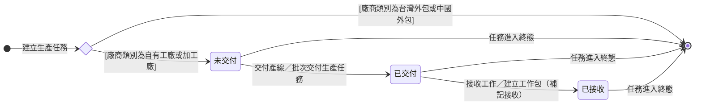

讀完這張卡，你會知道：

- 認識 [[生產任務]] 的「交付狀態」：系統依交付時間與接收工作推導的衍生狀態，回答這筆自有工廠或加工廠的活交給現場了沒、現場接手了沒
- 看懂各個交付狀態代表球在誰手上
- 掌握推導條件，以及外包任務與已收尾的任務為什麼不推導
- 理解任務層的交付怎麼決定工單何時轉「工單已交付」

## 狀態列舉（正本）

> 本段是生產任務交付狀態的唯一正本。狀態的新增與修改是商業決策，直接在此卡維護。

| 狀態 | 對應營運需求 |
|------|------------|
| [[ERP 詞彙表#生產任務交付狀態#未交付]] | 初始（自有工廠與加工廠任務）；現場知道這筆還沒交到產線 |
| [[ERP 詞彙表#生產任務交付狀態#已交付]] | 交了還沒人接，看得出卡在現場接收 |
| [[ERP 詞彙表#生產任務交付狀態#已接收]] | 現場已接手；沒人接的交付等於沒交付 |

本狀態不設終態：廠商類別為台灣外包或中國外包的任務，以及生產任務狀態屬「終態」（[[生產任務狀態]]）的任務不推導（推導條件順序 1 的「－」）。

### 推導條件

依序判定，第一個成立的就是結果。交付時間、接收工作、廠商類別的欄位見 [[生產任務]]。

| 順序 | 結果 | 條件 |
|------|------|------|
| 1 | 「－」 | 廠商類別為台灣外包或中國外包，或生產任務狀態屬「終態」 |
| 2 | 已接收 | 接收工作有值 |
| 3 | 已交付 | 交付時間有值 |
| 4 | 未交付 | 其餘 |

## 狀態機圖（UML）

- 記法：實心圓為初始點、菱形為選擇偽狀態（依廠商類別分流）、轉換標籤採「觸發事件 [轉換條件]」格式；本狀態沒有手動改狀態的動作，每條弧都是交付、接收等既有動作寫入欄位後的推導結果。
- 「－」不是狀態，是不推導的標示，圖上畫成直接結束；任務因報工修正自「已完成」退回時（[[生產任務狀態]]），本狀態依當下欄位重新推導。
- 銜接：旗下有效生產任務的交付時間到齊時，[[工單狀態]] 推進「工單已交付」。

## 轉換條件與觸發事件

| 轉換 | 觸發操作 | 條件 |
|------|---------|------|
| （建立）→ 未交付 | [[工單]] OP-WO-002 建立生產任務 | 廠商類別為自有工廠或加工廠 |
| （建立）→ 「－」 | [[工單]] OP-WO-002 建立生產任務 | 廠商類別為台灣外包或中國外包 |
| 未交付 → 已交付 | [[生產任務]] OP-TSK-003 交付產線、[[工單]] OP-WO-007 批次交付生產任務 | 系統寫入交付時間與操作人（欄位見 [[生產任務]]） |
| 已交付 → 已接收 | [[生產任務]] OP-TSK-004 接收工作 | 系統寫入接收工作；寫入後不清除 |
| 已交付 → 已接收 | [[工作包]] OP-WP-001 建立工作包 | 建立工作包時勾選的任務尚未接收時，系統補記接收工作：接收人為建立工作包的人、時間為建立工作包的時間；寫入後不清除 |
| 任一狀態 → 「－」 | 系統：任務進入「終態」（[[生產任務狀態]]） | 不再推導 |

## 關鍵轉換的營運動機

- 交付以生產任務為單位記錄 → 動機：工單「全部任務交付」要有逐筆依據，才看得出是哪一筆還沒交；多半在工單上一次交完，批次交付只是同一個動作一次做完 → 例子：一張工單三筆自有工廠任務，在工單一次交付，三筆同時轉「已交付」；接收印刷那筆後，只有印刷轉「已接收」，另兩筆仍是「已交付」。
- 加工廠任務與自有工廠同樣推導 → 動機：加工廠算場內，交了沒、現場接了沒同樣要看得出來，狀態變化不因場內或加工而不同；差別只在加工廠的活不建立工作包給師傅（報工方式見 [[報工規則]]） → 例子：同一張工單的上光加工廠任務，交付後為「已交付」，確認接收後轉「已接收」。
- 外包任務（台灣外包與中國外包）不推導 → 動機：外包的活一交付，派單即轉已發稿，沒有現場接收這一步，外部進度另有 [[派單狀態]] 追蹤，這裡再推導一套只會重複 → 例子：同一張工單的燙金外包任務交付後，本狀態不推導，進度看它的派單。

## 與其他狀態機的關係

- [[工單狀態]]：工單轉「工單已交付」的條件見該卡轉換表；交付時間各廠商類別都記，本狀態只對自有工廠與加工廠任務推導。
- [[工單狀態]] 的印件短出結案把旗下任務批次推「已完成」時，這些任務的本狀態不再推導。
- 工單異動加開的生產任務交付時間無值，為「未交付」；交付後工單依 [[工單狀態]] 既有轉換推進。
- [[生產任務狀態]]：任務屬「終態」時本狀態不推導；兩者互不推動。
- [[生產任務轉交狀態]]：同一筆任務的另一條衍生進度，兩者互不影響。
- [[派單狀態]]：外包任務交付後的外部進程在此追蹤，不映射到本狀態。

## 範圍外

- 交付時間、接收工作、廠商類別的欄位定義 → [[生產任務]]（正本）
- 派工怎麼分組、生管怎麼排程 → 工作包怎麼組見 [[工作包]]，派工排程規劃屬排程模組
- 外包任務交付後的外部進程 → [[派單狀態]]
- 手動轉換：不設；每一格都由欄位推導

## 相關卡

- 服務藍圖：[[生產流程群組]]（交付產線與接收在生產流程中的位置）
- 規則：[[交付看時間不看狀態]]（報工前提看交付時間、不看本狀態）
- 實體：[[生產任務]]（本狀態依附的主實體）、[[工單]]（批次交付的入口）
- 狀態機：[[工單狀態]]（交付到齊推進工單已交付）、[[生產任務狀態]]、[[生產任務轉交狀態]]、[[派單狀態]]
- 活動清單：[[製程規劃活動清單]]（交付）、[[派工活動清單]]（接收工作、建立工作包）
