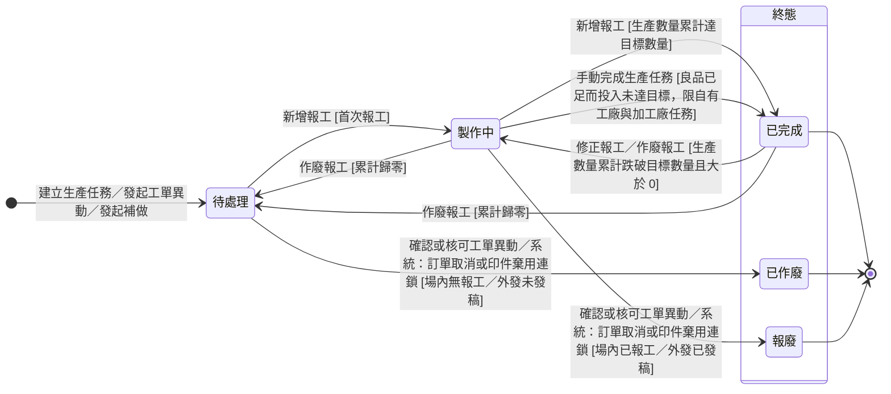

讀完這張卡，你會知道：

- 認識 [[生產任務]] 的「生產任務狀態」（ProductionTaskStatus）：生產流程裡真正動手做的最底層單位——一筆實際派給師傅或供應商的活，從派下去走到收尾
- 看懂為什麼它是整條向上反映鏈的源頭：一報工就往上帶動工單、印件與訂單
- 掌握每個轉換由哪個操作觸發、要滿足什麼條件才推得動，以及「做完了」看的是哪一個數
- 理解外發的活為什麼跟場內走同一條狀態路徑，外部進程又記在哪裡
- 知道品檢與「東西做壞」為什麼不落在本卡的終態上

## 狀態列舉（正本）

> 本段是生產任務狀態的唯一正本。狀態的新增與修改是商業決策，直接在此卡維護。

| 狀態  | 說明                                                                                                                | 對應營運需求                                       |
| --- | ----------------------------------------------------------------------------------------------------------------- | -------------------------------------------- |
| 待處理 | 初始；生產任務已建立，等待現場或供應商開始做。指派師傅只是欄位更新，不觸發狀態變更                                                                         | 排程定了不等於動工了，狀態忠於現場事實                          |
| 製作中 | 已開始做：收到第一筆報工即推進                                                                                                   | 一推進即往上帶動各層，現場不必另外更新上層狀態                      |
| 已完成 | 終態；這道工序該跑的量已經跑完，或良品已足時手動收尾。完成判定看生產數量累計達目標數量，逐條見 § 轉換條件與觸發事件。進入本態後的報工限制見 [[報工規則]]；報工修正或作廢使生產數量累計跌破目標數量時退回，見同段 | 完成事實往上彙整進齊套統計                                |
| 已作廢 | 終態；因上游決策收掉（異動、訂單取消、印件棄用連鎖）且**尚無實際投入事實**——場內任務無任何報工、外發任務其 [[派單]] 尚未發稿（無成本）                                         | 派錯或需求變更時乾淨收掉，不留無效任務污染進度                      |
| 報廢  | 終態；因上游決策中止（異動、訂單取消、印件棄用連鎖）且**已有實際投入事實**——場內任務已有報工、外發任務其 [[派單]] 已發稿（已有成本）。品質缺口不走此終態（見 § 與其他狀態機的關係）                 | 與已作廢區分有無投入成本，損耗看得見；委外已發稿即算投入，才不會把廠商已做的活記成零損耗 |

### 路徑

四種廠商類別走同一條路徑：待處理 → 製作中 → 已完成，一律由報工推進（誰在什麼範圍報工見 [[製作與報工活動清單]]，欄位正本見 [[報工紀錄]]）。外發的外部進程（發稿、打樣、大貨、集運、回台）由 [[派單]] 的 [[派單狀態]] 另行追蹤，不映射到本卡。

## 狀態機圖（UML）

- 記法：實心圓為初始點、雙圈為終止點、轉換標籤採「觸發操作名稱 [轉換條件]」格式（系統推進寫「系統：業務事件」）。
- 複合狀態＝可被引用的集合詞（成員以本圖為正本，不另立成員表）：「終態」＝這筆活已收尾、不再推進的處境。
- 圖上另有下列幾類弧：不經報工的手動完成弧（良品已足而投入未達目標時收尾）；上游決策把這條活收掉的弧，落「已作廢」還是「報廢」看有無實際投入事實；「已完成」因報工修正或作廢跌破目標數量而退回的弧。

## 轉換條件與觸發事件

| 轉換 | 觸發操作 | 條件 |
|------|---------|------|
| （建立）→ 待處理 | [[工單]] OP-WO-002 建立生產任務、[[工單]] OP-WO-009 發起工單異動、[[印件]] OP-PI-020 發起補做、系統：線上單印件審稿通過 | 異動加開與補做在原工單下新增生產任務（建立來源見 [[工單]] § 建立來源）；指派師傅為欄位更新，不觸發狀態變更 |
| 待處理 → 製作中 | [[生產任務]] OP-TSK-010 新增報工 | 本任務的第一筆報工；向上反映鏈的起點，往上帶動工單、印件與訂單各層（各層只在自己還處於可推進前態時被推動，見 § 與其他狀態機的關係）|
| 製作中 → 已完成 | [[生產任務]] OP-TSK-010 新增報工 | 報工的**生產數量累計達目標數量**時系統自動判定完成；作廢的報工不計入累計。目標數量本身就是含放損緩衝的投入計畫（欄位見 [[生產任務]]），該跑的量跑完即算這道工序做完；進入本態時系統寫入任務實際完成日（欄位見 [[生產任務]]）|
| 製作中 → 已完成 | [[生產任務]] OP-TSK-005 手動完成生產任務 | 放損低於預期（良品已足下游所需、投入未達目標數量）時的收尾路徑，適用自有工廠與加工廠任務；不改任務內容，操作人與時間留在 [[生產任務]] 歷程紀錄；進入本態時系統寫入任務實際完成日（欄位見 [[生產任務]]）|
| 製作中 → 待處理 | [[報工紀錄]] OP-RPT-003 作廢報工 | 本任務的報工全數被作廢（每筆生產數量大於 0，修正不會讓累計歸零；擋下條件見 [[報工規則]] § 報工修正與作廢的擋下條件）。累計歸零後這筆任務事實上沒有開工過——留在製作中會讓待派清單漏掉它，也會讓工單層「首個任務開始製作」的判定失真 |
| 已完成 → 製作中 | [[報工紀錄]] OP-RPT-002 修正報工、[[報工紀錄]] OP-RPT-003 作廢報工 | 修正或作廢使生產數量累計由達到目標數量變為低於目標數量，且仍大於 0（擋下條件見 [[報工規則]] § 報工修正與作廢的擋下條件） |
| 已完成 → 待處理 | [[報工紀錄]] OP-RPT-003 作廢報工 | 本任務的報工全數被作廢，累計歸零 |
| 待處理 → 已作廢 | [[工單]] OP-WO-010 確認工單異動、[[工單]] OP-WO-011 核可工單異動、系統：訂單取消由上而下連鎖、系統：印件棄用連鎖 | 異動取消的任務在異動把關通過時生效（把關分流見 [[工單狀態]]）。尚無實際投入事實：場內任務無任何報工、外發任務其 [[派單]] 尚未發稿（無成本）|
| 製作中 → 報廢 | [[工單]] OP-WO-010 確認工單異動、[[工單]] OP-WO-011 核可工單異動、系統：訂單取消由上而下連鎖、系統：印件棄用連鎖 | 純上游決策。已有實際投入事實：場內任務已有報工，或外發任務其 [[派單]] 已發稿；報廢讓已投入成本可結算（外發的實付額結清路徑見 [[派單狀態]]）；品質缺口不走此轉換（東西做壞的處置見 § 與其他狀態機的關係） |

**回廠收斂**（外發任務走到已完成這一段的逐項規則）

| 面向 | 規則 |
|------|------|
| 點收載體 | 回廠點收（清點＋秤重）：中國線登記在 [[貨運單]] 明細（[[貨運單]] OP-WB-004 回廠點收登記）、台灣外包直接登記在生產任務（[[生產任務]] OP-TSK-009 回廠點收確認） |
| 報工收斂 | 對本任務報工，生產數量累計達目標數量即完成（欄位正本見 [[報工紀錄]]）|
| 下游放行 | 點收確認只將貨登記暫存區；下游到料放行不因點收啟動，另依 [[工序相依性規則]] |
| 點收短少或損壞－補件 | 等補件的貨到、點收後再報工收斂（正本見 [[外發委外與回廠點收]]）|
| 點收短少或損壞－折價 | 供應商報價依實收調整後報工收斂（正本見 [[外發委外與回廠點收]]）|

## 關鍵轉換的營運動機

- 待處理 → 製作中 → 動機：以開始動工為觸發點，現場一開始做、系統各層自動跟上 → 例子：ORD-2026-0512 的印刷任務報進第一筆工，生產任務轉「製作中」，所屬工單同步反映。
- 製作中 → 已完成（手動完成）→ 動機：目標數量是含放損緩衝的投入計畫，實際放損比預估低時投入跑不到目標、但良品已經夠下游用，逼現場把剩下的量跑完等於為了系統數字多做廢工；收尾判斷交給現場執行面，比回頭改目標數量乾淨——目標是規劃當時的決定，不因現場好運被改寫，放損估得準不準才看得出來 → 例子：名片 1,000 份的印刷任務目標 1,051 份，實際只損 10 份，投入 1,030 份時良品已達下游裁切要的 1,020 份，直接把任務標完成，剩下 21 份不再上機。
- 四種廠商類別走同一條路徑 → 動機：任務層要回答的只有「這道活做完了沒」，這件事場內場外一樣由報工說了算；外發委外單的詳細外部進程（打樣多階、大貨整批分批、補做、海外直發）放在獨立的 [[派單]]（[[派單狀態]]）追蹤，兩實體各記各的、不重疊，避免外部細節撐胖內部狀態 → 例子：某中國廠商盒型派單推進到回台，貨回場後做貨運單點收（清點＋秤重）確認，再對該任務報工、達標轉「已完成」；派單自己的進程不改任務狀態。
- 已完成 → 製作中（報工修正或作廢跌破目標）→ 動機：報工修正與報工作廢都在訂正同一筆現場事實的錯誤，兩者對任務狀態的連動一致，完成判定才不會因為修正方式不同而有兩種結果 → 例子：裁切任務目標 1,020、報工累計 1,020 已完成；查出其中一筆報工的生產數量誤報為 300、實際是 280，修正後累計變 1,000，任務退回「製作中」；再跑 20 報工後累計回到 1,020，再轉「已完成」。
- 已作廢與報廢分兩個終態、且落點以「有無實際投入事實」為統一判準 → 動機：還沒投入就取消（無成本）與投入後中止（已有成本）對成本與損耗統計意義不同，分開才看得見損耗；判準對場內與外發各有對應事實——場內的投入起點是第一筆報工，外發的投入起點是發稿（球交到廠商手上、對方可能已裁料開工），若外發也拿報工當判準，會因為外發整段沒有場內報工而一律判成無成本，委外損耗就整批消失在帳上 → 例子：異動把 500 份改 300 份，未開工的加工任務作廢、已印一半的印刷任務報廢重開；同一張訂單取消時，一筆已發稿的中國廠盒型任務即使貨還在集運站，仍轉報廢並留下與廠商談定的實付額。

## 與其他狀態機的關係

- 生產任務是向上反映鏈的起點：首次報工依序往上帶動工單、印件、訂單，完整多層鏈路見 [[印件印製狀態]]。**每一層都帶轉換條件：上層必須還停在可推進的前態才會被推動**，已經越過的層維持原狀不動。

| 層級 | 被推動的轉換 | 前態限制的正本卡 |
|------|-------------|----------------|
| 工單 | 工單已交付 → 製作中 | [[工單狀態]] |
| 印件（印製維度）| 工單已交付 → 部分工單製作中 → 製作中 | [[印件印製狀態]] |
| 訂單 | 工單已交付 → 製作中 | [[訂單狀態]] |

- 沒有這道前態限制，補做與加量的重新投入會把已經走到後面的上層拉回頭——品檢缺口補做加開的任務首次報工時，該工單可能已經「已完成」、訂單可能已經走到出貨段，照鏈推進等於讓訂單回退（訂單不可回退見 [[訂單狀態]]；補做期間的工單由「異動」態承載，見 [[工單狀態]]）。
- 本任務因報工修正或作廢自「已完成」退回「製作中」時，所屬工單、印件、訂單的狀態不跟著回退。這與上方前態限制同一原則：向上反映只往前推，已經推進的上層不回頭，終態也不回退。
- 做齊的數量往上彙整到工單，齊套統計見 [[齊套邏輯]]。
- 異動流程中的取消與中止直接落在本層（作廢／報廢）——以 [[工單]] OP-WO-009 發起工單異動發起、異動把關通過後生效，工單往上鏡像（見 [[工單狀態]]）。本任務轉報廢或已作廢時，旗下**在途的 [[轉交單]]**（[[轉交單狀態]]） 會被自動標示警示且點收被擋下，處置見 [[場內轉交與修正]]（貨已到目的地就作廢原單依實況重建、貨還沒動就直接作廢）——不自動作廢是因為任務報廢是上游的帳務決策，貨在物理上可能已經在路上，系統替人決定「這批貨作廢」會讓現場那落實體貨變成沒有單據對應的孤兒。
- [[印件印製狀態]] 轉「已棄用」時連鎖到本層：有實際投入事實的轉報廢、沒有的轉已作廢（判準同上，場內看報工、外發看發稿）；旗下工單一律轉「已取消」、成本依當時已投入內容結算（[[PI-003-印件棄用時工單與任務連動行為]] 決議，2026-07-30 拍板已封存）。
- 本任務另有兩條由系統推導的衍生進度：[[生產任務轉交狀態]] 以本卡「已完成」為待點收與已轉交的前提，本卡為「已作廢」「報廢」時顯示「－」；[[生產任務交付狀態]] 在本卡屬「終態」時顯示「－」。兩條衍生進度只讀取本卡，不反過來推動本卡；本卡因報工修正或作廢退回時，兩條都依當下數字重新推導。
- 外發委外的詳細外部進程（大陸處理狀態 13 值）正本在 [[派單狀態]]，不映射到本卡；回台跨境物流與運費關稅見 [[貨運單]]。兩實體不重疊。
- 品檢（[[品檢紀錄]]）與本卡的分工：品檢不是生產任務（決策脈絡見 [[QC-002-QC兩張wiki卡退役或保留]]），以印件層 [[品檢紀錄]] 承載——品檢人員分次驗、一次驗收一筆，累計通過即入庫（可出貨）；本卡的生產任務只涵蓋**製作工序**，印件工序依賴圖終點（無下游的生產任務）的產出送品檢站，待驗量的正本見 [[印件]]，品檢規則見 [[印件生產流程]] 與 [[齊套邏輯]]。
	- **「工作中止」與「東西做壞」分兩軸**：任務終態「報廢／已作廢」只留給整份工作中止（異動、訂單取消、印件棄用連鎖等上游決策）；東西做壞的處置不動任務狀態——工序中途做壞屬過程損耗，報工照常填不良品數（欄位與填報規則見 [[報工紀錄]]）、任務以重做湊齊目標數。
	- 成品缺口由 [[品檢紀錄]] 的不通過數字承載，對累計缺口的處置是兩個獨立決策的組合（缺口是否補做 × 瑕疵品去向），處置紀錄掛印件層、不另開單據（欄位見 [[印件]] § 品檢缺口處置），補做接力見 [[QC不通過補生產]]。

## 範圍外

- **多筆生產任務怎麼彙整成工單與印件完成度**：系統會自動彙整——本卡只承諾此行為，公式屬 [[齊套邏輯]]（規則正本；齊套取最慢的單位是生產任務），實作時勿自行發明
- 外發回場的銜接已定（中國線與台灣外包流程一致）：回廠點收（清點＋秤重）確認、貨登記暫存區（下游到料放行不因點收啟動，依 [[工序相依性規則]]），再對該任務報工、達標推進本卡「製作中 → 已完成」（B1 定案 2026-08-05）；中國線的點收載體為 [[貨運單]] 明細、台灣外包直接對生產任務做點收確認（外包派單模組成形後再評估掛單），決策脈絡見 [[PT-008-外發回廠流轉的系統設計範圍]]
- 數量在不同計量單位間的換算：不做；任務數量由填寫者自行計算，系統一律當數值比（見 [[數量換算規則]]）
- 外包廠與中國廠商任務的手動完成：隨外發流程一併延後規劃，目前不開放
- 派工怎麼分組、怎麼指派 → 場內合批見 [[工作包]]、外包分組見 [[派單]]，派工排程規劃屬排程模組
- 品檢的判定標準與不良品處置細節 → 屬品檢規則（[[品檢紀錄]]），不在本卡
- 重做湊齊目標數時的加生產與扣庫存系統機制 → 留待 MES 設計階段定，現況為現場口頭協調＋紙本改工單或重打新單（見 [[PT-014-加生產系統機制]]）

## 相關卡

- 規則：[[齊套邏輯]]（向上彙整與做齊判定正本）、[[數量換算規則]]、[[印件生產流程]]
- 實體：[[生產任務]]（本狀態機依附的主實體）、[[報工紀錄]]（報工欄位與填報規則正本）、[[派單]]（外發委外的詳細外部進程，與本卡不重疊）、[[貨運單]]（中國回台跨境物流與運費關稅）
- 狀態機：[[工單狀態]]／[[印件印製狀態]]／[[訂單狀態]]（由下往上的反映鏈）、[[生產任務轉交狀態]]／[[生產任務交付狀態]]（由本卡與任務欄位推導的衍生進度）、[[派單狀態]]（外發外部進程，與本卡各記各的）
- 活動清單：[[製程規劃活動清單]]（建立生產任務、工單異動）、[[製作與報工活動清單]]（報工、修正與作廢報工、手動完成）、[[品檢活動清單]]（發起補做）
- 情境：[[生產數量錯誤的逐層修正]]（報工修正被擋下後由下往上逐層修正）、[[場內轉交與修正]]（來源任務報廢或作廢時在途轉交單的處置）、[[報工與修正]]（報工與修正的完成過程）
