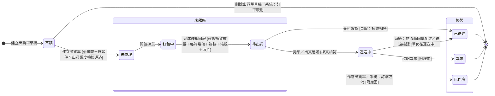

# 範例 - 狀態機

> [!info] 本卡為撰寫示範，不與來源卡保持同步，不是出貨單狀態正本
> 本卡示範此卡型的合規寫法，內容取材自 [[出貨單狀態]]，不與其保持同步、不揹商業正確性。用途：撰寫狀態機卡時對照合規樣貌、稽核時當通過樣本。出貨單狀態的現行內容一律以 [[出貨單狀態]] 為準。本卡的操作編號是示範編號，與 [[範例 - 實體]]、[[範例 - 活動清單]]、[[範例 - 業務情境]] 共用同一組。本卡只在撰寫方式變化時更新，與 [[規範 - 狀態機]]（規範）、[[範本 - 狀態機]]（骨架）同一次 commit。維護規則見 [[卡片撰寫共用規範]] § 一。

## frontmatter（快照）

```yaml
type: state-machine
tags:
  - 領域/履約與售後
source:
  - "[[齊套邏輯]]"
  - "[[2026-06-10-miles-upload-出貨部門實際職能與流程整合]]"
  - "Miles 2026-10-12 拍板（生產與出貨修正機制統一 grill，Sens memory/erp/plans/production-ui-correction-20261012/grill.md）：揀貨不符擋下拋單、出貨確認、交付確認；待出貨期間可裝箱回報修正"
  - "Miles 2026-10-13 拍板（wiki 權責結構重構 grill，Sens memory/erp/plans/document-access-scope-20261013/grill.md G13）：轉換表改記觸發操作"
status: active
last-reviewed: 2026-10-13
```

## 正文（快照）

讀完這張卡，你會知道：

- 認識 [[出貨單]] 狀態機涵蓋的生命週期：從在訂單上建草稿排這一批的出貨計畫，到揀貨裝箱、離廠在途，最後收在送達、異常或作廢
- 看懂出貨單有哪幾種處境、每一格代表這批貨走到哪
- 掌握每個轉換由哪些操作觸發、要滿足什麼條件才推得動
- 理解為什麼揀貨段與物流段一起切進這條鏈：出貨單本身就是揀貨指令
- 知道出貨失敗為什麼做成不回流的終態

## 狀態列舉（正本）

> 本段是出貨單狀態的唯一正本。狀態的新增與修改是商業決策，直接在此卡維護。
> 「已出貨狀態群」指運送中與已送達；出貨單首次進入這一群的日期即本單的實際出貨日（欄位見 [[出貨單]]）。

| 狀態 | 說明 | 對應營運需求 |
|------|------|------------|
| 草稿 | 初始；出貨計畫，只有單頭與預計出貨印件，不佔可出貨額度、不推進印件與訂單 | 出貨計畫與出貨指令分開，客戶談定的日期與收件資訊當下就記得下來，不必等品檢結果 |
| 未處理 | 出貨明細通過可出貨額度檢核後進入；還沒有人開始揀貨 | 出貨指令與處理進度分開，「還沒人動」看得出來 |
| 打包中 | 清點、打包、裝箱進行中 | 隨時看得到倉庫已經在處理這張單 |
| 待出貨 | 裝箱回報完成；貨已裝箱等交寄；本狀態期間可做裝箱回報修正，不改狀態 | 揀貨與出貨的交棒點明確，裝箱證據留在單上 |
| 運送中 | 貨已離廠在途 | 在途與到貨分開看，客戶問「到哪了」答得出來 |
| 已送達 | 終態；貨到客戶手上，留有時間、操作人與送達憑證 | 印件與訂單完成判定的依據 |
| 異常 | 終態；拒收、退件、超商未取等統一視為異常，理由必填；轉入即逐印件自動回補可出貨額度 | 出貨失敗明確收掉，要再出就建新出貨單 |
| 已作廢 | 終態；貨未離廠前撤銷，理由必填；作廢明細數量逐印件回補可出貨額度 | 建錯或客戶取消不留無效單據，額度回算 |

## 狀態機圖（UML）

- 記法：實心圓為初始點、雙圈為終止點、轉換標籤採「觸發操作名稱 [轉換條件]」格式，系統推進寫「系統：業務事件」。
- 分組語意：複合狀態「未離廠」＝貨還在廠內、可撤銷的處境；「終態」＝出貨單已收束的處境（兩者皆為可被他卡引用的集合詞，成員以本圖為正本）。作廢弧自「未離廠」邊界出發，適用其內全部狀態；草稿不屬「未離廠」，草稿的出口是刪除。
- 銜接：所屬訂單轉「已取消」時連鎖刪除草稿、作廢未離廠的單（見 [[訂單狀態]]）。



## 轉換條件與觸發事件

| 轉換 | 觸發操作 | 條件 |
|------|---------|------|
| （建立）→ 草稿 | [[訂單]] OP-ORD-001 建立出貨單草稿 | 不可跨訂單；訂單處於任何狀態都建得出來；出貨單預計出貨日必填；本步不檢核可出貨額度 |
| 草稿 → 未處理 | [[出貨單]] OP-SHP-003 建立出貨單 | 必填齊備（出貨單預計出貨日、出貨方式、收件人、收件地址，且至少一條預計出貨印件數量大於 0）；每條明細數量不得超過該印件可出貨額度（算式見 [[印件]] 可出貨額度欄，回補規則見 [[齊套邏輯]]），以執行操作那一刻的額度計；額度不足時整張不成立、不做部分成立；印製維度已棄用的印件由系統自動移除 |
| 草稿 → 刪除 | [[出貨單]] OP-SHP-002 刪除出貨單草稿 | 不要求理由；紀錄留存供追溯 |
| 草稿 → 刪除（訂單取消連鎖） | 系統：所屬訂單轉「已取消」 | 不要求理由 |
| 未處理 → 打包中 | [[出貨單]] OP-SHP-004 開始揀貨 | — |
| 打包中 → 待出貨 | [[出貨單]] OP-SHP-005 完成裝箱回報 | 每條明細都填了揀貨數量與每箱幾個，並填了箱數、箱規、照片 |
| 待出貨 → 運送中 | [[出貨單]] OP-SHP-007 拋單、[[出貨單]] OP-SHP-008 出貨確認 | 揀貨相符（判準見下方「揀貨不符與裝箱回報修正」）；第三方物流用拋單、專車配送用出貨確認；本單的實際出貨日取此時間 |
| 待出貨 → 已送達 | [[出貨單]] OP-SHP-009 交付確認 | 出貨方式為自取；揀貨相符；附現場點交照；本單的實際出貨日取此時間 |
| 運送中 → 已送達 | 系統：物流商回傳配達、[[出貨單]] OP-SHP-010 送達確認 | 單仍在運送中；物流商回傳只對出貨方式為第三方且物流單號相符的單生效；配達只認簽收或取件完成事件；兩者同時到時先寫入者成立 |
| 運送中 → 異常 | [[出貨單]] OP-SHP-011 標記異常 | 理由必填；轉入即逐印件自動回補可出貨額度 |
| 「未離廠」的任何狀態 → 已作廢 | [[出貨單]] OP-SHP-012 作廢出貨單 | 原因必填；已裝箱者現場拆箱歸位；作廢明細數量逐印件回補可出貨額度 |
| 「未離廠」的任何狀態 → 已作廢（訂單取消連鎖） | 系統：所屬訂單轉「已取消」 | 原因自動記「訂單取消」；運送中與已送達的單不動 |

### 揀貨不符與裝箱回報修正

> 本段是揀貨不符的判準與放行規則的正本，也是待出貨期間裝箱回報修正的規則正本。兩者都不是狀態轉換，不改出貨單狀態。

- **揀貨不符的判準**：任一條出貨明細的揀貨數量不等於數量，即為揀貨不符。
- **放行規則**：不符未解除前，系統擋下 OP-SHP-007 拋單、OP-SHP-008 出貨確認與 OP-SHP-009 交付確認。兩數相符即放行，不另設確認關卡。
- **解除方式**：以 OP-SHP-001 編輯出貨單改明細數量，或以 OP-SHP-006 裝箱回報修正改揀貨數量，使兩數相符。
- **裝箱回報修正**：只在待出貨期間可執行，不改狀態；運送中以後不能修正。可修正揀貨數量、每箱幾個、箱數、箱規與裝箱照片；修正原因必填；修正前的值留在裝箱回報修正紀錄（欄位見 [[出貨單]]）。

## 關鍵轉換的營運動機

- 先草稿再出貨單 → 動機：與客戶談定這一批大概哪天出、送到哪的當下要記下來，能不能真的出貨要等品檢結果；兩件事之間的時間差就是草稿存在的理由 → 例子：客戶講定 9 月 10 日要到貨，日期與收件資訊先記在草稿上；品檢過了 495 本之後，同一張草稿直接建立成出貨單。
- 異常為終態、不回流 → 動機：「這次出貨有問題」要當一個明確結果收掉，後續對帳與責任都對著這張單；重出是新的決定、開新單 → 例子：超商件七天未取退回，原單標異常，改宅配時建新出貨單。
- 第三方物流的送達以物流商回傳為主、人工為備援 → 動機：配達是物流商手上的事實，由它回傳比人工查詢再回填準確；備援讓回傳沒進來的單不會卡在運送中 → 例子：順豐回傳配達時間後，這張單當天就收在已送達。

## 與其他狀態機的關係

- 出貨額度的上游：[[品檢紀錄]] 通過數量 → 印件的完工良品數 → 可出貨額度（見 [[齊套邏輯]]）。
- 印件與訂單轉「出貨中」：含該印件出貨明細的首張出貨單由「草稿」轉「未處理」時推進（轉換正本見 [[印件印製狀態]]、[[訂單狀態]]）。
- 印件層收尾：排除草稿、異常與已作廢的出貨單之後，其餘出貨單全部已送達且累計送達數達購買數量 → [[印件印製狀態]] 轉「已送達」。
- 訂單取消時本層被連鎖收掉：草稿刪除、未離廠的單作廢並回補額度，運送中與已送達的不動（連鎖全貌見 [[訂單狀態]]）。

## 範圍外

- **可出貨額度的計算**：系統會自動計算，本卡只承諾此行為；算式正本在 [[印件]] 可出貨額度欄、回補規則見 [[齊套邏輯]]，實作時勿自行發明
- 誰在什麼範圍能做上表的各個操作 → [[出貨活動清單]]
- 揀貨回報的欄位定義 → [[出貨單]]（欄位正本）
- 異常的原因分類與理賠 → 刻意先不設計，統一當異常看

## 相關卡

- 規則：[[齊套邏輯]]（齊套判定與回補規則）
- 流程：[[出貨與交付流程群組]]（階段 1 出貨）
- 活動清單：[[出貨活動清單]]（觸發各轉換的活動）
- 實體：[[出貨單]]（本狀態機依附的主實體與操作登記處）、[[訂單]]（建立出貨單草稿的登記處）
- 狀態機：[[印件印製狀態]]（送達的彙整層）、[[訂單狀態]]（完成的觸發與取消連鎖）
