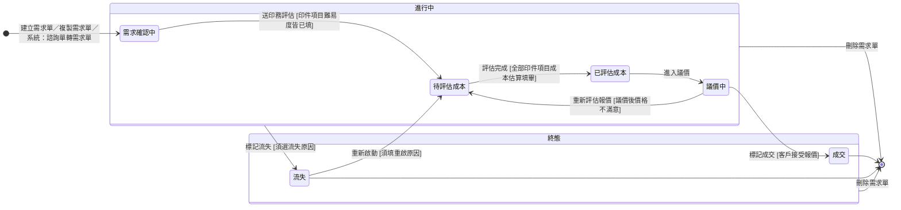

讀完這張卡，你會知道：

- 認識 [[需求單]]（QuoteStatus）狀態機涵蓋的生命週期：從蒐集客戶需求、取得製程成本、報價議價，到成交或流失
- 看懂需求單有哪幾種處境、每一格代表成本到齊了沒、能不能報價
- 掌握每個轉換由哪些操作觸發、要滿足什麼條件才推得動
- 理解為什麼切成這幾格：要先取得製程成本，才報得出價
- 知道流失後客戶回頭怎麼重新啟動、誤建的需求單怎麼刪除，以及這段刻意不設審核關卡的營運理由

## 狀態列舉（正本）

> 本段是需求單狀態的唯一正本。狀態的新增與修改是商業決策，直接在此卡維護。

| 狀態 | 說明 | 對應營運需求 |
|------|------|------------|
| 需求確認中 | 初始；蒐集客戶需求、填印件項目的規格與難易度 | 給與客戶來回確認需求的編輯空間 |
| 待評估成本 | 送出評估後，等評估印務主管提供製程成本 | 標示成本還沒到齊、還不能報價；評估印務主管從 Slack 討論串或需求單列表找到這張單 |
| 已評估成本 | 成本到齊、已執行評估完成，可報價 | 標示成本已到齊，可向客戶報價 |
| 議價中 | 對客戶報價、來回議價 | 記錄議價歷程，管理層看得到在途的議價單 |
| 成交 | 終態；客戶接受報價，可一鍵轉建訂單 | 把承諾落定的時點標出來，後續訂單審核與生產才有起點 |
| 流失 | 終態；客戶不成交，任一階段皆可標記；客戶回頭時可重新啟動回「待評估成本」（見轉換表）| 沒談成的需求有歸屬與原因紀錄，供管理層分析流失趨勢；客戶回頭不必重建單，歷程保留 |

## 狀態機圖（UML）

- 記法：實心圓為初始點、雙圈為終止點、轉換標籤採「觸發操作名稱 [轉換條件]」格式，系統推進寫「系統：業務事件」。
- 複合狀態＝可被引用的集合詞（成員以本圖為正本，不另立成員表）：「進行中」＝需求還在評估與議價之間來回、結局尚未定的處境；「終態」＝結局已定、需求單鎖定的處境；流失是唯一可再離開的終態成員。
- 流失與刪除為群組型轉換：自複合狀態邊界出發，依 UML 語意適用框內全部子狀態；流失表達「任一非終態皆可標記流失」，刪除表達「任一狀態皆可刪除」。刪除為軟刪除，資料保留、單據離開生命週期。

## 轉換條件與觸發事件

| 轉換 | 觸發操作 | 條件 |
|------|---------|------|
| （建立）→ 需求確認中 | [[需求單]] OP-QR-001 建立需求單、[[需求單]] OP-QR-002 複製需求單、系統：諮詢單轉需求單 | 諮詢單轉入時系統自動建立，接單業務記為該諮詢單的諮詢人員；複製時帶入範圍見 [[報價邏輯#複製需求單帶入範圍]] |
| 需求確認中 → 待評估成本 | [[需求單]] OP-QR-006 送印務評估 | 已指定評估印務主管；每筆印件項目的難易度必填，未填不可送出；系統以 Slack 通知評估印務主管（見 [[需求單評估Slack通知串接約束]]）；送出後評估印務主管的人選仍可改（見 [[需求單]]）|
| 待評估成本 → 已評估成本 | [[需求單]] OP-QR-007 評估完成 | 所有印件項目的成本估算填寫完畢才允許 |
| 已評估成本 → 議價中 | [[需求單]] OP-QR-008 進入議價 | 不另設審核關卡 |
| 議價中 → 成交 | [[需求單]] OP-QR-010 標記成交 | 依議價結果標記 |
| 議價中 → 待評估成本 | [[需求單]] OP-QR-009 重新評估報價 | 議價後價格不滿意才退回重評；系統在原 Slack 討論串通知評估印務主管（見 [[需求單評估Slack通知串接約束]]）；歷史報價保留，重評後系統建新報價紀錄。已評估成本階段要修成本直接改欄位、不退回（可改時機見 [[需求單]] 成本估算欄）|
| 任一非終態 → 流失 | [[需求單]] OP-QR-012 標記流失 | 須選流失原因；流失後需求單鎖定，唯一出口是重新啟動 |
| 流失 → 待評估成本 | [[需求單]] OP-QR-013 重新啟動 | 重啟原因必填；系統在原 Slack 討論串通知評估印務主管（見 [[需求單評估Slack通知串接約束]]）；系統清空流失原因與流失補充說明，回到成本評估；印件項目的成本估算與單價、報價紀錄、活動紀錄全部保留 |
| 任一非終態 → （刪除） | [[需求單]] OP-QR-004 刪除需求單 | 軟刪除，資料保留、不再出現在清單 |
| 任一終態 → （刪除） | [[需求單]] OP-QR-004 刪除需求單 | 同上；成交且已轉訂單者刪除後，訂單保留、失去需求單來源連結 |

## 關鍵轉換的營運動機

- 待評估成本 → 已評估成本（交接切兩格）→ 動機：報價的一方算不出製程成本，要先把需求送評估、拿到成本才報得出價；切成「等評估／評估完」兩格，雙方看得出評估卡在哪一邊、避免空等或漏接 → 例子：1,000 本 A4 型錄的需求送評估後，討論串回覆成本 35,000，填入後按評估完成，單轉「已評估成本」，據此報價 50,000。
- 議價中 → 待評估成本（重新評估）→ 動機：議價後客戶對價格不滿意（嫌貴、要改規格壓成本）才退回重抓成本；還沒進議價、只是成本數字要修，在「已評估成本」直接改，不必退回 → 例子：客戶嫌 50,000 太貴想換磅數較低的紙張，執行重新評估報價退回重估，原報價紀錄保留可追溯。
- 議價中 → 成交 → 動機：客戶接受報價即標成交，把承諾落定的時點明確標出來；之後一鍵轉建訂單，系統自動帶入需求單資料建立訂單（從草稿開始），後續訂單審核與生產才有起點 → 例子：45,000 成交後執行轉訂單，系統把需求單各印件項目的印件內部完成日帶入印件層的「未扣急件內部完成日」（項目為空時印件的兩個推得日期同為空）建立草稿訂單。
- 任一非終態 → 流失 → 動機：客戶在任何階段都可能取消或消失，每一格都要有收尾出口，否則沒談成的單會永遠掛在在途清單、污染統計 → 例子：客戶在成本評估期間說不做了，直接在「待評估成本」標流失（原因選「其他」），單子不會懸在評估清單裡。
- 流失 → 待評估成本（重新啟動）→ 動機：客戶流失後回頭是常態，重建一張新單會斷掉原本的需求、報價與流失原因歷程；直接重啟並回到成本評估，是因為時間過去材料與工價可能已變 → 例子：客戶三個月前因價格流失，回頭說預算過了，重新啟動填「客戶預算核准」，單回「待評估成本」重估。
- 任一狀態 → 刪除 → 動機：建錯客戶或重複建單的需求單，留著會污染在途清單與流失統計；採軟刪除是為了誤刪可追回 → 例子：同一客戶建了兩張相同需求，把重複那張刪除，清單只剩一張。
- 全程無自動推進 → 動機：這段都是人在跟客戶互動（蒐集、報價、議價），沒有底層事件可自動驅動，每個轉換都由轉換表的觸發操作推動。
- 全程不設審核關卡 → 動機：報價議價每動一步都要核准，會拖垮回應客戶的速度；真正需要把關的是錢與承諾落定的訂單階段，所以審核放在訂單、不放這裡 → 例子：50,000 的報價一路議到 45,000 成交，中間不必等核准，成交轉訂單後才進訂單審核。

## 與其他狀態機的關係

- 成交後以 [[需求單]] OP-QR-011 轉訂單一鍵轉建訂單（系統自動帶入需求單資料），建立的是**一般訂單、從「草稿」開始走** [[訂單狀態]]；諮詢來源的需求單成交同樣建一般訂單，並把諮詢費帶入訂單作為額外費用（不建諮詢訂單）。
- **諮詢來源的需求單流失**會觸發系統建立諮詢訂單收尾（流失後若重新啟動，已建立的諮詢訂單如何處理見 [[QR-006-諮詢來源需求單流失後重新啟動與諮詢訂單的關係]]）：諮詢訂單即時推進「訂單完成」、諮詢費留在諮詢訂單請款；諮詢單狀態維持「已轉需求單」定格不回寫（商業出口分類）——這條收尾鏈見 [[諮詢服務流程群組]] 出口與 [[諮詢單狀態]]、[[訂單狀態]]。
- 上游：諮詢單執行轉需求單時系統自動建立需求單（帶入客戶資料），接單業務記為該諮詢單的諮詢人員，見 [[諮詢單狀態]]。
- 需求單階段就會填難易度與免審判定，供成交轉訂單後的審稿分派與排程使用，規則見 [[難易度機制]]／[[免審決策樹]]。

## 範圍外

- 誰在什麼範圍能做上表的各個操作 → [[了解需求活動清單]]、[[報價評估活動清單]]、[[成交建訂單活動清單]]
- 成本評估與報價的分工理由 → [[報價邏輯]]
- **刪除後的資料還原方式**：軟刪除保留資料，本卡只承諾此行為；能否還原、由誰還原屬實作規格，不在本卡
- **成交轉訂單的資料帶入明細**：系統會自動帶入需求單資料建立草稿訂單——本卡只承諾此行為，哪些欄位怎麼帶屬實作規格、不在本卡，實作時勿自行發明
- 訂單審核 → 發生在訂單階段（訂單建立後的審核段），不在需求單階段；本段刻意無把關
- 報價金額怎麼算、成本怎麼帶入 → 見 [[報價邏輯]]（規則正本）；利潤率的算式 → 見 [[生產績效指標]]（算式正本）
- 進入待評估成本時 Slack 通知怎麼發、發到哪、失敗怎麼補 → 見 [[需求單評估Slack通知串接約束]]
- 成交轉訂單後的回簽、付款、製作、出貨進度 → 走 [[訂單狀態]]
- 諮詢費 2,000 元的帳務處理 → 走 [[諮詢收尾規則]]
- 電商規格品不走需求單報價流程（價格在商品建立時已設定）

## 相關卡

- 規則：[[報價邏輯]]（報價計算與分工正本）、[[需求單評估Slack通知串接約束]]（進入待評估成本時的 Slack 通知）、[[難易度機制]]／[[免審決策樹]]（需求單階段填寫）、[[諮詢收尾規則]]（諮詢來源的費用處理）
- 流程：[[線下接單流程群組]]（階段 1-3 了解需求／報價評估／成交建訂單）、[[諮詢服務流程群組]]（出口 A 轉需求單）
- 活動清單：[[了解需求活動清單]]、[[報價評估活動清單]]、[[成交建訂單活動清單]]（觸發各轉換的活動）
- 實體：[[需求單]]（本狀態機依附的主實體與操作登記處）
- 狀態機：[[訂單狀態]]（成交轉訂單後接手）、[[諮詢單狀態]]（諮詢轉入的上游；諮詢來源流失的收尾連動）
