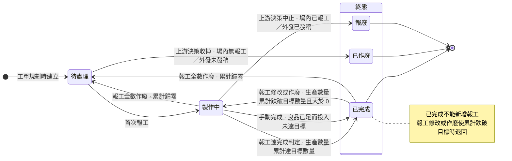
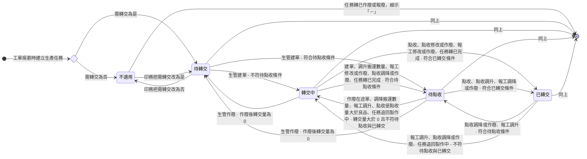
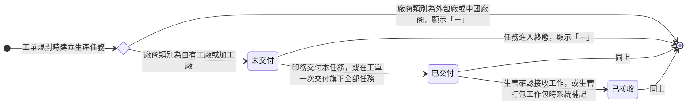
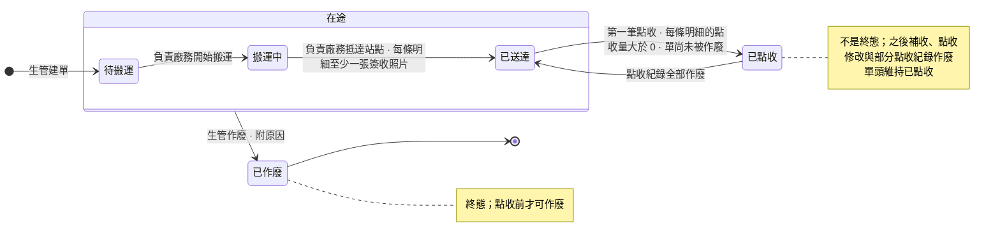

# 生產管理 Linear Feature 層交付稿（2026-10-12，尚未評分、尚未寫入）

範圍：P-PM-237 專案描述、PM-1356～PM-1359 全文；P-DE-33 的 PM-1346、PM-1149 只改本輪相關段落。Task 票全部不動，不在本稿。
格式：10/12 Linear 新格式（權限表三欄：動作、可執行角色、資料範圍；管理權責與操作權限分開寫；驗收取自情境目錄與測試）。
讀取來源：Linear 現行版本（2026-10-12 唯讀讀取，現行仍是未改寫的舊版）、wiki 生產段卡、情境目錄與測試、Prototype 提交 20370532。
寫入原則：

1. 既有票只傳 `id` 與 `description`；不動 estimate、assignee、cycle、priority、milestone、labels。
2. 本稿「改寫後」整段可直接覆蓋。外層用四個反引號包住；內層 Mermaid 區塊沒有零寬字元，貼進 Linear 即可。
3. 不寫訂正紀錄留言，不放參考留言連結。PM-1346、PM-1149 未改寫的段落保留原狀，含舊連結。
4. 站點名稱（品檢站、後加工站、裁切站等）是 Prototype 假資料，站點清單定案後整批換名，規則不變。

---

## 一、票清單與處置

| 票號 | 處置 | 一句話 |
|------|------|--------|
| P-PM-237 專案描述 | 局部改寫 | Use Case、Scope、Out of Scope、另案處理依拍板改；四張狀態機依 wiki 現行版重繪 |
| Milestone「現場分派與報工」「場內轉交」 | 不動 | 名稱與描述仍然正確 |
| PM-1356 生產任務接收與派工 | 全文改寫 | 權限表改三欄；加工廠同進接收；新增「生產任務與工作包檢視」節；驗收改取情境目錄，派工補工作包不限設備的驗收 |
| PM-1357 生產任務報工 | 全文改寫 | 報工前提補「已作廢或報廢任務不能報工」並與五入口重寫；報廢任務既有報工仍可修改與作廢；刪人工註記、單位換算、印件詳情報工；新增逐層更正節 |
| PM-1358 轉交單建立與搬運 | 全文改寫 | 依目的產線成單；任一超額全擋；新增搬運數量修改；點收前可作廢；預計轉交日必填；檢視補業務看不到可勾選列的驗收 |
| PM-1359 轉交點收與到料 | 全文改寫 | 點收單一動作；刪「再次點收」「代點收」；新增點收紀錄作廢；每條明細都大於 0 |
| PM-1346 工單製程審核與交付產線 | 逐段改寫（兩處） | 交付實體關係第 3 條只留交付，接收歸 PM-1356；站點與產線驗收改為產線加站點寫法，並補製程確認中只有負責人或編輯（代理）成員能改的驗收 |
| PM-1149 工單製程規劃 | 逐段改寫（五處） | 外發任務產線依 wiki；單位取主檔；刪拼版換算句；需轉交只寫必填目的站點 |
| P-DE-33 專案描述、PM-1347、其餘票 | 不動 | 與拍板無涉 |
| Task 票（BE-424～427、FE-592～595、BE-360、BE-419 等） | 不動 | 本輪只到 Feature 層 |

---

## 二、P-PM-237 專案描述（整段覆寫）

````markdown
## 概述

生產管理承接印務交付產線之後的現場執行：生管接收生產任務並合批派給師傅，師傅報工，做好的半成品由生管建轉交單、廠務搬運、下一站照實點收後開工。

現行工廠靠紙本工單。師傅做完在紙上註記，進度靠人工回報，主管看不到即時狀況，產能不透明。生管每天手動整理派工表。半成品靠紙本工單跟著貨走，下一站靠口頭確認貨到了沒有；師傅不看前置就報工，會出現上一站的貨還沒到、這一站已經報了產出的錯報。

---

## 使用情境

### Use Case

1. 印務把生產任務交付產線後，生管確認接收，把可以一起做的活合成工作包派給一位師傅；要換師傅時，取消工作包後重新打包。
2. 師傅打開自己的工作包或生產任務，前置有到料就開工，做完一段就報工並附現場照片。
3. 生管、印務、印務主管在生產管理頁面依所屬產線代報；印務在工單詳情頁替自己負責的工單報工，含加工廠與外發任務。
4. 師傅與代報人員數字錯就修改，整筆不該存在就作廢重報。良品已經夠下游用時，生管手動完成生產任務。
5. 生管在待轉交任務勾選各任務累積的可搬量建轉交單，指定這趟的負責廠務，系統只通知負責廠務。
6. 負責廠務開始搬運，抵達站點時逐條明細拍簽收照片。
7. 目的產線的師傅或品檢人員逐條明細照實點收；貨後來補到就再點收一筆，點錯就修改點收量，整筆點錯單就作廢那一筆。下游的到料量隨點收增加。
8. 單子建錯時，生管作廢重開、改單或改搬運數量。
9. 數量錯誤流到下游時，生管與師傅由下往上逐層更正。
10. 現場人員打開生產管理，只看到所屬產線或指派給自己的單據。

### Scope（功能票清單）

1. **生產任務接收與派工**：生管確認接收交付來的自有工廠與加工廠生產任務，合批成工作包派給師傅，並調整或取消工作包。　PM-1356
2. **生產任務報工**：師傅與代報人員報工、修改或作廢報錯的報工，生管在良品已足時手動完成生產任務，並查看每筆生產任務的歷程。　PM-1357
3. **轉交單建立與搬運**：生管建轉交單並指定負責廠務、改單、改搬運數量、作廢重開，負責廠務回報開始搬運與抵達站點。　PM-1358
4. **轉交點收與到料**：收貨人照實點收、補收、修改點收量、作廢點錯的點收紀錄，生管看得到每筆任務的轉交進度與到料量。　PM-1359

**Out of Scope**

* 印務交付產線、生產任務的目的站點、產線、需轉交與前置設定：歸 <project id="0f3014e0-20e5-4411-babe-15da0609564d" href="https://linear.app/sensationdeveloper/project/%E4%B8%AD%E5%8F%B0-%E5%B7%A5%E5%96%AE%E7%AE%A1%E7%90%86-811bb7333b57/overview">中台 - 工單管理</project>。
* 工單異動、生產任務作廢與報廢的發起與確認：歸 <project id="0f3014e0-20e5-4411-babe-15da0609564d" href="https://linear.app/sensationdeveloper/project/%E4%B8%AD%E5%8F%B0-%E5%B7%A5%E5%96%AE%E7%AE%A1%E7%90%86-811bb7333b57/overview">中台 - 工單管理</project> 後續批次。
* 報工作廢在逆流程（如印件取消）的觸發條件與連動、短少補做：後續批次。
* 排程與工廠總覽、生產績效指標：後續批次。
* 外發派單、外發回廠點收：歸派單（尚未建立 project）。
* 品檢待驗清單與品檢紀錄：歸品檢與出貨（尚未建立 project）。
* 涉及暫存區的場內搬運：不在本 project，現場以標示留痕。
* 人員所屬產線的維護、各角色預設持有的生產管理權限：歸人員主檔與角色權限管理模組。

---

## 另案處理（來源尚未定案，暫不實作）

* 廠務以 Slack 表單回報開始搬運與抵達站點：外部串接另案，本批在系統端回報。
* 來源任務報廢後依實況重建的轉交單如何點收：待裁，本批重建單的點收照樣被擋下。
* 外發回台的貨送場內後段產線是否走轉交單：待裁，本批只做送品檢站這一條。
* 產線底下的站點清單：待提供，現行站點為暫用名稱，清單定案後規則不變。

---

## 狀態機

工單狀態機見 <project id="0f3014e0-20e5-4411-babe-15da0609564d" href="https://linear.app/sensationdeveloper/project/%E4%B8%AD%E5%8F%B0-%E5%B7%A5%E5%96%AE%E7%AE%A1%E7%90%86-811bb7333b57/overview">中台 - 工單管理</project>。

>>> ### 生產任務狀態機



* 四種廠商類別走同一條路徑；外部進程由派單另行追蹤。
* 本任務退回製作中時，所屬工單、印件、訂單不跟著回退。

>>>

>>> ### 生產任務轉交狀態機



系統推導的衍生狀態，沒有手動轉換。依下表順序判定，第一個成立的就是結果：

| 順序 | 結果 | 條件 |
| -- | -- | -- |
| 1 | 「－」 | 生產任務狀態為已作廢或報廢 |
| 2 | 不適用 | 需轉交為否 |
| 3 | 已轉交 | 生產任務已完成，良品數大於 0，轉交點收量等於良品數 |
| 4 | 待點收 | 生產任務已完成，轉交量不小於良品數，轉交點收量小於良品數 |
| 5 | 轉交中 | 轉交量大於 0 |
| 6 | 待轉交 | 轉交量等於 0 |

>>>

>>> ### 生產任務交付狀態機



系統推導的衍生狀態，沒有手動轉換。依下表順序判定，第一個成立的就是結果：

| 順序 | 結果 | 條件 |
| -- | -- | -- |
| 1 | 「－」 | 廠商類別為外包廠或中國廠商，或生產任務狀態屬終態 |
| 2 | 已接收 | 接收工作有值 |
| 3 | 已交付 | 交付時間有值 |
| 4 | 未交付 | 其餘 |

>>>

>>> ### 轉交單狀態機



>>>
````

---

## 三、P-PM-237 Feature 票

### 3-1 PM-1356 生產任務接收與派工（全文改寫）

````markdown
## 概述

這張票做完，生管能在 <project id="9d055ea4-9212-4711-a0d6-22870079b450" href="https://linear.app/sensationdeveloper/project/%E4%B8%AD%E5%8F%B0-%E7%94%9F%E7%94%A2%E7%AE%A1%E7%90%86-148ecc50024f/overview">中台 - 生產管理</project> 確認接收印務交付來的生產任務，把可以一起做的活合成工作包派給一位師傅，並調整或取消工作包。

生產任務交付狀態的流轉見 <project id="9d055ea4-9212-4711-a0d6-22870079b450" href="https://linear.app/sensationdeveloper/project/%E4%B8%AD%E5%8F%B0-%E7%94%9F%E7%94%A2%E7%AE%A1%E7%90%86-148ecc50024f/overview">中台 - 生產管理</project> 的生產任務交付狀態機。

## 權限

| 動作 | 可執行角色 | 資料範圍 |
| -- | -- | -- |
| 檢視所有生產任務 | 生管、印務、印務主管 | 產線範圍 |
| 檢視我的生產任務 | 師傅 | 負責範圍 |
| 檢視所有工作包 | 生管、印務、印務主管 | 產線範圍 |
| 檢視我的工作包 | 師傅 | 負責範圍 |
| 唯讀檢視生產任務與工作包 | 高階主管（Supervisor） | 全公司 |
| 確認接收工作 | 生管、印務、印務主管 | 產線範圍 |
| 建立工作包並指派師傅 | 生管、印務、印務主管 | 產線範圍 |
| 取消工作包 | 生管、印務、印務主管 | 產線範圍 |
| 修改工作包的預計完成日、備註與確樣備註（所有工作包） | 生管、印務、印務主管 | 產線範圍 |
| 修改工作包的預計完成日、備註與確樣備註（我的工作包） | 師傅 | 負責範圍 |

## 管理權責

| 對象 | 誰對它負責 |
| -- | -- |
| 生產任務的接收與派工 | 生管。印務與印務主管可代行，責任歸屬仍在生管。 |
| 工作包 | 生管負責建立與取消。指派師傅負責現場執行，並可改自己工作包的預計完成日、備註與確樣備註。 |

>>> ## 生產任務接收

身為生管，我要確認接收印務交付來的生產任務，以讓每一筆交出來的活都有人接手、查得到誰在什麼時候接的。

**實體關係**

1. 接收以生產任務為單位，可單筆，也可批次。每筆接收記接收人與接收時間，寫入後不清除。

**驗證規則**

1. 生產任務的交付狀態在已交付才可確認接收。
2. 已接收的生產任務不再重複寫入接收紀錄。批次接收只對尚未接收的任務寫入。

**驗收**

1. 假設 WO-2026-0815 的牛皮紙 150g 備料已交付、尚未接收，當許文傑接收這一筆，則接收工作記許文傑與接收時間，交付狀態轉已接收，生產任務狀態仍為待處理。
2. 假設接上一條，當許文傑勾選 WO-2026-0815 的四筆任務批次接收，則只寫入另外三筆，牛皮紙 150g 備料的接收時間不變。
3. 假設 WO-2026-0812 的證書局部上光為加工廠任務，2026-08-22 09:00 交付、10:00 由許文傑接收，當印務開啟工單詳情，則它的交付狀態為已接收。
4. 假設一筆加工廠任務尚未交付，當印務交付、生管接收，則交付狀態依序為未交付、已交付、已接收；外包廠任務交付後仍顯示「－」。

>>>

>>> ## 生產任務派工

身為生管，我要把可以一起做的生產任務合成一個工作包派給一位師傅，以讓師傅上工就知道要做哪一批。

**實體關係**

1. 一個工作包收多筆生產任務，可跨工單、跨印件。一筆生產任務同時只屬於一個工作包。合批方式由生管自主決定，系統不設規則。
2. 一個工作包指派給一位師傅。旗下生產任務的指派師傅取自工作包，未打包時為空。
3. 派工後生產任務留在生產任務清單，帶出所屬工作包與指派師傅。工作包不設狀態，現場進度取已完成任務數與任務總數。
4. 派工時，尚未接收的生產任務由系統補記接收：接收人為派工者，時間為派工時間。
5. 加工廠任務與自有工廠任務同一套流程，系統不限制打包。實務上加工廠任務不打包給師傅。

**驗證規則**

1. 交付狀態為已交付或已接收的生產任務才可派工。
2. 已屬某個工作包的生產任務不可再併入其他工作包。
3. 必填欄位未填齊不受理。
4. 派工不檢查前置到料，也不改變生產任務狀態。

**驗收**

1. 假設 WO-2026-0815 的牛皮紙 150g 備料已交付、尚未接收，當許文傑直接勾選它，指派劉阿海並填預計完成日後建立，則派工成立，不要求先接收，接收人記許文傑，交付狀態轉已接收。
2. 假設許文傑已對牛皮紙 150g 備料代報生產數量 520、良品 520、不良品 0，任務為製作中，當他接收並打包給劉阿海，則成立，任務維持製作中，落進新的工作包。
3. 假設 WO-2026-0710 的海報四色印刷屬 WP-2026-0710-01、指派師傅劉阿海，WO-2026-0812 的證書裁切尚未派工，當印務展開兩張工單的生產任務，則海報四色印刷的指派師傅為劉阿海，證書裁切的指派師傅為空。
4. 假設 WO-2026-0815 的牛皮紙 150g 備料已作廢、五色印刷已報廢、軋盒成型為待處理，當許文傑把三筆一起打包，則前兩筆不可勾選，繞過介面直接打包時也不進工作包，軋盒成型照常打包。
5. 假設 WO-2026-0812 的證書裁切（POLAR 137 裁切機、手工產線）與三件配套裝袋（貼標工作站、裝訂產線）都已交付、已接收、尚未派工，許文傑的所屬產線含手工與裝訂，當他勾選兩筆打包並指派一名師傅，則系統不因兩筆任務的計畫設備不同而擋下，兩筆進同一個工作包。

>>>

>>> ## 生產任務與工作包檢視

身為生管，我要只看到自己產線的生產任務與工作包，以讓我處理的都是我該管的活。

**實體關係**

1. 產線範圍：單據的產線在自己的所屬產線內。負責範圍：單據指派給自己。兩種範圍各自判定，不疊加。
2. 各單元依下表列出單據：

| 單元 | 產線範圍列出 | 負責範圍列出 |
| -- | -- | -- |
| 所有生產任務、我的生產任務 | 已交付、廠商類別為自有工廠或加工廠、產線在所屬產線內的生產任務，含已完成等終態 | 指派師傅為自己的生產任務 |
| 所有工作包、我的工作包 | 旗下任一任務的產線在所屬產線內的工作包 | 指派師傅為自己的工作包 |

3. 負責範圍不看產線。師傅被打包到所屬產線以外的任務時，照樣看得到並報得了。
4. 高階主管對生產管理各產線單元只有唯讀檢視，看得到全部產線的單據，不開放任何操作。

**驗證規則**

1. 未交付的任務，以及外包廠與中國廠商的任務，不列在所有生產任務。

**驗收**

1. 假設許文傑的所屬產線為數位、裝訂、手工，鄭宇翔為手工、壓克力，WO-2026-0815 四筆任務與 WO-2026-0812 的證書局部上光皆已交付，當兩人各自開啟所有生產任務，則許文傑看到 WO-2026-0815 四筆與證書局部上光，鄭宇翔只看到手工產線的任務含證書局部上光，看不到 WO-2026-0815 四筆。
2. 假設一張工單同時有自有工廠、加工廠、外包廠與中國廠商的任務且皆已交付，當許文傑開啟所有生產任務，則只列自有工廠與加工廠的任務。
3. 假設劉阿海是 WP-2026-0710-01 的指派師傅，李榮發是 WP-2026-0710-02 的指派師傅，當劉阿海開啟我的工作包與我的生產任務，則只看到指派給他的工作包與任務，看不到李榮發的工作包。
4. 假設許文傑把 WO-2026-0812 的證書裁切（手工產線）打包給所屬產線為數位、裝訂的劉阿海，當劉阿海開啟我的生產任務與我的工作包，則兩處都列出證書裁切，該筆有報工入口，點收佇列仍不列 TT-20260830-002。
5. 假設王大明為高階主管，所屬產線全選，當他開啟所有生產任務、所有工作包、待轉交任務、所有轉交單與點收佇列，則五個單元都列出全部產線的單據，任何一筆都沒有操作入口，歷程照樣看得到。

>>>

>>> ## 工作包調整

身為生管，我要在派工後改工作包的預計完成日、備註與確樣備註，以跟上現場進度的變化。

**實體關係**

1. 工作包派出後可改預計完成日、備註與確樣備註。指派師傅也能在我的工作包改自己的工作包。
2. 指派師傅在工作包建立後不可改。要換師傅，取消工作包後重新打包。
3. 每次修改寫入旗下每筆任務的歷程，記原值與新值。

**驗證規則**

1. 必填欄位未填齊不受理。

**驗收**

1. 假設 WP-2026-0710-02 的指派師傅為李榮發，當許文傑在所有工作包編輯它，則指派師傅唯讀；改預計完成日後儲存，列表顯示新的預計完成日。
2. 假設劉阿海是 WP-2026-0812-01 的指派師傅，當他在我的工作包把備註改為「先印證書再印信封」，則生管在所有工作包看到新備註，旗下每筆任務的歷程最上一筆記備註原值與新值、操作人劉阿海。

>>>

>>> ## 工作包取消

身為生管，我要取消排錯或要換師傅的工作包，以把旗下任務放回待派、重新打包給對的師傅。

**實體關係**

1. 取消即刪除這個工作包。旗下生產任務解除工作包、回到待派，指派師傅回到空值，可再打包進新的工作包。
2. 已有的報工紀錄留在生產任務上，不因取消而改動。
3. 取消寫入旗下每筆任務的歷程。

**驗證規則**

1. 工作包任何時候都可取消，不看旗下生產任務的狀態。

**驗收**

1. 假設 WP-2026-0710-02 旗下只有裁切成型一筆、指派師傅李榮發，當許文傑在所有生產任務取消這個工作包，則裁切成型的工作包與指派師傅皆為空，可再勾選，生產任務狀態與報工累計不變，歷程記一筆取消工作包。
2. 假設接上一條，當許文傑勾選裁切成型、指派陳金水建立工作包，則裁切成型落在新的工作包，指派師傅為陳金水。
3. 假設 WP-2026-0710-01 旗下的雪銅紙 150g 備料已完成、海報四色印刷製作中且累計 2,000、目標 3,090，當許文傑取消這個工作包，則取消成立，兩筆回到待派，報工紀錄全部保留。

>>>

>>> ## 另案處理（來源尚未定案，暫不實作）

* 自工作包移出單筆任務：規則來源未定義，待補齊來源後另開。

>>>
````

---

### 3-2 PM-1357 生產任務報工（全文改寫）

````markdown
## 概述

這張票做完，師傅與代報人員能在 <project id="9d055ea4-9212-4711-a0d6-22870079b450" href="https://linear.app/sensationdeveloper/project/%E4%B8%AD%E5%8F%B0-%E7%94%9F%E7%94%A2%E7%AE%A1%E7%90%86-148ecc50024f/overview">中台 - 生產管理</project> 對生產任務報工、修改或作廢報錯的報工，生管能在良品已足時手動完成生產任務，並查看每筆生產任務的歷程。

生產任務狀態的流轉見 <project id="9d055ea4-9212-4711-a0d6-22870079b450" href="https://linear.app/sensationdeveloper/project/%E4%B8%AD%E5%8F%B0-%E7%94%9F%E7%94%A2%E7%AE%A1%E7%90%86-148ecc50024f/overview">中台 - 生產管理</project> 的生產任務狀態機。

## 權限

| 動作 | 可執行角色 | 資料範圍 |
| -- | -- | -- |
| 報工（我的工作包、我的生產任務） | 師傅 | 負責範圍 |
| 報工（所有工作包、所有生產任務） | 生管、印務、印務主管 | 產線範圍 |
| 報工（工單詳情） | 印務 | 工單負責或取得編輯分享 |
| 修改報工（我的工作包、我的生產任務） | 師傅 | 負責範圍，限自己提交的報工 |
| 修改報工（所有工作包、所有生產任務） | 生管、印務、印務主管 | 產線範圍 |
| 修改報工（工單詳情） | 印務 | 工單負責或取得編輯分享 |
| 作廢報工（我的工作包、我的生產任務） | 師傅 | 負責範圍，限自己提交的報工 |
| 作廢報工（所有工作包、所有生產任務） | 生管、印務、印務主管 | 產線範圍 |
| 作廢報工（工單詳情） | 印務 | 工單負責或取得編輯分享 |
| 手動完成生產任務 | 生管、印務、印務主管 | 產線範圍 |
| 檢視生產任務歷程（所有生產任務、所有工作包） | 生管、印務、印務主管 | 產線範圍 |
| 檢視生產任務歷程（我的生產任務、我的工作包） | 師傅 | 負責範圍 |
| 檢視生產任務歷程（工單詳情） | 印務 | 全公司 |
| 唯讀檢視生產任務歷程 | 高階主管（Supervisor） | 全公司 |

## 管理權責

| 對象 | 誰對它負責 |
| -- | -- |
| 報工 | 提交報工的人對自己報的數字負責。師傅只修改與作廢自己提交的報工。 |
| 代報 | 生管、印務、印務主管代報時，報工人員記實際操作的人。 |
| 工單詳情的報工 | 工單的負責印務，或取得編輯分享的成員。 |
| 加工廠任務的報工 | 印務。加工廠任務實務上不打包給師傅。 |
| 手動完成 | 生管主責。印務與印務主管可代行。 |

>>> ## 生產任務報工

身為師傅，我要做完一段活就回報投入多少、好的幾件、壞的幾件並附照片，以讓工單、印件、訂單的進度不必有人轉抄就跟上現場。

**實體關係**

1. 一筆生產任務有多筆報工紀錄。報工記在生產任務上，不掛工作包。
2. 師傅在我的工作包與我的生產任務報工，提交管道記為師傅自助，由系統依入口帶入。
3. 任務實際開工取首筆報工的時間。任務轉已完成時記任務實際完成日。
4. 首次報工時，所屬工單、印件、訂單依各自狀態機推進。

**驗證規則**

1. 生產任務已交付（交付時間有值）才可報工。不要求已接收，也不要求已打包。
2. 任一前置任務的到料量為 0 時不可報工，系統指出在等哪張工單、哪一筆生產任務的貨。沒有前置任務時不檢查到料。
3. 生產任務為已作廢或報廢時不可報工。報廢任務既有的報工，照「報工修改」「報工作廢」的規則仍可修改與作廢。

**算式**

```
生產數量累計 ＝ 有效報工的生產數量加總
產出數量 ＝ 有效報工的良品數累計 ＋ 不良品數累計
完成判定：生產數量累計 ≧ 目標數量
```

1. 有效報工指未作廢的報工。報工修改後取改後的值。
2. 生產數量累計超過目標數量時照實記。

**驗收**

1. 假設 WO-2026-0815 的牛皮紙 150g 備料與五色印刷已由許文傑打包給劉阿海，備料已報工並點收到印刷站，五色印刷已到料，當劉阿海從我的工作包與我的生產任務各報一筆五色印刷，則兩筆的提交管道皆為師傅自助。
2. 假設 WO-2026-0815 工單已交付、四筆任務已派工、尚無報工，當師傅對第一筆任務報第一筆工，則任務轉製作中，印件印製狀態與訂單轉製作中，工單由工單已交付轉製作中。
3. 假設 WP-2026-0710-01 的海報四色印刷製作中，累計 2,000、目標 3,090，當劉阿海先報生產數量 500、再報 590，則累計先為 2,500、仍為製作中，再為 3,090、任務轉已完成。
4. 假設 WP-2026-0710-02 的裁切成型已交付，前置 TT-20260830-002 已送達未點收，當李榮發開啟這個工作包，則可做量為 0，沒有報工入口；繞過介面送出報工時被擋下、不寫入，並指出在等 WO-2026-0710 的海報四色印刷。
5. 假設 WO-2026-0908 的三筆任務交付時間皆無值；又假設 WO-2026-0710 的海報四色印刷原為製作中、指派給劉阿海、報工累計生產數量 2,000、良品 1,990、不良品 10，周建宏在工單異動作廢這筆任務、許文傑確認後因已有報工轉報廢。當周建宏開啟 WO-2026-0908 的工單詳情，或劉阿海、許文傑、周建宏從各自的報工入口找海報四色印刷，則這些任務都沒有報工入口，繞過介面送出報工時被擋下、不寫入；海報四色印刷累計維持 2,000、1,990、10。

>>>

>>> ## 報工內容填寫

身為師傅，我要照實填投入、良品與不良品數並附現場照片，以讓折損率、良率與實際成本取到現場真正的數字。

**實體關係**

1. 每筆報工附現場照片，可多張。備註選填，修改報工時可一併修改。
2. 報工人員、報工時間與提交管道由系統帶入，使用者不可改。

**驗證規則**

1. 必填欄位未填齊不受理。
2. 下列情形無法送出報工，修改報工時同樣適用：
   * 生產數量不大於 0。
   * 良品數與不良品數同為 0。
   * 良品數加不良品數大於生產數量。
3. 生產數量、良品數與不良品數一律當數值比較，單位只用於顯示，不做換算。

**驗收**

1. 假設 WO-2026-0812 的信封四色印刷製作中、指派給劉阿海，當他填生產數量 205、良品 200、不良品 5 與不良原因但不附照片，則無法送出，不寫入；附兩張照片後送出，報工成立並保存兩張照片。
2. 假設同一筆任務，當報生產數量 1,051、良品 4,084、不良品 0，或生產數量 1,000、良品 980、不良品 40，則兩組都無法送出。
3. 假設 WP-2026-0710-01 的海報四色印刷，當劉阿海報生產數量 300、良品與不良品都不填，則無法送出，不寫入任何報工。
4. 假設劉阿海報海報四色印刷生產數量 500、良品 490、不良品 10（色差），備註填「換版後第二批，色偏已調回」，則報工紀錄與歷程顯示這則備註。

>>>

>>> ## 生產任務代報

身為生管，我要在師傅沒空時從所有工作包與所有生產任務依所屬產線代報，以讓進度不必有人轉抄就進系統。
身為印務，我要在工單詳情頁替自己負責的工單報工，以讓加工廠與外發任務的進度進系統。

**實體關係**

1. 代報的入口與提交管道如下表，管道由系統依入口帶入，使用者不可選、不可改：

| 報工入口 | 提交管道 |
| -- | -- |
| 工單詳情 | 印務於工單詳情頁 |
| 所有工作包、所有生產任務 | 生產管理頁面代報 |

2. 印件詳情不報工。
3. 加工廠任務不打包給師傅時，沒有指派師傅，照樣可報工。

**驗證規則**

1. 代報同樣依「生產任務報工」「報工內容填寫」的規則受理，不要求已接收或已打包。
2. 所有工作包與所有生產任務的代報，只受理產線在本人所屬產線內的生產任務。
3. 所有工作包列出整包，但包內只有產線在本人所屬產線內的任務可報工、修改與作廢，其他任務只能看。
4. 工單詳情的報工，只受理本人負責或取得編輯分享的工單下的生產任務。
5. 繞過介面送出範圍外的任務時，系統擋下、不寫入，也不寫稽核日誌。

**驗收**

1. 假設 WO-2026-0815 的牛皮紙 150g 備料已交付、尚未接收、尚未打包、沒有前置，當許文傑在所有生產任務報生產數量 520、良品 520、不良品 0 並附照片，則報工成立，提交管道為生產管理頁面代報，報工人員為許文傑，任務轉製作中，交付狀態維持已交付。
2. 假設 WO-2026-0812 的證書局部上光為加工廠任務、已接收、未打包、沒有前置，負責印務為周建宏，當周建宏在工單詳情報生產數量 200、良品 198、不良品 2（刮傷），則報工成立，提交管道為印務於工單詳情頁，任務轉製作中，仍沒有工作包。
3. 假設許文傑把證書裁切（手工產線）與 WO-2026-0815 的五色印刷（數位產線）打成一包給劉阿海，當鄭宇翔（手工、壓克力產線）開啟所有工作包展開這一包，則證書裁切有報工、修改與作廢入口，五色印刷只能看。
4. 假設鄭宇翔的所有生產任務沒有五色印刷，當他繞過清單送出五色印刷的報工，或劉阿海繞過我的生產任務送出軋盒成型的報工，或非負責且未取得編輯分享的印務在工單詳情送出報工，則三種都被擋下、不寫入，任務累計不變。
5. 假設周建宏開啟 PI-2026-0815 的印件詳情，則印件詳情頁首與工單與生產任務區塊都沒有報工入口。

>>>

>>> ## 報工修改

身為師傅，我要把報錯的生產數量、良品數或不良品數直接改成正確的數，以讓折損率、良率與實際成本取到現場真正的數字。

**實體關係**

1. 修改只動有效的報工，可改生產數量、良品數與不良品數，備註可一併修改。
2. 每次修改留一筆修改紀錄，記修改前後值、修改人、修改時間與原因。一筆報工可有多筆修改紀錄。
3. 一部分要算損耗時，良品改少、不良品改多同量，生產數量不變。損耗怎麼來的寫在修改原因，系統不區分。

**驗證規則**

1. 必填欄位未填齊不受理，修改原因必填。
2. 師傅只能修改自己提交的報工。生管、印務、印務主管不受此限。
3. 修改後同樣要通過報工內容的數量檢核。
4. 已完成的生產任務可修改報工。所屬工單或訂單已完成後，報工同樣可修改。
5. 已完成的生產任務不能新增報工。修改或作廢使生產數量累計跌破目標數量且大於 0 時，任務退回製作中，之後即可再報。所屬工單、印件、訂單不跟著回退。
6. 調降的數量會讓已流到下游的量對不上時，擋下修改，數字不改。擋下條件與系統列出的內容如下表，調升不擋：

| 情形 | 擋下條件 | 系統列出 |
| -- | -- | -- |
| 需轉交的任務 | 改後良品數低於在途明細搬運數量合計加已點收明細點收數量合計 | 佔用的轉交單與數字 |
| 不需轉交的任務 | 下游任務已有報工 | 已報工的下游任務 |
| 所屬印件 | 改後待驗量變成負數 | 該印件已驗量 |

7. 第 6 條以寫入當下的數字檢核。兩筆修改或作廢同時寫入時，先寫入者成立，後到者以新數字重新檢核。
8. 已轉報廢的生產任務，既有的報工照同一組條件修改，不另行擋下，修改後任務維持報廢。

**驗收**

1. 假設 WO-2026-0812 的證書四色印刷有一筆報工 wr-0018（生產 515、良品 500、不良 15），TT-20260827-001 已點收 480，當周建宏把良品改為 480 但不填修改原因，則無法修改；填原因後送出，則修改成立，修改紀錄記良品數 500 → 480、周建宏、時間與原因，任務維持已完成。
2. 假設海報四色印刷良品 1,990，其中 TT-20260830-002 已送達 1,190、TT-20260830-003 搬運中 800，當周建宏把第二筆報工（生產 1,000、良品 1,000）的良品改為 900，則擋下修改，列出兩張轉交單，良品仍為 1,990。
3. 假設信封四色印刷目標 515、兩筆報工 310 與 205、已完成，沒有轉交單、所屬印件已驗量 0，當有人新增報工，則被擋下，累計維持 515。
4. 假設同一筆任務，當第二筆報工改為生產數量 185、良品 180、不良品 5 並填原因，則累計 495、任務退回製作中；再報 20，累計回到 515，任務再轉已完成。
5. 假設許文傑代報了海報四色印刷一筆生產數量 100、良品 100，當劉阿海在我的工作包看這筆，則沒有修改與作廢；他自己提交的報工照樣有修改。
6. 假設一筆已轉報廢的生產任務有一筆報工良品 300，沒有轉交單、下游未動工、所屬印件未被品檢驗過，當有人把良品改為 280 並填原因，則修改成立，任務維持報廢，轉交狀態與交付狀態仍顯示「－」。

>>>

>>> ## 報工作廢

身為師傅，我要把整筆不該存在的報工作廢後重報，以免錯的數字留在累計裡。

**實體關係**

1. 作廢的報工不消失，改列為已作廢，記作廢人、作廢時間與原因，不計入任何累計。
2. 整筆報工不該存在（如報到錯的任務）時才作廢，再到正確的任務重報。數字不對用報工修改。

**驗證規則**

1. 必填欄位未填齊不受理，作廢原因必填。
2. 師傅只能作廢自己提交的報工。生管、印務、印務主管不受此限。
3. 已完成的生產任務可作廢報工。
4. 作廢以扣除這一筆之後的累計判定，套用「報工修改」的擋下條件。
5. 任務的報工全數作廢使累計歸零時，任務退回待處理，仍屬原工作包。
6. 已轉報廢的生產任務，既有的報工同樣可作廢，照第 4 條判定。

**驗收**

1. 假設劉阿海把 WO-2026-0815 五色印刷的一筆報工（生產 200、良品 195、不良 5）誤報到牛皮紙 150g 備料，當他作廢備料那一筆、原因填「報到錯的任務」，再到五色印刷照原數字重報，則備料那一筆列為已作廢、不計入累計，備料任務退回待處理，五色印刷多一筆有效報工，兩筆任務的歷程各記一筆。
2. 假設信封四色印刷良品 300 全數在已送達的 TT-20260827-002 上，當報工人員作廢那一筆報工，則擋下作廢，列出 TT-20260827-002，報工維持有效。
3. 假設證書四色印刷已完成，報工 wr-0018 的良品已被 TT-20260827-001 點收 480，當周建宏作廢 wr-0018，則照同一組擋下條件判定，擋下並列出那張轉交單。
4. 假設一筆任務製作中、已派入工作包、只有一筆有效報工，當作廢這一筆，則任務退回待處理，仍屬原工作包，師傅可直接重新報工。
5. 假設一筆報工生產 200、良品 190、不良 10，沒有轉交單佔用，當作廢，則成立，生產數量、良品數、產出數量各減 200、190、200。

>>>

>>> ## 生產數量逐層更正

身為生管，我要在錯的數字已流到下游時由下往上逐層更正，以讓每一層的數字都對上現場實際數量。

**實體關係**

1. 數量錯誤由下往上逐層更正：下游報工、點收、搬運數量、上游報工。
2. 被擋下時，系統指出卡在哪一筆，不自動修改其他單據。
3. 每層修改原因必填，歷程各記一筆。
4. 已進品檢時，由品檢人員先更正品檢紀錄。

**驗證規則**

1. 每一層照自己的擋下條件檢查，被擋下的那一層不可跳過。

**驗收**

1. 假設 WO-2026-0815 的五色印刷報工生產 500、良品 500、不良 0，TT-20260901-001 搬運 500、點收 500，軋盒成型已報工 500，當周建宏直接把五色印刷那筆報工改為良品 480、不良品 20，則擋下並指出卡在 TT-20260901-001 的點收 500，數字不變，系統不自動改點收或軋盒成型的報工。
2. 假設同一起點，當陳金水把軋盒成型改為 480／480／0，周建宏把 TT-20260901-001 那筆點收紀錄改為 480，周建宏（代行生管）把搬運數量改為 480，再改五色印刷那筆報工，則四層各自成立、各留一筆修改紀錄，TT-20260901-001 維持已點收，五色印刷的良品、轉交量、轉交點收量都是 480，可搬量 0，生產數量維持 500。
3. 假設同一起點，當點收提前在軋盒成型之前修改，則擋下並指出軋盒成型已報工 500。
4. 假設五色印刷有一張搬運中 500、還沒點收的單，當周建宏改上游報工，則先被擋下並指出那張單；搬運數量改為 480 後，報工修改成立，單維持搬運中。
5. 假設貨在途中全部遺失、單搬運中 500 還沒點收，當生管作廢整張單、印務把那筆報工改為良品 0、不良品 500，則作廢與修改都成立，搬運數量退回，生產數量不變；只把良品改 0、不良品維持 0 時被擋下。

>>>

>>> ## 生產任務手動完成

身為生管，我要在良品已經夠下游用時直接把生產任務標完成，以免逼現場把剩下的量跑完多做廢工。

**實體關係**

1. 手動完成不改任務內容，目標數量、放損率與已報工數量不變。
2. 手動完成時，生產任務歷程記操作人與時間，並記任務實際完成日。

**驗證規則**

1. 生產任務在製作中才可手動完成。
2. 手動完成限生管、印務與印務主管操作，不限廠商類別。

**驗收**

1. 假設 WP-2026-0710-01 的海報四色印刷製作中、目標 3,090、已報 2,000，當許文傑手動完成，則任務轉已完成，目標數量與放損率不變，已報工數不動，歷程新增一筆手動完成，記許文傑與時間。
2. 假設同一筆任務製作中，當劉阿海（師傅）或王大明（高階主管）開啟，則都沒有手動完成。
3. 假設 WO-2026-0812 的證書局部上光為加工廠任務、未打包、待處理、目標 513，當鄭宇翔（手工、壓克力產線）開啟所有生產任務，則待處理時沒有手動完成；他代報生產數量 300、良品 298、不良品 2 後，任務轉製作中，出現手動完成；完成後任務轉已完成，投入 300 與目標 513 不變，仍沒有工作包。
4. 假設一筆任務由生管手動完成，當檢視任務實際完成日，則取該次手動操作的時間。

>>>

>>> ## 生產任務歷程檢視

身為生管，我要在一處看到一筆生產任務發生過的每一件事，以追得出數字在哪一步變了、貨流到哪一站。

**實體關係**

1. 一筆生產任務有一份歷程。歷程收錄本任務的交付與接收、派工與工作包、報工及其修改作廢、手動完成、目的站點與產線變更、狀態變化，以及以本任務為來源的轉交單（含搬運數量修改）與點收（含點收修改、點收紀錄作廢）。
2. 派工與工作包類事件指打包派工（含補記接收）、所屬工作包被取消、所屬工作包被編輯。
3. 每筆記時間與操作人。數字、站點與工作包內容的變更記前後值，報工照片、簽收照片與關聯單據一併帶出。
4. 工單詳情與生產管理看到的是同一份歷程。

**驗證規則**

1. 歷程由系統在事件發生時自動寫入，不可手動修改或刪除。

**驗收**

1. 假設 WO-2026-0812 的證書四色印刷已交付、接收、派工、報工完成，並建了 TT-20260827-001 送到手工產線，當許文傑在所有生產任務檢視歷程，則列出點收（李榮發）、抵達站點（附簽收照片）、開始搬運、建轉交單、報工（附現場照片與前後值）、派工、接收、交付，每筆記時間與操作人。
2. 假設同一筆任務，當周建宏開啟 WO-2026-0812 工單詳情並展開證書四色印刷，則展開列的歷程與上一條內容相同。
3. 假設 TT-20260830-003 搬運中、明細為海報四色印刷 800，當簡俊男附簽收照片回報抵達站點，則海報四色印刷的歷程最上一筆為抵達手工產線，附剛上傳的簽收照片，關聯單據為 TT-20260830-003。
4. 假設許文傑把 TT-20260830-003 的搬運數量由 800 改為 790 並填原因，則歷程最上一筆為搬運數量修改，記改前 800、改後 790、修改人、時間與原因。
5. 假設鏈一材料備料的 TT-20260615-001 有一筆已作廢的點收紀錄 100，當生管檢視材料備料的歷程，則有一筆點收紀錄作廢，記作廢人與作廢原因。

>>>
````

---

### 3-3 PM-1358 轉交單建立與搬運（全文改寫）

````markdown
## 概述

這張票做完，生管能在 <project id="9d055ea4-9212-4711-a0d6-22870079b450" href="https://linear.app/sensationdeveloper/project/%E4%B8%AD%E5%8F%B0-%E7%94%9F%E7%94%A2%E7%AE%A1%E7%90%86-148ecc50024f/overview">中台 - 生產管理</project> 從待轉交任務建轉交單並指定負責廠務、改單、改搬運數量、作廢重開，負責廠務能回報開始搬運與抵達站點。

轉交單狀態的流轉見 <project id="9d055ea4-9212-4711-a0d6-22870079b450" href="https://linear.app/sensationdeveloper/project/%E4%B8%AD%E5%8F%B0-%E7%94%9F%E7%94%A2%E7%AE%A1%E7%90%86-148ecc50024f/overview">中台 - 生產管理</project> 的轉交單狀態機。

## 權限

| 動作 | 可執行角色 | 資料範圍 |
| -- | -- | -- |
| 檢視待轉交任務 | 生管、印務、印務主管 | 產線範圍 |
| 檢視所有轉交單 | 生管、印務、印務主管 | 產線範圍 |
| 檢視我的轉交單 | 廠務 | 負責範圍 |
| 唯讀檢視待轉交任務與所有轉交單 | 高階主管（Supervisor） | 全公司 |
| 建立轉交單 | 生管、印務、印務主管 | 產線範圍 |
| 修改待搬運的轉交單 | 生管、印務、印務主管 | 產線範圍 |
| 修改搬運數量 | 生管、印務、印務主管 | 產線範圍 |
| 作廢轉交單 | 生管、印務、印務主管 | 產線範圍 |
| 重開作廢的轉交單 | 生管、印務、印務主管 | 產線範圍 |
| 回報開始搬運 | 廠務 | 負責範圍 |
| 回報抵達站點並上傳簽收照片 | 廠務 | 負責範圍 |

## 管理權責

| 對象 | 誰對它負責 |
| -- | -- |
| 轉交單的內容 | 生管。送哪幾筆、各送多少、改單與作廢都由生管決定。印務與印務主管可代行，責任歸屬仍在生管。 |
| 搬運與回報 | 本單的負責廠務。廠務只執行搬運與回報，不決定數量，也不填量。 |

>>> ## 轉交單建立

身為生管，我要在待轉交任務勾選各任務累積出來的可搬量建單，以讓負責廠務接到通知就知道送哪批貨、送去哪、送多少。

**實體關係**

1. 一張轉交單是一趟送往同一條目的產線的搬運，有多條明細。每條明細是一筆來源生產任務與搬運數量，同一筆任務在一張單只出現一次。一張單可含跨工單、跨印件的貨。
2. 單頭記目的產線，每條明細記目的站點。兩者取建單當下來源生產任務的目的站點，建單時不可改。
3. 系統依目的產線分組成單，同一條目的產線併成一張，各明細的目的站點可不同。外發生產任務回台點收後為來源時，目的地為品檢站。
4. 生管建單時指定這趟的負責廠務。候選限負責範圍可處理轉交單的人員，即廠務。
5. 系統記建單人與建單時間，並只通知負責廠務。

**驗證規則**

1. 必填欄位未填齊不受理。
2. 每條明細的搬運數量大於 0，且不超過來源任務的轉交可申請上限。額度以按下建立那一刻的最新值計。
3. 一次勾多筆建多張單時，任一條超額就全部擋下，一張都不建立。系統顯示超額的任務與當下可搬量，生管重新勾選後再送出。
4. 來源生產任務沒有報工良品，或轉交可申請上限不大於 0 時，不可建單。

**算式**

```
轉交量 ＝ 來源任務未作廢轉交明細的搬運數量合計
轉交可申請上限 ＝ 良品數 − 轉交量
```

1. 待搬運、搬運中、已送達、已點收的明細都計入轉交量。搬運數量修改後取改後的值。
2. 報工修改讓良品數低於轉交量時，轉交可申請上限為負，建單一樣被擋下。

**驗收**

1. 假設 WO-2026-0820 的精裝裝訂（PT-0820-9）良品 500、目的站點為品檢線的品檢站、尚未建單，當許文傑勾選它，但不選負責廠務、不填預計轉交日就建單，則無法建立。
2. 假設同一筆任務，當許文傑選邱志明、填預計轉交日後建單，則負責廠務的候選只有簡俊男與邱志明；建立一張待搬運的單，目的產線為品檢線、明細目的站點為品檢站、負責廠務邱志明、建單人許文傑；只有邱志明收到通知，簡俊男沒有。
3. 假設兩筆生產任務的目的站點分別為壓克力產線的數位站與雷切站，當許文傑一次勾兩筆、填預計轉交日、選負責廠務後建單，則建立一張轉交單，目的產線為壓克力產線，兩條明細各記數位站與雷切站。
4. 假設待轉交任務有四筆可搬量：裁切甲 300 與裁切乙 100（手工產線裁切站）、燙金丙 200（手工產線燙金站）、裝訂丁 500（品檢線品檢站），當許文傑勾四筆、燙金丙填 250 後建單，則兩張都不建立，系統指出燙金丙與當下可搬量 200；改回 200 後重新送出，建立兩張：手工產線一張三條明細、品檢線一張一條明細。
5. 假設海報四色印刷良品 1,990，TT-20260830-002 搬運 1,190、TT-20260830-003 搬運 800，當許文傑要為它建單，則轉交可申請上限為 0，不可建單。

>>>

>>> ## 待轉交任務與轉交單檢視

身為生管，我要在待轉交任務與所有轉交單看到自己產線的貨與單，以讓我只處理自己該管的搬運。

**實體關係**

1. 各單元依下表列出單據：

| 單元 | 範圍 | 列出哪些單據 |
| -- | -- | -- |
| 待轉交任務 | 產線範圍 | 產線在所屬產線內的來源生產任務，各廠商類別都列，含外包廠與中國廠商 |
| 所有轉交單 | 產線範圍 | 來源任務的產線或目的產線在所屬產線內的轉交單 |
| 我的轉交單 | 負責範圍 | 負責廠務為自己的轉交單 |

**驗收**

1. 假設鄭宇翔的所屬產線為手工、壓克力，當他開啟待轉交任務，則不列裝訂產線的精裝裝訂；他的點收佇列列出兩張目的產線為手工產線的已送達單。
2. 假設十六張既有轉交單的負責廠務皆為簡俊男，當簡俊男與邱志明各自開啟我的轉交單，則簡俊男看到十六張，邱志明一張都沒有。
3. 假設鏈四 PT-0820-9 精裝裝訂的可搬量為 500，當業務開啟待轉交任務，則提示轉交單建立限生管、印務與印務主管操作，清單沒有可勾選列；生管開啟同一頁，則欄位含累計良品、已開轉交單與可搬量。

>>>

>>> ## 待搬運轉交單修改

身為生管，我要在貨還沒人去搬之前直接改單上的明細、搬運數量與負責廠務，以免為了一個數字或換一個人作廢重開。

**實體關係**

1. 待搬運的單可改明細、搬運數量、預計轉交日、備註與負責廠務。開始搬運後，明細、負責廠務、預計轉交日與備註都不可改。
2. 改了負責廠務，系統通知新的負責廠務，並在轉交單歷程記改前與改後的負責廠務。

**驗證規則**

1. 轉交單在待搬運才可修改。
2. 修改後的搬運數量同樣大於 0，且受轉交可申請上限管制。檢核先把本單原有的佔用還回額度。
3. 必填欄位未填齊不受理。

**驗收**

1. 假設裁切成型良品累計 1,180、可搬量 1,180，生管已為它建一張到品檢線品檢站的待搬運單，當許文傑把搬運數量改成 1,300，則擋下，列出裁切成型當下可搬量；改成 900 則成立。
2. 假設同一張單，當許文傑一併改預計轉交日、備註與負責廠務後儲存，則寫入成立，單維持待搬運，歷程追加一筆改單。
3. 假設一張待搬運單的負責廠務為邱志明，當許文傑改為簡俊男，則簡俊男收到通知，歷程記邱志明改為簡俊男。
4. 假設廠務對同一張單開始搬運，當許文傑再開啟它，則明細的生產任務不可再改，沒有改單入口，只剩搬運數量修改、抵達站點與作廢。
5. 假設一筆任務良品 500，本單待搬運 200，另一張單佔用 100，當許文傑把本單改為 400，則成立；改為 450，則擋下並顯示還回後的可搬量 400。

>>>

>>> ## 搬運數量修改

身為生管，我要在開始搬運之後把報錯的搬運數量改正並留下原因，以讓來源任務的轉交量對得上實際搬的量。

**實體關係**

1. 搬運中、已送達與已點收的單，每條明細的搬運數量都可修改。
2. 每次修改記修改前後值、修改人、修改時間與原因，並記入轉交單歷程與來源任務歷程。
3. 修改不改變單頭狀態。

**驗證規則**

1. 必填欄位未填齊不受理，修改原因必填。
2. 改後搬運數量大於 0，且不低於該明細的點收數量。要更低，先修改或作廢點收紀錄。
3. 調降不受轉交可申請上限管制。調升受轉交可申請上限管制，檢核先把本明細原有的搬運數量還回額度。
4. 來源生產任務已轉報廢或已作廢時，不可修改搬運數量。

**驗收**

1. 假設 TT-20260827-001 已點收，證書四色印刷搬運數量 500、點收數量 480，當許文傑把搬運數量改為 470，則擋下，因為低於點收數量 480。
2. 假設同一張單，當許文傑把搬運數量改為 480 並填原因，則修改成立，單頭維持已點收，歷程記改前 500、改後 480、修改人、時間與原因，證書四色印刷的轉交可申請上限為 20。
3. 假設同一張單，當許文傑不填原因、清空或填 0，則三種都被擋下，數字不變。
4. 假設一張搬運中的單搬運數量 300，當許文傑把它調升到超過來源任務的轉交可申請上限，則擋下。
5. 假設來源任務已轉報廢，當許文傑修改該任務已點收單的搬運數量，則被擋下。

>>>

>>> ## 搬運開始回報

身為廠務，我要在把貨推走時回報開始搬運，以讓「該送而還沒有人去搬」與「貨在路上」分得清楚。

**實體關係**

1. 開始搬運由本單的負責廠務回報，歷程的操作人即負責廠務。
2. 廠務不填量。

**驗證規則**

1. 轉交單在待搬運才可開始搬運。
2. 只有本單的負責廠務可回報開始搬運，其他人被擋下。

**驗收**

1. 假設精裝裝訂那張待搬運單的負責廠務為簡俊男，當簡俊男開始搬運，則狀態轉搬運中，歷程的操作人為簡俊男，廠務不填任何數量，單上不再有編輯入口，負責廠務不能再改。
2. 假設同一張待搬運單，當邱志明開啟我的轉交單，則不列這張單，沒有開始搬運的入口；邱志明繞過介面回報時被擋下。

>>>

>>> ## 站點抵達回報

身為廠務，我要在貨放到目的地時逐條明細拍簽收照片回報，以讓下一站知道貨到了、事後查得到送達憑證。

**實體關係**

1. 抵達站點由本單的負責廠務回報。簽收照片掛在每條明細上，每條至少一張。
2. 一張單回報一次抵達即可，不分站點分次回報。抵達成立時系統記實際轉交日。廠務不填量，實際量由收貨人點收時填。

**驗證規則**

1. 轉交單在搬運中才可回報抵達站點。
2. 任一條明細沒有簽收照片時，抵達站點回報送不出去，系統列出缺照的明細。

**驗收**

1. 假設 TT-20260830-003 搬運中、一條明細為海報四色印刷 800、負責廠務簡俊男，當簡俊男不附照片就回報抵達，則擋下，列出海報四色印刷 800 缺照，該單維持搬運中。
2. 假設同一張單，當簡俊男在海報四色印刷那一條附兩張照片後回報，則該單轉已送達並記實際轉交日，該條明細有兩張簽收照片，歷程的操作人為簡俊男。
3. 假設一張搬運中的單有兩條明細，當廠務只為第一條附照片回報，則整筆擋下，列出缺照的第二條，該單維持搬運中；兩條各至少一張後，該單轉已送達。
4. 假設一張單的兩條明細各送到壓克力產線的數位站與雷切站，當廠務為兩條各附一張照片回報一次，則該單轉已送達，不要求分兩次回報。

>>>

>>> ## 轉交單作廢

身為生管，我要把建錯或不送的轉交單作廢，以讓額度當下回到來源任務、可以立刻重開。

**實體關係**

1. 作廢以整張單為單位，記作廢人、作廢時間與原因，原因為文字。
2. 作廢的單，其明細即退出轉交量，額度當下回到來源任務。
3. 來源生產任務轉報廢或已作廢時，該任務在途的轉交單標示警示，點收被擋下，處置由生管決定。

**驗證規則**

1. 轉交單在點收前（待搬運、搬運中、已送達）可作廢，原因不限。
2. 轉交單在已點收或已作廢時不可作廢。
3. 必填欄位未填齊不受理，作廢原因必填。
4. 作廢與點收同時送出時，先寫入者成立，後到者被拒絕。

**驗收**

1. 假設 TT-20260830-003 搬運中、TT-20260830-002 已送達、TT-20260828-001 已點收，當許文傑在所有轉交單看三張單，則搬運中與已送達的單有作廢，已點收的單沒有。
2. 假設同一組單，當許文傑對 TT-20260830-002 作廢，先不填原因，則擋下；填「點收前發現數量不對，依實況重建」後成立，單轉已作廢，搬運數量 1,190 退回海報四色印刷，可搬量回到 1,190。
3. 假設資料層對已點收的 TT-20260828-001 直接作廢，則被擋下，該單維持已點收。
4. 假設來源任務海報四色印刷已轉報廢，TT-20260830-002 已送達，當許文傑點收它，則擋下；他作廢這張單，則作廢成立，單轉已作廢。
5. 假設一筆任務只有一張搬運中的單，轉交狀態為轉交中，當許文傑作廢該單，則轉交量為 0，轉交狀態回到待轉交。

>>>

>>> ## 作廢轉交單重開

身為生管，我要以作廢的原單為底另建新單，以不必從待轉交任務重新勾一次。

**實體關係**

1. 重開的新單沿用原單的目的產線、明細目的站點與負責廠務，不取來源任務當下的目的站點。
2. 重開成立時系統通知該負責廠務。新單從待搬運起，重走開始搬運與抵達站點。

**驗證規則**

1. 原單在已作廢才可重開。
2. 新單的搬運數量大於 0，且受轉交可申請上限管制。

**驗收**

1. 假設 TT-20260830-003 搬運中，目的產線手工產線、明細目的站點裁切站，印務已把海報四色印刷的目的站點改為裝訂產線的後加工站，當許文傑作廢它（原因「數量填錯」）後重開新單，則作廢當下可搬量由 0 回到 800；新單的目的產線為手工產線、明細目的站點為裁切站，停在待搬運，要重走開始搬運與抵達站點。
2. 假設生管已為 WO-2026-0820 的精裝裝訂建一張待搬運單（目的站點為品檢站），印務把它的目的站點改為裝訂產線的後加工站，當許文傑作廢該單、再從待轉交任務重新建單，則第一張單的目的地仍是品檢線的品檢站；新單的目的產線為裝訂產線、明細目的站點為後加工站。

>>>

>>> ## 另案處理（來源尚未定案，暫不實作）

* 廠務以 Slack 表單回報：外部串接另案，本票在系統端回報。
* 外發回台的貨送場內後段產線：待裁，本票只做送品檢站。

>>>
````

---

### 3-4 PM-1359 轉交點收與到料（全文改寫）

````markdown
## 概述

這張票做完，目的產線的師傅或品檢人員能在 <project id="9d055ea4-9212-4711-a0d6-22870079b450" href="https://linear.app/sensationdeveloper/project/%E4%B8%AD%E5%8F%B0-%E7%94%9F%E7%94%A2%E7%AE%A1%E7%90%86-148ecc50024f/overview">中台 - 生產管理</project> 照實點收送到本站的貨、補收、修改點收量與作廢點錯的點收紀錄，生管能看到每筆生產任務的轉交進度與到料量。

轉交單與生產任務轉交狀態的流轉，見 <project id="9d055ea4-9212-4711-a0d6-22870079b450" href="https://linear.app/sensationdeveloper/project/%E4%B8%AD%E5%8F%B0-%E7%94%9F%E7%94%A2%E7%AE%A1%E7%90%86-148ecc50024f/overview">中台 - 生產管理</project> 的轉交單狀態機與生產任務轉交狀態機。

## 權限

| 動作 | 可執行角色 | 資料範圍 |
| -- | -- | -- |
| 檢視點收佇列 | 師傅、品檢人員、生管、印務、印務主管 | 產線範圍 |
| 唯讀檢視點收佇列 | 高階主管（Supervisor） | 全公司 |
| 點收（點收佇列） | 師傅、品檢人員、生管、印務、印務主管 | 產線範圍，目的產線在所屬產線內 |
| 點收（所有轉交單） | 生管、印務、印務主管 | 產線範圍，來源任務或目的產線在所屬產線內 |
| 修改點收紀錄（點收佇列） | 師傅、品檢人員、生管、印務、印務主管 | 產線範圍 |
| 修改點收紀錄（所有轉交單） | 生管、印務、印務主管 | 產線範圍 |
| 作廢點收紀錄（點收佇列） | 師傅、品檢人員、生管、印務、印務主管 | 產線範圍 |
| 作廢點收紀錄（所有轉交單） | 生管、印務、印務主管 | 產線範圍 |
| 檢視生產任務的轉交進度與到料量（所有生產任務） | 生管、印務、印務主管 | 產線範圍 |
| 檢視生產任務的轉交進度與到料量（我的生產任務） | 師傅 | 負責範圍 |
| 檢視生產任務的轉交進度與到料量（工單詳情） | 印務 | 全公司 |

## 管理權責

| 對象 | 誰對它負責 |
| -- | -- |
| 點收 | 按下點收的人。點收不看角色，誰按下誰就是點收人，不另區分代點收。常態由目的產線的師傅或品檢人員點收。 |
| 轉交進度 | 生管。生管追蹤每筆任務的轉交進度與到料量。 |

>>> ## 轉交單點收

身為師傅，我要逐條明細填實際收到的量，以讓下游開工的料源是收方清點過的事實，而不是搬運方的宣稱。

**實體關係**

1. 每次點收，每條填了量的明細各新增一筆點收紀錄，記點收量、點收人、時間與備註。
2. 本單第一筆點收讓單頭轉已點收。之後補到的貨，對該條明細再新增一筆點收紀錄，單頭維持已點收。
3. 點收佇列與所有轉交單都能點收，功能相同，只差列出的範圍。點收佇列看目的產線在所屬產線內的單。所有轉交單看來源任務或目的產線在所屬產線內的單。品檢站適用同一條規則。
4. 誰按下點收，誰就是點收人，不另區分代點收。
5. 點收數量多於搬運數量時，系統不擋，照實計入。

**驗證規則**

1. 轉交單在已送達或已點收才可點收。
2. 第一筆點收時，每條明細都要填大於 0 的點收量。有任何一條完全沒到，就先不點收，到齊再點收，不做部分明細點收。
3. 已點收的單補收時，點收量大於 0。
4. 任一明細的來源生產任務已轉報廢或已作廢時，點收、點收修改與點收紀錄作廢都被擋下，由生管處置。

**驗收**

1. 假設 TT-20260827-002 與 TT-20260830-002 已送達手工產線，劉阿海的所屬產線為數位、裝訂，郭淑芬為品檢線，許文傑含手工產線，當三人各自開啟點收佇列，則劉阿海看不到這兩張，郭淑芬只看到目的產線為品檢線的單，許文傑看到兩張並可點收。
2. 假設 TT-20260827-002 已送達，內卡四色印刷 200、信封四色印刷 300，當許文傑把內卡那一條清空送出，則整次擋下，不寫入任何點收紀錄，單維持已送達。
3. 假設同一張單，當許文傑填內卡 200、信封 280，並在信封備註「少一落，待查」後送出，則單轉已點收，兩條明細各新增一筆點收紀錄，點收人為許文傑，信封四色印刷的轉交進度為轉交量 300、點收量 280、良品 300。
4. 假設 TT-20260827-001 已點收，證書四色印刷搬運數量 500、點收數量 480，當許文傑只對這條明細補收 20，則新增一筆點收紀錄，點收數量為 500，單頭維持已點收，證書四色印刷的轉交狀態由待點收轉已轉交；補收 30 照收，點收數量為 510。
5. 假設來源任務海報四色印刷已轉報廢，TT-20260830-002 已送達，當許文傑點收，則擋下並列出無效的來源任務，該單維持已送達。

>>>

>>> ## 點收修改

身為師傅，我要把點錯的點收量改正，以不必繞回生管作廢重開。

**實體關係**

1. 可改任一筆有效點收紀錄的點收量與備註。誰能修改，與點收同一群人。
2. 每次修改把修改前後值、修改人、時間與原因記進轉交單歷程。修改不改變單頭狀態。

**驗證規則**

1. 必填欄位未填齊不受理，修改原因必填。
2. 改後點收量大於 0。
3. 改後來源任務的轉交點收量低於任一下游任務已報工的生產數量時，擋下修改，系統列出該下游任務。檢核以寫入當下的數字計。

**驗收**

1. 假設 TT-20260827-001 已點收，證書四色印刷的點收紀錄為 480、備註「少一落，待查」，手工產線重點後是 490，當許文傑在點收佇列把點收量改為 490、備註改為「第二落在門邊」但不填修改原因，則擋下送出。
2. 假設同一筆，當許文傑填修改原因「重點數量」後送出，則點收數量為 490，證書裁切的到料量改為 490，歷程記點收量與備註的修改前後值、修改人、時間與原因，單頭維持已點收。
3. 假設前置甲的點收紀錄 200、下游乙已報工生產數量 190，當把甲改為 150，則擋下並提示下游乙已報工 190，紀錄維持 200。
4. 假設需轉交的前置印刷在裁切站點收 300、在裝訂產線的後加工站點收 200，下游裁切已報工 450，當把 300 那筆改為 200，則擋下並提示下游已報工 450；改為 250，則成立。
5. 假設某明細搬運數量 200、兩筆點收紀錄 150 與 30，當把 30 那筆改為 60，則照收，點收數量為 210。

>>>

>>> ## 點收紀錄作廢

身為師傅，我要把整筆點錯單的點收紀錄作廢，以不必把數字改成沒意義的值。

**實體關係**

1. 作廢的點收紀錄不消失，仍列在明細上，記作廢人、作廢時間與原因，不計入點收數量。
2. 誰能作廢，與點收同一群人。
3. 本單點收紀錄全部作廢時，單頭退回已送達，可重新點收，或由生管作廢本單。

**驗證規則**

1. 必填欄位未填齊不受理，作廢原因必填。
2. 作廢後來源任務的轉交點收量低於任一下游任務已報工的生產數量時，擋下作廢，系統列出該下游任務。檢核以寫入當下的數字計。

**驗收**

1. 假設鏈一 TT-20260615-001 已點收，一筆有效點收紀錄 5,100，一筆已作廢的點收紀錄 100（作廢人陳金水，原因「點錯單，這一落是別張單的貨」），當生管開啟這張單的明細，則作廢那一筆標為已作廢並帶作廢人與原因，點收數量為 5,100，單頭仍為已點收。
2. 假設陳金水把 TT-20260901-002 的貨誤點收到 TT-20260901-003，TT-20260901-003 只有這一筆點收紀錄、下游尚未報工，當他作廢那一筆並填原因，則那一筆列為已作廢、不計入點收數量，TT-20260901-003 單頭退回已送達；他再到 TT-20260901-002 點收實際收到的量，則新增一筆點收紀錄。
3. 假設 TT-20260901-003 已退回已送達，當生管以文字原因作廢該單，則轉已作廢，搬運數量退回來源任務。
4. 假設陳金水作廢時不填作廢原因，則擋下。
5. 假設前置甲的點收紀錄 200、下游乙已報工生產數量 190，當作廢甲那一筆，則擋下並指出下游乙已報工 190。

>>>

>>> ## 轉交進度檢視

身為生管，我要在生產任務上看到良品送到下游哪一步、下游到料多少，以不必問人就看得出哪一筆短少、哪一筆還有貨沒送。

**實體關係**

1. 生產任務的轉交進度由轉交量、點收量、良品三數構成。
2. 下游任務的到料量隨點收、補收、點收修改與點收紀錄作廢即時更新，不看貨實際在哪一站。貨放錯站時，由現場直接搬正。
3. 前置可指向別張工單的生產任務，算法相同。

**驗證規則**

1. 轉交狀態、轉交進度與到料量皆由系統推導，不可手動修改。

**算式**

```
明細點收數量 ＝ 該明細各筆有效點收紀錄的點收量合計
轉交點收量 ＝ 來源任務各轉交明細的點收數量合計
需轉交的前置到料量 ＝ 前置任務的轉交點收量
不需轉交的前置到料量 ＝ 前置任務的有效報工良品數累計
可做量 ＝ 各前置到料量取最小值
```

1. 點收量修改後取改後的值，已作廢的點收紀錄不計入。
2. 跨任務的數量比較直接比數值，不做單位換算。

**驗收**

1. 假設 WO-2026-0812 的證書四色印刷已完成、良品 500、TT-20260827-001 點收 480，信封四色印刷製作中、良品 300、TT-20260827-002 已送達未點收，當周建宏開啟工單詳情，則證書四色印刷的轉交狀態為待點收，轉交量 500、點收量 480、良品 500；信封四色印刷為轉交中，轉交量 300、點收量 0、良品 300。
2. 假設證書裁切的前置為證書四色印刷，點收 480，當再點收 20，則到料量 500；當把點收紀錄由 480 改為 490，則到料量 490；當再點收 20 後作廢那一筆，則回到 480。鏈一材料備料有一筆有效點收 5,100 與一筆已作廢的 100，其到料量為 5,100。
3. 假設 WP-2026-0710-02 的裁切成型前置 TT-20260830-002（搬運 1,190）未點收，當許文傑點收該單、點收量 1,190，則可做量由 0 變成 1,190（目標 3,000）。
4. 假設 WO-2026-0815 的軋盒成型標為不需轉交、下游為糊盒成型，當軋盒成型尚未報工，則糊盒成型可做量為 0；軋盒成型報出良品 1,200 後，糊盒成型可做量為 1,200（目標 2,000），不經轉交點收。
5. 假設一筆任務已完成、良品 1,000，建兩張單各 500，當第一張點收 500，則轉交狀態為待點收，轉交量 1,000、點收量 500、良品 1,000；第二張點收 500 後轉已轉交。

>>>

>>> ## 另案處理（來源尚未定案，暫不實作）

* 來源任務報廢後依實況重建的轉交單如何點收：待裁，本票重建單的點收照樣被擋下。

>>>
````

---

## 四、P-DE-33 工單管理（逐段改寫；未列出的段落、權限表與其餘功能節維持現行票文，含舊連結）

### 4-1 PM-1346 工單製程審核與交付產線（兩處）

**位置一：「生產任務交付」功能節的「實體關係」段，只替換第 3 條。第 1、2 條與其連結保留。**

改寫後第 3 條：

````markdown
3. 生產任務交付後，交付狀態為已交付。
````

**位置二：「送審後站點與產線修改」功能節的「驗收」段，整段替換。**

````markdown
**驗收**

1. 假設 WO-2026-0910 停在製程審核完成、貼紙四色數位印刷的產線為數位產線，當吳國豪改為手工產線，則改動成立，工單仍為製程審核完成，不必收回或重新送審，該任務歷程記數位產線改為手工產線、吳國豪與時間。
2. 假設 WO-2026-0908 停在製程審核完成、負責印務為周建宏、名片雙面四色印刷的產線為數位產線，當周建宏改為手工產線，則改動成立，不必重新送審，歷程記修改人周建宏。
3. 假設 WO-2026-0820 已完成、負責印務為周建宏，精裝裝訂的目的站點為品檢線的品檢站，當周建宏改為裝訂產線的後加工站，則改動成立；已建的轉交單維持原目的地，之後新建的單取後加工站，歷程記品檢站改為後加工站、修改人與時間。
4. 假設 WO-2026-0909 的 DM 對摺加工已作廢，當吳國豪修改其產線，則系統拒絕。
5. 假設 WO-2026-0910 負責人為蔡明修，當周建宏開啟該單，則沒有修改產線與目的站點的動作。
6. 假設 WO-2026-0907 停在製程確認中、負責印務為蔡明修，型錄四色雙面印刷的產線為數位產線、目的站點為品檢站，當吳國豪開啟該任務的編輯，則產線與目的站點都改不了；蔡明修把產線改為裝訂產線後儲存，則直接儲存，工單仍為製程確認中，不必收回或重新送審，該任務歷程記數位產線改為裝訂產線、蔡明修與時間。
````

### 4-2 PM-1149 工單製程規劃（五處）

**位置一：「生產任務建立」功能節的「實體關係」段，只替換第 10 條。其餘條文與其連結保留。**

改寫後第 10 條：

````markdown
10. 產線只能選生產產線，不能選品檢線，外發任務同樣。
````

**位置二：「生產任務數量填寫」功能節的「實體關係」段，只替換第 2 條。第 1 條與其連結保留。**

改寫後第 2 條：

````markdown
2. 數量單位取所引用主檔項目維護時設定的單位，只用於顯示。生產任務不設單位欄位，印務不填單位。
````

**位置三：「生產任務數量填寫」功能節的「算式」段，整段替換（刪第 1 條拼版換算句，原第 2 條改為第 1 條）。**

````markdown
**算式**

```
目標數量 ＝ 預計生產 ＋ 放損
```

1. 工單層的目標數量維持成品需求語意、不含放損。
````

**位置四：「生產任務數量填寫」功能節的「驗收」段，只替換第 5 條。第 1 至 4 條保留。**

改寫後第 5 條：

````markdown
5. 假設 WO-2026-0812 的三件配套裝袋引用工序主檔手工包裝（主檔單位為個），雪銅紙 150g 菊全的材料規格單位為張，當印務開啟工單詳情的生產任務清單，則三件配套裝袋的數量單位顯示個，雪銅紙 150g 菊全顯示張。
````

**位置五：「生產任務排程」功能節的「實體關係」段，只替換第 3 條。其餘條文與其連結保留。**

改寫後第 3 條：

````markdown
3. 需轉交的任務必填目的站點。
````

---

## 五、停下待裁決清單

| # | 問題 | 上游現況 | 本稿採用的做法 |
|---|------|---------|--------------|
| 1 | 規範檔 § 五 與範本、範例仍是舊版權限表（權限名稱、動作、範圍三欄）；§ 七「權限表不出現角色」與新版「可執行角色」欄矛盾；規範沒有「管理權責」段的位置與寫法 | 新格式拍板 P1、P2、P4（grill-decisions.md）只改了 § 六 Task 票 | 照拍板寫：權限表三欄、權限表後加「管理權責」表。評分者若照現行規範評分，D2、D5 會被扣，需先改規範再評分 |
| 2 | 已處理：情境目錄 9.3 與 wiki 工作包卡矛盾 | 上游已修：目錄 9.3 改為「工作包是純分組、不設設備」，與 wiki 一致 | PM-1356「生產任務派工」補驗收第 5 條，取 9.3 的具名案例（WO-2026-0812 證書裁切與三件配套裝袋進同一包） |
| 3 | 已處理：「已作廢或報廢的生產任務不可報工」 | 上游已修：wiki 報工規則補第 3 項前提，並註明報廢任務既有報工仍可修改與作廢；目錄 10.37 已有報廢任務報工修改的情境 | PM-1357 報工前提寫入規則句（不另立節），報工修改與作廢各補一句報廢任務規則，修改補 10.37 的驗收。「已作廢或報廢任務不能報工」的驗收見第 12 項 |
| 4 | 工單詳情內「修改報工」「作廢報工」的資料範圍 | 報工規則只寫了報工的入口範圍守門；情境目錄 10.34 的修改只在生產管理頁操作 | 沿用舊票寫法：工單負責或取得編輯分享。若不成立，需補 wiki 或改目錄 |
| 5 | 來源任務報廢時，在途轉交單「標示警示」的畫面驗收 | wiki 轉交單狀態卡有警示句；情境目錄 10.17 只驗點收被擋下、可作廢 | 規則句保留（wiki 有），驗收只取擋下與作廢兩部分 |
| 6 | 已處理：情境目錄 10.2 標題「待轉交任務頁只有生管進得去」 | 上游已修：標題改為「限生管、印務與印務主管建單，業務看不到可勾選列」，內文改為印務與印務主管代行 | 權限表維持生管、印務、印務主管；PM-1358「待轉交任務與轉交單檢視」補驗收第 3 條，取 10.2 的業務看不到可勾選列 |
| 7 | wiki 轉交單卡仍寫「候選限持有『管理轉交單（負責）』權限的人員」（權限名稱未清，W5 待辦） | 拍板：Linear 不寫權限名稱 | 改寫成「負責範圍可處理轉交單的人員，即廠務」 |
| 8 | 已處理：PM-1346 製程確認中只有負責或編輯（代理）成員能改產線與目的站點，缺驗收 | 上游已修：目錄新增 8.19（WO-2026-0907，蔡明修與吳國豪） | PM-1346「送審後站點與產線修改」驗收補第 6 條，取 8.19 的具名案例 |
| 9 | PM-1346、PM-1149 其餘段落（含權限表）仍是舊格式 | 本輪只改指定段落 | 保留原狀。全面改格式另案 |
| 10 | wiki 轉交單狀態卡目前有未提交的修改；生產任務交付狀態卡的 status 為 draft | git status 顯示該卡已修改未提交 | 本稿以工作區現行內容為準。提交前請確認 |
| 11 | 已處理：PM-1346 第 3 條與 PM-1356 的接收規則重複 | 規範「規則重複代表拆錯」 | PM-1346 第 3 條只留交付，接收規則歸 PM-1356 |
| 12 | 已處理：「生產任務為已作廢或報廢時不可報工」沒有對應驗收 | 上游已補：wiki 業務情境卡補上這條副流程，情境目錄新增 10.60 與測試，以 WO-2026-0710 的海報四色印刷（原為製作中、報工累計 2,000／1,990／10，已有報工而轉報廢）為具名案例 | PM-1357「生產任務報工」驗收第 5 條與既有「未交付」案例合併，取 10.60 的具名案例；驗收上限五條，不另增條 |
