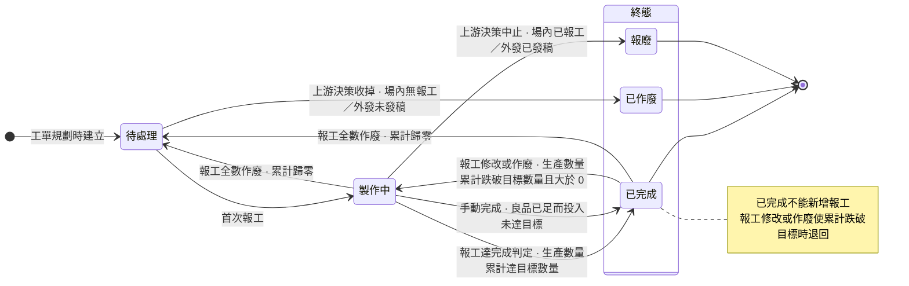
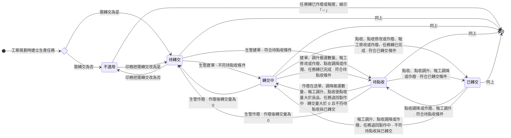
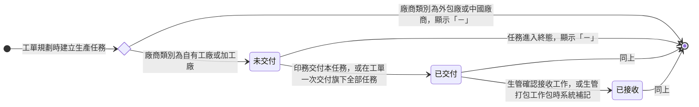
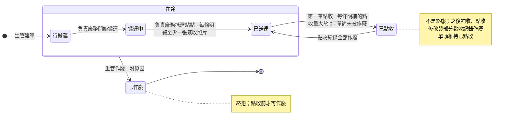

# 生產段分派、報工、轉交 Linear 修正草稿（2026-10-07，尚未評分、尚未寫入）

依據：2026-10-06～07 拍板正本（Sens memory/erp/production-dispatch-report-transfer-20261006/grill-decisions.md）、已落卡的 wiki 生產段卡、Prototype 分支 prototype/dispatch-and-shipping 提交 20370532（mock 與情境目錄）。
比對對象：Linear 現行版本，讀取時間 2026-10-07（唯讀，未寫入任何內容）。

寫入原則：

1. 既有票只傳 `id` 與 `description`；不動 estimate、assignee、cycle、priority、milestone、labels。全部受影響票皆為 Backlog，不涉及改回 Todo。
2. 本稿的「改寫後」整段可直接覆蓋寫入。外層用四個反引號包住，內層的 Mermaid 區塊沒有零寬字元，貼進 Linear 即可。
3. P-PM-237 各票的舊「參考留言」連結全數移除（舊訂正已被本輪內容取代）。凡有訂正紀錄留言的票，以段落為單位，在每個有改寫的段落結尾放一個「參考留言」連結占位（留言代號寫「待填」）：Feature 票的使用者故事、實體關係、驗證規則、算式、驗收、權限表各為一段；整節新增的功能節只在節尾放一個；Task 票的背景、規則、驗收、範圍各為一段。寫入時先發第八節的留言，再把留言網址填入主體。P-DE-33 四張票未改寫的段落保留舊連結。
4. 驗收條件欄位數字、單號、人名取自 Prototype mock 與 `erp-prototype-tests/docs/scenario-catalog.md` 的起點資料；Prototype 沒有現成資料的情境，已在「停下待裁決」標出。
5. 站點名稱（品檢站、裁切站等）為 Prototype 假資料，待站點清單定案後整批換名，規則不變。

---

## 一、票清單與處置

### 生產管理 project（P-PM-237）

| 票號 | 票名 | 處置 | 一句話理由 |
|------|------|------|-----------|
| P-PM-237 描述 | 中台 - 生產管理 | 局部改寫 | Use Case、Scope 與 Out of Scope 對齊拍板；刪前置受影響警示與已完成再報工另案；四張狀態機依 wiki 現行版重繪（已完成不能新增報工、加工廠進交付狀態、轉交單可作廢範圍、已點收可退回已送達） |
| PM-1356 | 生產任務接收與派工 | 局部改寫 | 加工廠進所有生產任務與接收；取消工作包即刪除；補加工廠驗收 |
| PM-1357 | 生產任務報工 | 重寫 | 報工前提與入口全部改寫；自助報工併入「生產任務報工」，新增「代報生產任務」節；已完成可作廢；刪人工註記、單位換算、印件詳情報工 |
| PM-1358 | 轉交單建立與搬運 | 重寫 | 依目的產線分組；多張建單任一超額全擋；新增「搬運數量修改」；點收前可作廢；預計轉交日必填 |
| PM-1359 | 轉交點收與到料 | 重寫 | 點收只有一個動作；刪「再次點收」節與代點收；新增「點收紀錄作廢」；每條明細都要大於 0；可做量不換算 |
| BE-424 | 生產任務接收與工作包的資料處理 | 局部改寫 | 「待接收清單」改所有生產任務並納入加工廠；取消即刪除 |
| FE-592 | 生產任務管理與工作包管理介面 | 局部改寫 | 移除舊參考留言連結；規則 6、驗收 2、4、5 改為業務結果寫法（非行為變更） |
| BE-425 | 報工、修改、作廢與手動完成的資料處理 | 重寫 | 範圍判定、報工前提、數量檢核、已完成可作廢全部改寫；刪人工註記與單位換算 |
| FE-593 | 報工、修改、作廢與手動完成的操作介面 | 重寫 | 已完成沒有報工入口但保留修改與作廢；刪人工註記；範圍段刪印件詳情頁 |
| BE-426 | 轉交單建立、搬運與作廢的資料處理 | 局部改寫 | 依目的產線分組；整批全擋；預計轉交日必填；新增搬運數量修改；已送達可作廢 |
| FE-594 | 待轉交任務與轉交單管理介面 | 局部改寫 | 預計轉交日；搬運數量修改入口；作廢入口範圍；作廢原因為文字；刪預設值規則 |
| BE-427 | 點收、點收修改與到料量的資料處理 | 重寫 | 單一點收動作；每條明細大於 0；點收紀錄作廢；退回已送達；刪代點收標記 |
| FE-595 | 點收佇列與轉交進度介面 | 局部改寫 | 點收佇列與所有轉交單同功能；刪再次點收與預設值規則；補點收紀錄作廢 |

### 工單管理 project（P-DE-33）

| 票號 | 票名 | 處置 | 一句話理由 |
|------|------|------|-----------|
| P-DE-33 描述 | 中台 - 工單管理 | 不動 | 描述已把交付後的接收、派工、報工、轉交歸生產管理 |
| PM-1346 | 工單製程審核與交付產線 | 局部改寫（逐段） | 只改「生產任務交付」實體關係（刪待接收清單句）與「送審後站點與產線修改」驗收（站點名當產線名改為產線加站點） |
| PM-1149 | 工單製程規劃 | 局部改寫（逐段） | 只改外發任務產線、數量單位取主檔單位、刪上機張數換算、需轉交預設句，共五個段落 |
| BE-360 | 生產任務數量、排程、排序與確樣的資料處理 | 局部改寫 | 數量單位取主檔單位（一行） |
| BE-419 | 送審、審核、收回與交付的狀態處理 | 局部改寫 | 驗收第 5 條把站點名當產線名，改為「產線＋站點」寫法（一條） |
| FE-468 | 工單詳情與製程規劃介面 | 不動 | 票內沒有報工入口與單位的內容，報工入口歸生產管理 FE-593 |
| PM-1347、FE-469、FE-503、BE-340、其他 | — | 不動 | 與拍板無涉 |

### 訂單管理 project

- 掃過全部 49 張票，沒有「印件詳情報工入口」的票。印件詳情不報工的規則只需要在 PM-1357 與 FE-593 寫明。

---

## 二、P-PM-237 專案描述

### 刪除

- Use Case 第 8 條「單子建錯時，生管在待搬運時直接改單，搬運中作廢後重開」：整條改寫，搬運中以外的已送達也可作廢。
- Out of Scope「前置受影響警示：後續批次。」整條刪（前置受影響規則已刪）。
- 另案處理「已完成的生產任務再報工時，所屬工單、印件或訂單已到終態是否擋下」整條刪（已完成的任務不能新增報工，此題不成立）。
- 狀態機：生產任務狀態機「已完成再報工維持已完成」整條弧與註記、生產任務轉交狀態機「再報工」字樣、交付狀態機「自有工廠才推導」、轉交單狀態機「已送達只有報廢才可作廢」與「已點收為終態」。

### 改寫後（整段覆寫；概述與第一行工單狀態機引用維持現行，下列為全文）

````markdown
## 概述

生產管理承接印務交付產線之後的現場執行：生管接收生產任務並合批派給師傅，師傅報工，做好的半成品由生管建轉交單、廠務搬運、下一站照實點收後開工。

現行工廠靠紙本工單。師傅做完在紙上註記，進度靠人工回報，主管看不到即時狀況，產能不透明。生管每天手動整理派工表。半成品靠紙本工單跟著貨走，下一站靠口頭確認貨到了沒有；師傅不看前置就報工，會出現上一站的貨還沒到、這一站已經報了產出的錯報。

---

## 使用情境

### Use Case

1. 印務把生產任務交付產線後，生管確認接收，把可以一起做的活合成工作包派給一位師傅；要換師傅時，取消工作包後重新打包。
2. 師傅打開自己的工作包或生產任務，前置有到料就開工，做完一段就報工並附現場照片。
3. 生管、印務、印務主管在生產管理頁面依所屬產線代報；印務在工單詳情頁替自己負責的工單報工，含加工廠與外發任務。
4. 師傅與代報人員數字錯就修改，整筆不該存在就作廢重報。良品已經夠下游用時，生管手動完成生產任務。
5. 生管在待轉交任務勾選各任務累積的可搬量建轉交單，指定這趟的負責廠務，系統只通知負責廠務。
6. 負責廠務開始搬運，抵達站點時逐條明細拍簽收照片。
7. 目的產線的師傅或品檢人員逐條明細照實點收；貨後來補到就再點收一筆，點錯就修改點收量，整筆點錯單就作廢那一筆。下游的到料量隨點收增加。
8. 單子建錯時，生管作廢重開、改單或改搬運數量。
9. 數量錯誤流到下游時，生管與師傅由下往上逐層更正。
10. 現場人員打開生產管理，只看到所屬產線或指派給自己的單據。

### Scope（功能票清單）

1. **生產任務接收與派工**：生管確認接收交付來的自有工廠與加工廠生產任務，合批成工作包派給師傅，並調整或取消工作包。　<issue id="6302f97d-c269-4551-ae46-e9ac2facb8e5" href="https://linear.app/sensationdeveloper/issue/PM-1356/feature-%E7%94%9F%E7%94%A2%E4%BB%BB%E5%8B%99%E6%8E%A5%E6%94%B6%E8%88%87%E6%B4%BE%E5%B7%A5">PM-1356</issue>
2. **生產任務報工**：師傅與代報人員報工、修改或作廢報錯的報工，生管在良品已足時手動完成生產任務，並查看每筆生產任務的歷程。　<issue id="98ca98df-6a24-434a-96b7-7915d5743a5a" href="https://linear.app/sensationdeveloper/issue/PM-1357/feature-%E7%94%9F%E7%94%A2%E4%BB%BB%E5%8B%99%E5%A0%B1%E5%B7%A5">PM-1357</issue>
3. **轉交單建立與搬運**：生管建轉交單並指定負責廠務、改單、改搬運數量、作廢重開，負責廠務回報開始搬運與抵達站點。　<issue id="5f2a2762-24c1-4c1a-a3a0-4cc74f783126" href="https://linear.app/sensationdeveloper/issue/PM-1358/feature-%E8%BD%89%E4%BA%A4%E5%96%AE%E5%BB%BA%E7%AB%8B%E8%88%87%E6%90%AC%E9%81%8B">PM-1358</issue>
4. **轉交點收與到料**：收貨人照實點收、補收、修改點收量、作廢點錯的點收紀錄，生管看得到每筆任務的轉交進度與到料量。　<issue id="232a90d0-9e1a-412a-9234-bbf677e5816e" href="https://linear.app/sensationdeveloper/issue/PM-1359/feature-%E8%BD%89%E4%BA%A4%E9%BB%9E%E6%94%B6%E8%88%87%E5%88%B0%E6%96%99">PM-1359</issue>

**Out of Scope**

* 印務交付產線、生產任務的目的站點、產線、需轉交與前置設定：歸 <project id="0f3014e0-20e5-4411-babe-15da0609564d" href="https://linear.app/sensationdeveloper/project/%E4%B8%AD%E5%8F%B0-%E5%B7%A5%E5%96%AE%E7%AE%A1%E7%90%86-811bb7333b57/overview">中台 - 工單管理</project>。
* 工單異動、生產任務作廢與報廢的發起與確認：歸 <project id="0f3014e0-20e5-4411-babe-15da0609564d" href="https://linear.app/sensationdeveloper/project/%E4%B8%AD%E5%8F%B0-%E5%B7%A5%E5%96%AE%E7%AE%A1%E7%90%86-811bb7333b57/overview">中台 - 工單管理</project> 後續批次。
* 排程與工廠總覽、生產績效指標：後續批次。
* 外發派單、外發回廠點收：歸派單（尚未建立 project）。
* 品檢待驗清單與品檢紀錄：歸品檢與出貨（尚未建立 project）。
* 涉及暫存區的場內搬運：不在本 project，現場以標示留痕。
* 人員所屬產線的維護、各角色預設持有的生產管理權限：歸人員主檔與角色權限管理模組。

---

## 另案處理（來源尚未定案，暫不實作）

* 廠務以 Slack 表單回報開始搬運與抵達站點：外部串接另案，本批在系統端回報。
* 來源任務報廢後依實況重建的轉交單如何點收：待裁，本批重建單的點收照樣被擋下。
* 外發回台的貨送場內後段產線是否走轉交單：待裁，本批只做送品檢站這一條。

---

## 狀態機

工單狀態機見 <project id="0f3014e0-20e5-4411-babe-15da0609564d" href="https://linear.app/sensationdeveloper/project/%E4%B8%AD%E5%8F%B0-%E5%B7%A5%E5%96%AE%E7%AE%A1%E7%90%86-811bb7333b57/overview">中台 - 工單管理</project>。

>>> ### 生產任務狀態機



* 四種廠商類別走同一條路徑。
* 本任務退回製作中時，所屬工單、印件、訂單不跟著回退。

>>>

>>> ### 生產任務轉交狀態機



系統推導的衍生狀態，沒有手動轉換。依下表順序判定，第一個成立的就是結果：

| 順序 | 結果 | 條件 |
| -- | -- | -- |
| 1 | 「－」 | 生產任務狀態為已作廢或報廢 |
| 2 | 不適用 | 需轉交為否 |
| 3 | 已轉交 | 生產任務已完成，良品數大於 0，轉交點收量等於良品數 |
| 4 | 待點收 | 生產任務已完成，轉交量不小於良品數，轉交點收量小於良品數 |
| 5 | 轉交中 | 轉交量大於 0 |
| 6 | 待轉交 | 轉交量等於 0 |

>>>

>>> ### 生產任務交付狀態機



系統推導的衍生狀態，沒有手動轉換。依下表順序判定，第一個成立的就是結果：

| 順序 | 結果 | 條件 |
| -- | -- | -- |
| 1 | 「－」 | 廠商類別為外包廠或中國廠商，或生產任務狀態屬終態 |
| 2 | 已接收 | 接收工作有值 |
| 3 | 已交付 | 交付時間有值 |
| 4 | 未交付 | 其餘 |

>>>

>>> ### 轉交單狀態機



>>>
````

---

## 三、P-PM-237 Feature 票

### 3-1 PM-1356 生產任務接收與派工（局部改寫）

#### 刪除

- 「生產任務接收」實體關係第 2 條「只有自有工廠的生產任務進接收與派工。加工廠、外包廠與中國廠商的生產任務不進。」：改寫為自有工廠與加工廠進、外包廠與中國廠商不進（加工廠算場內，交付與接收同自有工廠）。
- 「生產任務派工」驗證規則第 1 條的「自有工廠」限定（待裁決 1）。

#### 改寫後（整張覆寫）

````markdown
## 概述

這張票做完，生管能在 <project id="9d055ea4-9212-4711-a0d6-22870079b450" href="https://linear.app/sensationdeveloper/project/%E4%B8%AD%E5%8F%B0-%E7%94%9F%E7%94%A2%E7%AE%A1%E7%90%86-148ecc50024f/overview">中台 - 生產管理</project> 確認接收印務交付來的生產任務，把可以一起做的活合成工作包派給一位師傅，並調整或取消工作包。

生產任務交付狀態的流轉見 <project id="9d055ea4-9212-4711-a0d6-22870079b450" href="https://linear.app/sensationdeveloper/project/%E4%B8%AD%E5%8F%B0-%E7%94%9F%E7%94%A2%E7%AE%A1%E7%90%86-148ecc50024f/overview">中台 - 生產管理</project> 的生產任務交付狀態機。

## 權限

| 權限名稱 | 動作 | 範圍 |
| -- | -- | -- |
| 管理生產任務（產線） | 檢視生產任務、確認接收工作、建立工作包並指派師傅、取消工作包 | 自己負責 |
| 管理生產任務（負責） | 檢視生產任務 | 被指派 |
| 管理工作包（產線） | 檢視工作包、修改預計完成日、備註與確樣備註 | 自己負責 |
| 管理工作包（負責） | 檢視工作包、修改預計完成日、備註與確樣備註 | 被指派 |
| 檢視生產管理 | 檢視生產任務、工作包 | 全公司 |

>>> ## 生產任務接收

身為生管，我要確認接收印務交付來的生產任務，以讓每一筆交出來的活都有人接手、查得到誰在什麼時候接的。

**實體關係**

1. 接收以生產任務為單位，可單筆，也可批次。每筆接收記接收人與接收時間，寫入後不清除。
2. 所有生產任務只列已交付的自有工廠與加工廠任務。外包廠與中國廠商的任務不列，不經生管接收。

（[參考留言](<https://linear.app/sensationdeveloper/issue/PM-1356#comment-待填>)）

**驗證規則**

1. 生產任務的交付狀態在已交付才可確認接收。
2. 已接收的生產任務不再重複寫入接收紀錄。

**驗收**

1. 假設 WO-2026-0815 的牛皮紙 150g 備料已交付、尚未接收，當許文傑在所有生產任務對這一筆按接收工作，則該筆的接收工作記許文傑與接收時間。
2. 假設接上一條，當許文傑勾選 WO-2026-0815 的牛皮紙 150g 備料、五色印刷、軋盒成型、糊盒成型四筆後批次接收，則只接收另外三筆，牛皮紙 150g 備料的接收人與接收時間維持上一條的值。
3. 假設 WO-2026-0812 的證書裁切已由許文傑於 2026-08-22 10:00 接收，當許文傑在所有生產任務檢視這一筆，則沒有接收工作的動作，接收紀錄仍為許文傑、2026-08-22 10:00。
4. 假設 WO-2026-0812 的證書局部上光為加工廠任務、已由許文傑於 2026-08-22 10:00 接收，當鄭宇翔（手工、壓克力產線）開所有生產任務，則列出這一筆，交付狀態為已接收，沒有接收工作的動作。

（[參考留言](<https://linear.app/sensationdeveloper/issue/PM-1356#comment-待填>)）

>>>

>>> ## 生產任務派工

身為生管，我要把可以一起做的生產任務合成一個工作包派給一位師傅，以讓師傅上工就知道要做哪一批。

**實體關係**

1. 一個工作包收多筆生產任務，可跨工單、跨印件。一筆生產任務同時只屬於一個工作包。
2. 一個工作包指派給一位師傅。旗下生產任務的指派師傅取自工作包，未打包時為空。
3. 派工後生產任務留在生產任務清單，帶出所屬工作包與指派師傅。工作包不設狀態，現場進度取「已完成任務數／任務總數」。
4. 派工時，尚未接收的生產任務由系統補記接收：接收人為派工者，時間為派工時間。
5. 自己負責範圍以生產任務的產線對應本人的所屬產線，工作包取旗下任一任務的產線。被指派範圍以工作包的指派師傅對應本人。兩種範圍各自判定、不疊加。

**驗證規則**

1. 交付狀態為已交付或已接收的生產任務才可派工。
2. 已屬某個工作包的生產任務不可再併入其他工作包。
3. 必填欄位未填齊不受理。
4. 派工不檢查前置到料，也不改變生產任務狀態。

（[參考留言](<https://linear.app/sensationdeveloper/issue/PM-1356#comment-待填>)）

**驗收**

1. 假設 WO-2026-0812 的證書裁切、信封裁切、內卡裁切已接收、尚未打包，信封裁切與內卡裁切的可做量皆為 0，當許文傑勾選三筆、指派李榮發、預計完成日填 2026-09-08 後建立，則派工照常成立：系統建立一個新工作包，三筆仍在所有生產任務並帶出新工作包與李榮發，生產任務狀態仍為待處理，新工作包已完成 0 筆、共 3 筆。
2. 假設 WO-2026-0710 的海報四色印刷已屬 WP-2026-0710-01（指派師傅劉阿海），當許文傑開所有生產任務，則該列不可勾選併入其他工作包，並帶出 WP-2026-0710-01 與劉阿海。
3. 假設鄭宇翔的所屬產線為手工產線與壓克力產線，當鄭宇翔開所有生產任務，則只看到手工產線的任務，看不到 WO-2026-0815 四筆。
4. 假設劉阿海是 WP-2026-0710-01、WP-2026-0812-01 與 WP-2026-0820-01 的指派師傅，當劉阿海開我的工作包，則只看到這三個工作包，WP-2026-0710-01 已完成 1 筆、共 2 筆，看不到李榮發的 WP-2026-0710-02。

（[參考留言](<https://linear.app/sensationdeveloper/issue/PM-1356#comment-待填>)）

>>>

>>> ## 工作包調整

身為生管，我要在派工後改工作包的預計完成日、備註與確樣備註，以跟上現場進度的變化。

**實體關係**

1. 工作包派出後可改預計完成日、備註與確樣備註。
2. 指派師傅在工作包建立後不可改。要換師傅，取消工作包後重新打包。

**驗證規則**

1. 必填欄位未填齊不受理。

**驗收**

1. 假設 WP-2026-0710-02 的指派師傅為李榮發、預計完成日 2026-09-02，當許文傑在所有工作包按編輯工作包，則指派師傅不可改。
2. 假設接上一條，當許文傑把預計完成日改為 2026-09-05、確樣備註填「首件對刀線」後儲存，則儲存成立，列表的預計完成日為 2026-09-05。
3. 假設李榮發是 WP-2026-0710-02 的指派師傅，當李榮發在我的工作包對它按編輯工作包、改備註後儲存，則儲存成立，備註顯示新的內容。

（[參考留言](<https://linear.app/sensationdeveloper/issue/PM-1356#comment-待填>)）

>>>

>>> ## 工作包取消

身為生管，我要取消排錯或要換師傅的工作包，以把旗下任務放回待派、重新打包給對的師傅。

**實體關係**

1. 取消即刪除這個工作包。旗下生產任務解除工作包、回到待派，指派師傅回到空值，可再打包進新的工作包。
2. 已有的報工紀錄留在生產任務上，不因取消而改動。

（[參考留言](<https://linear.app/sensationdeveloper/issue/PM-1356#comment-待填>)）

**驗證規則**

1. 工作包任何時候都可取消，不看旗下生產任務的狀態。

**驗收**

1. 假設 WP-2026-0710-02 旗下只有裁切成型一筆、指派師傅李榮發，當許文傑在所有生產任務對裁切成型按取消工作包並確認，則裁切成型的工作包與指派師傅皆為空，該列可再勾選。
2. 假設 WP-2026-0710-01 旗下的雪銅紙 150g 備料已完成、海報四色印刷製作中，當許文傑取消這個工作包，則取消成立，兩筆回到待派，備料與海報四色印刷的生產數量累計維持 3,090 與 2,000，目標數量都是 3,090。
3. 假設接第 1 條，當許文傑勾選裁切成型、指派陳金水建立工作包，則裁切成型落在新的工作包，指派師傅為陳金水。

（[參考留言](<https://linear.app/sensationdeveloper/issue/PM-1356#comment-待填>)）

>>>

>>> ## 另案處理（來源尚未定案，暫不實作）

* 自工作包移出單筆任務：規則來源未定義，待補齊來源後另開。

>>>
````

---

### 3-2 PM-1357 生產任務報工（重寫）

#### 刪除

- 權限表：「在工單詳情頁、印件詳情頁對生產任務報工」的印件詳情頁；整份權限表依五個入口與單元重排（補管理生產任務（產線）、管理生產任務（負責）的報工動作）。
- 「生產任務報工」實體關係第 1 條的「所屬工作包」（報工不掛工作包）；第 4 條的「印件詳情頁」；驗證規則第 3 條「換算成投入單位」；算式第 2 條「投入與產出單位不同時依每件產出耗用的投入量換算」。
- 「報工作廢」驗證規則第 1 條「已完成時不可作廢報工」與第 1 條驗收（已完成沒有作廢）。
- 「人工註記新增」整個功能節。
- 「生產任務歷程檢視」實體關係的「人工註記」。
- 另案處理「已完成的生產任務再報工時…是否擋下」整段。

#### 改寫後（整張覆寫）

````markdown
## 概述

這張票做完，師傅與代報人員能在 <project id="9d055ea4-9212-4711-a0d6-22870079b450" href="https://linear.app/sensationdeveloper/project/%E4%B8%AD%E5%8F%B0-%E7%94%9F%E7%94%A2%E7%AE%A1%E7%90%86-148ecc50024f/overview">中台 - 生產管理</project> 對生產任務報工、修改或作廢報錯的報工，生管能在良品已足時手動完成生產任務，並查看每筆生產任務的歷程。

生產任務狀態的流轉見 <project id="9d055ea4-9212-4711-a0d6-22870079b450" href="https://linear.app/sensationdeveloper/project/%E4%B8%AD%E5%8F%B0-%E7%94%9F%E7%94%A2%E7%AE%A1%E7%90%86-148ecc50024f/overview">中台 - 生產管理</project> 的生產任務狀態機。

## 權限

| 權限名稱 | 動作 | 範圍 |
| -- | -- | -- |
| 管理生產任務（產線） | 對生產任務報工、修改與作廢報工、手動完成生產任務、檢視生產任務歷程 | 自己負責 |
| 管理生產任務（負責） | 對指派給自己的生產任務報工、修改與作廢自己提交的報工、檢視生產任務歷程 | 被指派 |
| 管理工作包（產線） | 對工作包內的生產任務報工、修改與作廢報工、手動完成生產任務 | 自己負責 |
| 管理工作包（負責） | 對自己工作包內的生產任務報工、修改與作廢自己提交的報工 | 被指派 |
| 工單內報工 | 在工單詳情頁對生產任務報工 | 自己負責 |
| 工單內報工 | 在工單詳情頁對生產任務報工 | 被分享（編輯） |
| 修改作廢工單內報工 | 修改、作廢工單下生產任務的報工 | 自己負責 |
| 修改作廢工單內報工 | 修改、作廢工單下生產任務的報工 | 被分享（編輯） |

（[參考留言](<https://linear.app/sensationdeveloper/issue/PM-1357#comment-待填>)）

>>> ## 生產任務報工

身為師傅，我要做完一段活就回報投入多少、好的幾件、壞的幾件並附照片，以讓工單、印件、訂單的進度不必有人轉抄就跟上現場。

**實體關係**

1. 一筆生產任務有多筆報工紀錄。
2. 師傅在我的工作包與我的生產任務報工，提交管道為師傅自助，由系統依入口帶入。
3. 備註是報工人員報工當下的補充。
4. 任務實際開工取首筆報工的時間。任務轉已完成時記任務實際完成日。
5. 首次報工時，所屬工單、印件、訂單依各自狀態機推進。

**驗證規則**

1. 生產任務已交付（交付時間有值）才可報工。不要求已接收，也不要求已打包。
2. 生產任務已完成、已作廢或報廢時不可新增報工。
3. 任一前置任務的到料量為 0 時不可報工，系統指出在等哪張工單、哪一筆生產任務的貨。沒有前置任務時不檢查到料。
4. 必填欄位未填齊不受理。
5. 下列情形無法送出報工：
   * 生產數量不大於 0。
   * 良品數與不良品數同為 0。
   * 良品數加不良品數大於生產數量。
6. 師傅只能報指派給自己的生產任務。
7. 繞過介面送出越權的報工時，系統擋下，不寫入。

**算式**

```
生產數量累計 ＝ 有效報工的生產數量加總
產出數量 ＝ 有效報工的良品數累計 ＋ 不良品數累計
完成判定：生產數量累計 ≧ 目標數量
```

1. 有效報工指未作廢的報工。報工修改後取改後的值。
2. 生產數量、良品數與不良品數一律當數值計算，單位只用於顯示。
3. 生產數量累計超過目標數量時照實記。

**驗收**

1. 假設 WO-2026-0815 的牛皮紙 150g 備料已打包給劉阿海、沒有前置、尚無報工、目標數量 2,060，當劉阿海在我的生產任務對它報生產數量 520、良品 520、不良品 0，則報工成立，提交管道為師傅自助，生產數量累計為 520，任務轉製作中，WO-2026-0815 的工單轉製作中。
2. 假設同一筆任務，當劉阿海報生產數量 300、良品 300、不良品 10，則無法送出，不寫入報工。
3. 假設 WP-2026-0710-02 的裁切成型，前置海報四色印刷的 TT-20260830-002 已送達未點收、TT-20260830-003 搬運中，當李榮發在我的工作包展開這個工作包，則裁切成型的可做量為 0，沒有報工入口。
4. 假設 WO-2026-0812 的證書四色印刷已完成，當劉阿海在我的生產任務檢視它，則沒有報工入口。
5. 假設接第 1 條，當劉阿海再對牛皮紙 150g 備料報生產數量 1,540、良品 1,540，則生產數量累計為 2,060、目標數量為 2,060，任務轉已完成。

（[參考留言](<https://linear.app/sensationdeveloper/issue/PM-1357#comment-待填>)）

>>>

>>> ## 代報生產任務

身為生管，我要在師傅沒空時從所有工作包與所有生產任務依所屬產線代報，以讓進度不必有人轉抄就進系統。
身為印務，我要在工單詳情頁替自己負責的工單報工，以讓加工廠與外發任務的進度進系統。

**實體關係**

1. 代報的入口與提交管道如下表，管道由系統依入口帶入，使用者不可選、不可改：

| 報工入口 | 提交管道 |
| -- | -- |
| 工單詳情 | 印務於工單詳情頁 |
| 所有工作包、所有生產任務 | 生產管理頁面代報 |

2. 印件詳情不報工。

**驗證規則**

1. 代報同樣依「生產任務報工」的報工前提與數量檢核受理，不要求已接收或已打包。
2. 所有工作包與所有生產任務的代報，只受理產線在本人所屬產線內的生產任務。
3. 所有工作包列出整包，但包內只有產線在本人所屬產線內的生產任務可報、可改、可作廢，其他任務只能看。
4. 工單詳情的報工，只受理自己負責或被分享（編輯）的工單下的生產任務。

**驗收**

1. 假設 WO-2026-0815 的牛皮紙 150g 備料已交付、尚未接收、尚未打包、沒有前置，當許文傑在所有生產任務對它報生產數量 520、良品 520、不良品 0，則報工成立，提交管道為生產管理頁面代報，報工人員為許文傑，任務轉製作中，交付狀態維持已交付。
2. 假設 WO-2026-0812 的證書局部上光為加工廠任務、已接收，當負責印務周建宏在工單詳情對它報生產數量 200、良品 198、不良品 2，則報工成立，提交管道為印務於工單詳情頁，任務轉製作中，沒有所屬工作包、指派師傅為空。
3. 假設許文傑把證書裁切（手工產線）與 WO-2026-0815 的五色印刷（數位產線）打成一包給劉阿海，當鄭宇翔（手工、壓克力產線）在所有工作包展開這一包，則證書裁切有報工入口，五色印刷沒有。
4. 假設 PI-2026-0815 的工單已交付，當周建宏開 PI-2026-0815 印件詳情，則沒有報工入口。

（[參考留言](<https://linear.app/sensationdeveloper/issue/PM-1357#comment-待填>)）

>>>

>>> ## 報工修改

身為師傅，我要把報錯的生產數量、良品數或不良品數直接改成正確的數，以讓折損率、良率與實際成本取到現場真正的數字。

**實體關係**

1. 修改只動有效的報工，可改生產數量、良品數與不良品數，備註可一併修改。
2. 每次修改留一筆修改紀錄，記修改前後值、修改人、修改時間與原因。一筆報工可有多筆修改紀錄。
3. 一部分要算損耗時，良品改少、不良品改多同量，生產數量不變。損耗怎麼來的寫在修改原因，系統不區分。

**驗證規則**

1. 必填欄位未填齊不受理。
2. 已完成的生產任務可修改報工；所屬工單或訂單已完成後，報工同樣可修改。
3. 修改後同樣要滿足報工的數量檢核：生產數量大於 0，良品數與不良品數不得同時為 0，良品數加不良品數不大於生產數量。
4. 調降的數量會讓已流到下游的量對不上時，擋下修改，數字不改。擋下條件與系統列出的內容如下表，調升不擋：

| 情形 | 擋下條件 | 系統列出 |
| -- | -- | -- |
| 需轉交的任務 | 改後良品數低於在途明細搬運數量合計加已點收明細點收數量合計 | 佔用的轉交單與數字 |
| 不需轉交的任務 | 下游任務已有報工 | 已報工的下游任務 |
| 所屬印件 | 改後待驗量變成負數 | 該印件已驗量 |

5. 擋下時，系統不自動修改點收、轉交單或下游報工。由下往上逐層更正：下游報工、點收、搬運數量、上游報工，每層照同一組條件檢查。
6. 第 4 條以寫入當下的數字檢核。兩筆修改或作廢同時寫入時，先寫入者成立，後到者以新數字重新檢核。

**驗收**

1. 假設 WP-2026-0812-01 的證書四色印刷有一筆報工 wr-0018（生產 515、良品 500、不良 15），TT-20260827-001 已點收 480，當周建宏把良品改為 480、不良品改為 35 後送出，則修改成立，生產數量仍為 515，良品為 480、不良品為 35，修改紀錄記良品數 500 → 480、不良品數 15 → 35、周建宏、時間與原因，證書四色印刷維持已完成。
2. 假設海報四色印刷良品 1,990，其中 TT-20260830-002 已送達 1,190、TT-20260830-003 搬運中 800，當周建宏把報工 wr-0006（生產 1,000、良品 1,000）的良品改為 900，則擋下修改，列出 TT-20260830-002 與 TT-20260830-003，良品仍為 1,990。
3. 假設許文傑已把 TT-20260830-003 的搬運數量改為 700，當周建宏把 wr-0006 的良品改為 900，則修改成立，海報四色印刷的良品為 1,890。
4. 假設 wr-0018 為原值，當周建宏把生產數量改為 500、良品改為 485、不良品維持 15 後送出，則修改成立，證書四色印刷的生產數量累計為 500、目標數量為 515，任務退回製作中。

（[參考留言](<https://linear.app/sensationdeveloper/issue/PM-1357#comment-待填>)）

>>>

>>> ## 報工作廢

身為師傅，我要把整筆不該存在的報工作廢後重報，以免錯的數字留在累計裡。

**實體關係**

1. 作廢的報工不消失，改列為已作廢，記作廢人、作廢時間與原因。
2. 作廢的報工不計入任何累計。
3. 整筆報工不該存在（如報到錯的任務）時才作廢，再到正確的任務重報。數字不對用報工修改。

**驗證規則**

1. 已完成的生產任務可作廢報工。
2. 作廢套用「報工修改」驗證規則第 4 條的擋下條件，以作廢後的數字檢核。
3. 必填欄位未填齊不受理。

**驗收**

1. 假設證書四色印刷已完成，報工 wr-0018 的良品已被 TT-20260827-001 點收 480，當周建宏在所有工作包作廢 wr-0018，則擋下作廢，列出 TT-20260827-001，報工維持有效。
2. 假設信封四色印刷良品 300 全數在已送達的 TT-20260827-002 上，當周建宏作廢報工 wr-0019，則擋下作廢，列出 TT-20260827-002，報工維持有效。
3. 假設 TT-20260830-002 與 TT-20260830-003 合計佔用海報四色印刷 1,990，劉阿海剛報一筆生產 500、良品 490、不良品 10（生產數量累計 2,500、目標數量 3,090），當劉阿海作廢這一筆，則作廢成立，生產數量累計回到 2,000，良品為 1,990，該筆列為已作廢並記作廢人、時間與原因。

（[參考留言](<https://linear.app/sensationdeveloper/issue/PM-1357#comment-待填>)）

>>>

>>> ## 生產任務手動完成

身為生管，我要在良品已經夠下游用時直接把生產任務標完成，以免逼現場把剩下的量跑完多做廢工。

**實體關係**

1. 手動完成不改任務內容，目標數量、放損率與已報工數量不變。
2. 手動完成時，生產任務歷程記操作人與時間，並記任務實際完成日。

**驗證規則**

1. 生產任務在製作中才可手動完成。

**驗收**

1. 假設 WO-2026-0710 的海報四色印刷製作中、目標 3,090、已報 2,000，當許文傑在所有工作包或所有生產任務對它按手動完成，則任務轉已完成，目標數量 3,090 與生產數量累計 2,000 不變，歷程新增一筆手動完成，記許文傑與時間。
2. 假設 WP-2026-0710-02 的裁切成型為待處理、WP-2026-0812-01 的證書四色印刷已完成，當許文傑展開這兩個工作包，則這兩列都沒有手動完成。
3. 假設接第 1 條，當印務周建宏開 WO-2026-0710 工單詳情，則海報四色印刷的任務實際完成日為手動完成那一天。

（[參考留言](<https://linear.app/sensationdeveloper/issue/PM-1357#comment-待填>)）

>>>

>>> ## 生產任務歷程檢視

身為生管，我要在一處看到一筆生產任務發生過的每一件事，以追得出數字在哪一步變了、貨流到哪一站。

**實體關係**

1. 一筆生產任務有一份歷程。歷程收錄本任務的交付與接收、派工與工作包、報工及其修改作廢、手動完成、目的站點與產線變更、狀態變化，以及以本任務為來源的轉交單（含搬運數量修改）與點收（含點收修改、點收紀錄作廢）。
2. 派工與工作包類事件指打包派工（含補記接收）、所屬工作包被取消、所屬工作包被編輯。
3. 每筆記時間與操作人。數字、站點與工作包內容的變更記前後值，報工照片、簽收照片與關聯單據一併帶出。
4. 工單詳情與生產管理看到的是同一份歷程。

（[參考留言](<https://linear.app/sensationdeveloper/issue/PM-1357#comment-待填>)）

**驗證規則**

1. 歷程由系統在事件發生時自動寫入，不可手動修改或刪除。

**驗收**

1. 假設證書四色印刷已交付、接收、派工、報工完成，並建了 TT-20260827-001 送到手工產線，當許文傑在所有生產任務對它按檢視歷程，則列出下列各筆：交付（周建宏）、接收（許文傑）、派工（許文傑）、報工（劉阿海）、任務轉已完成（劉阿海）、建轉交單（許文傑）、開始搬運（簡俊男）、抵達站點（簡俊男）、點收（李榮發）。
2. 假設同一筆任務，當周建宏開 WO-2026-0812 工單詳情並展開證書四色印刷，則展開列的歷程與上一條內容相同。
3. 假設 TT-20260830-003 搬運中、明細為海報四色印刷 800、負責廠務簡俊男，當簡俊男附簽收照片回報抵達站點，則海報四色印刷的歷程含一筆抵達事件，記目的產線手工產線，附簽收照片，關聯單據為 TT-20260830-003。
4. 假設周建宏已把 wr-0018 的良品由 500 改為 480，當許文傑開證書四色印刷的歷程，則歷程含一筆報工修改，前後值列出良品數 500 → 480。

（[參考留言](<https://linear.app/sensationdeveloper/issue/PM-1357#comment-待填>)）

>>>
````

---

### 3-3 PM-1358 轉交單建立與搬運（重寫）

#### 刪除

- 「轉交單建立」實體關係第 2 條「系統依來源生產任務建單當下的目的站點分組成單，同一目的地併成一張」；驗證規則第 3 條「其他目的地的單照常建立」；驗收第 5 條（WO-2026-0815 四筆沒有良品，已由驗證規則第 4 條與驗收第 4 條涵蓋）；驗收第 1 條的預設搬運數量（預設值歸 Prototype）。
- 「待搬運轉交單修改」實體關係「待搬運的單可改明細、搬運數量與負責廠務。開始搬運後三者鎖定」：改為「開始搬運後，明細、負責廠務、預計轉交日與備註都不可改」（開始搬運後搬運數量改走新節）。
- 「轉交單作廢」驗證規則第 2 條「已送達時，只有來源任務已轉報廢或已作廢才可作廢」與驗收第 3 條。

#### 改寫後（整張覆寫）

````markdown
## 概述

這張票做完，生管能在 <project id="9d055ea4-9212-4711-a0d6-22870079b450" href="https://linear.app/sensationdeveloper/project/%E4%B8%AD%E5%8F%B0-%E7%94%9F%E7%94%A2%E7%AE%A1%E7%90%86-148ecc50024f/overview">中台 - 生產管理</project> 從待轉交任務建轉交單並指定負責廠務、改單、改搬運數量、作廢重開，負責廠務能回報開始搬運與抵達站點。

（[參考留言](<https://linear.app/sensationdeveloper/issue/PM-1358#comment-待填>)）

轉交單狀態的流轉見 <project id="9d055ea4-9212-4711-a0d6-22870079b450" href="https://linear.app/sensationdeveloper/project/%E4%B8%AD%E5%8F%B0-%E7%94%9F%E7%94%A2%E7%AE%A1%E7%90%86-148ecc50024f/overview">中台 - 生產管理</project> 的轉交單狀態機。

## 權限

| 權限名稱 | 動作 | 範圍 |
| -- | -- | -- |
| 管理待轉交任務（產線） | 檢視待轉交任務、建立轉交單 | 自己負責 |
| 管理轉交單（產線） | 檢視轉交單、修改待搬運的轉交單、修改搬運數量、作廢轉交單、作廢後重開 | 自己負責 |
| 管理轉交單（負責） | 檢視轉交單、開始搬運、抵達站點並上傳簽收照片 | 被指派 |
| 檢視生產管理 | 檢視待轉交任務、轉交單 | 全公司 |

（[參考留言](<https://linear.app/sensationdeveloper/issue/PM-1358#comment-待填>)）

>>> ## 轉交單建立

身為生管，我要在待轉交任務勾選各任務累積出來的可搬量建單，以讓負責廠務接到通知就知道送哪批貨、送去哪、送多少。

**實體關係**

1. 待轉交任務與轉交單的範圍判定如下表：

| 單元 | 自己負責範圍 | 被指派範圍 |
| -- | -- | -- |
| 待轉交任務 | 產線欄在本人所屬產線內的來源生產任務 | 不設 |
| 轉交單 | 來源生產任務的產線或目的產線在本人所屬產線內的轉交單 | 負責廠務為本人的轉交單 |

2. 一張轉交單是一趟送往同一條目的產線的搬運，有多條明細。每條明細是一筆來源生產任務與搬運數量，同一筆任務在一張單只出現一次。一張單可含跨工單、跨印件的貨。
3. 單頭記目的產線，每條明細記目的站點。兩者取建單當下來源生產任務的目的站點，建單時不可改。
4. 系統依目的產線分組成單，同一條目的產線併成一張，各明細的目的站點可不同。外發生產任務回台點收後為來源時，目的地為品檢站。
5. 生管建單時指定這趟的負責廠務，候選限持有管理轉交單（負責）權限的人員。
6. 系統記建單人與建單時間，並只通知負責廠務。

**驗證規則**

1. 必填欄位未填齊不受理。
2. 每條明細的搬運數量大於 0，且不超過來源任務的轉交可申請上限。額度以按下建立那一刻的最新值計。
3. 一次勾多筆建多張單時，任一條超額就全部擋下，一張都不建立。系統顯示超額的任務與當下可搬量，生管重新勾選後再送出。
4. 來源生產任務沒有報工良品，或轉交可申請上限不大於 0 時，不列在待轉交任務，不可建單。

**算式**

```
轉交量 ＝ 來源任務未作廢轉交明細的搬運數量合計
轉交可申請上限 ＝ 良品數 − 轉交量
```

1. 待搬運、搬運中、已送達、已點收的明細都計入轉交量。搬運數量修改後取改後的值。
2. 報工修改讓良品數低於轉交量時，轉交可申請上限為負，建單一樣被擋下。

**驗收**

1. 假設 WO-2026-0820 的精裝裝訂良品 500、目的站點品檢站（品檢線）、尚未建單，當許文傑在待轉交任務勾選它，則可搬量顯示 500。
2. 假設接上一條，當許文傑選邱志明後建單，則負責廠務的候選只有簡俊男與邱志明，並建立一張目的產線為品檢線、明細目的站點為品檢站、待搬運的轉交單，負責廠務邱志明、建單人許文傑；只有邱志明收到通知，簡俊男沒有；精裝裝訂不再列在待轉交任務。
3. 假設海報四色印刷良品 1,990，TT-20260830-002 已送達 1,190、TT-20260830-003 搬運中 800，當許文傑開待轉交任務，則海報四色印刷不列出，轉交可申請上限為 0。
4. 假設許文傑在待轉交任務一次勾兩筆來源任務，其中一筆的搬運數量超過可搬量，當送出建單，則兩張單都不建立，系統指出超額的那一筆與當下可搬量。

（[參考留言](<https://linear.app/sensationdeveloper/issue/PM-1358#comment-待填>)）

>>>

>>> ## 待搬運轉交單修改

身為生管，我要在貨還沒人去搬之前直接改單上的明細、搬運數量與負責廠務，以免為了一個數字或換一個人作廢重開。

**實體關係**

1. 開始搬運後，明細、負責廠務、預計轉交日與備註都不可改。
2. 改了負責廠務，系統通知新的負責廠務，並在轉交單歷程記改前與改後的負責廠務。

**驗證規則**

1. 轉交單在待搬運才可修改。
2. 修改後的搬運數量同樣大於 0，且受轉交可申請上限管制。檢核不計本單原有的佔用。
3. 必填欄位未填齊不受理。

**驗收**

1. 假設許文傑已為精裝裝訂建一張待搬運單、搬運數量 500、負責廠務邱志明，當許文傑在所有轉交單把搬運數量改為 600 後儲存，則擋下修改，顯示精裝裝訂當下可搬 500。
2. 假設同一張單，當許文傑把搬運數量改為 300 後儲存，則修改成立，待轉交任務的精裝裝訂可搬量為 200。
3. 假設同一張單，當許文傑把負責廠務改為簡俊男後儲存，則修改成立，簡俊男收到這張單的通知，歷程記負責廠務由邱志明改為簡俊男。
4. 假設 TT-20260830-003 搬運中，當許文傑在所有轉交單看這一列，則沒有修改明細的入口，只有搬運數量修改與作廢。

（[參考留言](<https://linear.app/sensationdeveloper/issue/PM-1358#comment-待填>)）

>>>

>>> ## 搬運數量修改

身為生管，我要在開始搬運之後把報錯的搬運數量改正並留下原因，以讓來源任務的轉交量對得上實際搬的量。

**實體關係**

1. 搬運中、已送達與已點收的單，每條明細的搬運數量都可修改。
2. 每次修改記修改前後值、修改人、修改時間與原因，並記入轉交單歷程與來源任務歷程。
3. 修改不改變單頭狀態。

**驗證規則**

1. 必填欄位未填齊不受理。
2. 改後搬運數量大於 0，且不低於該明細的點收數量。
3. 調降不受轉交可申請上限管制。調升受轉交可申請上限管制，檢核不計本明細原有的搬運數量。
4. 來源生產任務已轉報廢或已作廢時，不可修改搬運數量。

**驗收**

1. 假設 TT-20260830-003 搬運中、海報四色印刷搬運數量 800，當許文傑把搬運數量改為 700，則修改成立，單維持搬運中，歷程記 800 → 700 與原因，待轉交任務的海報四色印刷可搬量為 100。
2. 假設同一張單，當許文傑把搬運數量改為 900，則擋下修改，顯示海報四色印刷當下可搬 800。
3. 假設 TT-20260827-001 已點收、證書四色印刷搬運數量 500、點收數量 480，當許文傑把搬運數量改為 470，則擋下修改，因為低於點收數量 480。
4. 假設同一張單，當許文傑把搬運數量改為 480 後送出，則修改成立，單維持已點收。

（[參考留言](<https://linear.app/sensationdeveloper/issue/PM-1358#comment-待填>)）

>>>

>>> ## 搬運開始回報

身為廠務，我要在把貨推走時回報開始搬運，以讓「該送而還沒有人去搬」與「貨在路上」分得清楚。

**實體關係**

1. 開始搬運由本單的負責廠務回報，歷程的操作人即負責廠務。
2. 廠務不填量。

**驗證規則**

1. 轉交單在待搬運才可開始搬運。

**驗收**

1. 假設精裝裝訂那張待搬運單的負責廠務為簡俊男，當簡俊男在我的轉交單按開始搬運，則狀態轉搬運中，歷程的操作人為簡俊男，廠務不填任何數量。
2. 假設同一張待搬運單，當邱志明開我的轉交單，則不列這張單，沒有開始搬運的入口。
3. 假設 TT-20260830-003 搬運中，當簡俊男在我的轉交單看這一列，則沒有開始搬運，只有抵達站點。

（[參考留言](<https://linear.app/sensationdeveloper/issue/PM-1358#comment-待填>)）

>>>

>>> ## 站點抵達回報

身為廠務，我要在貨放到目的地時逐條明細拍簽收照片回報，以讓下一站知道貨到了、事後查得到送達憑證。

**實體關係**

1. 抵達站點由本單的負責廠務回報。簽收照片掛在每條明細上，每條至少一張。
2. 一張單回報一次抵達即可，抵達成立時系統記實際轉交日。廠務不填量，實際量由收貨人點收時填。

（[參考留言](<https://linear.app/sensationdeveloper/issue/PM-1358#comment-待填>)）

**驗證規則**

1. 轉交單在搬運中才可回報抵達站點。
2. 任一條明細沒有簽收照片時，抵達站點回報送不出去，系統列出缺照的明細。

**驗收**

1. 假設 TT-20260830-003 搬運中、一條明細為海報四色印刷 800、負責廠務簡俊男，當簡俊男按抵達站點、不附照片就送出，則擋下回報，列出海報四色印刷 800 尚未附照，該單維持搬運中。
2. 假設接上一條，當簡俊男在海報四色印刷那一條附兩張照片後送出，則該單轉已送達並記實際轉交日，該條明細有兩張簽收照片，歷程的操作人為簡俊男。
3. 假設 TT-20260830-002 已送達，當簡俊男在我的轉交單看這一列，則沒有抵達站點。

（[參考留言](<https://linear.app/sensationdeveloper/issue/PM-1358#comment-待填>)）

>>>

>>> ## 轉交單作廢

身為生管，我要把建錯或不送的轉交單作廢，以讓額度當下回到來源任務、可以立刻重開。

**實體關係**

1. 作廢以整張單為單位，記作廢人、作廢時間與原因。
2. 作廢的單，其明細即退出轉交量，額度當下回到來源任務。
3. 來源生產任務轉報廢或已作廢時，該任務在途的轉交單（待搬運、搬運中、已送達）標示警示。

**驗證規則**

1. 轉交單在點收前（待搬運、搬運中、已送達）可作廢，原因不限。
2. 轉交單在已點收或已作廢時不可作廢。
3. 必填欄位未填齊不受理。

**驗收**

1. 假設 TT-20260830-003 搬運中、海報四色印刷可搬量 0，當許文傑作廢這張單，則該單轉已作廢，待轉交任務的海報四色印刷可搬量為 800，歷程記許文傑、時間與原因。
2. 假設 TT-20260830-002 已送達、來源海報四色印刷為製作中，當許文傑在所有轉交單作廢這張單，則該單轉已作廢，搬運數量 1,190 退回海報四色印刷。
3. 假設 TT-20260828-001 已點收，當許文傑在所有轉交單看這一列，則沒有作廢。
4. 假設印務在工單異動把海報四色印刷轉報廢，當許文傑開所有轉交單，則已送達的 TT-20260830-002 標示來源任務已無效的警示。

（[參考留言](<https://linear.app/sensationdeveloper/issue/PM-1358#comment-待填>)）

>>>

>>> ## 作廢轉交單重開

身為生管，我要以作廢的原單為底另建新單，以不必從待轉交任務重新勾一次。

**實體關係**

1. 重開的新單沿用原單的目的地與負責廠務，不取來源任務當下的目的站點。
2. 重開成立時系統通知該負責廠務。新單從待搬運起，重走開始搬運與抵達站點。

**驗證規則**

1. 原單在已作廢才可重開。
2. 新單的搬運數量大於 0，且受轉交可申請上限管制。

（[參考留言](<https://linear.app/sensationdeveloper/issue/PM-1358#comment-待填>)）

**驗收**

1. 假設 TT-20260830-003 已作廢、原目的產線手工產線、明細目的站點裁切站、負責廠務簡俊男，周建宏已把海報四色印刷的目的站點改為裝訂產線的後加工站，當許文傑對 TT-20260830-003 按重開新單後送出，則新單目的產線為手工產線、明細目的站點為裁切站、負責廠務簡俊男、狀態待搬運，簡俊男收到通知。
2. 假設同一張作廢單，當許文傑在重開時把搬運數量改為 900，則擋下重開，顯示海報四色印刷當下可搬 800。
3. 假設接第 1 條，當簡俊男開我的轉交單，則新單有開始搬運，沒有抵達站點。
4. 假設 TT-20260830-002 已送達、未作廢，當許文傑在所有轉交單看這一列，則沒有重開新單。

（[參考留言](<https://linear.app/sensationdeveloper/issue/PM-1358#comment-待填>)）

>>>

>>> ## 另案處理（來源尚未定案，暫不實作）

* 廠務以 Slack 表單回報：外部串接另案，本票在系統端回報。
* 外發回台的貨送場內後段產線：待裁，本票只做送品檢站。

>>>
````

---

### 3-4 PM-1359 轉交點收與到料（重寫）

#### 刪除

- 「轉交明細再次點收」整個功能節（點收只有一個動作，補收併入「轉交單點收」）。
- 「轉交單點收」實體關係的「首次點收」說法與「系統留代點收標記」；驗收第 3 條「歷程註明代點收」；驗收第 5 條「沒有點收，只有修改」。
- 「點收量修改」實體關係第 3 條「點收不撤回，要歸零時把點收量改成 0」與驗收第 4 條（改為 0 成立）。
- 轉交進度檢視算式「可做量 ＝ 各前置到料量 ÷ 每件產出耗用的投入量，無條件捨去」的換算。
- 點收量預設值相關內容（預設值歸 Prototype）。

#### 改寫後（整張覆寫）

````markdown
## 概述

這張票做完，目的產線的師傅或品檢人員能在 <project id="9d055ea4-9212-4711-a0d6-22870079b450" href="https://linear.app/sensationdeveloper/project/%E4%B8%AD%E5%8F%B0-%E7%94%9F%E7%94%A2%E7%AE%A1%E7%90%86-148ecc50024f/overview">中台 - 生產管理</project> 照實點收送到本站的貨、補收、修改點收量與作廢點錯的點收紀錄，生管能看到每筆生產任務的轉交進度與到料量。

（[參考留言](<https://linear.app/sensationdeveloper/issue/PM-1359#comment-待填>)）

轉交單與生產任務轉交狀態的流轉，見 <project id="9d055ea4-9212-4711-a0d6-22870079b450" href="https://linear.app/sensationdeveloper/project/%E4%B8%AD%E5%8F%B0-%E7%94%9F%E7%94%A2%E7%AE%A1%E7%90%86-148ecc50024f/overview">中台 - 生產管理</project> 的轉交單狀態機與生產任務轉交狀態機。

## 權限

| 權限名稱 | 動作 | 範圍 |
| -- | -- | -- |
| 管理點收佇列（產線） | 檢視點收佇列、點收、修改點收數量、作廢點收紀錄 | 自己負責 |
| 管理轉交單（產線） | 在所有轉交單點收、修改點收數量、作廢點收紀錄 | 自己負責 |
| 管理生產任務（產線） | 檢視生產任務的轉交狀態、轉交進度與到料量 | 自己負責 |
| 管理生產任務（負責） | 檢視生產任務的轉交狀態、轉交進度與到料量 | 被指派 |
| 檢視生產管理 | 檢視點收佇列 | 全公司 |

（[參考留言](<https://linear.app/sensationdeveloper/issue/PM-1359#comment-待填>)）

>>> ## 轉交單點收

身為師傅，我要逐條明細填實際收到的量，以讓下游開工的料源是收方清點過的事實，而不是搬運方的宣稱。

**實體關係**

1. 每次點收，每條填了量的明細各新增一筆點收紀錄，記點收量、點收人、時間與備註。
2. 本單第一筆點收讓單頭轉已點收。之後補到的貨，對該條明細再新增一筆點收紀錄，單頭維持已點收。
3. 點收佇列與所有轉交單都能點收，功能相同，只差列出的範圍：點收佇列看目的產線在本人所屬產線內的單，所有轉交單看來源或目的產線在本人所屬產線內的單。品檢站適用同一條規則。
4. 誰按下點收，誰就是點收人。
5. 點收數量多於搬運數量時，系統不擋，照實計入。

**驗證規則**

1. 轉交單在已送達或已點收才可點收。
2. 第一筆點收時，每條明細都要填大於 0 的點收量。有任何一條完全沒到，就先不點收，到齊再點收，不做部分明細點收。
3. 已點收的單補收時，點收量大於 0。
4. 任一明細的來源生產任務已轉報廢或已作廢時，點收被擋下，由生管處置。
5. 點收與作廢同時送出時，先寫入者成立，後到者被拒絕。

**驗收**

1. 假設 TT-20260827-002 與 TT-20260830-002 已送達手工產線，劉阿海的所屬產線為數位產線與裝訂產線，當劉阿海開點收佇列，則這兩張都不出現；許文傑開點收佇列時兩張都出現並可點收。
2. 假設 TT-20260827-002 有內卡四色印刷 200、信封四色印刷 300 兩條明細，當許文傑點收時只填內卡 210、信封不填就送出，則整次擋下，不寫入任何點收紀錄，單維持已送達。
3. 假設接上一條，當許文傑內卡填 210、信封填 280 後送出，則該單轉已點收，兩條各寫一筆點收紀錄，點收人許文傑；內卡點收數量 210 多於搬運數量 200，系統不擋。
4. 假設 TT-20260827-001 已點收，明細為證書四色印刷搬運數量 500、點收數量 480，當許文傑在所有轉交單對這條明細補收 20，則明細新增一筆點收紀錄，點收數量為 500，單頭維持已點收。
5. 假設印務在工單異動把海報四色印刷轉報廢，當許文傑對 TT-20260830-002 點收後送出，則擋下點收，提示來源任務已無效，該單維持已送達。

（[參考留言](<https://linear.app/sensationdeveloper/issue/PM-1359#comment-待填>)）

>>>

>>> ## 點收修改

身為師傅，我要把點錯的點收量改正，以不必繞回生管作廢重開。

**實體關係**

1. 可改任一筆有效點收紀錄的點收量與備註。誰能修改，與點收同一群人。
2. 每次修改把修改前後值、修改人、時間與原因記進轉交單歷程。

**驗證規則**

1. 必填欄位未填齊不受理。
2. 改後點收量大於 0。
3. 改後來源任務的轉交點收量低於任一下游任務已報工的生產數量時，擋下修改，系統列出該下游任務。檢核以寫入當下的數字計。
4. 來源生產任務已轉報廢或已作廢時，點收修改被擋下。

**驗收**

1. 假設 TT-20260827-001 證書四色印刷的點收紀錄為 480，當許文傑在點收佇列按修改、改為 490 後送出，則點收數量為 490，歷程記點收紀錄 480 → 490、原因與修改人許文傑。
2. 假設證書裁切已派給李榮發、李榮發已報生產數量 450，當許文傑把證書四色印刷的點收紀錄由 480 改為 400，則擋下修改，列出下游證書裁切已報工 450，點收紀錄維持 480。
3. 假設同一筆點收紀錄 480，當許文傑清空點收量或填 0 後送出，則無法修改，點收數量維持 480。

（[參考留言](<https://linear.app/sensationdeveloper/issue/PM-1359#comment-待填>)）

>>>

>>> ## 點收紀錄作廢

身為師傅，我要把整筆點錯單的點收紀錄作廢，以不必把數字改成沒意義的值。

**實體關係**

1. 作廢的點收紀錄不消失，仍列在明細上，記作廢人、作廢時間與原因，不計入點收數量。
2. 誰能作廢，與點收同一群人。
3. 本單點收紀錄全部作廢時，單頭退回已送達，可重新點收，或由生管作廢本單。

**驗證規則**

1. 必填欄位未填齊不受理。
2. 作廢後來源任務的轉交點收量低於任一下游任務已報工的生產數量時，擋下作廢，系統列出該下游任務。檢核以寫入當下的數字計。
3. 來源生產任務已轉報廢或已作廢時，點收紀錄作廢被擋下。

**驗收**

1. 假設 TT-20260615-001 已點收，銅西卡 250g 備料有一筆有效點收紀錄與一筆已作廢的點收紀錄 100，當許文傑打開這張單的明細，則作廢那一筆標為已作廢並帶作廢人與原因，點收數量為 5,100，單頭仍為已點收。
2. 假設 TT-20260827-001 只有一筆有效點收紀錄 480、證書裁切尚未報工，當許文傑作廢這一筆，則該筆列為已作廢，點收數量為 0，單頭退回已送達。
3. 假設證書裁切已派給李榮發、李榮發已報生產數量 450，當許文傑作廢證書四色印刷那一筆 480 的點收紀錄，則擋下作廢，列出下游證書裁切已報工 450，點收紀錄維持有效。

（[參考留言](<https://linear.app/sensationdeveloper/issue/PM-1359#comment-待填>)）

>>>

>>> ## 轉交進度檢視

身為生管，我要在生產任務上看到良品送到下游哪一步、下游到料多少，以不必問人就看得出哪一筆短少、哪一筆還有貨沒送。

**實體關係**

1. 生產任務的轉交進度由轉交量、點收量、良品三數構成。
2. 下游任務的到料量隨點收、補收、點收修改與點收紀錄作廢即時更新，不看貨實際在哪一站。貨放錯站時，由現場直接搬正。
3. 前置可指向別張工單的生產任務，算法相同。

（[參考留言](<https://linear.app/sensationdeveloper/issue/PM-1359#comment-待填>)）

**驗證規則**

1. 轉交狀態、轉交進度與到料量皆由系統推導，不可手動修改。

**算式**

```
明細點收數量 ＝ 該明細各筆有效點收紀錄的點收量合計
轉交點收量 ＝ 來源任務各轉交明細的點收數量合計
需轉交的前置到料量 ＝ 前置任務的轉交點收量
不需轉交的前置到料量 ＝ 前置任務的有效報工良品數累計
可做量 ＝ 各前置到料量取最小值
```

1. 點收量修改後取改後的值，已作廢的點收紀錄不計入。

（[參考留言](<https://linear.app/sensationdeveloper/issue/PM-1359#comment-待填>)）

**驗收**

1. 假設 WO-2026-0812 的證書四色印刷良品 500、TT-20260827-001 點收 480，當周建宏開 WO-2026-0812 工單詳情，則證書四色印刷的轉交量為 500、點收量為 480、良品為 500，證書裁切的可做量為 480。
2. 假設信封四色印刷良品 300、TT-20260827-002 已送達未點收，當周建宏看同一頁，則信封四色印刷的轉交量為 300、點收量為 0、良品為 300。
3. 假設接上一條，當許文傑點收 TT-20260827-002、信封填 280，則信封四色印刷的轉交量為 300、點收量為 280、良品為 300，信封裁切的可做量為 280。
4. 假設許文傑對 TT-20260827-001 補收 20，當周建宏看同一頁，則證書四色印刷的轉交量為 500、點收量為 500、良品為 500，證書裁切的可做量為 500。
5. 假設 WO-2026-0815 的軋盒成型不需轉交、尚無報工，下游為糊盒成型，當許文傑看糊盒成型的生產任務側板，則可做量為 0。

（[參考留言](<https://linear.app/sensationdeveloper/issue/PM-1359#comment-待填>)）

>>>

>>> ## 另案處理（來源尚未定案，暫不實作）

* 來源任務報廢後依實況重建的轉交單如何點收：待裁，本票重建單的點收照樣被擋下。

>>>
````

---

## 四、P-PM-237 Task 票

### 4-1 BE-424 生產任務接收與工作包的資料處理（局部改寫）

#### 刪除

- 規則第 1 條的「待接收清單只回傳…自有工廠」：改為所有生產任務，納入加工廠。
- 規則第 21 條的取消寫法：改為取消即刪除工作包。
- 全部「參考留言」連結。
- 驗收第 4 條補加工廠樣本。

#### 改寫後（整張覆寫）

````markdown
## 背景

身為生管，我要接收與派工的紀錄存得住、師傅只拿得到自己的工作包，以讓每一筆交出來的活都追得到誰接、誰做。

>>> ## 規則

1. 所有生產任務只回傳已交付、廠商類別為自有工廠或加工廠的生產任務（依「生產任務接收」）。
2. 確認接收時逐筆寫入接收的操作人與時間（依「生產任務接收」）。
3. 已寫入接收紀錄的任務不覆寫（依「生產任務接收」）。
4. 接收寫入後，該任務的交付狀態依推導條件回傳已接收（依「生產任務接收」）。
5. 以自己負責範圍取生產任務時，回傳產線在操作人所屬產線內的任務（依「生產任務派工」）。
6. 以被指派範圍取生產任務時，回傳所屬工作包師傅為本人的任務（依「生產任務派工」）。
7. 以自己負責範圍取工作包時，回傳旗下任一任務產線在操作人所屬產線內的工作包（依「生產任務派工」）。
8. 以被指派範圍取工作包時，回傳指派師傅為本人的工作包（依「生產任務派工」）。
9. 建立工作包時記指派師傅、預計完成日、備註與確樣備註（依「生產任務派工」）。
10. 建立工作包時，必填欄位缺漏即拒絕（依「生產任務派工」）。
11. 工作包接受跨工單、跨印件的生產任務（依「生產任務派工」）。
12. 交付狀態不是已交付或已接收的任務，拒絕併入工作包（依「生產任務派工」）。
13. 已屬其他工作包的任務，拒絕併入工作包（依「生產任務派工」）。
14. 派工不檢查前置到料（依「生產任務派工」）。
15. 派工不改變生產任務狀態（依「生產任務派工」）。
16. 派工時，尚未接收的任務補寫接收紀錄，接收人為派工者、時間為派工時間（依「生產任務派工」）。
17. 生產任務的指派師傅依所屬工作包回傳，未打包時為空（依「生產任務派工」）。
18. 派工後的任務仍在生產任務清單回傳，附所屬工作包（依「生產任務派工」）。
19. 工作包回傳旗下已完成任務數與任務總數（依「生產任務派工」）。
20. 工作包修改只受理預計完成日、備註與確樣備註，指派師傅的修改一律拒絕（依「工作包調整」）。
21. 修改工作包時，必填欄位缺漏即拒絕（依「工作包調整」）。
22. 取消工作包即刪除這個工作包，旗下任務解除工作包、回到待派（依「工作包取消」）。
23. 取消工作包不改動旗下任務的報工紀錄（依「工作包取消」）。
24. 拒絕時回覆生管讀得懂的原因。

（[參考留言](<https://linear.app/sensationdeveloper/issue/BE-424#comment-待填>)）

>>>

## 驗收

1. 假設 WO-2026-0815 的牛皮紙 150g 備料已交付、尚未接收，當許文傑接收工作，則該任務的接收工作欄記許文傑與接收時間（生產任務側板）。
2. 假設接上一條，當許文傑對 WO-2026-0815 四筆批次接收，則只寫入另外三筆，牛皮紙 150g 備料的接收時間不變（生產任務側板）。
3. 假設許文傑勾選 WO-2026-0812 的證書裁切、信封裁切、內卡裁切指派李榮發，當建立工作包，則三筆的工作包欄為新工作包、指派師傅為李榮發，狀態仍為待處理，新工作包已完成 0 筆、共 3 筆（所有生產任務、所有工作包）。
4. 假設鄭宇翔的所屬產線為手工產線與壓克力產線，當鄭宇翔開所有生產任務，則列出手工產線的任務，含 WO-2026-0812 的證書局部上光（加工廠），WO-2026-0815 四筆不列（所有生產任務）。
5. 假設 WP-2026-0710-01 旗下有雪銅紙 150g 備料與海報四色印刷，當許文傑取消這個工作包，則兩筆都沒有所屬工作包、指派師傅為空，備料與海報四色印刷的生產數量累計維持 3,090 與 2,000，目標數量都是 3,090（所有生產任務）。

（[參考留言](<https://linear.app/sensationdeveloper/issue/BE-424#comment-待填>)）

## 範圍

* 生產任務的交付時間、廠商類別：只取用、不自行實作。
* 人員主檔與人員的所屬產線：只取用、不自行實作。
* 工作包編號：沿用系統既有編號產生機制，只取用。
* 不做：自工作包移出單筆任務。原因：來源尚未定案。
````

---

### 4-2 FE-592 生產任務管理與工作包管理介面（局部改寫）

#### 刪除

- 全部「參考留言」連結。
- 規則 6：「列表顯示『已完成任務數／任務總數』」改為「現場進度取已完成任務數與任務總數」。
- 驗收 2、4、5：畫面字樣、提示字樣與控制項描述，改為業務結果；驗收 3 的現場進度改為「已完成 1 筆、共 2 筆」，驗收 5 的「－」改為「沒有所屬工作包、指派師傅為空」。以上為非行為變更。

#### 改寫後（整張覆寫）

````markdown
## 背景

身為生管，我要在同一處接收交付來的任務、合批派工、調整與取消工作包，以讓師傅打開工作面板就看到自己這一批要做的活。

>>> ## 規則

1. 接收動作只出現在交付狀態為已交付的任務上（依「生產任務接收」）。
2. 接收可單筆，也可勾選批次（依「生產任務接收」）。
3. 派工可一次勾選多筆未打包的生產任務建立工作包（依「生產任務派工」）。
4. 已打包的任務留在清單，帶出所屬工作包與指派師傅（依「生產任務派工」）。
5. 已打包的任務不可再勾入其他工作包（依「生產任務派工」）。
6. 工作包的現場進度取已完成任務數與任務總數（依「生產任務派工」）。
7. 持自己負責範圍的人看到所屬產線內的生產任務與工作包（依「生產任務派工」）。
8. 持被指派範圍的人只看到所屬工作包師傅為本人的生產任務與工作包（依「生產任務派工」）。
9. 工作包與生產任務上的指派師傅唯讀（依「工作包調整」）。
10. 取消工作包後，旗下任務回到待派（依「工作包取消」）。
11. 取消工作包後，旗下任務的指派師傅清空（依「工作包取消」）。
12. 拒絕時顯示後端回覆的原因。

>>>

## 驗收

1. 假設 WO-2026-0815 四筆已交付未接收、WO-2026-0812 的證書裁切已接收，當許文傑開所有生產任務，則四筆有接收工作，證書裁切沒有（所有生產任務）。
2. 假設海報四色印刷已屬 WP-2026-0710-01，當許文傑開所有生產任務，則該列不可併入其他工作包，帶出 WP-2026-0710-01 與劉阿海，可取消工作包（所有生產任務）。
3. 假設劉阿海是 WP-2026-0710-01、WP-2026-0812-01 與 WP-2026-0820-01 的指派師傅，當劉阿海開我的工作包，則只看到這三個工作包，WP-2026-0710-01 已完成 1 筆、共 2 筆，看不到 WP-2026-0710-02（我的工作包）。
4. 假設 WP-2026-0710-02 的指派師傅為李榮發，當許文傑按編輯工作包、改預計完成日為 2026-09-05 後儲存，則指派師傅不可改，列表的預計完成日為 2026-09-05（所有工作包的編輯工作包）。
5. 假設 WP-2026-0710-02 旗下只有裁切成型，當許文傑取消這個工作包，則裁切成型沒有所屬工作包、指派師傅為空，該列可再勾選（所有生產任務）。

## 範圍

* 生產任務與工作包的當前值：只取用、不自行實作。
* 不做：排程與工廠總覽頁。原因：後續批次。
````

---

### 4-3 BE-425 報工、修改、作廢與手動完成的資料處理（重寫）

#### 刪除

- 規則第 33～36 條（人工註記四條）。
- 規則第 9 條「換算後超過生產數量」的換算。
- 規則第 3、4 條「限旗下任務產線在操作人所屬產線內的工作包」：改為只受理產線在所屬產線內的生產任務（所有工作包列整包、包內只能動自己產線的任務）。
- 規則第 27 條「生產任務已完成時拒絕作廢報工，並回覆改用報工修改」。
- 規則第 11 條的「印件詳情頁」。
- 範圍「不做：已完成任務再報工時檢查工單、印件或訂單終態」（已完成不能新增報工，此題不成立）。
- 全部「參考留言」連結。

#### 改寫後（整張覆寫）

````markdown
## 背景

身為師傅，我要報工、改報工與作廢報工不論從哪個入口進來都受同一套檢核，以免從另一個入口寫進被擋掉的數字。

>>> ## 規則

1. 提交管道依報工入口寫入，不接受呼叫端指定（依「生產任務報工」「代報生產任務」）。
2. 工單詳情的報工，以工單當下的負責人與分享成員判定範圍（依「代報生產任務」）。
3. 所有工作包與所有生產任務的報工、修改與作廢，只受理產線在操作人所屬產線內的生產任務（依「代報生產任務」）。
4. 我的工作包與我的生產任務的報工，只受理指派給本人的生產任務（依「生產任務報工」）。
5. 以被指派範圍修改或作廢報工時，只受理本人提交的報工（依「報工修改」「報工作廢」）。
6. 越權報工一律拒絕，不寫入（依「生產任務報工」）。
7. 報工時，生產任務未交付即拒絕，不要求已接收或已打包（依「生產任務報工」）。
8. 報工時，生產任務已完成、已作廢或報廢即拒絕新增（依「生產任務報工」）。
9. 報工時，任一前置到料量為 0 即拒絕，並回傳在等的工單與生產任務。沒有前置任務時不檢查（依「生產任務報工」）。
10. 報工與修改報工時，依「生產任務報工」「報工修改」的數量檢核拒絕。
11. 報工時，必填欄位缺漏即拒絕（依「生產任務報工」）。
12. 修改報工時，必填欄位缺漏即拒絕（依「報工修改」）。
13. 作廢報工時，必填欄位缺漏即拒絕（依「報工作廢」）。
14. 報工受理後重算生產數量累計、良品數累計與產出數量（依「生產任務報工」）。
15. 報工受理後依生產任務狀態機推進生產任務狀態（依「生產任務報工」）。
16. 報工受理後寫入任務實際開工與任務實際完成日（依「生產任務報工」）。
17. 首次報工時，所屬工單、印件、訂單依各自狀態機推進（依「生產任務報工」）。
18. 備註隨報工寫入，修改報工時可一併修改（依「生產任務報工」「報工修改」）。
19. 報工修改逐次寫入修改紀錄，記修改欄位、前後值、修改人、時間與原因（依「報工修改」）。
20. 已完成的生產任務受理報工修改與作廢（依「報工修改」「報工作廢」）。
21. 修改與作廢共用同一組擋下條件，以寫入當下的數字檢核（依「報工修改」「報工作廢」）。
22. 擋下條件命中時拒絕，並回傳佔用的轉交單、下游任務或印件已驗量（依「報工修改」「報工作廢」）。
23. 兩筆修改或作廢同時寫入時，後到者以先寫入後的數字重新檢核（依「報工修改」）。
24. 修改或作廢使累計跌破目標數量時，依生產任務狀態機退回狀態（依「報工修改」「報工作廢」）。
25. 作廢寫入作廢人、時間與原因（依「報工作廢」）。
26. 作廢的報工自全部累計移出（依「報工作廢」）。
27. 手動完成只受理製作中的任務（依「生產任務手動完成」）。
28. 手動完成不改目標數量、放損率與已報工數（依「生產任務手動完成」）。
29. 手動完成時，歷程記操作人與時間（依「生產任務手動完成」）。
30. 生產任務狀態變動後，轉交狀態與交付狀態依當下數字重新推導（依「生產任務報工」「報工修改」「報工作廢」「生產任務手動完成」）。
31. 歷程收錄的每一類事件發生時，寫入一筆歷程，記時間、操作人、事件、前後值、附件與關聯單據（依「生產任務歷程檢視」）。
32. 工單詳情與生產管理回傳的歷程內容一致（依「生產任務歷程檢視」）。
33. 拒絕時回覆報工人員讀得懂的原因。

（[參考留言](<https://linear.app/sensationdeveloper/issue/BE-425#comment-待填>)）

>>>

## 驗收

1. 假設 WP-2026-0710-01 的海報四色印刷已報 2,000，當劉阿海報生產 500、良品 490、不良品 10，則報工紀錄的提交管道為「師傅自助」，生產數量累計為 2,500、目標數量為 3,090（我的生產任務）。
2. 假設 WP-2026-0812-01 的證書四色印刷有一筆報工 wr-0018（生產 515、良品 500、不良 15），當周建宏把良品改為 480、不良品改為 35 後送出，則修改成立，生產數量仍為 515，修改紀錄記周建宏、時間與原因（所有工作包的工作包側板）。
3. 假設海報四色印刷良品 1,990 全數在 TT-20260830-002 與 TT-20260830-003 上，當周建宏把 wr-0006 的良品改為 900，則拒絕並列出這兩張單，良品仍為 1,990（所有工作包的工作包側板）。
4. 假設劉阿海剛對海報四色印刷報一筆生產 500、良品 490、不良品 10（生產數量累計 2,500、目標數量 3,090），當劉阿海作廢這一筆，則該筆列為已作廢並記作廢人、時間與原因，生產數量累計回到 2,000（我的工作包的工作包側板）。
5. 假設海報四色印刷製作中、目標 3,090、已報 2,000，當許文傑手動完成，則任務轉已完成，目標數量與生產數量累計 2,000 不變，歷程新增一筆手動完成並記許文傑（所有工作包、所有生產任務、生產任務側板）。

（[參考留言](<https://linear.app/sensationdeveloper/issue/BE-425#comment-待填>)）

## 範圍

* 工單、印件、訂單的狀態轉換規則：只取用、不自行實作。
* 印件的待驗量與已驗量：只取用、不自行實作。
* 轉交單的明細與點收紀錄：只取用、不自行實作。

（[參考留言](<https://linear.app/sensationdeveloper/issue/BE-425#comment-待填>)）
````

---

### 4-4 FE-593 報工、修改、作廢與手動完成的操作介面（重寫）

#### 刪除

- 規則第 14、15 條（人工註記只提供新增、已寫入唯讀）；規則第 4 條「不良品數大於 0 時要求選不良原因」；規則第 5 條「可填備註」。
- 規則第 9 條「生產任務已完成時不顯示作廢動作」：已完成可作廢，與第 10 條合併改寫。
- 範圍「不做：印件詳情頁與工單詳情頁的版面」的印件詳情頁與訂單管理 project 引用。
- 驗收第 3 條「證書四色印刷已完成…沒有作廢，只有修改」。
- 驗收第 5 條的九筆歷程逐字描述：改為摘要。
- 全部「參考留言」連結。

#### 改寫後（整張覆寫）

````markdown
## 背景

身為師傅，我要在機台旁就報得了工、改得了報錯的數字，以讓現場的數字當下進系統。

>>> ## 規則

1. 報工入口只出現在可報工的生產任務上（依「生產任務報工」「代報生產任務」）。
2. 前置到料量為 0 時不給報工入口，並提示在等哪張工單、哪一筆生產任務的貨（依「生產任務報工」）。
3. 報工送出後以後端檢核結果為準（依「生產任務報工」）。
4. 報工與修改報工的數量檢核未過時不可送出（依「生產任務報工」「報工修改」）。
5. 修改或作廢被擋下時，列出後端回傳的佔用轉交單、下游任務或印件已驗量（依「報工修改」「報工作廢」）。
6. 生產任務已完成時，保留修改與作廢動作（依「報工修改」「報工作廢」）。
7. 報工紀錄顯示每一次修改的前後值、修改人、時間與原因（依「報工修改」）。
8. 持被指派範圍的人只在自己提交的報工上看到修改與作廢（依「報工修改」「報工作廢」）。
9. 所有工作包的整包任務中，產線不在本人所屬產線內的任務沒有報工、修改與作廢入口（依「代報生產任務」）。
10. 手動完成動作只出現在製作中的任務上（依「生產任務手動完成」）。
11. 生產管理與工單詳情顯示同一份歷程內容（依「生產任務歷程檢視」）。
12. 拒絕時顯示後端回覆的原因。

（[參考留言](<https://linear.app/sensationdeveloper/issue/FE-593#comment-待填>)）

>>>

## 驗收

1. 假設 WP-2026-0710-02 的裁切成型前置尚未點收，當李榮發展開這個工作包，則可做量為 0，該列只有檢視歷程、沒有報工（我的工作包）。
2. 假設劉阿海對海報四色印刷報生產 300、良品與不良品都不填，當送出，則無法送出，不寫入報工（報工對話框）。
3. 假設 WO-2026-0812 的證書四色印刷已完成，當劉阿海在我的生產任務看它，則沒有報工入口，它的報工 wr-0018 有修改與作廢（我的生產任務）。
4. 假設周建宏把 wr-0018 的良品改為 480、不良品改為 35 後送出，當他看報工紀錄，則修改紀錄記良品數由 500 改為 480、不良品數由 15 改為 35，並記周建宏、時間與原因（所有工作包的工作包側板）。
5. 假設證書四色印刷已交付、接收、派工、報工完成，並建了 TT-20260827-001 送到手工產線，當許文傑在所有生產任務按檢視歷程，再由周建宏在 WO-2026-0812 工單詳情展開同一筆，則兩處列出同樣的九類事件：交付、接收、派工、報工、任務轉已完成、建轉交單、開始搬運、抵達站點、點收，抵達站點那一筆附簽收照片（生產任務側板、工單詳情展開列）。

（[參考留言](<https://linear.app/sensationdeveloper/issue/FE-593#comment-待填>)）

## 範圍

* 生產任務的累計、狀態與歷程資料：只取用、不自行實作。
* 不做：工單詳情頁的版面。原因：歸 <project id="0f3014e0-20e5-4411-babe-15da0609564d" href="https://linear.app/sensationdeveloper/project/%E4%B8%AD%E5%8F%B0-%E5%B7%A5%E5%96%AE%E7%AE%A1%E7%90%86-811bb7333b57/overview">中台 - 工單管理</project>，本票只提供報工入口與歷程內容。

（[參考留言](<https://linear.app/sensationdeveloper/issue/FE-593#comment-待填>)）
````

---

### 4-5 BE-426 轉交單建立、搬運與作廢的資料處理（局部改寫）

#### 刪除

- 規則第 5、6 條「依目的站點分組」「目的地不接受呼叫端指定」：改為依目的產線分組、明細記目的站點。
- 規則第 10 條「一張單被拒絕時，其他目的地的單照常建立」：改為整批全擋。
- 規則第 25 條「作廢依單的狀態與來源任務狀態受理或拒絕」：改為點收前可作廢。
- 驗收第 4 條（抵達站點）與第 5 條（作廢後重開）：改由 FE-594 驗收第 3 條與 PM-1358 驗收承載。
- 全部「參考留言」連結。

#### 改寫後（整張覆寫）

````markdown
## 背景

身為生管，我要建單、改單、作廢與重開都守得住可搬量上限，以免同一批貨被重複開單送兩次。

>>> ## 規則

1. 待轉交任務回傳各來源任務的轉交可申請上限（依「轉交單建立」）。
2. 待轉交任務以自己負責範圍回傳產線在操作人所屬產線內的來源任務（依「轉交單建立」）。
3. 轉交單以自己負責範圍回傳來源任務產線或目的產線在操作人所屬產線內的單（依「轉交單建立」）。
4. 轉交單以被指派範圍回傳負責廠務為本人的單（依「轉交單建立」）。
5. 建單、改單、作廢與搬運數量修改只受理操作人範圍內的單（依「轉交單建立」）。
6. 建單時把勾選的明細依來源任務當下的目的產線分組成單，每條明細記來源任務當下的目的站點（依「轉交單建立」）。
7. 目的產線與目的站點不接受呼叫端指定（依「轉交單建立」）。
8. 同一來源任務的多筆勾選先合併成一條明細（依「轉交單建立」）。
9. 每條明細的搬運數量依「轉交單建立」的數量檢核受理。
10. 建單時，必填欄位缺漏即拒絕（依「轉交單建立」）。
11. 額度以按下建立那一刻的最新值檢核（依「轉交單建立」）。
12. 一次建多張單時，任一條超額即整批拒絕，一張都不建立，並回傳超額的任務與當下可搬量（依「轉交單建立」）。
13. 建單時負責廠務不在持有管理轉交單（負責）權限的人員之中即拒絕建立（依「轉交單建立」）。
14. 建單成立時記建單人與建單時間（依「轉交單建立」）。
15. 建單成立時只通知負責廠務（依「轉交單建立」）。
16. 修改只受理待搬運的單（依「待搬運轉交單修改」）。
17. 修改待搬運的單時，必填欄位缺漏即拒絕（依「待搬運轉交單修改」）。
18. 修改的額度檢核不計本單原有的佔用（依「待搬運轉交單修改」）。
19. 改了負責廠務時通知新的負責廠務，並在歷程記改前與改後（依「待搬運轉交單修改」）。
20. 搬運數量修改受理搬運中、已送達與已點收的單（依「搬運數量修改」）。
21. 修改搬運數量時，必填欄位缺漏即拒絕（依「搬運數量修改」）。
22. 改後搬運數量依「搬運數量修改」的數量檢核拒絕。
23. 搬運數量調降不受轉交可申請上限管制（依「搬運數量修改」）。
24. 搬運數量調升受轉交可申請上限管制，檢核不計本明細原有的搬運數量（依「搬運數量修改」）。
25. 來源任務已轉報廢或已作廢時，拒絕搬運數量修改（依「搬運數量修改」）。
26. 搬運數量修改成立時寫入修改紀錄，並記入轉交單與來源任務歷程（依「搬運數量修改」）。
27. 開始搬運只受理待搬運的單（依「搬運開始回報」）。
28. 開始搬運的回報者須為本單的負責廠務（依「搬運開始回報」）。
29. 開始搬運後，明細、負責廠務、預計轉交日與備註都不可改（依「待搬運轉交單修改」）。
30. 抵達站點只受理搬運中的單（依「站點抵達回報」）。
31. 抵達站點的回報者須為本單的負責廠務（依「站點抵達回報」）。
32. 任一條明細沒有簽收照片時，拒絕抵達站點回報（依「站點抵達回報」）。
33. 抵達站點成立時寫入實際轉交日（依「站點抵達回報」）。
34. 作廢依「轉交單作廢」的狀態條件受理或拒絕。
35. 作廢時，必填欄位缺漏即拒絕（依「轉交單作廢」）。
36. 作廢成立時寫入作廢人、時間與原因（依「轉交單作廢」）。
37. 作廢成立時，明細當下退出轉交量（依「轉交單作廢」）。
38. 來源任務轉報廢或已作廢時，對其在途的轉交單（待搬運、搬運中、已送達）回傳警示（依「轉交單作廢」）。
39. 重開只受理已作廢的原單（依「作廢轉交單重開」）。
40. 重開的新單沿用原單的目的地與負責廠務，從待搬運起（依「作廢轉交單重開」）。
41. 重開成立時通知該負責廠務（依「作廢轉交單重開」）。
42. 建單、修改、作廢後，來源任務的轉交量、轉交可申請上限與轉交狀態依當下數字重新推導（依「轉交單建立」「搬運數量修改」「轉交單作廢」）。
43. 拒絕時回覆生管與廠務讀得懂的原因。

（[參考留言](<https://linear.app/sensationdeveloper/issue/BE-426#comment-待填>)）

>>>

## 驗收

1. 假設 WO-2026-0820 的精裝裝訂可搬量 500、目的站點品檢站，當許文傑選邱志明後建單，則建出一張目的產線品檢線、待搬運、負責廠務邱志明、建單人許文傑的轉交單，精裝裝訂不再列在待轉交任務（所有轉交單、待轉交任務）。
2. 假設精裝裝訂那張待搬運單搬運數量 500，當許文傑改為 600，則拒絕並回傳超額任務精裝裝訂與當下可搬量 500（所有轉交單的編輯對話框）。
3. 假設 TT-20260827-001 已點收、搬運數量 500、點收數量 480，當許文傑把搬運數量改為 470，則拒絕（所有轉交單的明細子層）。
4. 假設同一張單，當許文傑把搬運數量改為 480，則成立，單維持已點收，歷程記 500 → 480（所有轉交單的明細子層、轉交單側板）。
5. 假設 TT-20260830-002 已送達、搬運數量 1,190，當許文傑作廢這張單，則該單轉已作廢，海報四色印刷的搬運數量 1,190 退回，可搬量增加 1,190（所有轉交單、待轉交任務）。

（[參考留言](<https://linear.app/sensationdeveloper/issue/BE-426#comment-待填>)）

## 範圍

* 生產任務的良品數、目的站點、產線與需轉交：只取用、不自行實作。
* 人員主檔與人員的所屬產線：只取用、不自行實作。
* 轉交單編號：沿用系統既有編號產生機制，只取用。
* 不做：Slack 表單回報通道。原因：外部串接另案。
* 不做：外發回台送場內後段產線。原因：來源尚未定案。
````

---

### 4-6 FE-594 待轉交任務與轉交單管理介面（局部改寫）

#### 刪除

- 規則第 2 條「搬運數量預設帶可搬全量」（預設值歸 Prototype）。
- 規則第 13 條「作廢動作依單的狀態與來源任務狀態顯示」：改為點收前顯示。
- 驗收第 4 條「只有 TT-20260830-003 有作廢」、提示「請選擇作廢原因」：改為已送達也可作廢、提示「請填作廢原因」。
- 全部「參考留言」連結。

#### 改寫後（整張覆寫）

````markdown
## 背景

身為生管，我要在待轉交任務一次勾多筆建單並指定負責廠務，在轉交單管理改單、改搬運數量與作廢重開，以讓負責廠務接到的每一趟搬運都有正確的單。

（[參考留言](<https://linear.app/sensationdeveloper/issue/FE-594#comment-待填>)）

>>> ## 規則

1. 待轉交任務顯示各來源任務的當下可搬量（依「轉交單建立」）。
2. 建單後依目的產線分組顯示建出的單（依「轉交單建立」）。
3. 建單被拒絕時，列出超額的任務與當下可搬量，一張單都不建立（依「轉交單建立」）。
4. 修改動作只出現在待搬運的單上（依「待搬運轉交單修改」）。
5. 搬運數量修改動作出現在搬運中、已送達與已點收的單上（依「搬運數量修改」）。
6. 開始搬運只出現在待搬運的單上（依「搬運開始回報」）。
7. 抵達站點只出現在搬運中的單上（依「站點抵達回報」）。
8. 開始搬運與抵達站點只對本單的負責廠務出現（依「搬運開始回報」「站點抵達回報」）。
9. 抵達站點要求逐條明細上傳簽收照片（依「站點抵達回報」）。
10. 任一條明細沒有照片時，抵達站點不可送出（依「站點抵達回報」）。
11. 作廢動作出現在待搬運、搬運中與已送達的單上，已點收的單沒有（依「轉交單作廢」）。
12. 來源任務已轉報廢或已作廢時，在途的轉交單（待搬運、搬運中、已送達）顯示警示（依「轉交單作廢」）。
13. 持被指派範圍的人只看到負責廠務為本人的轉交單（依「搬運開始回報」「站點抵達回報」）。
14. 持被指派範圍的人只能做開始搬運與抵達站點（依「搬運開始回報」「站點抵達回報」）。
15. 拒絕時顯示後端回覆的原因。

（[參考留言](<https://linear.app/sensationdeveloper/issue/FE-594#comment-待填>)）

>>>

## 驗收

1. 假設 WO-2026-0820 的精裝裝訂可搬量 500，當許文傑勾選它、選邱志明後建單，則建立該單並通知負責廠務邱志明，建出的單依目的產線分組顯示（待轉交任務）。
2. 假設 TT-20260830-003 搬運中、負責廠務簡俊男，當簡俊男開我的轉交單並按抵達站點，則該列沒有開始搬運與編輯，缺照時列出缺照的明細（我的轉交單）。
3. 假設既有轉交單的負責廠務皆為簡俊男，當邱志明開我的轉交單，則清單是空的（我的轉交單）。
4. 假設 TT-20260830-002 已送達、TT-20260828-001 已點收、TT-20260830-003 搬運中，當許文傑開所有轉交單，則 TT-20260830-002 與 TT-20260830-003 有作廢、TT-20260828-001 沒有（所有轉交單）。
5. 假設 TT-20260827-001 已點收，當許文傑在所有轉交單展開這張單，則證書四色印刷那條明細有搬運數量修改（所有轉交單的明細子層）。

（[參考留言](<https://linear.app/sensationdeveloper/issue/FE-594#comment-待填>)）

## 範圍

* 轉交單與轉交可申請上限的當前值：只取用、不自行實作。
* 不做：Slack 表單。原因：外部串接另案。
````

---

### 4-7 BE-427 點收、點收修改與到料量的資料處理（重寫）

#### 刪除

- 規則第 3 條「首次點收只受理…」「再次點收只受理已點收的單」「再次點收不改單頭狀態」：改為單一點收動作。
- 規則第 5 條「生管、印務、印務主管點收時寫入代點收標記」。
- 驗收第 2 條「歷程註明代點收」。
- 全部「參考留言」連結。

#### 改寫後（整張覆寫）

````markdown
## 背景

身為師傅，我要點收、補收、點收修改與點收紀錄作廢都留下每一次的紀錄、改不出比下游已用掉還少的數，以讓到料量對得上實物。

（[參考留言](<https://linear.app/sensationdeveloper/issue/BE-427#comment-待填>)）

>>> ## 規則

1. 點收佇列只回傳目的產線在操作人所屬產線內、狀態為已送達或已點收的單（依「轉交單點收」）。
2. 點收、點收修改與點收紀錄作廢只受理操作人範圍內的單（依「轉交單點收」）。
3. 點收只受理已送達與已點收的單，且單未被作廢（依「轉交單點收」）。
4. 第一筆點收依「轉交單點收」的逐條明細檢核受理，不通過整次拒絕，不寫入任何點收紀錄。
5. 每次點收逐條寫入點收紀錄，記點收量、點收人、時間與備註（依「轉交單點收」）。
6. 第一筆點收讓單頭轉已點收，之後的點收不改單頭狀態（依「轉交單點收」）。
7. 點收人記實際操作人（依「轉交單點收」）。
8. 點收與作廢同時寫入時，先寫入者成立，後到者拒絕（依「轉交單點收」）。
9. 點收數量多於搬運數量時照收，不拒絕（依「轉交單點收」「點收修改」）。
10. 來源任務已轉報廢或已作廢時，拒絕點收、點收修改與點收紀錄作廢（依「轉交單點收」「點收修改」「點收紀錄作廢」）。
11. 點收修改寫入修改前後值、修改人、時間與原因（依「點收修改」）。
12. 點收修改依「點收修改」的數量檢核拒絕。
13. 點收修改時，必填欄位缺漏即拒絕（依「點收修改」）。
14. 點收修改與點收紀錄作廢依下游已報工量的檢核拒絕，並回傳那些下游任務（依「點收修改」「點收紀錄作廢」）。
15. 點收紀錄作廢寫入作廢人、時間與原因，作廢的紀錄不計入點收數量（依「點收紀錄作廢」）。
16. 作廢點收紀錄時，必填欄位缺漏即拒絕（依「點收紀錄作廢」）。
17. 本單點收紀錄全部作廢時，單頭退回已送達（依「點收紀錄作廢」）。
18. 轉交點收量、下游到料量與可做量依有效點收紀錄即時推導（依「轉交進度檢視」）。
19. 轉交狀態與轉交進度的轉交量、點收量、良品三數依推導條件回傳（依「轉交進度檢視」）。
20. 拒絕時回覆收貨人讀得懂的原因。

（[參考留言](<https://linear.app/sensationdeveloper/issue/BE-427#comment-待填>)）

>>>

## 驗收

1. 假設 TT-20260827-002 有內卡 200、信封 300 兩條，當許文傑只填內卡 210 送出，則整次拒絕，不寫入任何點收紀錄，單維持已送達（轉交單側板）。
2. 假設同一張單，當許文傑內卡填 210、信封填 280 後送出，則單轉已點收，兩條各一筆點收紀錄，點收人許文傑（轉交單側板）。
3. 假設 TT-20260827-001 證書四色印刷點收數量 480，當許文傑補收 20，則點收數量為 500，單頭維持已點收（所有轉交單子層）。
4. 假設同一條明細的點收紀錄 480，當許文傑改為 490，則歷程記 480 → 490，證書裁切的可做量為 490（轉交單側板、生產任務側板）。
5. 假設證書裁切已派給李榮發並已報生產數量 450，當許文傑把證書四色印刷的點收紀錄由 480 改為 400，則拒絕並回傳下游證書裁切已報工 450，點收紀錄維持 480（點收佇列的修改對話框）。

（[參考留言](<https://linear.app/sensationdeveloper/issue/BE-427#comment-待填>)）

## 範圍

* 人員的所屬產線、產線標籤：只取用、不自行實作。
* 下游任務的報工累計：只取用、不自行實作。
* 不做：來源任務報廢後重建單的點收。原因：來源尚未定案。
````

---

### 4-8 FE-595 點收佇列與轉交進度介面（局部改寫）

#### 刪除

- 規則第 3 條「首次點收預設帶搬運數量」、第 4 條「再次點收預設帶尚未收到的量」（預設值歸 Prototype；再次點收併入單一點收動作）。
- 驗收第 2 條（點收成功提示）與第 3 條（再次點收預設 20）。
- 「點收佇列」限定語：點收佇列與所有轉交單功能相同。
- 全部「參考留言」連結。

#### 改寫後（整張覆寫）

````markdown
## 背景

身為師傅，我要在點收佇列逐條填實際收到的量、補到時再點收、點錯時改正或作廢，以讓下游開工的料源對得上實物。

（[參考留言](<https://linear.app/sensationdeveloper/issue/FE-595#comment-待填>)）

## 規則

1. 點收佇列只列目的產線在自己所屬產線內的已送達與已點收的單（依「轉交單點收」）。
2. 所有轉交單列來源或目的產線在所屬產線內的單（依「轉交單點收」）。
3. 點收佇列與所有轉交單的點收、修改與作廢點收紀錄操作相同（依「轉交單點收」）。
4. 點收逐條明細填量，任何一條沒填或為 0 時不可送出（依「轉交單點收」）。
5. 已點收的單可對單條明細補收（依「轉交單點收」）。
6. 點收數量多於搬運數量時照常送出（依「轉交單點收」）。
7. 點收修改被擋下時，列出後端回傳的下游任務（依「點收修改」）。
8. 轉交單詳情顯示每條明細的每一筆點收紀錄（含已作廢的）與修改歷程（依「點收修改」「點收紀錄作廢」）。
9. 生產任務的轉交進度由轉交量、點收量、良品三數構成（依「轉交進度檢視」）。
10. 拒絕時顯示後端回覆的原因。

（[參考留言](<https://linear.app/sensationdeveloper/issue/FE-595#comment-待填>)）

## 驗收

1. 假設 TT-20260827-002 已送達、兩條明細內卡 200 與信封 300，當許文傑在點收佇列按點收，則內卡與信封兩條明細都要填點收量（點收佇列）。
2. 假設接上一條，當許文傑把信封那一條清空、只留內卡送出，則無法送出，不寫入任何點收紀錄（點收佇列）。
3. 假設 TT-20260615-001 已點收且有一筆已作廢的點收紀錄 100，當許文傑展開這張單，則已作廢那一筆標為已作廢並顯示作廢人與原因（所有轉交單的明細子層）。
4. 假設 WO-2026-0812 的證書四色印刷良品 500、點收 480，當周建宏開工單詳情，則證書四色印刷的轉交量為 500、點收量為 480、良品為 500（工單詳情、生產任務側板）。
5. 假設信封四色印刷良品 300、TT-20260827-002 已送達，當許文傑點收信封 280，則信封四色印刷的轉交量為 300、點收量為 280、良品為 300（工單詳情、生產任務側板）。

（[參考留言](<https://linear.app/sensationdeveloper/issue/FE-595#comment-待填>)）

## 範圍

* 點收紀錄、轉交點收量與到料量的當前值：只取用、不自行實作。
* 不做：品檢站的待驗清單。原因：歸品檢與出貨。
````

---

## 五、P-DE-33 工單管理（四張局部改寫；PM-1346、PM-1149 逐段）

### 5-1 PM-1346 工單製程審核與交付產線（局部改寫，逐段）

#### 刪除

- 「生產任務交付」實體關係第 3 條（自有工廠任務交付後出現在生管的待接收清單，其他廠商類別不進生管接收）：整條刪。交付後的接收規則在 PM-1356。
- 「送審後站點與產線修改」驗收第 1、2、5 條把站點名當產線名：改為產線加目的站點的寫法。

#### 改寫（只列要改的段落；未列出的段落、權限表與其餘功能節維持現行票文，含舊參考留言連結）

**位置一：「生產任務交付」功能節的「實體關係」段（整段）**

````markdown
**實體關係**

1. 交付以生產任務為單位，每筆記交付時間與操作人。可逐筆交付，也可在工單一次交付旗下全部生產任務，各任務各寫一筆。
2. 工單是否轉工單已交付，取旗下有效生產任務（不含已作廢、報廢）的交付時間是否到齊。

（[參考留言](<https://linear.app/sensationdeveloper/issue/PM-1346#comment-待填>)）
````

**位置二：「送審後站點與產線修改」功能節的「驗收」段（整段）**

````markdown
**驗收**

1. 假設 WO-2026-0908 停在製程審核完成、名片裁切分盒的產線為手工產線、目的站點為品檢站，當吳國豪把產線改為裝訂產線、目的站點改為後加工站，則改動成立、工單仍為製程審核完成，該任務歷程記下手工產線改為裝訂產線、品檢站改為後加工站與吳國豪。
2. 假設 WO-2026-0908 的一級卡 300g 名片八開產線為數位產線，當周建宏改為裝訂產線，則改動成立、不必重新送審。
3. 假設 WO-2026-0909 的 DM 對摺加工已作廢，當吳國豪修改其產線，則系統拒絕。
4. 假設 WO-2026-0910 負責人為蔡明修，當周建宏開啟該單，則沒有修改產線與目的站點的動作。
5. 假設 WO-2026-0907 停在製程確認中、負責人為蔡明修，當吳國豪把型錄四色雙面印刷的產線由數位產線改為裝訂產線，則系統拒絕；當蔡明修做同一筆修改，則改動成立。

（[參考留言](<https://linear.app/sensationdeveloper/issue/PM-1346#comment-待填>)）
````

---

### 5-2 PM-1149 工單製程規劃（局部改寫，逐段）

#### 刪除

- 「生產任務建立」實體關係第 10 條「外發任務的產線選公司為外發新增的產線標籤。」：與 wiki 現行不符，改寫。
- 「生產任務數量填寫」實體關係第 2 條「數量單位由所引用主檔項目的計價方式推導」：改為取主檔單位。
- 「生產任務數量填寫」算式第 1 條「需要設備上機的工序任務，兩欄以上機張數為單位，由印務依拼版自行換算」：整條刪。
- 「生產任務數量填寫」驗收第 5 條的「上機印數計價」。
- 「生產任務排程」實體關係第 3 條的「需轉交預設是，印務標例外為否」：刪，只留需轉交的任務必填目的站點。

#### 改寫（只列要改的段落；未列出的段落、權限表與其餘功能節維持現行票文，含舊參考留言連結）

**位置一：「生產任務建立」功能節的「實體關係」段（整段）**

````markdown
**實體關係**

1. 一張工單有多筆生產任務。每筆引用材料、工序、裝訂三類主檔之中恰好一類的一個項目。
2. 廠商類別由所引用主檔項目的承作廠商決定，承作廠商留空即自有工廠；外發承作的任務計畫設備留空。
3. 計價選項隨主檔類型挑定，分流如下：
   * 按重量的材料：挑一筆備料規格。
   * 按面積的材料與工序：挑一列面積區間，另填面積數值。
   * 裝訂：挑台數或頁數階梯列。
4. 計價選項選定當下參數凍結，主檔事後改列不回寫。
5. 放損率由所引用主檔項目的預設放損率帶入並凍結於任務，唯讀參考，不驅動任何預填。
6. 是否印刷類工序為是的工序任務逐色登記色數，外發承作的也照樣登記。
7. 要不要登記色數，依工序主檔當下的是否印刷類工序判定。
8. 計畫設備的候選限適用該工序的設備，選填。
9. 每筆任務歸一條產線，一律從所引用部件配方的工序段帶入，不分任務類型與場內外發；工序段沒有產線時為空，由印務在儲存前選定。
10. 產線只能選生產產線，外發任務同樣，不能選品檢線。
11. 產線不與計畫設備的所屬產線比對。
12. 新增的任務排在清單最後。初始順序在工單建立或配方展開當下落定一次，之後只由排序作業改。

（[參考留言](<https://linear.app/sensationdeveloper/issue/PM-1149#comment-待填>)）
````

**位置二：「生產任務數量填寫」功能節的「實體關係」段（整段）**

````markdown
**實體關係**

1. 每筆任務有「是否計入完成度」。勾為是時另填「每份工單需生產數量」，只供齊套換算、不參與任何數量計算。
2. 數量單位取所引用主檔項目維護時設定的單位，只用於顯示。生產任務不設單位欄位，印務不填單位。

（[參考留言](<https://linear.app/sensationdeveloper/issue/PM-1149#comment-待填>)）
````

**位置三：「生產任務數量填寫」功能節的「算式」段（整段）**

````markdown
**算式**

```
目標數量 ＝ 預計生產 ＋ 放損
```

1. 工單層的目標數量維持成品需求語意、不含放損。

（[參考留言](<https://linear.app/sensationdeveloper/issue/PM-1149#comment-待填>)）
````

**位置四：「生產任務數量填寫」功能節的「驗收」段（整段）**

````markdown
**驗收**

1. 假設 WO-2026-0901 的印刷任務預計生產 3,000、放損 90，當周建宏儲存，則目標數量為 3,090。
2. 假設上一條放損改為 120，當周建宏儲存，則目標數量 3,120，其餘任務數量不變。
3. 假設周建宏把預計生產與放損都填 0，當儲存，則系統拒絕。
4. 假設 WO-2026-0901 的三摺加工任務勾計入完成度，當檢視，則每份工單需生產數量出現。
5. 假設 WO-2026-0901 的印刷任務引用平版印刷，當檢視清單，則該列單位為張，取自平版印刷主檔的單位。

（[參考留言](<https://linear.app/sensationdeveloper/issue/PM-1149#comment-待填>)）
````

**位置五：「生產任務排程」功能節的「實體關係」段（整段）**

````markdown
**實體關係**

1. 任務預計完成日由印務填，系統不推算。工單預排完成日＝旗下未作廢任務的任務預計完成日最大值，唯讀；全部未填時為空。
2. 前置任務由印務逐筆手設，可多筆、可跨工單，系統不自動帶。
3. 需轉交的任務必填目的站點。
4. 任務預計完成日晚於工單承接的印件內部完成日時標超期，只標示不擋存檔。
5. 超期不判定已完成、已作廢、報廢與售後補做的任務。
6. 印件內部完成日為空時不比對超期，工單詳情顯示沒有交期基準。
7. 任務預計完成日當天未完成標今日到期，過了標逾期的工作天數；終態任務不標。
8. 任務實際開工取首筆報工時間、任務實際完成日取進入已完成的時間，皆唯讀。

（[參考留言](<https://linear.app/sensationdeveloper/issue/PM-1149#comment-待填>)）
````

---

### 5-3 BE-360 生產任務數量、排程、排序與確樣的資料處理（局部改寫，一行）

#### 刪除

- 規則第 12 條「存檔的任務依計價方式帶數量單位」。

#### 改寫後（整張覆寫）

````markdown
## 背景

身為印務，我要填進去的量與日期怎麼進系統就怎麼留著，以免自己判斷過的數字被系統算的值蓋掉。

>>> ## 規則

1. 生產任務的新增、修改、刪除依工單狀態受理或拒絕（依「生產任務建立」）。
2. 新增或修改時檢查必填欄位，缺漏時拒絕並回傳缺漏清單（依「生產任務建立」）。
3. 按重量材料規格無備料時拒絕儲存材料型任務（依「生產任務建立」）。
4. 被設為前置的任務刪除時拒絕（依「生產任務建立」）。
5. 製程定案後拒絕更換主檔項目（依「生產任務建立」）。
6. 建立時自主檔帶入預設放損率並凍結於任務（依「生產任務建立」）。
7. 新建生產任務時，產線預設帶所引用部件配方工序段的值（依「生產任務建立」）。
8. 工序段沒有產線時，產線留空，待印務選定（依「生產任務建立」）。
9. 儲存生產任務時產線未填即拒絕（依「生產任務建立」）。
10. 目標數量為預計生產與放損的加總，不接受直接寫入（依「生產任務數量填寫」）。
11. 兩欄加總為零時拒絕（依「生產任務數量填寫」）。
12. 任務的數量單位取所引用主檔項目的單位，任務不另存單位（依「生產任務數量填寫」）。
13. 工單預排完成日在任務日期變動、加開、作廢時重算（依「生產任務排程」）。
14. 超期判定在任務日期寫入與印件內部完成日同步時各判定一次（依「生產任務排程」）。
15. 超期判定排除已完成、已作廢、報廢與售後補做任務（依「生產任務排程」）。
16. 逾期工作天數依工作天規則計算（依「生產任務排程」）。
17. 需轉交的任務目的站點缺漏時拒絕（依「生產任務排程」）。
18. 任務已有報工或有未終態轉交單時拒絕改需轉交標記（依「生產任務排程」）。
19. 排序送出時清單已有任務加開或作廢則拒絕（依「生產任務排序」）。
20. 確樣需求在工單非終態受理修改（依「確樣需求與印件製程說明填寫」）。
21. 印件的製程說明與品檢需求在印件印製維度非終態受理修改（依「確樣需求與印件製程說明填寫」）。
22. 印務印件檔案與檔案備註不依狀態拒絕（依「印務印件檔案維護」）。
23. 拒絕時回覆讀得懂的原因。

（[參考留言](<https://linear.app/sensationdeveloper/issue/BE-360#comment-待填>)）

>>>

## 驗收

1. 假設 WO-2026-0901 印刷任務預計生產 3,000、放損 90，當儲存，則取回目標數量 3,090（工單詳情製程規劃）。
2. 假設 WO-2026-0906 停在製程確認中，當周建宏新增任務，則拒絕（工單詳情製程規劃）。
3. 假設 WO-2026-0901 四筆任務日期填為 2026-09-20 至 2026-09-24，當三摺加工改 2026-09-26，則取回工單預排完成日 2026-09-26 且該任務超期（工單詳情製程規劃）。
4. 假設 PI-2026-0904 旗下兩張工單，當周建宏在 WO-2026-0904 改製程說明，則 WO-2026-0905 取回同一內容（工單詳情印件基本資訊）。

## 範圍

* 材料、工序、裝訂主檔與設備主檔的值：只取用、不自行實作。
* 不做：成本計算。原因：歸「生產任務成本試算」。
````

---

### 5-4 BE-419 送審、審核、收回與交付的狀態處理（局部改寫，一條驗收）

#### 刪除

- 驗收第 5 條「名片裁切分盒的產線由裁切站改為後加工產線」：把站點名當產線名，改為「產線＋站點」寫法。其餘全文維持現行。

#### 改寫後（整張覆寫）

````markdown
## 背景

身為印務，我要送審、收回與交付不論從哪個入口來都守得住狀態規矩，以免現場接到沒核可的活。

>>> ## 規則

1. 送審時檢查工單為草稿或重新確認製程，否則拒絕（依「製程送審」）。
2. 送審時檢查至少一筆有效任務計入完成度，否則拒絕（依「製程送審」）。
3. 送審時比對工單預排完成日與印件內部完成日，晚於者拒絕並回傳兩個日期與相差工作天數（依「製程送審」）。
4. 送審受理時記送審人與時間（依「製程送審」）。
5. 送審受理時狀態轉製程確認中（依「製程送審」）。
6. 核可與退回時檢查工單為製程確認中，否則拒絕（依「製程審核」）。
7. 核可時重比排程，晚於者拒絕（依「製程審核」）。
8. 退回時檢查退回原因已填，否則拒絕（依「製程審核」）。
9. 退回受理時記退回原因（依「製程審核」）。
10. 退回受理時狀態轉重新確認製程（依「製程審核」）。
11. 核可受理時轉製程審核完成（依「製程審核」）。
12. 收回與審核併發時先到者生效，後到者拒絕並回覆狀態已變更（依「製程審核」）。
13. 收回時檢查狀態為製程確認中，或製程審核完成且無任務交付、無派單，否則拒絕（依「工單收回」）。
14. 收回時檢查收回原因已填，否則拒絕（依「工單收回」）。
15. 收回受理時記收回原因（依「工單收回」）。
16. 收回受理時狀態回草稿（依「工單收回」）。
17. 收回時製程內容保留（依「工單收回」）。
18. 交付時檢查工單為製程審核完成、工單已交付或異動，否則拒絕（依「生產任務交付」）。
19. 交付時工單有待核可重審異動即拒絕（依「生產任務交付」）。
20. 交付受理逐筆，也受理工單一次交付全部（依「生產任務交付」）。（[參考留言](<https://linear.app/sensationdeveloper/issue/BE-419#comment-722f73bc>)）
21. 交付受理時每筆寫入交付時間與操作人（依「生產任務交付」）。（[參考留言](<https://linear.app/sensationdeveloper/issue/BE-419#comment-722f73bc>)）
22. 旗下不含已作廢、報廢的生產任務交付時間到齊時，工單轉工單已交付（依「生產任務交付」）。（[參考留言](<https://linear.app/sensationdeveloper/issue/BE-419#comment-722f73bc>)）
23. 工單轉工單已交付時，所屬印件依印件印製狀態機推進（依「生產任務交付」）。（[參考留言](<https://linear.app/sensationdeveloper/issue/BE-419#comment-722f73bc>)）
24. 送審後的目的站點與產線修改，只受理製程確認中、製程審核完成、工單已交付、製作中、異動或已完成的工單（依「送審後站點與產線修改」）。（[參考留言](<https://linear.app/sensationdeveloper/issue/BE-419#comment-722f73bc>)）
25. 任務在已作廢或報廢時，拒絕目的站點與產線修改（依「送審後站點與產線修改」）。（[參考留言](<https://linear.app/sensationdeveloper/issue/BE-419#comment-722f73bc>)）
26. 目的站點與產線修改受理時，不改工單狀態（依「送審後站點與產線修改」）。（[參考留言](<https://linear.app/sensationdeveloper/issue/BE-419#comment-722f73bc>)）
27. 以全公司範圍修改目的站點與產線時，工單在製程確認中即拒絕（依「送審後站點與產線修改」）。（[參考留言](<https://linear.app/sensationdeveloper/issue/BE-419#comment-722f73bc>)）
28. 目的站點與產線修改受理時，任務歷程記原值、新值、修改人與時間（依「送審後站點與產線修改」）。（[參考留言](<https://linear.app/sensationdeveloper/issue/BE-419#comment-722f73bc>)）
29. 拒絕時回覆讀得懂的原因。

>>>

## 驗收

1. 假設周建宏先取消 WO-2026-0901 三摺加工的計入完成度，當送審，則拒絕（工單詳情）。
2. 假設 WO-2026-0906 預排 2026-09-24、內部完成日 2026-09-18，當吳國豪核可，則拒絕並回傳兩個日期與相差工作天數（工單詳情）。
3. 假設 WO-2026-0907 製程確認中，當蔡明修填原因收回，則取回狀態草稿、兩筆任務保留（工單詳情）。
4. 假設 WO-2026-0908 三筆未交付，當周建宏交付全部三筆，則取回工單狀態工單已交付、PI-2026-0801 印製維度工單已交付（工單詳情、印件詳情）。
5. 假設 WO-2026-0908 停在製程審核完成、名片裁切分盒的產線為手工產線、目的站點為品檢站，當吳國豪把產線改為裝訂產線、目的站點改為後加工站，則取回的產線為裝訂產線、目的站點為後加工站、工單狀態仍為製程審核完成（工單詳情製程規劃）。

（[參考留言](<https://linear.app/sensationdeveloper/issue/BE-419#comment-待填>)）

## 範圍

* 不做：核可時建立派單。原因：與派單模組同批。
* 不做：生管接收與派工。原因：歸 <project id="9d055ea4-9212-4711-a0d6-22870079b450" href="https://linear.app/sensationdeveloper/project/%E4%B8%AD%E5%8F%B0-%E7%94%9F%E7%94%A2%E7%AE%A1%E7%90%86-148ecc50024f/overview">中台 - 生產管理</project>。（[參考留言](<https://linear.app/sensationdeveloper/issue/BE-419#comment-722f73bc>)）
````

---

## 六、不動的票與理由

| 票 | 理由 |
|----|------|
| FE-468 | 票內沒有報工入口、單位與印件詳情報工的內容；報工入口的出現條件歸 FE-593。產線欄與目的站點可編輯的規則與拍板一致（站點選單依產線分組屬 Prototype） |
| P-DE-33 專案描述 | 已把交付後的接收、派工、報工、轉交與歷程歸生產管理，沒有衝突 |
| FE-469、PM-1347 與其餘 | 與拍板無涉 |

---

## 七、停下待裁決清單

| # | 問題 | wiki 與 Prototype 的現況 | 草稿採用的做法 |
|---|------|------------------------|--------------|
| 1 | 加工廠任務能不能打包 | 已裁決（拍板 Q4）：ERP 流程同一套，系統不擋打包，實務上由印務報工、不打包。wiki 的過時句由主對話另修 | PM-1356 派工驗證規則刪「自有工廠」限定，不寫加工廠不得打包 |
| 2 | 報工作廢原因的形態 | 已裁決：Prototype 已改成文字欄 | 驗收寫「填作廢原因『數量填錯』」 |
| 3 | 外發任務的產線值 | 已裁決：Prototype 提示文字由主對話另修 | PM-1149 實體關係第 10 條維持依 wiki |
| 4 | 主檔「單位」欄的維護 | 已裁決：Feature 票不寫欄位表，主檔維護節不加單位 | 只在「生產任務數量填寫」寫單位取主檔單位 |
| 5 | 多張建單任一超額全擋的驗收沒有現成資料 | 情境目錄 10.54 標「未實作」：現行 mock 只有精裝裝訂一筆有可搬量，畫面構造不出超額 | PM-1358「轉交單建立」驗收第 4 條用「兩筆來源任務」泛稱；若要具名需補 mock 或接受只以純函式驗 |
| 6 | 手動完成的入口 | 已結案：權限清單規定「所有生產任務」單元持有手動完成，主對話會請 Prototype 補上 | PM-1357 權限表把手動完成放在管理生產任務（產線）與管理工作包（產線）；驗收寫「在所有工作包或所有生產任務」 |
| 7 | 修正留言 | 已裁決：依規範 § 九，凡改到行為的既有票各寫一則訂正紀錄留言，主體附留言連結 | 留言草稿在第八節；主體放連結占位，寫入時先發留言再回填網址 |
| 8 | 站點名稱 | 站點清單為 Prototype 假資料（PT-067 待提供）；驗收用品檢站、後加工站、裁切站 | 站點清單定案後整批換名，規則不變 |
| 9 | 工單審核票的既有驗收用字 | 已裁決：與產線和站點主從關係直接相關，一併改正 | PM-1346 驗收第 1、2、5 條與 BE-419 驗收第 5 條改為「產線＋站點」寫法（取自 mock：名片裁切分盒為手工產線、目的站點品檢站；一級卡 300g 名片八開與型錄四色雙面印刷為數位產線；改為裝訂產線、後加工站） |
| 10 | 報工修改被擋下時的訊息字樣 | 報工修改被擋下時，Prototype 是否已拿掉先作廢、先照實點收的提示字樣，未能在畫面確認（程式碼已無該字串） | 驗收只寫「列出佔用的轉交單」，不寫提示字樣 |
| 11 | 狀態機圖渲染 | 轉交單狀態機新圖用複合狀態「在途」並從複合狀態畫作廢弧，與 wiki 一致；Linear 的 Mermaid 渲染需要眼見確認 | 寫入後請 Miles 開頁面確認（規範 § 八 第 6 條） |

---

## 八、訂正紀錄留言

依規範 § 九：凡改到行為的既有票，各寫一則訂正紀錄留言，格式為原本與現行對照表，新增項也進表。引用其他 issue 一律寫識別碼，寫入後轉成原生提及。票本體在改寫的段落後放一個連結占位（留言代號寫「待填」），寫入時先發留言再回填網址。表中的規則號與驗收編號以第三至五節最終票文為準；「原本」欄的規則號為現行 Linear 票文的編號（2026-10-11 讀取）。FE-592 移除舊連結，並將規則 6、驗收 2、4、5 改為業務結果寫法，屬非行為變更，不寫留言。

### PM-1356 生產任務接收與派工

````markdown
## 票主體訂正的內容

| 項目 | 原本 | 現行 |
|------|------|------|
| 接收：實體關係 2 | 只有自有工廠的生產任務進接收與派工。加工廠、外包廠與中國廠商的生產任務不進 | 所有生產任務只列已交付的自有工廠與加工廠任務。外包廠與中國廠商的任務不列，不經生管接收 |
| 接收：驗收 4（新） | 沒有加工廠樣本 | 新增：證書局部上光為加工廠任務、已接收，鄭宇翔的所有生產任務列出這一筆，交付狀態為已接收 |
| 派工：驗證規則 1 | 交付狀態為已交付或已接收的自有工廠生產任務才可派工 | 交付狀態為已交付或已接收的生產任務才可派工 |
| 派工：驗收 | 驗收 1 的可做量寫成 0／500；驗收 2：不選指派師傅就送出，無法建立 | 驗收 1 的可做量寫成 0；原驗收 2 刪除（單欄必填），原 3 至 5 順移為 2 至 4 |
| 工作包調整：驗收 | 驗收 1：指派師傅唯讀，並說明要換人請先取消工作包再重新打包；驗收 3：清空預計完成日無法儲存 | 驗收 1 只留指派師傅不可改；原驗收 3 刪除（單欄必填），原 4 順移為 3 |
| 工作包取消：實體關係 1 | 取消後旗下生產任務解除工作包、回到待派，指派師傅回到空值，可再打包進新的工作包 | 開頭加「取消即刪除這個工作包」，其餘不變 |
| 派工與取消：進度寫法 | 派工驗收 1 寫成「現場進度為 0 / 3」；派工驗收 4 寫成「現場進度為 1 / 2」；工作包取消驗收 2 寫成「報工進度維持 3,090 / 3,090 與 2,000 / 3,090」 | 分開寫：已完成 0 筆、共 3 筆；已完成 1 筆、共 2 筆；備料與海報四色印刷的生產數量累計維持 3,090 與 2,000，目標數量都是 3,090 |
| 派工：驗證規則 3；工作包調整：驗證規則 1 | 3：建立工作包時驗證必填欄位是否填寫，未填齊則無法建立；1：修改工作包時驗證必填欄位是否填寫，未填齊則無法儲存 | 兩條都改為「必填欄位未填齊不受理」 |
````

### PM-1357 生產任務報工

````markdown
## 票主體訂正的內容

| 項目 | 原本 | 現行 |
|------|------|------|
| 報工：實體關係 | 1：所屬工作包與提交管道由系統依派工與報工入口帶入；2：備註與人工註記並存；3：實際開工與完成日；4：外發任務與場內任務走同一套報工，外發任務由印務在工單或印件詳情頁報工 | 1：只留報工紀錄多筆；2（新）：師傅在我的工作包與我的生產任務報工，管道為師傅自助；3：備註；4：實際開工與完成日；5（新）：首次報工時，所屬工單、印件、訂單依各自狀態機推進；原第 4 條刪除，印務報工由「代報生產任務」涵蓋 |
| 報工：驗證規則 | 1：已作廢或報廢時不可報工；2：任一前置任務的到料量為 0 時不可報工；3：無法送出的情形含必填欄位未填齊與換算成投入單位後超過生產數量；4：繞過介面送出越權的報工時系統擋下 | 1：已交付才可報工，不要求已接收與已打包；2：已完成、已作廢或報廢時不可新增報工；3：前置到料量為 0 不可報工，沒有前置任務不檢查到料；4（新）：必填欄位未填齊不受理；5：無法送出的情形改為生產數量不大於 0、良品與不良品同為 0、良品加不良品大於生產數量；6（新）：師傅只能報指派給自己的生產任務；7：繞過介面送出越權的報工時系統擋下，不寫入 |
| 報工：算式 2 | 投入與產出單位不同時，依每件產出耗用的投入量換算 | 三個數量一律當數值計算，單位只用於顯示 |
| 報工：驗收 | 驗收 1 帶不良原因色差、附照片、在我的工作包，進度寫成 2,500 / 3,090；驗收 2：良品 300、不良 10 無法送出；驗收 3：良品與不良品都不填無法送出；驗收 4：前置到料量為 0，可做量寫成 0／3,000；驗收 5：再報 590，進度寫成 3,090 / 3,090 | 驗收 1 改為首次報工案例：WO-2026-0815 牛皮紙備料打包給劉阿海，在我的生產任務報生產數量 520、良品 520、不良品 0，結果為生產數量累計 520、任務與工單轉製作中，輸入不列照片；驗收 2 合併原 2 與 3；驗收 3：前置到料量為 0，可做量 0，沒有報工入口；驗收 4（新）：已完成的證書四色印刷沒有報工入口；驗收 5：接第 1 條再報 1,540，生產數量累計 2,060 達目標數量 2,060，任務轉已完成 |
| 代報生產任務（新節） | 沒有；入口與管道散在實體關係，範圍只在權限表 | 新增：兩個角色各一句使用者故事；實體關係 1 至 2（代報入口與管道表、印件詳情不報工）；驗證規則 1 至 4（依報工前提與數量檢核受理、所有工作包與所有生產任務看所屬產線、整包只能動自己產線的任務、工單詳情看負責與分享）；驗收 1 至 4（含加工廠、跨產線工作包、印件詳情沒有報工入口，輸入不列照片） |
| 報工修改：實體關係 | 1：直接改生產數量、良品數與不良品數 | 1 加備註可一併修改；新增 3：一部分要算損耗時，良品改少、不良品改多同量，生產數量不變 |
| 報工修改：驗證規則 | 1：驗證修改原因是否填寫；2：修改後良品與不良品不得同時為 0；3：表格第三欄提示待搬運或搬運中先作廢、已送達先照實點收；4：第 3 條以寫入當下的數字檢核 | 1 改為「必填欄位未填齊不受理」；新增 2：已完成的生產任務可修改報工，所屬工單或訂單已完成後同樣可修改；3 改為同樣要滿足報工的數量檢核；表格去掉提示字樣；新增 5：擋下時不自動修改別人的資料，由下往上逐層更正；原 4 成為 6 |
| 報工修改：驗收 | 驗收 1：不填原因無法修改；驗收 2：良品改 480 填原因成立；驗收 3：良品與不良品都改 0 無法修改；驗收 4：wr-0006 良品改 900 被擋，提示先作廢與先照實點收；驗收 5：良品改回 500，進度寫成 500 / 515 | 原 1、3、5 刪除；原 2 成為 1，良品改 480、不良品改 35、生產數量仍 515，輸入不列修改原因；原 4 成為 2，不寫提示；新增驗收 3（搬運數量先改為 700 後修改成立）與驗收 4（生產數量改 500，結果寫成生產數量累計 500、目標數量 515，任務退回製作中） |
| 報工作廢：使用者故事 | 身為師傅，我要把整筆報錯的報工作廢後重報 | 身為師傅，我要把整筆不該存在的報工作廢後重報 |
| 報工作廢：實體關係與驗證規則 | 驗證 1：已完成時不可作廢報工，改以報工修改改正；驗證 2：套用報工修改驗證規則第 3 條；驗證 3：驗證作廢原因是否填寫 | 新增實體關係 3：整筆不該存在才作廢，數字不對用報工修改；驗證 1 改為已完成的生產任務可作廢報工；驗證 2 改引用第 4 條；驗證 3 改為「必填欄位未填齊不受理」 |
| 報工作廢：驗收 | 驗收 1：已完成沒有作廢，只有修改；驗收 2：擋下作廢並提示先照實點收；驗收 3：作廢原因選「數量填錯」，進度寫成 2,500 / 3,090 回到 2,000 / 3,090；驗收 4：不選作廢原因無法作廢 | 驗收 1 改為已完成的證書四色印刷作廢被擋下，列出 TT-20260827-001；驗收 2 不寫提示；驗收 3 輸入不列作廢原因，結果寫成生產數量累計回到 2,000；原 4 刪除（單欄必填） |
| 手動完成：驗收 1 | 在所有工作包按手動完成，結果寫成報工進度 2,000 / 3,090 不變 | 在所有工作包或所有生產任務按手動完成，結果寫成目標數量 3,090 與生產數量累計 2,000 不變 |
| 人工註記 | 有「人工註記新增」功能節 | 整節刪除 |
| 歷程：實體關係 | 1 收錄人工註記；4 依時間由新到舊排列 | 1 刪人工註記，補搬運數量修改、點收修改、點收紀錄作廢；4 刪排序句 |
| 歷程：驗收 | 驗收 1 逐字寫九筆事件與時間；驗收 3 最上一筆為抵達手工產線；驗收 4 最上一筆為報工修改 | 驗收 1 只寫事件類別與操作人；驗收 3 含一筆抵達事件，記目的產線手工產線；驗收 4 含一筆報工修改 |
| 權限表 | 管理工作包（產線）：對工作包內的生產任務報工、修改與作廢報工、手動完成生產任務、在報工上加人工註記；管理轉交單（產線）：在轉交單上加人工註記；管理生產任務（產線）與管理生產任務（負責）：只有檢視生產任務歷程；工單內報工：在工單詳情頁、印件詳情頁對生產任務報工，範圍為「自己負責，或被分享（編輯）」一列；修改作廢工單內報工同樣一列 | 管理生產任務（產線）與（負責）補報工、修改與作廢動作，產線列另含手動完成；管理工作包（產線）刪人工註記；管理轉交單（產線）列刪除；工單內報工只剩工單詳情頁；工單內報工與修改作廢工單內報工各拆成自己負責與被分享（編輯）兩列 |
| 另案 | 已完成的生產任務再報工時，所屬工單、印件或訂單已到終態是否擋下 | 刪除（已完成的任務不能新增報工） |
````

### PM-1358 轉交單建立與搬運

````markdown
## 票主體訂正的內容

| 項目 | 原本 | 現行 |
|------|------|------|
| 概述 | 從待轉交任務建轉交單並指定負責廠務、改單、作廢重開 | 加入改搬運數量 |
| 權限表 | 管理轉交單（產線）：檢視轉交單、修改待搬運的轉交單、作廢轉交單、作廢後重開 | 增列修改搬運數量 |
| 建單：實體關係 | 1：一張轉交單是一趟搬運，有多條明細，每條明細是一筆來源任務與搬運數量，同一筆任務只出現一次，可跨工單、跨印件；2：系統依來源任務建單當下的目的站點分組成單，同一目的地併成一張，建單時不可改目的地，外發來源為品檢站；3：生管建單時指定負責廠務，系統記建單人並只通知負責廠務，候選限持有管理轉交單（負責）權限的人員；4：範圍判定寫成敘述句 | 1：範圍判定改寫成表並移到最前；2：一趟送往同一條目的產線的搬運，其餘同原 1；3：單頭記目的產線，明細記目的站點；4：依目的產線分組，各明細的站點可不同，外發來源為品檢站；5：指派負責廠務與候選；6：記建單人與建單時間並只通知負責廠務 |
| 建單：驗證規則 3 | 任一條超額時該張單整張擋下，其他目的地的單照常建立 | 一次勾多筆建多張單時，任一條超額就全部擋下，一張都不建立 |
| 建單：算式 | 含「搬運數量預設值 ＝ 來源任務當下的轉交可申請上限」；算式 1 計入轉交量的四種狀態 | 預設值算式刪除；算式 1 加搬運數量修改後取改後的值 |
| 建單：驗收 | 驗收 1：搬運數量預設 500；驗收 2：不選負責廠務無法建立，候選只有簡俊男與邱志明；驗收 3：目的地為品檢站，輸入含預計轉交日；驗收 5：WO-2026-0815 四筆沒有良品，無法建單 | 驗收 1 不寫預設，目的站點品檢站（品檢線）；原 2 的「不選負責廠務無法建立」刪除（單欄必填），候選只有簡俊男與邱志明併入新 2；原 3 成為 2，寫成目的產線品檢線、明細目的站點品檢站，輸入改為「選邱志明後建單」，不列預計轉交日；原 4 成為 3；原 5 改為新 4：一次勾兩筆其一超額，兩張都不建立 |
| 待搬運修改：實體關係 | 1：待搬運的單可改明細、搬運數量與負責廠務，開始搬運後三者鎖定 | 1：開始搬運後，明細、負責廠務、預計轉交日與備註都不可改 |
| 待搬運修改：驗證規則 2 | 修改後的搬運數量受轉交可申請上限管制，檢核不計本單原有的佔用 | 加：修改後的搬運數量同樣大於 0 |
| 待搬運修改：驗收 | 驗收 3：歷程記「改負責廠務：邱志明 → 簡俊男」；驗收 4：TT-20260830-003 搬運中，那一列沒有編輯入口 | 驗收 3：歷程記負責廠務由邱志明改為簡俊男；驗收 4：沒有修改明細的入口，只有搬運數量修改與作廢 |
| 搬運數量修改（新節） | 開始搬運後搬運數量鎖定，沒有修改入口 | 新增：使用者故事；實體關係 1 至 3（搬運中、已送達與已點收可改，留修改紀錄，不改單頭狀態）；驗證規則 1 至 4（必填欄位未填齊不受理、大於 0 且不低於點收數量、調降與調升管制、來源任務報廢不可改）；驗收 1 至 4，輸入不列修改原因 |
| 搬運開始回報：驗收 1 | 狀態轉搬運中，明細與搬運數量鎖定 | 狀態轉搬運中，歷程的操作人為簡俊男，廠務不填任何數量（鎖定句刪除，規則在待搬運修改） |
| 抵達回報 | 實體關係 2：抵達成立時系統記實際轉交日；驗收 2：轉交單側板的簽收照片列出兩張 | 實體關係 2 開頭加「一張單回報一次抵達即可」；驗收 2 改為該條明細有兩張簽收照片 |
| 作廢：實體關係 | 2：作廢的單，其明細即退出轉交量；3：未進終態的轉交單標示警示 | 2：加「額度當下回到來源任務」；3：改為在途的轉交單（待搬運、搬運中、已送達）標示警示 |
| 作廢：驗證規則 | 1：待搬運或搬運中可作廢；2：已送達時只有來源任務已轉報廢或已作廢才可作廢；3：已點收或已作廢不可作廢；4：驗證作廢原因是否填寫 | 1：點收前（待搬運、搬運中、已送達）可作廢，原因不限；2：已點收或已作廢不可作廢；3：必填欄位未填齊不受理 |
| 作廢：驗收 | 驗收 1：作廢原因選「數量填錯」；驗收 2：不選原因無法作廢；驗收 3：已送達沒有作廢；驗收 5：已送達標示警示並出現作廢 | 驗收 1 輸入不列作廢原因；原 2 刪除（單欄必填）；原 3 改為新 2：已送達可作廢，搬運數量 1,190 退回；原 4 成為 3；原 5 成為 4，只留警示 |
| 重開 | 驗證 2：新單的搬運數量受轉交可申請上限管制；驗收 1：新單目的地為手工產線 | 驗證 2 加大於 0；驗收 1 寫成目的產線手工產線、明細目的站點裁切站 |
| 建單：驗證規則 1 | 建立轉交單時驗證必填欄位是否填寫，未填齊則無法建立 | 改為「必填欄位未填齊不受理」 |
| 待搬運修改：驗證規則 3（新） | 沒有必填句 | 新增「必填欄位未填齊不受理」 |
````

### PM-1359 轉交點收與到料

````markdown
## 票主體訂正的內容

| 項目 | 原本 | 現行 |
|------|------|------|
| 概述與權限表 | 概述：目的站的師傅或品檢人員，再次點收與修改點收量；管理點收佇列（產線）：檢視、點收、再次點收、修改點收數量 | 概述：目的產線的師傅或品檢人員，補收、修改點收量與作廢點錯的點收紀錄；動作改為點收、修改點收數量、作廢點收紀錄；新增管理轉交單（產線）一列，在所有轉交單做同樣的點收操作 |
| 點收：實體關係 | 1：所屬產線含轉交單目的產線的人可以點收；2：首次點收逐條明細各寫一筆紀錄，生管、印務或印務主管點收時留代點收標記；3：點收量預設帶搬運數量，照實填，可填 0，多於搬運數量時系統不擋 | 1：每次點收，每條填了量的明細各新增一筆紀錄；2：第一筆點收讓單頭轉已點收，補收不改單頭；3：點收佇列與所有轉交單功能相同，只差列出範圍；4：誰按下點收誰就是點收人；5：多於搬運數量時系統不擋，照實計入；預設值、可填 0 與代點收標記刪除 |
| 點收：驗證規則 | 1：在已送達才可首次點收；3：點收與作廢同時送出，後到者被拒絕並提示重新整理 | 1：已送達或已點收才可點收；新增 2：第一筆點收每條明細都要大於 0，有一條沒到就先不點收；新增 3：補收點收量大於 0；原 3 成為 5，去掉提示重新整理 |
| 點收：驗收 | 驗收 2：點收量預設 200 與 300；驗收 3：歷程註明代點收；驗收 5：已點收沒有點收、只有修改 | 驗收 2 改為只填內卡整次擋下；驗收 3 不註明代點收；原 4（來源任務報廢擋下點收）成為 5；原 5 改為新 4：補收 20（原再次點收驗收 1 與 2 併入） |
| 再次點收節 | 有「轉交明細再次點收」功能節：實體關係 1 與 2、驗證 1 與 2、預設量算式、驗收 1 至 4 | 整節刪除，補收併入「轉交單點收」；原驗收 3（填 30 照收 510）與 4（已送達沒有再次點收）刪除 |
| 點收修改（節名） | 節名「點收量修改」 | 節名改「點收修改」 |
| 點收修改：實體關係 | 1：可改任一筆點收紀錄的點收量；3：點收不撤回，要歸零時改成 0 | 1 改為點收量與備註；原 3 刪除 |
| 點收修改：驗證規則 | 1：修改時驗證修改原因是否填寫；2：改後轉交點收量換算後低於下游已報工量擋下 | 1 改為「必填欄位未填齊不受理」；新增 2：改後點收量大於 0；原 2 成為 3，去掉換算後；原 3 成為 4 |
| 點收修改：驗收 | 驗收 1：不填原因無法修改；驗收 2：填修改原因「重點數量」後 480 改為 490；驗收 4：改為 0 成立 | 原 1 刪除（單欄必填）；原 2、3 成為 1、2，輸入不列修改原因；原 4 成為 3，清空點收量或填 0 無法修改 |
| 點收紀錄作廢（新節） | 沒有這個功能 | 新增：使用者故事；實體關係 1 至 3；驗證規則 1 至 3（必填欄位未填齊不受理、下游已報工擋下、來源任務報廢擋下）；驗收 1 至 3（已作廢紀錄標示、全部作廢退回已送達、下游已報工擋下），輸入不列作廢原因 |
| 轉交進度：實體關係與算式 | 實體關係 1：並列顯示「轉交量 N／點收量 M／良品 K」；2：到料量隨點收、再次點收與點收修改更新；可做量 ＝ 各前置到料量 ÷ 每件產出耗用的投入量，無條件捨去，取最小值；算式 1：點收量修改後取改後的值 | 1：由轉交量、點收量、良品三數構成；2：到料量隨點收、補收、點收修改與點收紀錄作廢更新；可做量 ＝ 各前置到料量取最小值；算式 1 加已作廢的點收紀錄不計入 |
| 轉交進度：驗收 | 驗收 1 至 4 寫「轉交量 500／點收量 480／良品 500」等字串；驗收 4：再次點收 20；驗收 5：可做量 0／2,000 | 改寫成轉交量、點收量、良品各自的數值；驗收 4 改為補收 20；可做量寫成單一數值 |
````

### BE-424 生產任務接收與工作包的資料處理

````markdown
## 票主體訂正的內容

| 項目 | 原本 | 現行 |
|------|------|------|
| 規則 1 | 待接收清單只回傳交付狀態為已交付的自有工廠生產任務 | 所有生產任務只回傳已交付、廠商類別為自有工廠或加工廠的生產任務 |
| 規則 10（新） | 沒有這條 | 建立工作包時，必填欄位缺漏即拒絕（依「生產任務派工」） |
| 規則 20 | 19：工作包修改只受理預計完成日、備註與確樣備註；20：指派師傅的修改一律拒絕 | 合為一條 |
| 規則 21（新） | 沒有這條 | 修改工作包時，必填欄位缺漏即拒絕（依「工作包調整」） |
| 規則 22 | 21：取消工作包時，旗下任務解除工作包、回到待派 | 取消工作包即刪除這個工作包，旗下任務解除工作包、回到待派 |
| 驗收 3、4、5 | 驗收 3 寫成「新工作包的現場進度為 0 / 3」；驗收 4：只列手工產線的任務；驗收 5：兩筆的工作包欄與指派師傅為「－」，寫成「報工進度維持 3,090 / 3,090 與 2,000 / 3,090」 | 驗收 3 寫成已完成 0 筆、共 3 筆；驗收 4 同時列出證書局部上光（加工廠）；驗收 5 改為兩筆都沒有所屬工作包、指派師傅為空，生產數量累計維持 3,090 與 2,000，目標數量都是 3,090 |
````

### BE-425 報工、修改、作廢與手動完成的資料處理

````markdown
## 票主體訂正的內容

| 項目 | 原本 | 現行 |
|------|------|------|
| 規則 1 | 1：各報工入口共用同一套檢核；2：提交管道依入口與角色寫入 | 提交管道依報工入口寫入，括註「生產任務報工」「代報生產任務」；原第 1 條刪除 |
| 規則 2 至 4 | 11：工單詳情頁與印件詳情頁的報工，以工單當下的負責人與分享成員判定範圍；3、4：生產管理頁面的報工、修改與作廢，限旗下任務產線在所屬產線內或指派師傅為本人的工作包 | 2：只剩工單詳情頁；3：所有工作包與所有生產任務只受理產線在所屬產線內的生產任務；4：我的工作包與我的生產任務只受理指派給本人的生產任務 |
| 規則 6 | 12：越權報工一律拒絕 | 越權報工一律拒絕，不寫入 |
| 規則 7 至 9 | 6：已作廢或報廢即拒絕；7：任一前置到料量為 0 即拒絕 | 7：未交付即拒絕，不要求已接收或已打包；8：已完成、已作廢或報廢即拒絕新增；9：前置到料量為 0 即拒絕，沒有前置任務時不檢查 |
| 規則 10 | 9：良品加不良品換算後超過生產數量即拒絕；10：生產數量大於 0 而良品與不良品同為 0 即拒絕 | 合為一條：依「生產任務報工」「報工修改」的數量檢核拒絕；換算刪除 |
| 規則 11 至 13 | 8：報工與修改報工時檢查必填欄位，未填齊即拒絕 | 改為報工、修改報工、作廢報工各一條「必填欄位缺漏即拒絕」，括註各自的節名 |
| 規則 17 | 16 至 18：首次報工時，工單、印件、訂單各一條，各依狀態機推進 | 三條合為一條：首次報工時，所屬工單、印件、訂單依各自狀態機推進 |
| 規則 20 | 19：已完成再報工時狀態維持已完成；20：累計照實增加；27：已完成時拒絕作廢報工，並回覆改用報工修改 | 19、20 刪除（已完成的任務不能新增報工）；20（新）：已完成的生產任務受理報工修改與作廢 |
| 規則 24 | 26：跌破目標數量或歸零時，依生產任務狀態機退回狀態 | 累計跌破目標數量時，依生產任務狀態機退回狀態 |
| 人工註記 | 33 至 36：人工註記四條 | 刪除 |
| 歷程 | 39：生產任務歷程依時間由新到舊回傳 | 刪除；規則 32 只留工單詳情與生產管理回傳同一份歷程 |
| 驗收 | 驗收 1：報工 500、良品 490、不良品 10，管道師傅自助，進度寫成 2,500 / 3,090；驗收 2：良品改 480；驗收 4：作廢原因選「數量填錯」，進度寫成 2,000 / 3,090；驗收 5 位置為所有工作包、生產任務側板 | 驗收 1 於我的生產任務，結果寫成生產數量累計 2,500、目標數量 3,090，輸入不列照片；驗收 2 加不良品改為 35，輸入不列修改原因；驗收 4 輸入不列作廢原因，結果寫成生產數量累計回到 2,000；驗收 5 位置加所有生產任務，結果寫成生產數量累計 2,000 |
| 範圍 | 不做：已完成任務再報工時檢查工單、印件或訂單終態 | 刪除 |
````

### FE-593 報工、修改、作廢與手動完成的操作介面

````markdown
## 票主體訂正的內容

| 項目 | 原本 | 現行 |
|------|------|------|
| 規則 1 | 報工入口只出現在可報工的生產任務上（依「生產任務報工」） | 括註加「代報生產任務」 |
| 規則 2 | 前置到料量為 0 時不給報工入口 | 加：並提示在等哪張工單、哪一筆生產任務的貨 |
| 規則 4 | 6：生產數量大於 0 而良品數與不良品數同為 0 時，報工與修改報工不可送出 | 報工與修改報工的數量檢核未過時不可送出 |
| 不良原因與備註 | 4：不良品數大於 0 時要求選不良原因；5：報工與修改報工時可填備註 | 兩條刪除 |
| 報工修改與作廢要求原因 | 7：報工修改與作廢要求填原因 | 刪除 |
| 規則 6 | 9：生產任務已完成時不顯示作廢動作；10：保留修改動作 | 已完成時保留修改與作廢動作 |
| 規則 9（新） | 沒有這條 | 所有工作包的整包任務中，產線不在本人所屬產線內的任務沒有報工、修改與作廢入口 |
| 人工註記 | 14：人工註記只提供新增；15：已寫入唯讀 | 兩條刪除 |
| 歷程 | 16：依時間由新到舊顯示；17：每一筆顯示時間、操作人、事件、前後值、附件縮圖與關聯單據連結；18：兩處顯示同一份 | 只留規則 11：生產管理與工單詳情顯示同一份歷程內容 |
| 驗收 | 驗收 1 可做量 0／3,000；驗收 2 提示字樣；驗收 3 已完成的證書四色印刷沒有作廢，只有修改；驗收 4 修改紀錄顯示「良品數 500 → 480」；驗收 5 逐字寫九筆事件 | 驗收 1 可做量 0；驗收 2 無法送出，不寫入報工；驗收 3 沒有報工入口，wr-0018 有修改與作廢；驗收 4 輸入去掉修改原因，記良品數由 500 改為 480、不良品數由 15 改為 35；驗收 5 只寫九類事件，去掉由新到舊與縮圖 |
| 範圍 | 不做：印件詳情頁與工單詳情頁的版面，歸工單管理與訂單管理 | 不做：工單詳情頁的版面，歸工單管理 |
````

### BE-426 轉交單建立、搬運與作廢的資料處理

````markdown
## 票主體訂正的內容

| 項目 | 原本 | 現行 |
|------|------|------|
| 規則 5（新） | 只寫回傳範圍 | 建單、改單、作廢與搬運數量修改只受理操作人範圍內的單 |
| 規則 6、7 | 5：依來源任務當下的目的站點分組成單；6：目的地不接受呼叫端指定 | 6：依目的產線分組，每條明細記目的站點；7：目的產線與目的站點不接受呼叫端指定 |
| 規則 9、10（新） | 沒有這兩條 | 9：每條明細的搬運數量依「轉交單建立」的數量檢核受理；10：建單時，必填欄位缺漏即拒絕 |
| 規則 12 | 9：任一條超額時該張單整張拒絕；10：一張單被拒絕時，其他目的地的單照常建立 | 一次建多張單時，任一條超額即整批拒絕，一張都不建立 |
| 負責廠務缺漏 | 11：建單時負責廠務缺漏即拒絕建立 | 刪除，併入規則 10 的必填通用句 |
| 規則 17（新） | 沒有這條 | 修改待搬運的單時，必填欄位缺漏即拒絕（依「待搬運轉交單修改」） |
| 規則 19 | 17：改了負責廠務時通知新的負責廠務 | 加：並在歷程記改前與改後 |
| 規則 20 至 26（新） | 沒有搬運數量修改的規則 | 新增七條：受理搬運中、已送達與已點收的單；修改搬運數量時必填缺漏拒絕（21）；改後數量檢核；調降不受上限管制；調升受上限管制；來源任務報廢時拒絕；成立時寫入修改紀錄並記入兩份歷程 |
| 規則 29 | 20：開始搬運受理後鎖定明細、搬運數量與負責廠務 | 開始搬運後，明細、負責廠務、預計轉交日與備註都不可改 |
| 規則 34、35 | 25：作廢依單的狀態與來源任務狀態受理或拒絕 | 34：作廢依「轉交單作廢」的狀態條件受理或拒絕（點收前可作廢）；35（新）：作廢時，必填欄位缺漏即拒絕 |
| 規則 38 | 28：來源任務轉報廢或已作廢時，對其未進終態的轉交單回傳警示 | 警示對象為在途的轉交單（待搬運、搬運中、已送達） |
| 規則 40 | 30：沿用原單的目的地與負責廠務；31：從待搬運起 | 合為一條 |
| 規則 42 | 33：建單、修改、作廢後重新推導轉交量等 | 括註加「搬運數量修改」 |
| 驗收 | 驗收 1：建單目的地品檢站；驗收 2：不選負責廠務提示「請選一位負責廠務」；驗收 3：改 600 提示畫面字串；驗收 4：抵達站點無照片被擋；驗收 5：作廢後重開 | 驗收 1 加目的產線品檢線，輸入為「選邱志明後建單」；原 2 刪除；原 3 成為 2，不寫畫面字串；原 4、5 刪除；新增驗收 3、4（搬運數量改 470 拒絕、改 480 成立，兩個情境各一條）與驗收 5（已送達作廢） |
````

### FE-594 待轉交任務與轉交單管理介面

````markdown
## 票主體訂正的內容

| 項目 | 原本 | 現行 |
|------|------|------|
| 背景 | 身為生管，我要在待轉交任務一次勾多筆建單並指定負責廠務，在轉交單管理改單與作廢重開 | 改單、改搬運數量與作廢重開 |
| 預設與指定 | 2：搬運數量預設帶可搬全量；3：建單要求指定負責廠務 | 兩條刪除 |
| 規則 2、3 | 4：建單後依目的地分組顯示；5：被拒絕的單列出超額的任務與當下可搬量 | 2：依目的產線分組顯示；3：被拒絕時一張單都不建立 |
| 修改 | 6：修改動作只出現在待搬運的單上；7：修改可改明細、搬運數量與負責廠務 | 第 7 條刪除，保留規則 4 |
| 搬運數量修改（新） | 沒有入口 | 規則 5：搬運中、已送達與已點收的單有搬運數量修改 |
| 作廢 | 13：作廢動作依單的狀態與來源任務狀態顯示；14：作廢要求填原因；15：來源任務已轉報廢或已作廢的單顯示警示 | 規則 11：待搬運、搬運中與已送達的單有作廢，已點收的單沒有；原 14 刪除；規則 12：警示對象為在途的轉交單 |
| 驗收 | 驗收 1：搬運數量預設 500、負責廠務下拉；驗收 2：提示字樣；驗收 3：簡俊男抵達站點與邱志明清單空兩個情境；驗收 4：只有 TT-20260830-003 有作廢，提示「請選擇作廢原因」；驗收 5：邱志明清單 | 驗收 1 合併原 1 與 2，寫成選邱志明後建單、建立並通知、依目的產線分組顯示；原 1 的負責廠務候選改由 PM-1358「轉交單建立」驗收 2 驗；原 3 成為 2（簡俊男抵達站點）；原 5 成為 3（邱志明清單空）；原 4 成為 4，已送達也有作廢；新增驗收 5：搬運數量修改 |
````

### BE-427 點收、點收修改與到料量的資料處理

````markdown
## 票主體訂正的內容

| 項目 | 原本 | 現行 |
|------|------|------|
| 背景 | 身為師傅，我要點收、再次點收與點收修改都留下每一次的紀錄 | 點收、補收、點收修改與點收紀錄作廢都留下每一次的紀錄 |
| 規則 1 | 1：點收佇列只回傳已送達的單；2：依操作人的所屬產線是否含目的產線過濾 | 合為一條：回傳目的產線在所屬產線內、已送達或已點收的單 |
| 規則 2（新） | 沒有這條 | 點收、點收修改與點收紀錄作廢只受理操作人範圍內的單 |
| 規則 3、6 | 3：首次點收只受理已送達且未被作廢的單；9：再次點收只受理已點收的單；10：再次點收不改單頭狀態 | 3：受理已送達與已點收的單，且單未被作廢；6：第一筆點收讓單頭轉已點收，之後不改單頭狀態 |
| 規則 4、5 | 4：首次點收時逐條明細寫入點收紀錄，記點收量、點收人與時間 | 4：第一筆點收依逐條明細檢核受理，不通過整次拒絕，不寫入任何點收紀錄；5：每次點收逐條寫入紀錄，加記備註 |
| 規則 7 | 5：生管、印務、印務主管點收時寫入代點收標記 | 點收人記實際操作人 |
| 規則 9 | 7：點收、再次點收與點收修改後，點收數量多於搬運數量時照收 | 點收數量多於搬運數量時照收（依點收與點收修改） |
| 規則 10 | 8：來源任務已轉報廢或已作廢時，拒絕點收、再次點收與點收修改 | 改為拒絕點收、點收修改與點收紀錄作廢 |
| 規則 12 至 14 | 12：改後轉交點收量換算後低於任一下游已報工生產數量時拒絕 | 12：點收修改依數量檢核拒絕；13（新）：點收修改時必填缺漏拒絕；14：點收修改與點收紀錄作廢依下游已報工量的檢核拒絕，並回傳下游任務；去掉換算後 |
| 規則 15 至 17（新） | 沒有點收紀錄作廢規則 | 15：作廢寫入作廢人、時間與原因，不計入點收數量；16：作廢點收紀錄時必填缺漏拒絕；17：全部作廢時單頭退回已送達 |
| 規則 18 | 13：轉交點收量、下游到料量與可做量依點收紀錄即時推導 | 改為依有效點收紀錄即時推導 |
| 驗收 | 驗收 1：點收佇列範圍；驗收 2：內卡 210、信封 280 一條涵蓋兩情境，歷程註明代點收；驗收 3：再次點收 20；驗收 4：可做量 490／500，輸入含原因 | 原 1 刪除（範圍已由 PM-1359 驗收 1 驗）；原 2 拆成 1（只填內卡整次拒絕）與 2（內卡 210、信封 280 成立）；原 3 成為 3，改為補收 20；原 4 成為 4，可做量寫成 490，輸入不列原因；原 5 成為 5，改為回傳下游任務 |
````

### FE-595 點收佇列與轉交進度介面

````markdown
## 票主體訂正的內容

| 項目 | 原本 | 現行 |
|------|------|------|
| 背景 | 逐條填實際收到的量、補到時再點收、點錯時改正 | 加：點錯時改正或作廢 |
| 規則 1 至 3 | 1：點收佇列只列目的產線在自己所屬產線內的已送達單 | 1：點收佇列列目的產線在所屬產線內的已送達與已點收的單；2（新）：所有轉交單列來源或目的產線在所屬產線內的單；3（新）：兩單元的點收、修改與作廢點收紀錄操作相同 |
| 預設值 | 3：首次點收預設帶搬運數量；4：再次點收預設帶尚未收到的量 | 兩條刪除 |
| 規則 4、5 | 2：點收逐條明細填量 | 4 加：任何一條沒填或為 0 時不可送出；新增 5：已點收的單可對單條明細補收 |
| 點收修改要求原因 | 6：點收量修改要求填原因 | 刪除 |
| 規則 7 | 7：點收量修改被擋下時，列出後端回傳的下游任務（依「點收量修改」） | 括註改為「點收修改」 |
| 規則 8 | 8：轉交單詳情顯示每條明細的每一筆點收紀錄與修改歷程（依「點收量修改」） | 同時含已作廢的點收紀錄，括註加「點收紀錄作廢」並改「點收修改」 |
| 規則 9 | 9：生產任務列顯示轉交狀態與「轉交量 N／點收量 M／良品 K」 | 轉交進度由轉交量、點收量、良品三數構成 |
| 驗收 | 驗收 1：點收量預設 200 與 300；驗收 2：點收成功的提示字樣；驗收 3：再次點收預設 20；驗收 4：不填原因提示「請填修改原因」；驗收 5：證書與信封轉交進度字串一條涵蓋 | 驗收 1 只寫兩條明細都要填；原 2、3、4 刪除；新增驗收 2（清空一條無法送出）與驗收 3（已作廢的點收紀錄標示）；原 5 拆成 4（證書四色印刷轉交量、點收量、良品）與 5（信封點收 280 後三個數值） |
````

### PM-1346 工單製程審核與交付產線（只列本輪改動的段落）

````markdown
## 票主體訂正的內容

| 項目 | 原本 | 現行 |
|------|------|------|
| 「生產任務交付」實體關係 | 1、2：交付以任務為單位、工單是否轉已交付；3：自有工廠的生產任務交付後，交付狀態為已交付，出現在生管的待接收清單；其他廠商類別的任務不進生管接收 | 第 3 條刪除，交付後的接收規則在 PM-1356；1、2 不變 |
| 「送審後站點與產線修改」驗收 | 驗收 1：名片裁切分盒的產線為裁切站，改為後加工產線；驗收 2：名片八開由印刷產線改為後加工產線；驗收 5：型錄四色雙面印刷由印刷產線改為後加工產線 | 驗收 1：手工產線、品檢站改為裝訂產線、後加工站；驗收 2 與 5：數位產線改為裝訂產線；驗收 3、4 不變 |
````

### PM-1149 工單製程規劃（只列本輪改動的段落）

````markdown
## 票主體訂正的內容

| 項目 | 原本 | 現行 |
|------|------|------|
| 「生產任務建立」實體關係 10 | 外發任務的產線選公司為外發新增的產線標籤 | 產線只能選生產產線，外發任務同樣，不能選品檢線 |
| 「生產任務數量填寫」實體關係 2 | 數量單位由所引用主檔項目的計價方式推導，印務不填單位 | 取所引用主檔項目維護時設定的單位，只用於顯示；生產任務不設單位欄位 |
| 「生產任務數量填寫」算式 1 | 需要設備上機的工序任務，兩欄以上機張數為單位，由印務依拼版自行換算 | 刪除，原第 2 條順移為 1 |
| 「生產任務數量填寫」驗收 5 | 引用平版印刷（上機印數計價）時單位為張 | 引用平版印刷時單位為張，取自平版印刷主檔的單位 |
| 「生產任務排程」實體關係 3 | 需轉交預設是，印務標例外為否；需轉交的任務必填目的站點 | 只留需轉交的任務必填目的站點 |
| 「生產任務數量填寫」驗收 1、3 | 驗收 1：目標數量唯讀顯示 3,090；驗收 3：系統拒絕並提示目標數量不得為零 | 驗收 1：目標數量為 3,090；驗收 3：系統拒絕 |
````

### BE-360 生產任務數量、排程、排序與確樣的資料處理

````markdown
## 票主體訂正的內容

| 項目 | 原本 | 現行 |
|------|------|------|
| 規則 12 | 存檔的任務依計價方式帶數量單位 | 任務的數量單位取所引用主檔項目的單位，任務不另存單位 |
````

### BE-419 送審、審核、收回與交付的狀態處理

````markdown
## 票主體訂正的內容

| 項目 | 原本 | 現行 |
|------|------|------|
| 驗收 5 | 名片裁切分盒的產線由裁切站改為後加工產線，取回的產線為後加工產線 | 名片裁切分盒的產線手工產線、目的站點品檢站，改為裝訂產線與後加工站，取回的產線為裝訂產線、目的站點為後加工站 |
````

