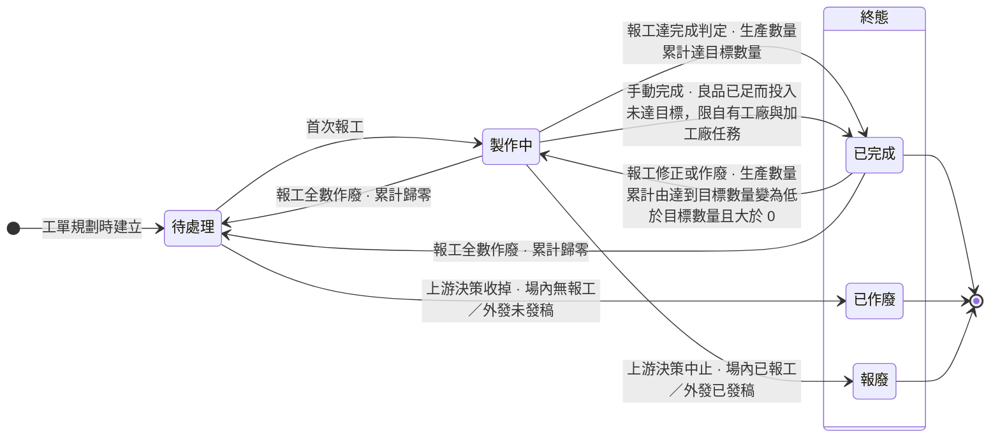
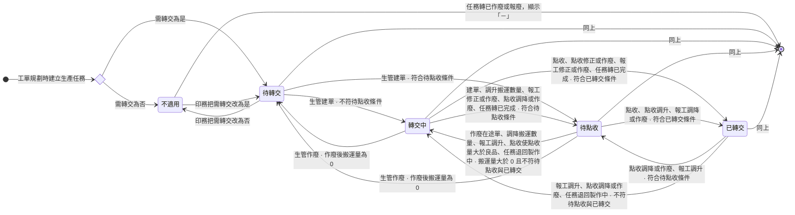
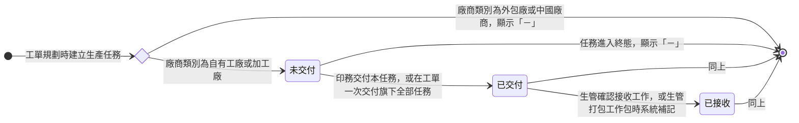
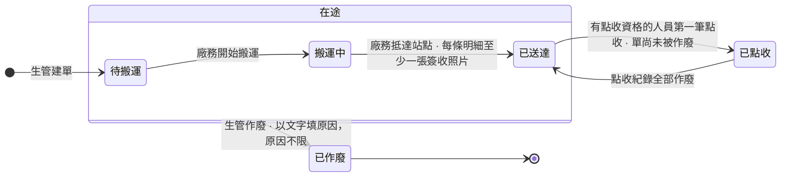

# 中台 - 生產管理（P-PM-237）與中台 - 工單管理（P-DE-33）Linear 交付草稿 v7

狀態：草稿，尚未稽核、尚未寫入 Linear。依 Linear 交付規範 v6.0 撰寫，以 v6 草稿（2026-10-12）為底。
撰寫日：2026-10-13。
本稿的取材版本：
- Prototype：erp repo 分支 prototype/production-stage，基準提交 ecf5d06c（v6 為 0c7168a3）。
- 情境目錄：Sens repo 提交 b0cb387 的 `erp-prototype-tests/docs/scenario-catalog.md`，已含 14.31 至 14.40。
- wiki：Sens repo 提交 b0cb387 的工作區現行版（wiki 目錄沒有未提交異動）。
- 差異清單：`memory/erp/plans/production-ui-correction-20261012/production-mgmt-delta-20261013.md`。
範圍：P-PM-237 的 project 描述、milestone、四張 Feature 票（PM-1356 至 PM-1359）與八張 Task 票；P-DE-33 動 PM-1346 的 v6 已涵蓋段落、PM-1149（BOM 選擇器工作階段完成後整段改寫）、FE-468、FE-503 與 BE-360（含標題）。PM-1075 與其底下 Backlog 的 BE-334 一併改寫（7-7）。BE-340 與 BE-324 為 In Review，不覆寫；FE-534 依第 59 題例外改寫（7-6）。審查中與已完成的票（BE-324、BE-326、BE-340）不覆寫主體。FE-503 依 Miles 裁決改寫主體並寫訂正留言（見第七節 7-4）。
寫入原則：既有票只傳 `id` 與 `description`；Task 票另傳 `title`（改成 v6 標題格式）；不動 estimate、assignee、cycle、priority、milestone、labels。不寫訂正紀錄留言，不放參考留言連結。FE-503 例外：寫訂正留言，主體改寫段後放「（參考留言）」連結，寫入時回填留言網址。本次不改任何票的狀態，FE-503 維持 Done，其餘票維持現況。
貼進 Linear 前：下列各區塊外層是四個反引號，內層程式碼區塊沒有零寬字元，可直接貼。票內 issue 識別碼寫純識別碼，寫入後 Linear 自動轉成提及元素。
與 v6 的差異：v6 之後的 Prototype 提交（ea4ed9c4、adf5461f、0a7b33c9、9602a825、5b34f4a0、ecf5d06c）、wiki 修正紀錄「每個被改的欄位一筆」、grill 第 41 至 52 題。品檢與出貨這次不交付。

---

## 一、Scope 清單（一條一張 Feature 票）

| # | Feature 票 | 做完後使用者能做到什麼 | 既有票 |
|---|-----------|---------------------|--------|
| 1 | 生產任務接收與派工 | 生管確認接收交付來的生產任務，合批成工作包派給師傅，並編輯或取消工作包 | PM-1356 |
| 2 | 生產任務報工 | 師傅與代報人員報工，修正或作廢報錯的報工，生管在良品已足時手動完成生產任務，並查看每筆生產任務的歷程 | PM-1357 |
| 3 | 轉交單建立與搬運 | 生管建轉交單並指定負責廠務，改單、修正搬運數量、作廢重開，負責廠務回報開始搬運與抵達站點 | PM-1358 |
| 4 | 轉交點收與到料 | 收貨人照實點收，補收、修正點收數量、作廢點收錯的紀錄，生管看得到每筆任務的轉交進度 | PM-1359 |

## 二、全票功能節名表（一條規則只在一節）

| Feature | 功能節（受詞加動詞，一節一個動作） | 本節獨有的規則 |
|---------|----------------------------------|---------------|
| PM-1356 | 生產任務接收 | 接收以生產任務為單位；接收記留痕；外發任務不經接收；已接收不重複寫入 |
| PM-1356 | 生產任務派工 | 工作包收哪些任務；一任務一工作包；合批不限設備；已完成、已作廢、報廢不可打包；補記接收；不檢查前置到料 |
| PM-1356 | 生產任務與工作包檢視 | 所有生產任務、我的生產任務、所有工作包、我的工作包各列哪些單據；Supervisor 對這些單元只檢視 |
| PM-1356 | 工作包編輯 | 可編輯的欄位；指派師傅不可改；編輯寫入歷程 |
| PM-1356 | 工作包取消 | 取消即刪除；任務回待派；報工留在任務上；只從所有工作包取消 |
| PM-1357 | 生產任務報工 | 報工入口與提交管道；印件詳情不報工；累計算式；已完成不能新增報工；首次報工推進上層 |
| PM-1357 | 一次報多筆生產任務 | 一次報多筆的入口；逐筆判定；任一筆被擋下整批不寫入 |
| PM-1357 | 報工前確認任務已交付 | 已交付才可報工；不要求接收與打包；已作廢或報廢不可報工 |
| PM-1357 | 報工前確認前置已到料 | 前置到料量為 0 擋下；到料量與可做量算式；多前置取最小；點收量含補收與修正、不含作廢 |
| PM-1357 | 填寫報工數量與照片 | 報工照片；不良原因；數量檢核；數量只比數值 |
| PM-1357 | 在入口範圍內報工 | 各入口只受理範圍內的任務；工作包內跨產線任務；越權只擋下 |
| PM-1357 | 修正報工 | 可修正的欄位與範圍；修正紀錄（每個被改的欄位一筆）；擋下條件；損耗寫法；併發寫入（報工類與品檢驗收） |
| PM-1357 | 修正收尾任務的報工 | 已完成、已轉報廢的任務與工單或訂單結束後，報工仍可修正與作廢 |
| PM-1357 | 作廢報工 | 作廢留痕；累計歸零退回待處理 |
| PM-1357 | 逐層修正生產數量 | 由下往上的修正順序；擋下時指出卡在哪一筆 |
| PM-1357 | 手動完成生產任務 | 手動完成的前提與留痕 |
| PM-1357 | 檢視生產任務歷程 | 歷程收錄的事件；工單詳情與生產管理同一份 |
| PM-1358 | 轉交單建立 | 轉交單與明細結構；目的地取數；負責廠務；搬運量與轉交可申請上限算式；超額擋下 |
| PM-1358 | 轉交作業檢視 | 待轉交任務、所有轉交單、我的轉交單各列哪些單據；Supervisor 只檢視 |
| PM-1358 | 待搬運轉交單修改 | 待搬運時可改的內容；開始搬運後鎖定；改負責廠務通知新人 |
| PM-1358 | 搬運數量修正 | 開始搬運後的搬運數量修正；下限；修正紀錄；來源任務收掉時擋下 |
| PM-1358 | 搬運開始回報 | 負責廠務回報開始搬運 |
| PM-1358 | 站點抵達回報 | 簽收照片；一次回報；實際轉交日 |
| PM-1358 | 轉交單作廢 | 點收前可作廢；額度回補；來源任務收掉時標示警示 |
| PM-1358 | 作廢轉交單重開 | 重開沿用原單的目的地與負責廠務 |
| PM-1359 | 轉交單點收 | 點收佇列範圍；點收紀錄；第一筆轉已點收；每條明細都要填；點收資格；點收量多於搬運數量不擋；點收類併發寫入 |
| PM-1359 | 轉交單補收 | 補收新增點收紀錄 |
| PM-1359 | 點收修正 | 點收數量修正；下限、不設上限；修正紀錄（每個被改的欄位一筆） |
| PM-1359 | 點收紀錄作廢 | 作廢不計入點收量；全部作廢退回已送達 |
| PM-1359 | 轉交進度檢視 | 轉交進度兩數；點收量算式；轉交狀態由系統推導 |

規則歸屬檢查：報工的擋下條件只在「報工修正」；「報工作廢」與「收尾任務報工修正」只引用它。到料量算式只在「前置到料檢查」；點收量算式只在「轉交進度檢視」。搬運量與轉交可申請上限只在「轉交單建立」。各單元列哪些單據，生產任務與工作包在 PM-1356，轉交相關單元在 PM-1358，點收佇列在 PM-1359。

---

## 三、P-PM-237 專案描述（整段覆寫）

寫入時 `save_project` 同時帶現行狀態（Kick off）抑制自動跳轉。

````markdown
## 概述

生產管理承接印務交付產線之後的現場執行：生管接收生產任務並合批派給師傅，師傅報工，做好的半成品由生管建轉交單、廠務搬運、下一站照實點收後開工。

現行工廠靠紙本工單。師傅做完在紙上註記，進度靠人工回報，主管看不到即時狀況，產能不透明。生管每天手動整理派工表。半成品靠紙本工單跟著貨走，下一站靠口頭確認貨到了沒有。師傅不看前置就報工，會出現上一站的貨還沒到、這一站已經報了產出的錯報。

---

## 使用情境

### Use Case

1. 印務把生產任務交付產線後，生管確認接收，把可以一起做的活合成工作包派給一位師傅。要換師傅時，取消工作包後重新打包。
2. 師傅打開自己的工作包或生產任務，前置有到料就開工，做完一段就報工並附報工照片。
3. 生管、印務與印務主管依所屬產線在生產管理頁面代報。印務在工單詳情頁替自己負責的工單報工，含加工廠與外發任務。
4. 數字報錯就修正，整筆不該存在就作廢。良品已經夠下游用時，生管手動完成生產任務。
5. 錯的數字已流到下游時，生管與師傅由下往上逐層修正。
6. 生管在待轉交任務勾選各任務累積的可搬量建轉交單，指定這趟的負責廠務，系統只通知負責廠務。
7. 負責廠務開始搬運，抵達站點時逐條明細拍簽收照片。
8. 目的產線的師傅或品檢人員照實點收。貨後來補到就再點收一筆，點錯就修正點收數量，或作廢那一筆點收紀錄。
9. 單子建錯時，生管在待搬運時直接改單，點收前作廢後重開。
10. 現場人員打開生產管理，只看到所屬產線或指派給自己的單據。

### Scope（功能票清單）

1. **生產任務接收與派工**：生管確認接收交付來的生產任務，合批成工作包派給師傅，並編輯或取消工作包。　PM-1356
2. **生產任務報工**：師傅與代報人員報工，修正或作廢報錯的報工，生管在良品已足時手動完成生產任務，並查看每筆生產任務的歷程。　PM-1357
3. **轉交單建立與搬運**：生管建轉交單並指定負責廠務，改單、修正搬運數量、作廢重開，負責廠務回報開始搬運與抵達站點。　PM-1358
4. **轉交點收與到料**：收貨人照實點收，補收、修正點收數量、作廢點收錯的紀錄，生管看得到每筆任務的轉交進度。　PM-1359

**Out of Scope**

* 印務交付產線、生產任務的目的站點、產線、需轉交與前置設定：歸 <project id="0f3014e0-20e5-4411-babe-15da0609564d" href="https://linear.app/sensationdeveloper/project/%E4%B8%AD%E5%8F%B0-%E5%B7%A5%E5%96%AE%E7%AE%A1%E7%90%86-811bb7333b57/overview">中台 - 工單管理</project>。
* 工單異動、生產任務作廢與報廢的發起與確認：歸 <project id="0f3014e0-20e5-4411-babe-15da0609564d" href="https://linear.app/sensationdeveloper/project/%E4%B8%AD%E5%8F%B0-%E5%B7%A5%E5%96%AE%E7%AE%A1%E7%90%86-811bb7333b57/overview">中台 - 工單管理</project> 後續批次。
* 報工作廢在逆流程（如印件取消）的觸發條件與連動、短少補做：後續批次。
* 排程與工廠總覽、生產績效指標：後續批次。
* 外發派單、外發回廠點收：歸派單（尚未建立 project）。
* 廠務以 Slack 表單回報開始搬運與抵達站點：延後批次，本批在系統端回報。
* 外包廠與中國廠商任務的手動完成：延後批次，隨外發一起。
* 品檢待驗清單、品檢紀錄與出貨單：歸「中台 - 品檢與出貨」（另開 project，尚未建立）。
* 涉及暫存區的場內搬運：不在本 project，現場以標示留痕。
* 人員所屬產線的維護、各角色預設持有的生產管理單元：歸人員主檔與角色權限管理模組。

### 範圍用詞

| 用詞 | 定義 |
|------|------|
| 全公司 | 該模組全部單據 |
| 自己負責 | 該單據的人員欄是本人。師傅看生產任務與工作包的指派師傅，廠務看轉交單的負責廠務。印務對生產任務看所屬工單的負責人。業務、諮詢對生產任務看所屬訂單的接單業務 |
| 被分享（檢視） | 以檢視層級分享給本人且未撤銷的單據。檢視生產任務歷程與轉交進度時，看所屬工單的分享或所屬訂單的分享，任一種成立即可 |
| 被分享（編輯） | 以編輯（代理）層級分享給本人且未撤銷的單據。報工、修正報工與作廢報工只看所屬工單的分享；訂單的分享不適用。檢視生產任務歷程與轉交進度時，看所屬工單或所屬訂單的分享 |
| 所屬產線 | 單據的產線在本人的所屬產線內。只用於生產相關模組 |

---

## 另案處理（來源尚未定案，暫不實作）

* 來源任務報廢後依實況重建的轉交單如何點收：待裁，本批重建單的點收照樣被擋下。
* 外發回台的貨送場內後段產線是否走轉交單：待裁，本批只做送品檢站這一條。
* 產線底下的站點清單：待提供，現行站點為暫用名稱，清單定案後規則不變。
* 工單詳情對外包廠與中國廠商任務的修正與作廢介面：Prototype 尚未呈現，前端介面另案。

---

## 狀態機

工單狀態機見 <project id="0f3014e0-20e5-4411-babe-15da0609564d" href="https://linear.app/sensationdeveloper/project/%E4%B8%AD%E5%8F%B0-%E5%B7%A5%E5%96%AE%E7%AE%A1%E7%90%86-811bb7333b57/overview">中台 - 工單管理</project>。

>>> ### 生產任務狀態機



* 各廠商類別的狀態路徑相同：待處理、製作中、已完成。差別只在誰報工。
* 手動完成只適用自有工廠與加工廠任務。
* 外部進程由派單另行追蹤。
* 手動完成的任務，生產數量累計本來就低於目標數量，不屬「由達到變為低於」，報工修正與作廢不會讓它退回製作中；報工全數作廢才退回待處理。
* 本任務退回製作中時，所屬工單、印件、訂單不跟著回退。

>>>

>>> ### 生產任務轉交狀態機



系統推導的衍生狀態，沒有手動轉換。依下表順序判定，第一個成立的就是結果：

| 順序 | 結果 | 條件 |
| -- | -- | -- |
| 1 | 「－」 | 生產任務狀態為已作廢或報廢 |
| 2 | 不適用 | 需轉交為否 |
| 3 | 已轉交 | 生產任務已完成，良品數大於 0，點收量等於良品數 |
| 4 | 待點收 | 生產任務已完成，搬運量不小於良品數，點收量小於良品數 |
| 5 | 轉交中 | 搬運量大於 0 |
| 6 | 待轉交 | 搬運量等於 0 |

>>>

>>> ### 生產任務交付狀態機



系統推導的衍生狀態，沒有手動轉換。依下表順序判定，第一個成立的就是結果：

| 順序 | 結果 | 條件 |
| -- | -- | -- |
| 1 | 「－」 | 廠商類別為外包廠或中國廠商，或生產任務狀態屬終態 |
| 2 | 已接收 | 接收工作有值 |
| 3 | 已交付 | 交付時間有值 |
| 4 | 未交付 | 其餘 |

>>>

>>> ### 轉交單狀態機



* 已點收不是終態。之後的補收、點收修正與部分點收紀錄作廢，單頭維持已點收。
* 已作廢是唯一終態。
* 作廢自在途的邊界出發，在途內的每一格都可作廢，已點收不可作廢。

>>>
````

---

## 四、Milestone（沿用既有，名稱已是需求主題，只改描述）

名稱檢查：「現場分派與報工」「場內轉交」都寫需求主題，沒有日期或批次字樣，符合規範，沿用。
描述寫入用 `save_milestone`，名稱不動。

```text
名稱：現場分派與報工
描述：生管接收交付來的生產任務、合批派工，師傅與代報人員報工、修正與作廢報工、手動完成。
```

```text
名稱：場內轉交
描述：生管建轉交單、廠務搬運送達、收貨人照實點收，下游依點收量取得到料量。
```

Feature 票掛法（既有，不動）：PM-1356、PM-1357 掛「現場分派與報工」；PM-1358、PM-1359 掛「場內轉交」。

---

## 五、Feature 票

四張 Feature 票都是既有票，標題、Label、Milestone 不動，描述整段覆寫。

### 5-1 PM-1356 生產任務接收與派工

````markdown
## 概述

這張票做完，生管能在 <project id="9d055ea4-9212-4711-a0d6-22870079b450" href="https://linear.app/sensationdeveloper/project/%E4%B8%AD%E5%8F%B0-%E7%94%9F%E7%94%A2%E7%AE%A1%E7%90%86-148ecc50024f/overview">中台 - 生產管理</project> 確認接收印務交付來的生產任務，把可以一起做的活合成工作包派給一位師傅，並編輯或取消工作包。

生產任務交付狀態的流轉見 <project id="9d055ea4-9212-4711-a0d6-22870079b450" href="https://linear.app/sensationdeveloper/project/%E4%B8%AD%E5%8F%B0-%E7%94%9F%E7%94%A2%E7%AE%A1%E7%90%86-148ecc50024f/overview">中台 - 生產管理</project> 的生產任務交付狀態機。

## 權限

| 動作 | 可執行角色 | 資料範圍 |
|------|-----------|---------|
| 檢視所有生產任務 | 生管、印務、印務主管 | 所屬產線 |
| 檢視所有生產任務 | Supervisor | 全公司 |
| 檢視我的生產任務 | 師傅 | 自己負責 |
| 檢視所有工作包 | 生管、印務、印務主管 | 所屬產線 |
| 檢視所有工作包 | Supervisor | 全公司 |
| 檢視我的工作包 | 師傅 | 自己負責 |
| 接收生產任務 | 生管、印務、印務主管 | 所屬產線 |
| 派工 | 生管、印務、印務主管 | 所屬產線 |
| 編輯工作包 | 生管、印務、印務主管 | 所屬產線 |
| 編輯工作包 | 師傅 | 自己負責 |
| 取消工作包 | 生管、印務、印務主管 | 所屬產線 |

>>> ## 生產任務接收

身為生管，我要確認接收印務交付來的生產任務，以讓每一筆交出來的活都有人接手、查得到誰在什麼時候接的。

**實體關係**

1. 接收以生產任務為單位，可單筆，也可批次。
2. 每筆接收記接收人與接收時間，寫入後不清除。
3. 自有工廠與加工廠的任務經生管接收。
4. 外包廠與中國廠商的任務不經接收，交付狀態顯示「－」。

**驗證規則**

1. 生產任務的交付狀態在已交付才可確認接收。
2. 已接收的生產任務不重複寫入接收紀錄，批次接收只對尚未接收的任務寫入。

**驗收**

1. 假設 WO-2026-0815 的牛皮紙 150g 備料已交付、尚未接收，當許文傑接收這一筆，則接收工作記許文傑與接收時間，交付狀態轉已接收，生產任務狀態仍為待處理。
2. 假設接上一條，當許文傑勾選 WO-2026-0815 的四筆任務批次接收，則只寫入另外三筆，牛皮紙 150g 備料的接收時間不變。
3. 假設 WO-2026-0812 的證書局部上光為加工廠任務，2026-08-22 09:00 交付、10:00 由許文傑接收，當印務開啟工單詳情，則生產任務清單的交付狀態欄為已接收，不顯示「－」。
4. 假設 WO-2026-0906 的局部上光為外包廠任務，當印務開啟工單詳情，則生產任務清單的交付狀態欄顯示「－」。

>>>

>>> ## 生產任務派工

身為生管，我要把可以一起做的生產任務合成一個工作包派給一位師傅，以讓師傅上工就知道要做哪一批。

**實體關係**

1. 一個工作包收多筆生產任務，可跨工單、跨印件。
2. 一筆生產任務同時只屬於一個工作包。
3. 合批方式由生管自主決定，系統不設規則，也不限計畫設備。
4. 一個工作包指派給一位師傅。
5. 生產任務的指派師傅取自所屬工作包，未打包時為空。
6. 派工後的生產任務留在生產任務清單，帶出所屬工作包與指派師傅。
7. 工作包不設狀態，現場進度取已完成任務數與任務總數。
8. 派工時尚未接收的生產任務，由系統補記接收。接收人為派工者，時間為派工時間。
9. 加工廠任務與自有工廠任務走同一套流程，系統不限制打包。
10. 派工不改變生產任務狀態。

**驗證規則**

1. 已完成、已作廢或報廢的生產任務不可打包。
2. 已屬某個工作包的生產任務不可再打包。
3. 必填欄位未填齊則無法建立工作包。
4. 派工不檢查前置到料。

**驗收**

1. 假設 WO-2026-0815 的牛皮紙 150g 備料已交付、尚未接收，當許文傑直接勾選它，指派劉阿海並填預計完成日後建立，則派工成立，不要求先接收，接收人記許文傑，交付狀態轉已接收。
2. 假設許文傑已對牛皮紙 150g 備料代報生產數量 520、良品 520、不良品 0，任務為製作中，當他接收並打包給劉阿海，則打包成立，任務維持製作中，落進新的工作包。
3. 假設 WO-2026-0710 的海報四色印刷屬 WP-2026-0710-01、指派師傅劉阿海，WO-2026-0812 的證書裁切尚未派工，當印務展開兩張工單的生產任務，則海報四色印刷的指派師傅為劉阿海，證書裁切的指派師傅為空。
4. 假設 WO-2026-0815 的牛皮紙 150g 備料已作廢、五色印刷已報廢、軋盒成型為待處理，當許文傑把三筆一起打包，則前兩筆不可勾選，繞過介面直接打包時也不進工作包，軋盒成型照常打包。
5. 假設 WO-2026-0812 的證書裁切（POLAR 137 裁切機、手工產線）與三件配套裝袋（貼標工作站、裝訂產線）都已交付、已接收、尚未派工，許文傑的所屬產線含手工與裝訂，當他勾選兩筆打包並指派一名師傅，則系統不因兩筆任務的計畫設備不同而擋下，兩筆進同一個工作包。

>>>

>>> ## 生產任務與工作包檢視

身為生管，我要只看到自己產線的生產任務與工作包，以讓我處理的都是我該管的活。

**實體關係**

1. 所有生產任務與所有工作包看所屬產線，我的生產任務與我的工作包看指派師傅是否為本人。兩種範圍各自判定，不疊加。
2. 各單元列出的單據如下表：

| 單元 | 列出哪些單據 |
| -- | -- |
| 所有生產任務 | 已交付、廠商類別為自有工廠或加工廠、產線在所屬產線內的生產任務，含已完成等終態 |
| 我的生產任務 | 指派師傅為本人的生產任務 |
| 所有工作包 | 旗下任一任務的產線在所屬產線內的工作包 |
| 我的工作包 | 指派師傅為本人的工作包 |

3. 我的生產任務與我的工作包不看產線。師傅被打包到所屬產線以外的任務，照樣看得到。

**驗證規則**

1. Supervisor 對所有生產任務與所有工作包只檢視，不開放任何操作。

**驗收**

1. 假設許文傑的所屬產線為數位、裝訂、手工，鄭宇翔為手工、壓克力，WO-2026-0815 四筆任務與 WO-2026-0812 的證書局部上光皆已交付，當兩人各自開啟所有生產任務，則許文傑看到 WO-2026-0815 四筆與證書局部上光，鄭宇翔只看到手工產線的任務含證書局部上光，看不到 WO-2026-0815 四筆。
2. 假設一張工單同時有自有工廠、加工廠、外包廠、中國廠商的生產任務且皆已交付，當許文傑開啟所有生產任務，則只列自有工廠與加工廠的任務。
3. 假設劉阿海是 WP-2026-0710-01 的指派師傅，李榮發是 WP-2026-0710-02 的指派師傅，當劉阿海開啟我的工作包與我的生產任務，則只看到指派給他的工作包與任務，看不到李榮發的工作包。
4. 假設許文傑把 WO-2026-0812 的證書裁切（手工產線）打包給所屬產線為數位、裝訂的劉阿海，當劉阿海開啟我的生產任務與我的工作包，則兩處都列出證書裁切。
5. 假設 Supervisor 王大明的所屬產線全選，當他開啟所有生產任務與所有工作包，則兩處都列出全部產線的單據，任何一筆都沒有操作入口。

>>>

>>> ## 工作包編輯

身為生管，我要在派工後編輯工作包的預計完成日、備註與確樣備註，以跟上現場進度的變化。

**實體關係**

1. 工作包派出後可編輯預計完成日、備註與確樣備註。
2. 指派師傅也能在我的工作包編輯自己的工作包。
3. 指派師傅在工作包建立後不可改。要換師傅，取消工作包後重新打包。
4. 編輯有值變動時，系統寫入旗下每筆生產任務的歷程，記原值、新值與操作人。

**驗證規則**

1. 必填欄位未填齊則無法儲存。

**驗收**

1. 假設 WP-2026-0710-02 的指派師傅為李榮發，當許文傑在所有工作包編輯它，改預計完成日後儲存，則編輯成立，指派師傅仍為李榮發且不可改。
2. 假設劉阿海是 WP-2026-0812-01 的指派師傅，當他在我的工作包把備註改為「先印證書再印信封」，則生管在所有工作包看到新備註，旗下每筆任務的歷程最上一筆為「編輯工作包 WP-2026-0812-01」，記備註原值與新值、操作人劉阿海。

>>>

>>> ## 工作包取消

身為生管，我要取消排錯或要換師傅的工作包，以把旗下任務放回待派、重新打包給對的師傅。

**實體關係**

1. 取消即刪除這個工作包。
2. 旗下生產任務解除工作包、回到待派，指派師傅回到空值，可再打包進新的工作包。
3. 已有的報工紀錄留在生產任務上，不因取消而改動。
4. 取消寫入旗下每筆任務的歷程。

**驗證規則**

1. 工作包任何時候都可取消，不看旗下生產任務的狀態。
2. 取消只從所有工作包開放，我的工作包與所有生產任務沒有取消入口。

**驗收**

1. 假設 WP-2026-0710-02 旗下只有裁切成型一筆、指派師傅李榮發，當許文傑在所有工作包的 WP-2026-0710-02 列上取消這個工作包，則所有工作包與李榮發的我的工作包都沒有它。到所有生產任務看，裁切成型的工作包與指派師傅皆為空、可再勾選，生產任務狀態與報工累計不變，歷程記一筆「取消工作包 WP-2026-0710-02（師傅 李榮發），任務回待派；報工紀錄留在任務上」。
2. 假設接上一條，當許文傑勾選裁切成型、指派陳金水建立工作包，則裁切成型落在新的工作包，指派師傅為陳金水。

>>>

````

### 5-2 PM-1357 生產任務報工

````markdown
## 概述

這張票做完，師傅與代報人員能在 <project id="9d055ea4-9212-4711-a0d6-22870079b450" href="https://linear.app/sensationdeveloper/project/%E4%B8%AD%E5%8F%B0-%E7%94%9F%E7%94%A2%E7%AE%A1%E7%90%86-148ecc50024f/overview">中台 - 生產管理</project> 對生產任務報工，修正或作廢報錯的報工。生管能在良品已足時手動完成生產任務，並查看每筆生產任務的歷程。

生產任務狀態的流轉見 <project id="9d055ea4-9212-4711-a0d6-22870079b450" href="https://linear.app/sensationdeveloper/project/%E4%B8%AD%E5%8F%B0-%E7%94%9F%E7%94%A2%E7%AE%A1%E7%90%86-148ecc50024f/overview">中台 - 生產管理</project> 的生產任務狀態機。

## 權限

| 動作 | 可執行角色 | 資料範圍 |
|------|-----------|---------|
| 報工 | 師傅 | 自己負責 |
| 報工 | 生管、印務、印務主管 | 所屬產線 |
| 報工 | 印務 | 自己負責 |
| 報工 | 所有角色 | 被分享（編輯） |
| 報工 | 印務主管 | 全公司 |
| 一次報多筆生產任務 | 師傅 | 自己負責 |
| 一次報多筆生產任務 | 生管、印務、印務主管 | 所屬產線 |
| 一次報多筆生產任務 | 印務 | 自己負責 |
| 一次報多筆生產任務 | 所有角色 | 被分享（編輯） |
| 一次報多筆生產任務 | 印務主管 | 全公司 |
| 修正報工 | 師傅 | 自己負責 |
| 修正報工 | 生管、印務、印務主管 | 所屬產線 |
| 修正報工 | 印務 | 自己負責 |
| 修正報工 | 所有角色 | 被分享（編輯） |
| 修正報工 | 印務主管 | 全公司 |
| 作廢報工 | 師傅 | 自己負責 |
| 作廢報工 | 生管、印務、印務主管 | 所屬產線 |
| 作廢報工 | 印務 | 自己負責 |
| 作廢報工 | 所有角色 | 被分享（編輯） |
| 作廢報工 | 印務主管 | 全公司 |
| 手動完成生產任務 | 生管、印務、印務主管 | 所屬產線 |
| 檢視生產任務歷程 | 生管、印務、印務主管 | 所屬產線 |
| 檢視生產任務歷程 | 師傅 | 自己負責 |
| 檢視生產任務歷程 | 印務、印務主管、生管、訂單管理人、Supervisor | 全公司 |
| 檢視生產任務歷程 | 所有角色 | 被分享（檢視） |
| 檢視生產任務歷程 | 所有角色 | 被分享（編輯） |
| 檢視生產任務歷程 | 業務、諮詢 | 自己負責 |

>>> ## 生產任務報工

身為師傅，我要做完一段活就回報投入多少、好的幾件、壞的幾件，以讓工單、印件、訂單的進度不必有人轉抄就跟上現場。

**實體關係**

1. 一筆生產任務有多筆報工紀錄，報工記在生產任務上，不掛工作包。
2. 報工入口與提交管道如下表。管道由系統依入口帶入，使用者不可選、不可改：

| 報工入口 | 提交管道 |
| -- | -- |
| 我的工作包、我的生產任務 | 師傅自助 |
| 所有工作包、所有生產任務 | 生產管理頁面代報 |
| 工單詳情 | 印務於工單詳情頁 |

3. 印件詳情不報工。
4. 任務實際開工取首筆報工的時間。
5. 任務轉已完成時，系統記任務實際完成日。
6. 首次報工時，所屬工單、印件、訂單依各自狀態機推進。

**驗證規則**

1. 已完成的生產任務不能新增報工。

**算式**

```
生產數量累計 ＝ 有效報工的生產數量加總
產出數量 ＝ 有效報工的良品數累計 ＋ 不良品數累計
完成判定：生產數量累計 ≧ 目標數量
```

1. 有效報工指未作廢的報工，修正後取修正後的值。
2. 生產數量累計超過目標數量時照實記。

**驗收**

1. 假設 WO-2026-0815 的牛皮紙 150g 備料與五色印刷已由許文傑打包給劉阿海，備料已報工並點收到印刷站，五色印刷已到料，當劉阿海從我的工作包與我的生產任務各報一筆五色印刷，則兩筆的提交管道皆為師傅自助。
2. 假設 WO-2026-0815 工單已交付、四筆任務已派工、尚無報工，當師傅對第一筆任務報第一筆工，則任務轉製作中，印件印製狀態與訂單轉製作中，工單由工單已交付轉製作中。
3. 假設 WP-2026-0710-01 的海報四色印刷製作中，累計 2,000、目標 3,090，當劉阿海先報生產數量 500、再報 590，則累計先為 2,500、仍為製作中，再為 3,090、任務轉已完成。
4. 假設 WO-2026-0812 的證書四色印刷已完成、目標 515、生產數量累計 515，當印務找報工入口並直接送出一筆報工，則沒有報工入口，直接送出被擋下，累計維持 515。
5. 假設 PI-2026-0815 旗下的工單有可報工的任務，當印務打開 PI-2026-0815 的印件詳情，則印件詳情頁首與工單與生產任務區塊都沒有報工入口。

>>>

>>> ## 一次報多筆生產任務

身為師傅，我要一次報好幾筆生產任務，以讓一包活做完不必一筆一筆回報，被擋下時也分得清哪幾筆已記進帳。

**實體關係**

1. 工單詳情、所有工作包、我的工作包可一次報多筆生產任務。所有生產任務、我的生產任務一次報一筆。
2. 一次報多筆時，每筆任務各填各的數量與報工照片，提交管道照入口記錄。

**驗證規則**

1. 一次報多筆時，系統逐筆判定報工前提、報工範圍與數量檢核。
2. 任一筆被擋下，整批都不寫入，系統指出被擋下的是哪幾筆與各自的原因。
3. 改好被擋下的幾筆之後，整批重新送出。

**驗收**

1. 假設 WP-2026-0812-01 的信封四色印刷已報 310、良品 300、不良品 10，內卡四色印刷已報 205、良品 200、不良品 5，兩筆都製作中、目標 515，當劉阿海在我的工作包整包報工、兩筆各填生產數量 100、良品 100，信封附報工照片、內卡不附，則整批被擋下，提示整批未送出，原因標在內卡那一筆。兩筆都沒有寫入，已報數量維持 310 與 205。
2. 假設同一批，當劉阿海替內卡補一張報工照片後整批重送，則兩筆各新增一筆報工，已報數量為信封 410／515、內卡 305／515。

>>>

>>> ## 報工前確認任務已交付

身為師傅，我要在任務還沒交付、或任務已被上游收掉時被擋下，以免報出沒有活可做的數字。

**實體關係**

1. 擋下時系統不寫入報工，任務累計不變。

**驗證規則**

1. 生產任務已交付（交付時間有值）才可報工。所有廠商類別都看交付時間，不看交付狀態。
2. 報工不要求生管已接收，也不要求已打包進工作包。
3. 生產任務在已作廢或報廢時不可報工。

**驗收**

1. 假設 WO-2026-0815 的牛皮紙 150g 備料已交付、尚未接收、未打包、沒有前置，當許文傑在所有生產任務報生產數量 520、良品 520、不良品 0 並附報工照片，則報工成立，提交管道為生產管理頁面代報，報工人員為許文傑，任務轉製作中，交付狀態維持已交付。
2. 假設 WO-2026-0908 停在製程審核完成、三筆任務交付時間皆無值，當周建宏開啟工單詳情，則沒有報工入口，繞過介面送出報工時被擋下、不寫入。
3. 假設 WO-2026-0710 的海報四色印刷原為製作中、指派給劉阿海、報工累計生產數量 2,000、良品 1,990、不良品 10，已因工單異動轉報廢，當劉阿海、許文傑、周建宏從各自的報工入口找海報四色印刷，則都沒有報工入口，繞過介面送出報工時被擋下，累計維持 2,000、1,990、10。

>>>

>>> ## 報工前確認前置已到料

身為師傅，我要在前置的料還沒到時被擋下並知道在等誰，以免報出上一站的貨還沒到、這一站已有產出的數字。

**實體關係**

1. 前置可指向別張工單的生產任務，到料量的算法相同。

**驗證規則**

1. 任一前置的到料量為 0 時不可報工，系統指出在等哪張工單、哪一筆生產任務的貨。
2. 沒有前置的任務不檢查到料。

**算式**

```
需轉交的前置到料量 ＝ 前置任務的點收量
不需轉交的前置到料量 ＝ 前置任務的有效報工良品數累計
可做量 ＝ 各前置到料量取最小值
```

1. 跨任務的數量直接比數值，不做單位換算。
2. 需轉交前置的點收量含補收與修正後的值，不含已作廢的點收紀錄。

**驗收**

1. 假設 WP-2026-0710-02 的裁切成型已交付，前置為海報四色印刷，經 TT-20260830-002（搬運數量 1,190）已送達、尚未點收，當生管展開這個工作包，則可做量為 0／3,000，裁切成型沒有報工入口。師傅繞過介面送出報工時被擋下，並指出在等 WO-2026-0710 的海報四色印刷。點任務名稱開生產任務側板，數量區提示「前置未到料：等 WO-2026-0710／海報四色印刷 的貨」。
2. 假設 WO-2026-0815 的軋盒成型標為不需轉交，下游為糊盒成型，當軋盒成型尚未報工，則糊盒成型可做量為 0／2,000，沒有報工入口。軋盒成型報出良品 1,200 後，糊盒成型可做量為 1,200／2,000，不經轉交點收。
3. 假設騎馬釘裝訂（WO-TEST-01）的前置為封面加工（WO-TEST-01）與內頁加工（WO-TEST-02），兩者皆需轉交，當封面加工點收 300、內頁加工點收 200，則可做量為 200。只有封面點收 300 時可做量為 0，系統只列在等的內頁加工。
4. 假設 WO-2026-0812 的證書四色印刷經 TT-20260827-001 點收 480，當生管對該明細再點收 20，則證書裁切的到料量為 500。
5. 假設證書四色印刷經 TT-20260827-001 點收 480 後再點收 20、到料量為 500，當作廢那一筆 20，則到料量回到 480。

>>>

>>> ## 填寫報工數量與照片

身為師傅，我要照實填投入、良品與不良品數並附報工照片，以讓折損率、良率與實際成本取到現場真正的數字。

**實體關係**

1. 每筆報工附報工照片，可多張。備註選填，修正報工時可一併修正。
2. 報工人員、報工時間與提交管道由系統帶入，使用者不可改。

**驗證規則**

1. 必填欄位未填齊不受理，未附報工照片則無法送出。
2. 不良品數大於 0 時要填不良原因，未填則無法送出。
3. 下列情形無法送出報工，修正報工時同樣適用：
   * 生產數量不大於 0。
   * 良品數與不良品數同為 0。
   * 良品數加不良品數大於生產數量。
4. 生產數量、良品數與不良品數一律當數值比較，單位只用於顯示，不做換算。

**驗收**

1. 假設 WO-2026-0812 的信封四色印刷製作中、指派給劉阿海，當他填生產數量 205、良品 200、不良品 5 與不良原因但不附照片，則無法送出，不寫入；附兩張照片後送出，報工成立並保存兩張照片。
2. 假設一筆印刷任務（單位顯示為「張」），當報生產數量 1,051、良品 4,084、不良品 0，或生產數量 1,000、良品 980、不良品 40，則兩組都無法送出。
3. 假設 WP-2026-0710-01 的海報四色印刷，當劉阿海報生產數量 300、良品與不良品都不填，則無法送出，不寫入任何報工。
4. 假設 WO-2026-0812 證書四色印刷的報工（生產數量 515、良品 500、不良品 15），當印務在所有工作包把良品與不良品都修正為 0 並填修正原因，則無法修正，數字不變。
5. 假設 WP-2026-0710-01 的海報四色印刷製作中，當劉阿海報生產數量 500、良品 490、不良品 10（色差），備註填「換版後第二批，色偏已調回」，則報工紀錄顯示這則備註。

>>>

>>> ## 在入口範圍內報工

身為生管，我要報工只受理各入口範圍內的生產任務，以免誤報不歸我管的數字。

**實體關係**

1. 加工廠任務不打包給師傅時，沒有指派師傅，由印務報工。
2. 外包廠與中國廠商的任務由印務在工單詳情報工。

**驗證規則**

1. 我的工作包與我的生產任務只受理指派給本人的生產任務。
2. 所有工作包與所有生產任務只受理產線在本人所屬產線內的生產任務。
3. 所有工作包列出整包。包內只有產線在本人所屬產線內的任務可報工、修正與作廢，其他任務只能看。
4. 工單詳情受理本人負責或被分享（編輯）的工單下的生產任務，印務主管不限工單。判定取工單當下的負責人與分享成員。
5. 繞過介面送出範圍外的任務時，系統擋下、不寫入，也不寫稽核日誌。

**驗收**

1. 假設 WO-2026-0812 的證書局部上光為加工廠任務、已接收、未打包、沒有前置，負責印務為周建宏，當周建宏在工單詳情報生產數量 200、良品 198、不良品 2（刮傷），則報工成立，提交管道為印務於工單詳情頁，任務轉製作中，仍沒有工作包。
2. 假設許文傑把 WO-2026-0812 的證書裁切（手工產線）與 WO-2026-0815 的五色印刷（數位產線）打成一包給劉阿海，當鄭宇翔（手工、壓克力產線）開啟所有工作包展開這一包，則證書裁切有報工入口，點任務名稱開生產任務側板可修正與作廢報工。五色印刷沒有報工入口，側板也沒有修正與作廢。
3. 假設鄭宇翔的所有生產任務沒有五色印刷，當他繞過清單送出五色印刷的報工，或劉阿海繞過我的生產任務送出軋盒成型的報工，或非負責且未取得編輯分享的印務在工單詳情送出報工，則都被擋下、不寫入，任務累計不變。
4. 假設工單負責人為蔡明修，周建宏在工單交付產線之後才取得被分享（編輯），當周建宏在工單詳情報工，則報工成立。

>>>

>>> ## 修正報工

身為師傅，我要把報錯的生產數量、良品數或不良品數直接改成正確的數，以讓折損率、良率與實際成本取到現場真正的數字。

**實體關係**

1. 修正只動有效的報工，可修正生產數量、良品數與不良品數，備註可一併修正。
2. 一次修正改了幾個欄位，就留幾筆報工修正紀錄。每筆記修正欄位、修正前後值、修正人、修正時間與修正原因。一筆報工可有多筆修正紀錄。
3. 一部分要算損耗時，良品修少、不良品修多同量，生產數量不變。損耗怎麼來的寫在修正原因，系統不區分。
4. 修正範圍依入口，如下表：

| 入口 | 可修正的報工 |
| -- | -- |
| 所有生產任務、所有工作包、工單詳情 | 該入口報工範圍內的全部報工 |
| 我的生產任務、我的工作包 | 該入口報工範圍內自己提交的報工 |

5. 外包廠與中國廠商的任務不在所有生產任務與所有工作包，只能經工單詳情修正。
6. 師傅被改派後，我的生產任務與我的工作包看不到原任務。以前提交的報工由所有生產任務或所有工作包的使用者修正。

**驗證規則**

1. 修正原因必填，未填則無法修正。
2. 下列情形擋下修正，數字不改，系統列出卡在哪一筆：

| 檢核對象 | 擋下條件 | 系統列出 |
| -- | -- | -- |
| 需轉交的任務 | 修正後良品數低於在途明細的搬運數量合計加已點收明細的點收量合計 | 佔用的轉交單與那一筆數字 |
| 不需轉交的任務 | 下游任務已有報工 | 已報工的下游任務 |
| 所屬印件 | 修正後待驗量變成負數 | 該印件的已驗量 |

3. 調升不擋。
4. 報工、報工修正、報工作廢，以及會與它們搶同一印件待驗量的品檢驗收與品檢修正，兩筆同時寫入時，先寫入者成立，後到者以寫入當下的數字重新檢核。品檢驗收與品檢修正的資料操作歸中台 - 品檢與出貨。

**驗收**

1. 假設 WO-2026-0812 證書四色印刷的報工（生產數量 515、良品 500、不良品 15），TT-20260827-001 已點收 480，所屬印件已驗量 0，當印務把良品修正為 480 但不填修正原因，則無法修正；填原因後送出，則修正成立，新增一筆修正紀錄，記良品數 500 → 480、修正人與時間。
2. 假設一筆報工生產數量 200、良品 200、不良品 0，沒有被佔用，當印務把良品 200 修正為 0、不良品 0 修正為 200 並填修正原因，則修正成立，良品數與不良品數各新增一筆修正紀錄，生產數量仍為 200。
3. 假設海報四色印刷良品 1,990，其中 TT-20260830-002 已送達 1,190、TT-20260830-003 搬運中 800，當印務把第二筆報工（生產數量 1,000、良品 1,000）的良品修正為 900，則擋下修正，列出兩張轉交單，良品仍為 1,990。
4. 假設許文傑代報了海報四色印刷一筆生產數量 100、良品 100，當劉阿海在我的工作包點海報四色印刷的名稱開生產任務側板，則這一筆沒有修正與作廢；他自己提交的報工照樣有修正。
5. 假設一筆不需轉交任務的報工生產數量 520、良品 500、不良品 20，下游任務已有一筆報工，當把良品調降，則擋下修正，列出已動工的下游任務。

>>>

>>> ## 修正收尾任務的報工

身為印務，我要在任務已完成、已轉報廢或工單訂單結束之後，仍修正報錯的報工，以讓成本與指標取到正確的值。

**實體關係**

1. 已完成的生產任務，報工仍可修正與作廢。
2. 已轉報廢的生產任務，既有的報工照同一組條件修正與作廢，修正後任務維持報廢。
3. 所屬工單已完成，或所屬訂單已到訂單完成之後，報工仍可修正與作廢，不設結束後的凍結。

**驗證規則**

1. 已完成與已轉報廢的任務，修正與作廢同樣受報工修正的擋下條件限制。

**驗收**

1. 假設一筆裁切任務目標 1,020、累計 1,020 已完成，其中一筆報工生產數量 300，當把它修正為 280，則累計 1,000、任務退回製作中、仍屬原工作包；再報工 20，則累計回到 1,020，任務轉已完成。
2. 假設一筆已轉報廢的生產任務，報工良品 300，沒有任何轉交單、下游未動工、未被品檢驗過，當印務把良品修正為 280 並填修正原因，則修正成立，任務維持報廢，轉交狀態與交付狀態仍顯示「－」。
3. 假設 WO-2026-0815 已完成，軋盒成型的報工由陳金水提交（生產數量 500、良品 500、不良品 0），當陳金水修正這筆報工，則修正成立，不因工單已完成擋下。

>>>

>>> ## 作廢報工

身為師傅，我要把整筆不該存在的報工作廢後重報，以免錯的數字留在累計裡。

**實體關係**

1. 作廢的報工不消失，改列為已作廢，記作廢人、作廢時間與作廢原因，不計入任何累計。
2. 整筆報工不該存在（如報到錯的任務）時才作廢，再到正確的任務重報。數字不對用報工修正。
3. 誰能作廢，與誰能修正同一群人。
4. 任務的報工全數作廢後，任務仍屬原工作包。

**驗證規則**

1. 作廢原因必填，未填則無法作廢。
2. 作廢以扣除這一筆之後的累計判定，套用報工修正的擋下條件。

**驗收**

1. 假設劉阿海把 WO-2026-0815 五色印刷的一筆報工（生產數量 200、良品 195、不良品 5）誤報到牛皮紙 150g 備料，當他作廢備料那一筆、原因填「報到錯的任務」，再到五色印刷照原數字重報，則備料那一筆列為已作廢、不計入累計，備料任務退回待處理，五色印刷多一筆有效報工。備料的歷程記一筆「報工作廢（報到錯的任務）：投入 200、良品 195 自累計移出；任務轉「待處理」」，五色印刷的歷程記一筆報工。
2. 假設 WO-2026-0812 的信封四色印刷良品 300 全數在已送達的 TT-20260827-002 上，當報工人員作廢那一筆報工，則擋下作廢，列出 TT-20260827-002，報工維持有效。
3. 假設一筆任務製作中、已派入工作包、只有一筆有效報工，當作廢這一筆，則任務退回待處理，仍屬原工作包，師傅可直接重新報工。
4. 假設一筆報工生產數量 200、良品 190、不良品 10，沒有轉交單佔用，當作廢，則成立，生產數量累計、良品數累計、產出數量各減 200、190、200。
5. 假設精裝書印件底下只有一筆計入完成度的裝訂任務（製作中、標不需轉交），報工良品 500，品檢已驗收通過 500，當對那筆報工作廢，則整筆擋下，並顯示該印件的已驗量 500。

>>>

>>> ## 逐層修正生產數量

身為生管，我要在錯的數字已流到下游時由下往上逐層修正，以讓每一層的數字都對上現場實際數量。

**實體關係**

1. 數量錯誤由下往上逐層修正：下游報工、點收、搬運數量、上游報工。
2. 被擋下時，系統指出卡在哪一筆，不自動修改其他單據。
3. 每層修正原因必填，歷程各記一筆。
4. 已進品檢時，由品檢人員先修正品檢紀錄。

**驗證規則**

1. 每一層照自己的擋下條件檢查，被擋下的那一層不可跳過。

**驗收**

1. 假設 WO-2026-0815 的五色印刷報工生產數量 500、良品 500、不良品 0，TT-20260901-001 搬運 500、點收 500，軋盒成型已報工 500，當周建宏直接把五色印刷那筆報工修正為良品 480、不良品 20，則擋下並指出卡在 TT-20260901-001 的點收 500，數字不變，系統不自動修改點收或軋盒成型的報工。
2. 假設同一起點，當陳金水把軋盒成型修正為 480／480／0，周建宏把 TT-20260901-001 那筆點收紀錄修正為 480，周建宏（代行生管）把搬運數量修正為 480，再修正五色印刷那筆報工，則各層各自成立並留修正紀錄。五色印刷那層改良品與不良品，留兩筆。TT-20260901-001 維持已點收。五色印刷的良品數、搬運量、點收量都是 480，轉交可申請上限 0，生產數量維持 500。
3. 假設同一起點，當把點收修正提前在軋盒成型修正之前做，則擋下並指出軋盒成型已報工 500。
4. 假設五色印刷有一張搬運中 500、還沒點收的單，當周建宏修正上游報工，則先被擋下並指出那張單；搬運數量修正為 480 後，報工修正成立，單維持搬運中。

>>>

>>> ## 手動完成生產任務

身為生管，我要在良品已經夠下游用時直接把生產任務標完成，以免逼現場把剩下的量跑完多做廢工。

**實體關係**

1. 手動完成不改任務內容，目標數量、放損率與已報工數量不變。
2. 手動完成時，歷程記操作人與時間，並記任務實際完成日。

**驗證規則**

1. 生產任務在製作中才可手動完成。
2. 手動完成適用自有工廠與加工廠的任務。

**驗收**

1. 假設 WP-2026-0710-01 的海報四色印刷製作中、目標 3,090、已報 2,000，當許文傑手動完成，則任務轉已完成，目標數量與放損率不變，已報工數不動，歷程新增一筆「手動完成（投入 2,000／目標 3,090，目標數量與放損率不變）；任務轉「已完成」」，記許文傑與時間。
2. 假設 WO-2026-0812 的證書局部上光為加工廠任務、未打包、待處理、目標 513，當鄭宇翔（手工、壓克力產線）開啟所有生產任務，則待處理時沒有手動完成；他代報生產數量 300、良品 298、不良品 2 後，任務轉製作中，出現手動完成；完成後任務轉已完成，投入 300 與目標 513 不變，仍沒有工作包。
3. 假設一筆任務由生管手動完成，當檢視任務實際完成日，則取該次手動操作的時間。

>>>

>>> ## 檢視生產任務歷程

身為生管，我要在一處看到一筆生產任務發生過的每一件事，以追得出數字在哪一步變了、貨流到哪一站。

**實體關係**

1. 一筆生產任務有一份歷程，收錄的事件如下表：

| 事件類別 | 收錄的事件 |
| -- | -- |
| 交付與接收 | 交付產線、確認接收 |
| 派工與工作包 | 打包派工（含補記接收）、所屬工作包被取消、所屬工作包被編輯 |
| 報工 | 每筆報工、每次報工修正、報工作廢 |
| 手動完成 | 手動完成 |
| 欄位變更 | 目的站點變更、產線變更 |
| 狀態變化 | 生產任務狀態的每一次變化 |
| 轉交 | 以本任務為來源的轉交單的建單、待搬運改單、開始搬運、抵達站點、搬運數量修正、作廢重開 |
| 點收 | 上列轉交單明細的每一筆點收、每次點收修正、點收紀錄作廢 |

2. 每筆記時間與操作人。數字、站點與工作包內容的變更記前後值，報工照片、簽收照片與關聯單據一併帶出。
3. 工單詳情與生產管理看到的是同一份歷程。

**驗證規則**

1. 歷程由系統在事件發生時自動寫入，不可手動修改或刪除。

**驗收**

1. 假設 WO-2026-0812 的證書四色印刷已交付、接收、派工、報工完成，並建了 TT-20260827-001 送到手工產線。簡俊男已開始搬運並抵達手工產線附簽收照片，李榮發已點收 480。當許文傑在所有生產任務點證書四色印刷的名稱開生產任務側板看歷程，則歷程列出下列各筆，每筆記時間與操作人：
   * 「轉交 480（搬運數量 500）已由 手工產線 點收」（李榮發，2026-08-27 10:30，關聯 TT-20260827-001）
   * 「抵達 手工產線（搬運數量 500），附簽收照片 1 張」（簡俊男，附簽收照片）
   * 「開始搬運 500（目的地 手工產線）」（簡俊男）
   * 「建轉交單：搬運數量 500 送手工產線」（許文傑，關聯 TT-20260827-001）
   * 「生產數量累計 515 達目標數量 515，任務轉「已完成」」（劉阿海）
   * 「報工：投入 515、良品 500、不良 15；任務轉「製作中」」（劉阿海，附報工照片）
   * 「派工：工作包 WP-2026-0812-01，指派師傅劉阿海」（許文傑）
   * 「生管確認接收」（許文傑）
   * 「印務交付產線」（周建宏）
2. 假設同一筆任務，當周建宏開啟 WO-2026-0812 工單詳情並展開證書四色印刷，則展開列的歷程與上一條內容相同。
3. 假設 TT-20260830-003 搬運中、明細為海報四色印刷 800，當簡俊男附一張簽收照片回報抵達站點，則海報四色印刷的歷程新增一筆「抵達 手工產線（搬運數量 800），附簽收照片 1 張」，附剛上傳的簽收照片，關聯單據為 TT-20260830-003。
4. 假設 TT-20260830-003 搬運中，當生管把搬運數量由 800 修正為 790 並填原因，則海報四色印刷的歷程新增一筆「搬運數量修正：800 → 790（所填原因）」，記修正人與時間。
5. 假設 TT-20260615-001 的材料備料有一筆已作廢的點收紀錄 100，當生管檢視材料備料的歷程，則歷程有一筆「點收紀錄作廢：100（點錯單，這一落是別張單的貨）」，作廢人為陳金水。

>>>

>>> ## 另案處理（來源尚未定案，暫不實作）

* 工單詳情對外包廠與中國廠商任務的修正與作廢介面：Prototype 尚未呈現，前端介面另案。

>>>
````

### 5-3 PM-1358 轉交單建立與搬運

````markdown
## 概述

這張票做完，生管能在 <project id="9d055ea4-9212-4711-a0d6-22870079b450" href="https://linear.app/sensationdeveloper/project/%E4%B8%AD%E5%8F%B0-%E7%94%9F%E7%94%A2%E7%AE%A1%E7%90%86-148ecc50024f/overview">中台 - 生產管理</project> 從待轉交任務建轉交單並指定負責廠務，改單、修正搬運數量、作廢重開。負責廠務能回報開始搬運與抵達站點。

轉交單狀態的流轉見 <project id="9d055ea4-9212-4711-a0d6-22870079b450" href="https://linear.app/sensationdeveloper/project/%E4%B8%AD%E5%8F%B0-%E7%94%9F%E7%94%A2%E7%AE%A1%E7%90%86-148ecc50024f/overview">中台 - 生產管理</project> 的轉交單狀態機。

## 權限

| 動作 | 可執行角色 | 資料範圍 |
|------|-----------|---------|
| 檢視待轉交任務 | 生管、印務、印務主管 | 所屬產線 |
| 檢視待轉交任務 | Supervisor | 全公司 |
| 檢視所有轉交單 | 生管、印務、印務主管 | 所屬產線 |
| 檢視所有轉交單 | Supervisor | 全公司 |
| 檢視我的轉交單 | 廠務 | 自己負責 |
| 建立轉交單 | 生管、印務、印務主管 | 所屬產線 |
| 修改待搬運轉交單 | 生管、印務、印務主管 | 所屬產線 |
| 修正搬運數量 | 生管、印務、印務主管 | 所屬產線 |
| 作廢轉交單 | 生管、印務、印務主管 | 所屬產線 |
| 重開作廢的轉交單 | 生管、印務、印務主管 | 所屬產線 |
| 開始搬運 | 廠務 | 自己負責 |
| 回報抵達站點 | 廠務 | 自己負責 |

>>> ## 轉交單建立

身為生管，我要在待轉交任務勾選各任務累積出來的可搬量建單，以讓負責廠務接到通知就知道送哪批貨、送去哪、送多少。

**實體關係**

1. 一張轉交單是一趟送往同一條目的產線的搬運，有多條明細。
2. 每條明細是一筆來源生產任務與搬運數量，同一筆任務在一張單只出現一次。
3. 一張單可含跨工單、跨印件的貨。
4. 單頭記目的產線，每條明細記目的站點。
5. 目的站點取建單當下來源生產任務的目的站點，建單時不可改。之後來源任務改站，已建的單不跟著改。
6. 系統依目的產線分組成單，同一條目的產線併成一張，各明細的目的站點可不同。
7. 外發生產任務回台點收後作為來源時，目的站點為品檢站。
8. 生管建單時指定這趟的負責廠務，候選限廠務。
9. 系統記建單人與建單時間，並只通知負責廠務。

**驗證規則**

1. 必填欄位未填齊不受理。
2. 每條明細的搬運數量大於 0，且不超過來源任務的轉交可申請上限。額度以按下建立那一刻的最新值計。
3. 一次勾多筆建多張單時，任一條超額就全部擋下，一張都不建立。系統列出超額的任務與當下可搬量。
4. 來源生產任務沒有報工良品，或轉交可申請上限不大於 0 時，不可建單。

**算式**

```
搬運量 ＝ 來源任務未作廢轉交明細的搬運數量合計
轉交可申請上限 ＝ 良品數 − 搬運量
```

1. 待搬運、搬運中、已送達、已點收的明細都計入搬運量。搬運數量修正後取修正後的值。
2. 報工修正讓良品數低於搬運量時，轉交可申請上限為負，建單一樣被擋下。

**驗收**

1. 假設 WO-2026-0820 的精裝裝訂（PT-0820-9）轉交可申請上限 500、目的站點為品檢線的品檢站，當生管勾選它，但不選負責廠務、不填預計轉交日就建單，則無法建立。
2. 假設同一筆任務，當生管選邱志明、填預計轉交日後建單，則負責廠務的候選只有簡俊男與邱志明。建立一張待搬運的單，目的產線為品檢線、明細目的站點為品檢站、負責廠務為邱志明。只有邱志明收到通知，簡俊男沒有。
3. 假設兩筆生產任務的目的站點分別為壓克力產線的數位站與雷切站，當生管一次勾兩筆、填預計轉交日、選負責廠務後建單，則建立一張轉交單，目的產線為壓克力產線，兩條明細各記數位站與雷切站。
4. 假設待轉交任務有四筆可搬量：裁切甲 300 與裁切乙 100（手工產線的裁切站）、燙金丙 200（手工產線的燙金站）、裝訂丁 500（品檢線的品檢站），當生管勾四筆、燙金丙填 250 後建單，則兩張都不建立，系統指出燙金丙與當下可搬量 200。改回 200 後重新送出，建立兩張：手工產線一張三條明細，品檢線一張一條明細。
5. 假設 WO-2026-0820（已完成，負責印務周建宏）的精裝裝訂（PT-0820-9，目的站點為品檢線的品檢站）已建一張單，印務把它的目的站點改為裝訂產線的後加工站，當生管作廢該單（原因「目的地填錯」）後重新從待轉交任務建單，則第一張單的目的地仍是品檢線的品檢站。新單的目的產線為裝訂產線，明細目的站點為後加工站。

>>>

>>> ## 轉交作業檢視

身為生管，我要在待轉交任務與所有轉交單看到自己產線的貨與單，以讓我只處理自己該管的搬運。

**實體關係**

1. 各單元列出的單據如下表：

| 單元 | 範圍 | 列出哪些單據 |
| -- | -- | -- |
| 待轉交任務 | 所屬產線 | 產線在所屬產線內的來源生產任務，各廠商類別都列，含外包廠與中國廠商 |
| 所有轉交單 | 所屬產線 | 來源任務的產線或目的產線在所屬產線內的轉交單 |
| 我的轉交單 | 自己負責 | 負責廠務為本人的轉交單 |

**驗證規則**

1. Supervisor 對待轉交任務與所有轉交單只檢視，不開放任何操作。

**驗收**

1. 假設鄭宇翔的所屬產線為手工、壓克力，當他開啟待轉交任務，則不列裝訂產線的精裝裝訂。
2. 假設 PT-0820-9 精裝裝訂的待搬運單，負責廠務由邱志明改為簡俊男，當簡俊男開啟我的轉交單，則列出這張單；當邱志明開啟我的轉交單，則不列這張單。
3. 假設 Supervisor 王大明的所屬產線全選，當他開啟待轉交任務與所有轉交單，則兩處都列出全部產線的單據，任何一筆都沒有操作入口。

>>>

>>> ## 待搬運轉交單修改

身為生管，我要在貨還沒人去搬之前直接改單上的明細、搬運數量與負責廠務，以免為了一個數字或換一個人作廢重開。

**實體關係**

1. 待搬運的單可改明細、搬運數量、預計轉交日、備註與負責廠務。
2. 開始搬運後，明細的生產任務、負責廠務、預計轉交日與備註都不可改。
3. 改了負責廠務，系統通知新的負責廠務，並在轉交單歷程記改前與改後的負責廠務。
4. 待搬運改單寫入轉交單歷程與來源任務歷程，記操作人與時間。

**驗證規則**

1. 轉交單在待搬運才可修改。
2. 修改後的搬運數量同樣大於 0。檢核前先把本單這條明細原搬運數量還回額度，再以還回後的轉交可申請上限檢核新數量。
3. 必填欄位未填齊不受理。

**驗收**

1. 假設裁切成型良品累計 1,180、生管已為它建一張到品檢線品檢站的待搬運單，當生管把搬運數量改成 1,300，則擋下，列出裁切成型當下可搬量 1,180；改成 900 則成立。
2. 假設同一張單，當生管一併改預計轉交日、備註與負責廠務後儲存，則寫入成立，單維持待搬運，轉交單歷程追加一筆以「改單：」開頭的紀錄。
3. 假設一張待搬運單的負責廠務為邱志明，當生管改為簡俊男，則簡俊男收到通知，轉交單歷程記「改負責廠務：邱志明 → 簡俊男」。
4. 假設廠務對同一張單開始搬運，當生管再開啟它，則明細的生產任務不可再改，沒有改單入口，只剩搬運數量修正與作廢。
5. 假設一筆生產任務良品 500，本單待搬運 200，另一張單佔用 100，當生管把本單改為 400，則成立；改為 450，則擋下並顯示還回後的可搬量 400。

>>>

>>> ## 搬運數量修正

身為生管，我要在開始搬運之後把報錯的搬運數量修正並留下原因，以讓來源任務的搬運量對得上實際搬的量。

**實體關係**

1. 搬運中、已送達與已點收的單，每條明細的搬運數量都可修正。
2. 每次修正、每個被改的欄位各記一筆搬運數量修正紀錄，記修正前後值、修正人、修正時間與修正原因。
3. 修正記入轉交單歷程與來源任務歷程。
4. 修正不改變單頭狀態。

**驗證規則**

1. 修正原因必填，未填則無法修正。
2. 修正後搬運數量大於 0，且不低於該明細的點收量。要更低，先修正或作廢點收紀錄。
3. 調降不受轉交可申請上限管制。
4. 調升以還回本明細原搬運數量後的轉交可申請上限檢核。
5. 來源生產任務已轉報廢或已作廢時，不可修正搬運數量。

**驗收**

1. 假設 TT-20260827-001 已點收，證書四色印刷搬運數量 500、點收量 480，當生管把搬運數量修正為 470，則擋下，因為低於點收量 480。
2. 假設同一張單，當生管把搬運數量修正為 480 並填原因，則修正成立，單頭維持已點收，轉交單歷程與證書四色印刷的歷程都記「搬運數量修正：500 → 480（所填原因）」，記修正人與時間，證書四色印刷的轉交可申請上限為 20。
3. 假設同一張單，當生管不填原因、清空或填 0，則都被擋下，數字不變。
4. 假設一張搬運中的單搬運數量 300，當生管把它調升到超過來源任務的轉交可申請上限，則擋下。
5. 假設 TT-20260828-001 已點收、來源任務材料備料已轉報廢，當生管修正該單的搬運數量，則被擋下。

>>>

>>> ## 搬運開始回報

身為廠務，我要在把貨推走時回報開始搬運，以讓「該送而還沒有人去搬」與「貨在路上」分得清楚。

**實體關係**

1. 開始搬運由本單的負責廠務回報，歷程的操作人即負責廠務。
2. 廠務不填量。

**驗證規則**

1. 轉交單在待搬運才可開始搬運。
2. 只有本單的負責廠務可回報開始搬運，其他人被擋下。

**驗收**

1. 假設 PT-0820-9 精裝裝訂的待搬運單負責廠務為簡俊男，當簡俊男開始搬運，則狀態轉搬運中，歷程的操作人為簡俊男，廠務不填任何數量，單上沒有編輯入口，負責廠務不能再改。
2. 假設同一張待搬運單，當邱志明繞過介面回報開始搬運，則被擋下。

>>>

>>> ## 站點抵達回報

身為廠務，我要在貨放到目的地時逐條明細拍簽收照片回報，以讓下一站知道貨到了、事後查得到送達憑證。

**實體關係**

1. 簽收照片掛在每條明細上，每條至少一張。
2. 一張單回報一次抵達即可，不分站點分次回報。
3. 抵達成立時系統記實際轉交日。
4. 廠務不填量，實際量由收貨人點收時填。

**驗證規則**

1. 轉交單在搬運中才可回報抵達站點。
2. 只有本單的負責廠務可回報抵達站點。
3. 任一條明細沒有簽收照片時，抵達站點回報送不出去，系統列出缺照的明細。

**驗收**

1. 假設 TT-20260830-003 搬運中、一條明細為海報四色印刷 800、負責廠務簡俊男，當簡俊男不附照片就回報抵達，則擋下，列出海報四色印刷 800 缺照，該單維持搬運中。
2. 假設同一張單，當簡俊男在海報四色印刷那一條附兩張照片後回報，則該單轉已送達並記實際轉交日，該條明細有兩張簽收照片，歷程的操作人為簡俊男。
3. 假設一張搬運中的單有兩條明細，當廠務只為第一條附照片回報，則整筆擋下，列出缺照的第二條，該單維持搬運中；兩條各至少一張後，該單轉已送達。
4. 假設一張單的兩條明細各送到壓克力產線的數位站與雷切站，當廠務為兩條各附一張照片回報一次，則該單轉已送達，不要求分兩次回報。

>>>

>>> ## 轉交單作廢

身為生管，我要把建錯或不送的轉交單作廢，以讓額度當下回到來源任務、可以立刻重開。

**實體關係**

1. 作廢以整張單為單位，記作廢人、作廢時間與作廢原因，原因為文字。
2. 作廢的單，其明細退出搬運量，額度當下回到來源任務。
3. 來源生產任務轉報廢或已作廢時，該任務在途的轉交單標示警示。處置由生管決定，在途的單可作廢。

**驗證規則**

1. 轉交單在點收前（待搬運、搬運中、已送達）可作廢，原因不限。
2. 轉交單在已點收或已作廢時不可作廢。
3. 作廢原因必填，未填則無法作廢。
4. 作廢與點收同時送出時，先寫入者成立，後到者被拒絕。

**驗收**

1. 假設 TT-20260830-003 搬運中、TT-20260830-002 已送達、TT-20260828-001 已點收，當生管在所有轉交單看三張單，則搬運中與已送達的單有作廢，已點收的單沒有。
2. 假設同一組單，當生管對 TT-20260830-002 作廢，先不填原因，則擋下；填「點收前發現數量不對，依實況重建」後成立，單轉已作廢，搬運數量 1,190 退回海報四色印刷。
3. 假設 TT-20260828-001 已點收，當生管繞過介面送出作廢，則被擋下，該單維持已點收。
4. 假設來源任務海報四色印刷已轉報廢，TT-20260830-002 已送達，當生管作廢這張單，則作廢成立，單轉已作廢。
5. 假設一筆任務只有一張搬運中的單，轉交狀態為轉交中，當生管作廢該單，則搬運量為 0，轉交狀態回到待轉交。

>>>

>>> ## 作廢轉交單重開

身為生管，我要以作廢的原單為底另建新單，以不必從待轉交任務重新勾一次。

**實體關係**

1. 重開的新單沿用原單的目的產線、明細目的站點與負責廠務。不取來源任務當下的目的站點。
2. 重開成立時系統通知該負責廠務。
3. 新單要重走開始搬運與抵達站點，不直接視為已送達。

**驗證規則**

1. 原單在已作廢才可重開。
2. 新單的搬運數量大於 0，且受轉交可申請上限管制。

**驗收**

1. 假設 TT-20260830-003 搬運中，目的產線手工產線、明細目的站點裁切站，印務已把海報四色印刷的目的站點改為裝訂產線的後加工站，當生管作廢它（原因「數量填錯」）後重開新單，則作廢當下可搬量由 0 回到 800。新單的目的產線為手工產線、明細目的站點為裁切站，停在待搬運，要重走開始搬運與抵達站點。

>>>

>>> ## 另案處理（來源尚未定案，暫不實作）

* 外發回台的貨送場內後段產線：待裁，本票只做送品檢站。

>>>
````

### 5-4 PM-1359 轉交點收與到料

````markdown
## 概述

這張票做完，目的產線的師傅或品檢人員能在 <project id="9d055ea4-9212-4711-a0d6-22870079b450" href="https://linear.app/sensationdeveloper/project/%E4%B8%AD%E5%8F%B0-%E7%94%9F%E7%94%A2%E7%AE%A1%E7%90%86-148ecc50024f/overview">中台 - 生產管理</project> 照實點收送到本站的貨，補收、修正點收數量、作廢點收錯的點收紀錄。生管能看到每筆生產任務的轉交進度。

轉交單與生產任務轉交狀態的流轉，見 <project id="9d055ea4-9212-4711-a0d6-22870079b450" href="https://linear.app/sensationdeveloper/project/%E4%B8%AD%E5%8F%B0-%E7%94%9F%E7%94%A2%E7%AE%A1%E7%90%86-148ecc50024f/overview">中台 - 生產管理</project> 的轉交單狀態機與生產任務轉交狀態機。

## 權限

| 動作 | 可執行角色 | 資料範圍 |
|------|-----------|---------|
| 檢視點收佇列 | 師傅、品檢人員、生管、印務、印務主管 | 所屬產線 |
| 檢視點收佇列 | Supervisor | 全公司 |
| 點收 | 師傅、品檢人員、生管、印務、印務主管 | 所屬產線 |
| 補收 | 師傅、品檢人員、生管、印務、印務主管 | 所屬產線 |
| 修正點收數量 | 師傅、品檢人員、生管、印務、印務主管 | 所屬產線 |
| 作廢點收紀錄 | 師傅、品檢人員、生管、印務、印務主管 | 所屬產線 |
| 檢視轉交進度 | 生管、印務、印務主管 | 所屬產線 |
| 檢視轉交進度 | 師傅 | 自己負責 |
| 檢視轉交進度 | 印務、印務主管、生管、訂單管理人、Supervisor | 全公司 |
| 檢視轉交進度 | 所有角色 | 被分享（檢視） |
| 檢視轉交進度 | 所有角色 | 被分享（編輯） |
| 檢視轉交進度 | 業務、諮詢 | 自己負責 |

>>> ## 轉交單點收

身為師傅，我要逐條明細填實際收到的量，以讓下游開工的料源是收方清點過的事實，而不是搬運方的宣稱。

**實體關係**

1. 每次點收，每條填了量的明細各新增一筆點收紀錄。紀錄記點收數量、點收人、點收時間與備註。
2. 點收佇列與所有轉交單都能點收，功能相同，只差列出的範圍。
3. 點收佇列列出目的產線在所屬產線內、狀態為已送達或已點收的轉交單。
4. 在所有轉交單點收，範圍同所有轉交單列出的單。師傅與品檢人員只有點收佇列。
5. 目的產線為品檢線的單，點收適用同一條規則。
6. 誰按下點收，誰就是點收人，不另區分代點收。
7. 點收數量不設搬運數量上限。點收量多於搬運數量時，系統不擋，照實計入。
8. Supervisor 在點收佇列只檢視，不開放任何操作。

**驗證規則**

1. 轉交單在已送達或已點收才可點收。
2. 第一筆點收時，每條明細都要填大於 0 的點收數量。有任何一條完全沒到，就先不點收，不做部分明細點收。
3. 任一明細的來源生產任務已轉報廢或已作廢時，點收被擋下，由生管處置。
4. 權限表列出的角色，在該單元範圍內的轉交單可以點收。點收佇列的範圍是目的產線在本人所屬產線內。所有轉交單的範圍是來源任務產線或目的產線在本人所屬產線內。
5. 點收、點收修正、點收紀錄作廢，兩筆同時寫入時，先寫入者成立，後到者以寫入當下的數字重新檢核。

**驗收**

1. 假設 TT-20260827-002 與 TT-20260830-002 已送達手工產線，另有一張由 PT-0820-9 建出、已送達品檢線的單，劉阿海的所屬產線為數位、裝訂，郭淑芬為品檢線，許文傑含手工產線，當三人各自開啟點收佇列，則劉阿海看不到這兩張，郭淑芬只看到目的產線為品檢線的那一張，許文傑看到手工產線的兩張並可點收，看不到品檢線的那一張。Supervisor 王大明開啟點收佇列，則列出全部產線的單，沒有點收入口。
2. 假設 TT-20260827-002 已送達，內卡四色印刷 200、信封四色印刷 300，當生管把信封那一條清空、只留內卡 200 送出，則整次擋下，不寫入任何點收紀錄，內卡也不寫入，單維持已送達。
3. 假設同一張單，當許文傑填內卡 200、信封 280，並在信封備註「少一落，待查」後送出，則單轉已點收，兩條明細各新增一筆點收紀錄，點收人為許文傑。信封四色印刷的轉交進度為「300／280」，內卡四色印刷為「200／200」。
4. 假設來源任務海報四色印刷已轉報廢，TT-20260830-002 已送達，當手工產線的人員點收，則擋下並列出無效的來源任務，該單維持已送達。
5. 假設 TT-20260827-002 已送達，內卡四色印刷搬運數量 200、信封四色印刷 300，當許文傑對內卡填 210、信封填 300 點收，則照收，內卡點收量為 210，內卡四色印刷的轉交進度為「200／210」。

>>>

>>> ## 轉交單補收

身為師傅，我要在短少的貨補到時對同一條明細再點收一筆，以不必另開一張單。

**實體關係**

1. 補到的貨，對該條明細再新增一筆點收紀錄。

**驗證規則**

1. 已點收的單補收時，點收數量大於 0。

**驗收**

1. 假設 TT-20260827-001 已點收，證書四色印刷搬運數量 500、點收量 480，當生管只對這條明細補收 20，則新增一筆點收紀錄，點收量為 500，單頭維持已點收。

>>>

>>> ## 點收修正

身為師傅，我要把點錯的點收數量修正，以不必繞回生管作廢重開。

**實體關係**

1. 可修正任一筆有效點收紀錄的點收數量與備註。誰能修正，與誰能點收同一群人。
2. 每次修正、每個被改的欄位各記一筆點收修正紀錄，記修正前後值、修正人、修正時間與修正原因，並記進轉交單歷程。
3. 修正不改變單頭狀態。

**驗證規則**

1. 修正原因必填，未填則無法修正。
2. 修正後點收數量大於 0，不設搬運數量上限，多於搬運數量時照收。
3. 修正後來源任務的點收量低於任一下游任務已報工的生產數量時，擋下修正。系統列出該下游任務，並以寫入當下的數字計。
4. 任一明細的來源生產任務已轉報廢或已作廢時，點收修正被擋下，由生管處置。

**驗收**

1. 假設 TT-20260827-001 已點收，證書四色印刷的點收紀錄為 480、備註「少一落，待查」，手工產線重點後是 490，當生管在點收佇列把點收數量修正為 490、備註修正為「第二落在門邊」但不填修正原因，則擋下送出。
2. 假設同一筆，當生管填修正原因「重點數量」後送出，則點收數量為 490，點收數量與備註各新增一筆修正紀錄，證書裁切的到料量改為 490，證書四色印刷的歷程記「點收量修正：480 → 490（重點數量）」，單頭維持已點收。
3. 假設前置甲的點收紀錄 200、下游乙已報工生產數量 190，當把甲修正為 150，則擋下並提示下游乙已報工 190，紀錄維持 200。
4. 假設需轉交的前置印刷在裁切站點收 300、在裝訂產線的後加工站點收 200，下游裁切已報工 450，當把 300 那筆修正為 200，則擋下並提示下游已報工 450；修正為 250，則成立。
5. 假設某明細搬運數量 200、兩筆點收紀錄 150 與 30，當把 30 那筆修正為 60，則照收，點收量為 210。

>>>

>>> ## 點收紀錄作廢

身為師傅，我要把整筆點錯單的點收紀錄作廢，以不必把數字改成沒意義的值。

**實體關係**

1. 作廢的點收紀錄不消失，仍列在明細上，記作廢人、作廢時間與作廢原因，不計入點收量。
2. 誰能作廢，與誰能點收同一群人。
3. 本單點收紀錄全部作廢後，可重新點收，或由生管作廢本單。

**驗證規則**

1. 作廢原因必填，未填則無法作廢。
2. 作廢後來源任務的點收量低於任一下游任務已報工的生產數量時，擋下作廢。系統列出該下游任務，並以寫入當下的數字計。
3. 任一明細的來源生產任務已轉報廢或已作廢時，點收紀錄作廢被擋下，由生管處置。

**驗收**

1. 假設 TT-20260615-001 已點收，一筆有效點收紀錄 5,100，一筆已作廢的點收紀錄 100（作廢人陳金水，原因「點錯單，這一落是別張單的貨」），當生管開啟這張單的明細，則作廢那一筆標為已作廢並帶作廢人與原因，點收量為 5,100，單頭仍為已點收。
2. 假設陳金水把 TT-20260901-002 的貨誤點收到 TT-20260901-003，TT-20260901-003 只有這一筆點收紀錄、下游尚未報工，當他作廢那一筆並填原因，則那一筆列為已作廢、不計入點收量，TT-20260901-003 單頭退回已送達；他再到 TT-20260901-002 點收實際收到的量，則新增一筆點收紀錄。
3. 假設 TT-20260901-003 已退回已送達，當生管以文字原因作廢該單，則轉已作廢，搬運數量退回來源任務。
4. 假設 TT-20260901-003 只有一筆有效點收紀錄，當陳金水作廢那一筆但不填作廢原因，則擋下。
5. 假設前置甲的點收紀錄 200、下游乙已報工生產數量 190，當作廢甲那一筆，則擋下並指出下游乙已報工 190。

>>>

>>> ## 轉交進度檢視

身為生管，我要在生產任務上看到良品送到下游哪一步，以不必問人就看得出哪一筆短少、哪一筆還有貨沒送。

**實體關係**

1. 生產任務的轉交進度由搬運量與點收量並陳，相減即得差額。
2. 貨放錯站時，由現場直接搬正，系統不因站點回頭減記。
3. 點收量大於良品數時，點收不擋。

**驗證規則**

1. 轉交狀態與轉交進度都由系統推導，不可手動修改。
2. 任務轉已作廢或報廢後，轉交狀態顯示「－」，不推導。

**算式**

```
明細點收量 ＝ 該明細各筆有效點收紀錄的點收數量合計
點收量 ＝ 任務各轉交明細的明細點收量合計
轉交進度 ＝ 搬運量／點收量
```

1. 點收紀錄修正後取修正後的值，已作廢的點收紀錄不計入。

**驗收**

1. 假設 WO-2026-0812 的證書四色印刷已完成、良品 500、TT-20260827-001 點收 480，信封四色印刷製作中、良品 300、TT-20260827-002 已送達未點收，當周建宏開啟工單詳情，則生產任務清單的轉交進度欄，證書四色印刷為「500／480」、轉交狀態待點收，信封四色印刷為「300／0」、轉交狀態轉交中。
2. 假設一筆任務已完成、良品 1,000，已建兩張單各 500，當第一張點收 500，則轉交狀態為待點收，轉交進度「1,000／500」；第二張點收 500 後轉已轉交。
3. 假設證書四色印刷已完成、良品 500，TT-20260827-001 搬運數量 500、點收 480，轉交狀態為待點收。當生管把搬運數量修正為 480，則轉交狀態為轉交中，轉交可申請上限 20。當印務把這筆報工的良品修正為 480、不良品修正為 35，生產數量 515 不變，則轉交狀態為已轉交，轉交進度「480／480」。
4. 假設證書四色印刷的報工良品已修正為 480、不良品 35，轉交進度為「480／480」。當貨找回後，生管對 TT-20260827-001 的那條明細再點收 20，則系統不以良品數擋下，轉交狀態為轉交中，轉交進度為「500／500」。報工良品修正回 500、不良品修正回 15 後，轉交狀態為已轉交。
5. 假設一筆任務的轉交狀態為轉交中，當工單異動把它轉報廢，則轉交狀態顯示「－」，不隨點收或報工變動。

>>>

>>> ## 另案處理（來源尚未定案，暫不實作）

* 來源任務報廢後依實況重建的轉交單如何點收：待裁，本票重建單的點收照樣被擋下。

>>>
````

---

## 六、Task 票（八張）

八張都是既有票。每張只覆寫描述並改標題成 v6 格式。標籤（Type/Task、Role/Backend 或 Role/Frontend、Product/ERP）、parent、team、project 不動。寫入時 `save_issue` 傳 `id`、`title`、`description`。

| 既有票 | parent | 新標題 |
|--------|--------|--------|
| BE-424 | PM-1356 | [ Task ] - 生產任務接收與派工的資料操作 |
| FE-592 | PM-1356 | [ Task ] - 生產任務接收與派工的頁面 |
| BE-425 | PM-1357 | [ Task ] - 生產任務報工的資料操作 |
| FE-593 | PM-1357 | [ Task ] - 生產任務報工的頁面 |
| BE-426 | PM-1358 | [ Task ] - 轉交單建立與搬運的資料操作 |
| FE-594 | PM-1358 | [ Task ] - 轉交單建立與搬運的頁面 |
| BE-427 | PM-1359 | [ Task ] - 轉交點收與到料的資料操作 |
| FE-595 | PM-1359 | [ Task ] - 轉交點收與到料的頁面 |

阻擋順序（Task 層，不動既有 blocking 關係）：同一張 Feature 下後端先、前端後。

### 6-1 BE-424

````markdown
## 要做什麼

提供生產任務接收與派工的資料操作，讓生管確認接收、合批派工，師傅只拿到自己的工作包。

## 要開的 API

1. 所有生產任務讀取
2. 我的生產任務讀取
3. 所有工作包讀取
4. 我的工作包讀取
5. 指派師傅候選讀取
6. 交付狀態讀取
7. 接收生產任務
8. 派工
9. 編輯工作包
10. 取消工作包

## 不用自己做

* 生產任務的建立、交付動作、目的站點與產線的寫入：由 <project id="0f3014e0-20e5-4411-babe-15da0609564d" href="https://linear.app/sensationdeveloper/project/%E4%B8%AD%E5%8F%B0-%E5%B7%A5%E5%96%AE%E7%AE%A1%E7%90%86-811bb7333b57/overview">中台 - 工單管理</project> 提供。
* 報工、手動完成與生產任務歷程：由 BE-425 提供。
````

### 6-2 FE-592

````markdown
## 要做什麼

讓生管在所有生產任務頁接收與派工，在所有工作包頁編輯與取消工作包，讓師傅在我的工作包頁編輯自己的工作包。

## 頁面與控制元件

* 所有生產任務頁
  * 動作按鈕：接收工作、派工
  * 對話框：派工
* 我的生產任務頁
* 所有工作包頁
  * 動作按鈕：編輯工作包、取消工作包
  * 對話框：編輯工作包、取消工作包
  * 側板：工作包側板
* 我的工作包頁
  * 動作按鈕：編輯工作包
  * 對話框：編輯工作包
  * 側板：工作包側板

## 不用自己做

* 報工、手動完成與生產任務側板：由 FE-593 提供。
* 工單詳情頁的生產任務清單：由 FE-503 提供。
````

### 6-3 BE-425

````markdown
## 要做什麼

提供報工、修正、作廢、手動完成與歷程的資料操作，讓各入口的報工都受同一套檢核。

## 要開的 API

1. 報工
2. 可做量讀取
3. 報工修正
4. 報工作廢
5. 生產任務手動完成
6. 生產任務歷程讀取
7. 報工紀錄讀取
8. 報工照片上傳

## 不用自己做

* 接收與工作包資料：由 BE-424 提供。
* 轉交單明細的搬運數量與點收紀錄：由 BE-426、BE-427 提供。
* 印件的已驗量：由中台 - 品檢與出貨（尚未建立 project）提供。
* 歷程收錄的交付、目的站點變更與產線變更事件：由 <project id="0f3014e0-20e5-4411-babe-15da0609564d" href="https://linear.app/sensationdeveloper/project/%E4%B8%AD%E5%8F%B0-%E5%B7%A5%E5%96%AE%E7%AE%A1%E7%90%86-811bb7333b57/overview">中台 - 工單管理</project> 的操作寫入。
````

### 6-4 FE-593

````markdown
## 要做什麼

讓師傅與代報人員在各報工入口報工，讓生管手動完成生產任務，並在生產任務側板修正與作廢報工、查看歷程。

## 頁面與控制元件

* 所有生產任務頁
  * 動作按鈕：報工、手動完成
  * 對話框：報工
  * 側板：生產任務側板
* 我的生產任務頁
  * 動作按鈕：報工
  * 對話框：報工
  * 側板：生產任務側板
* 所有工作包頁
  * 動作按鈕：報工、手動完成
  * 對話框：報工
  * 側板：生產任務側板
* 我的工作包頁
  * 動作按鈕：報工
  * 對話框：報工
  * 側板：生產任務側板
* 工單詳情頁
  * 頁籤：歷程
  * 動作按鈕：報工、批次報工、檢視
  * 對話框：報工
  * 側板：生產任務側板
* 生產任務側板的報工紀錄
  * 動作按鈕：修正、作廢
  * 對話框：修正報工、作廢報工

## 不用自己做

* 工單詳情頁本體與製程規劃頁籤的版面：由 FE-468 提供。
* 所有生產任務頁的接收工作與派工、所有工作包頁的編輯工作包與取消工作包：由 FE-592 提供。
* 工作包側板：由 FE-592 提供。
````

### 6-5 BE-426

````markdown
## 要做什麼

提供轉交單建立、改單、修正、作廢與搬運回報的資料操作，讓生管建單、廠務回報、額度當下回到來源任務。

## 要開的 API

1. 待轉交任務讀取
2. 所有轉交單讀取
3. 我的轉交單讀取
4. 轉交單歷程讀取
5. 負責廠務候選讀取
6. 建立轉交單
7. 修改待搬運轉交單
8. 修正搬運數量
9. 開始搬運
10. 回報抵達站點
11. 作廢轉交單
12. 重開作廢的轉交單
13. 負責廠務通知
14. 簽收照片上傳

## 不用自己做

* 點收紀錄與點收量：由 BE-427 提供。
* 生產任務的良品數累計：由 BE-425 提供。
````

### 6-6 FE-594

````markdown
## 要做什麼

讓生管在待轉交任務建單、在所有轉交單管理轉交單，讓負責廠務在我的轉交單回報開始搬運與抵達站點。

## 頁面與控制元件

* 待轉交任務頁
  * 動作按鈕：建立轉交單
  * 對話框：建立轉交單
* 所有轉交單頁
  * 動作按鈕：編輯、搬運數量修正、作廢、重開
  * 對話框：修改轉交單（待搬運）、搬運數量修正、作廢轉交單、重開新單
  * 側板：轉交單側板
* 我的轉交單頁
  * 動作按鈕：開始搬運、抵達站點
  * 對話框：回報抵達站點
  * 側板：轉交單側板

## 不用自己做

* 點收、修正點收紀錄與作廢點收紀錄的控制元件：由 FE-595 提供。
````

### 6-7 BE-427

````markdown
## 要做什麼

提供點收、點收修正、點收紀錄作廢與轉交進度的資料操作，讓下游依點收量取得到料量。

## 要開的 API

1. 點收佇列讀取
2. 點收紀錄讀取
3. 點收
4. 修正點收數量
5. 作廢點收紀錄
6. 轉交進度讀取

## 不用自己做

* 轉交單與明細本體：由 BE-426 提供。
* 報工累計與良品數：由 BE-425 提供。
````

### 6-8 FE-595

````markdown
## 要做什麼

讓師傅、品檢人員與生管在點收佇列與所有轉交單點收，修正點收數量，作廢點收錯的點收紀錄。

## 頁面與控制元件

* 點收佇列頁
  * 動作按鈕：點收、修正點收紀錄、作廢點收紀錄
  * 對話框：點收、修正點收紀錄、作廢點收紀錄
* 所有轉交單頁
  * 動作按鈕：點收、修正點收紀錄、作廢點收紀錄
  * 對話框：點收、修正點收紀錄、作廢點收紀錄

## 不用自己做

* 所有轉交單頁的清單與搬運相關控制元件：由 FE-594 提供。
* 工單詳情頁的生產任務清單：由 FE-503 提供。
````

---

## 七、P-DE-33（中台 - 工單管理）逐段改寫

PM-1346 只改 7-1 列的四處（概述、權限表、「生產任務交付」實體關係第 3 條、「送審後站點與產線修改」驗證規則與驗收），票內其餘段落與參考留言連結維持現行文字。PM-1149、FE-468、FE-503、BE-360、FE-534、PM-1075 與 BE-334 整段覆寫，歸屬重切見 7-2 至 7-7。BE-340 不覆寫也不留言（7-8）。審查中的票（BE-324、BE-326、BE-340）不覆寫主體。本次不改任何票的狀態。
寫入方式：`save_issue` 只傳 `id` 與完整 `description`，把下列「改寫後」文字替換到「位置」所指之處，其餘照現行描述重傳。
本節的段落名稱、條號以 2026-10-13 讀取的現行票文為準。

### 7-1 PM-1346 工單製程審核與交付產線（四處）

依據：製程規劃活動清單 ACT-PLAN-018 至 027、034 至 043（含 036、037、038、043 的印務主管全公司列），Miles 2026-10-14 第 64 題（印務主管任何時候都能協助改目的站點與產線）。「檢視待審核工單列表」取生產單據檢視活動清單 ACT-VPRD-028。

**位置一：概述第一段，整段替換。**

現行：「……印務能逐筆或從工單一次把核可後的生產任務交付產線，印務與印務主管能在送審後改產線與目的站點。」

改寫後：

````markdown
這張票做完，印務能在 <project id="0f3014e0-20e5-4411-babe-15da0609564d" href="https://linear.app/sensationdeveloper/project/%E4%B8%AD%E5%8F%B0-%E5%B7%A5%E5%96%AE%E7%AE%A1%E7%90%86-811bb7333b57/overview">中台 - 工單管理</project> 送審製程、送審後自行收回，印務主管能核可或附原因退回，印務能逐筆或從工單一次把核可後的生產任務交付產線，印務與印務主管能直接改產線與目的站點，印務主管也能協助送審、收回與交付。（[參考留言](<https://linear.app/sensationdeveloper/issue/PM-1346#comment-db53f388>)）
````

**位置二：「權限」表，整段替換（三欄，一列一個動作一個角色群組）。**

現行為舊四欄式（權限名稱、動作、範圍）六列。改寫後：

````markdown
| 動作 | 可執行角色 | 資料範圍 |
|------|-----------|---------|
| 送審 | 印務 | 自己負責 |
| 送審 | 所有角色 | 被分享（編輯） |
| 送審 | 印務主管 | 全公司 |
| 收回 | 印務 | 自己負責 |
| 收回 | 所有角色 | 被分享（編輯） |
| 收回 | 印務主管 | 全公司 |
| 核可 | 印務主管 | 全公司 |
| 退回 | 印務主管 | 全公司 |
| 檢視待審核工單列表 | 印務主管 | 全公司 |
| 逐筆交付生產任務 | 印務 | 自己負責 |
| 逐筆交付生產任務 | 所有角色 | 被分享（編輯） |
| 逐筆交付生產任務 | 印務主管 | 全公司 |
| 一次交付整張工單的生產任務 | 印務 | 自己負責 |
| 一次交付整張工單的生產任務 | 所有角色 | 被分享（編輯） |
| 一次交付整張工單的生產任務 | 印務主管 | 全公司 |
| 修改目的站點與產線 | 印務 | 自己負責 |
| 修改目的站點與產線 | 所有角色 | 被分享（編輯） |
| 修改目的站點與產線 | 印務主管 | 全公司 |
````

表後保留現行的（[參考留言]）連結行。

**位置三：「生產任務交付」功能節的「實體關係」段，只替換第 3 條。第 1、2 條與其連結保留。**

現行第 3 條：「自有工廠的生產任務交付後，交付狀態為已交付，出現在生管的待接收清單；其他廠商類別的任務不進生管接收。」

改寫後第 3 條：

````markdown
3. 所有廠商類別都記交付時間。
````

**位置四：「送審後站點與產線修改」功能節，使用者故事、驗證規則、驗收三段整段替換。實體關係 1、2、3 條保留。**

現行使用者故事：「身為印務主管，我要在工單送審後直接改選錯的產線或目的站點……」
現行驗證規則 6 條：1 列出可改的工單狀態；2 全公司範圍須在製程審核完成或其後；3 製程確認中只有自己負責或被分享編輯範圍可改；4 作廢報廢不可改；5 已完成仍可改；6 必填。
現行驗收 3 寫吳國豪在製程確認中改不了。

改寫後：

````markdown
身為印務與印務主管，我要直接改選錯的產線或目的站點，以免設錯站或歸錯產線要等收回重審才修得了。（[參考留言](<https://linear.app/sensationdeveloper/issue/PM-1346#comment-db53f388>)）

**驗證規則**

1. 生產任務在已作廢或報廢之前，不論工單狀態，都可修改目的站點與產線。
2. 已完成的生產任務仍可修改目的站點與產線。
3. 修改時驗證必填欄位是否填寫，未填齊則無法儲存。

**驗收**

1. 假設 WO-2026-0910 停在製程審核完成、貼紙四色數位印刷的產線為數位產線，WO-2026-0908 停在製程審核完成、負責印務為周建宏、名片雙面四色印刷的產線為數位產線，當吳國豪把貼紙四色數位印刷改為手工產線，周建宏把名片雙面四色印刷改為手工產線，則兩次改動都成立，工單仍為製程審核完成，不必收回或重新送審。兩筆任務的歷程各記數位產線改為手工產線、修改人與時間。
2. 假設 WO-2026-0820 已完成、負責印務為周建宏，精裝裝訂的目的站點為品檢線的品檢站且已建一張轉交單，當周建宏改為裝訂產線的後加工站，則改動成立。已建的轉交單維持原目的地，之後新建的單取後加工站，歷程記品檢站改為後加工站、修改人與時間。
3. 假設 WO-2026-0907 停在製程確認中、負責印務為蔡明修，型錄四色雙面印刷的產線為數位產線、目的站點為品檢站，當蔡明修把產線改為裝訂產線後儲存，吳國豪再把同一筆任務的目的站點改為另一個站點後儲存，則兩次改動都直接儲存，工單仍為製程確認中，不必收回或重新送審。該任務歷程新增兩筆，一筆記數位產線改為裝訂產線、蔡明修與時間，一筆記目的站點的原值、新值、吳國豪與時間。
4. 假設業務取消 ORD-2026-0710，已有報工的海報四色印刷轉報廢，當負責印務周建宏到 WO-2026-0710 打開該任務的編輯，則目的站點與產線都改不了。
5. 假設 WO-2026-0907 的負責印務為蔡明修，周建宏不是負責人也不是被分享成員，當周建宏直連開啟 WO-2026-0907，則編輯製程停用，產線與目的站點都改不了。
````

### 7-2 PM-1149 工單製程規劃（整段覆寫）

BOM 選擇器工作階段完成後改寫。計價輸入依 wiki 與 Prototype 的現行版：選擇器一個主檔品項一列，面積、每件時間、台數、頁數手填，本數計價的頁數從主檔頁數項目選。標題、Label、狀態不動。
改寫重點：權限表改三欄；計價輸入只寫怎麼填，成本算式、取整與凍結歸 PM-1075；新增功能節「生產任務計價輸入填寫」；「主檔預設放損率與是否印刷類工序維護」維持功能節，驗收取自情境目錄 7.43；驗收只用情境目錄有的案例。

````markdown
## 概述

這張票做完，印務能在 <project id="0f3014e0-20e5-4411-babe-15da0609564d" href="https://linear.app/sensationdeveloper/project/%E4%B8%AD%E5%8F%B0-%E5%B7%A5%E5%96%AE%E7%AE%A1%E7%90%86-811bb7333b57/overview">中台 - 工單管理</project> 自己的工單上建生產任務、填計價輸入、數量與完成日、設前置、目的站點與產線、登記色數、調順序，填確樣需求與所屬印件的製程說明，並維護主檔的是否印刷類工序與預設放損率。

工單的狀態流轉見 <project id="0f3014e0-20e5-4411-babe-15da0609564d" href="https://linear.app/sensationdeveloper/project/%E4%B8%AD%E5%8F%B0-%E5%B7%A5%E5%96%AE%E7%AE%A1%E7%90%86-811bb7333b57/overview">中台 - 工單管理</project> 的工單狀態機。

## 權限

| 動作 | 可執行角色 | 資料範圍 |
|------|-----------|---------|
| 新增生產任務 | 印務 | 自己負責 |
| 新增生產任務 | 所有角色 | 被分享（編輯） |
| 新增生產任務 | 印務主管 | 全公司 |
| 修改生產任務 | 印務 | 自己負責 |
| 修改生產任務 | 所有角色 | 被分享（編輯） |
| 修改生產任務 | 印務主管 | 全公司 |
| 刪除生產任務 | 印務 | 自己負責 |
| 刪除生產任務 | 所有角色 | 被分享（編輯） |
| 刪除生產任務 | 印務主管 | 全公司 |
| 調整生產任務順序 | 印務 | 自己負責 |
| 調整生產任務順序 | 所有角色 | 被分享（編輯） |
| 調整生產任務順序 | 印務主管 | 全公司 |
| 填寫確樣需求 | 印務 | 自己負責 |
| 填寫確樣需求 | 所有角色 | 被分享（編輯） |
| 填寫確樣需求 | 印務主管 | 全公司 |
| 修改印件製程說明 | 印務 | 自己負責 |
| 修改印件製程說明 | 所有角色 | 被分享（編輯） |
| 修改印件製程說明 | 印務主管 | 全公司 |
| 修改品檢需求 | 印務 | 自己負責 |
| 修改品檢需求 | 所有角色 | 被分享（編輯） |
| 修改品檢需求 | 印務主管 | 全公司 |
| 維護印務印件檔案 | 印務 | 自己負責 |
| 維護印務印件檔案 | 所有角色 | 被分享（編輯） |
| 維護印務印件檔案 | 印務主管 | 全公司 |
| 編輯檔案備註 | 印務 | 自己負責 |
| 編輯檔案備註 | 所有角色 | 被分享（編輯） |
| 編輯檔案備註 | 印務主管 | 全公司 |
| 維護工序是否印刷類 | 印務 | 全公司 |
| 維護預設放損率 | 印務 | 全公司 |

>>> ## 生產任務建立

身為印務，我要在工單上逐筆建生產任務並指到主檔上的那一個項目，以讓每道活的做法與承作對象只有一個來源。

**實體關係**

1. 一張工單有多筆生產任務。每筆引用材料、工序、裝訂三類主檔之中恰好一類的一個項目。
2. 廠商類別由所引用主檔項目的承作廠商決定，承作廠商留空即自有工廠；外發承作的任務計畫設備留空。
3. 任務的放損率由所引用主檔項目的預設放損率帶入，不驅動任何預填。
4. 是否印刷類工序為是的工序任務逐色登記色數，外發承作的也照樣登記。
5. 要不要登記色數，依工序主檔當下的是否印刷類工序判定。
6. 計畫設備的候選限適用該工序的設備，選填。
7. 每筆任務歸一條產線，一律從所引用部件配方的工序段帶入，不分任務類型與場內外發；工序段沒有產線時為空，由印務在儲存前選定。（[參考留言](<https://linear.app/sensationdeveloper/issue/PM-1149#comment-37a75c91>)）
8. 產線只能選生產產線，不能選品檢線，外發任務同樣。
9. 產線不與計畫設備的所屬產線比對。（[參考留言](<https://linear.app/sensationdeveloper/issue/PM-1149#comment-37a75c91>)）
10. 新增的任務排在清單最後。初始順序在工單建立或配方展開當下落定一次，之後只由排序作業改。

**驗證規則**

1. 工單在草稿或重新確認製程才可新增、修改、刪除生產任務。
2. 工單在製程確認中時，目的站點與產線以外的內容要先收回才可改。（[參考留言](<https://linear.app/sensationdeveloper/issue/PM-1149#comment-37a75c91>)）
3. 工單在製程審核完成之後，目的站點與產線以外的內容改走工單異動。（[參考留言](<https://linear.app/sensationdeveloper/issue/PM-1149#comment-37a75c91>)）
4. 新增或修改生產任務時驗證必填欄位是否填寫，未填齊則無法儲存，系統列出缺漏欄位。
5. 按重量的材料規格下沒有任何備料時，材料型任務無法儲存。
6. 任務被任何生產任務設為前置時不可刪除，含別張工單的生產任務，系統提示先解除相依。
7. 製程定案後不可換所引用的主檔項目。

**驗收**

1. 假設 WO-2026-0901 停在草稿，當周建宏新增工序任務並選平版印刷，則色數段出現，單黑、CMYK、Pantone、金屬色（合印）、獨立印各有一個數字欄。改帶入非印刷類工序後，色數段消失。
2. 假設 WO-2026-0901 的 DM 四色雙面印刷產線為數位產線（取自配方的印刷工序段），當周建宏把計畫設備改成另一台印刷機，則產線不跟著變。新增一筆不從配方帶入的工序任務、不選產線就儲存，則被擋下並提示產線為必填，選定後存得進去。
3. 假設 WO-2026-0901 停在草稿，當周建宏新增一筆外包廠承作的工序任務，計畫設備留空、不選產線就儲存，則被擋下，產線下拉只有壓克力產線、馬克杯產線、杯墊產線、數位產線、裝訂產線、手工產線，沒有外發加工線。外發任務同樣由印務自六條產線擇一。
4. 假設 WO-2026-0908 停在製程審核完成，當周建宏開啟任一任務的編輯，則沒有重選按鈕，不可換所引用的主檔項目。

>>>

>>> ## 生產任務計價輸入填寫

身為印務，我要依主檔項目的計價方式填面積、每件時間、台數或頁數，以讓系統有我現場判斷的數值可以查價。

**實體關係**

1. 計價輸入隨所引用主檔項目的計價方式填或選，分流如下：
   * 按重量的材料：挑一筆備料規格。
   * 材料按面積、工序成品計價與工序面積：填計價面積，單位取該項目價格表的面積單位。
   * 時間計價的工序：填每件時間，單位取該工序價格表的時間單位。
   * 裝訂的台數計價：填台數。
   * 裝訂的頁數計價：填頁數。
   * 裝訂的本數計價：從該裝訂項目的主檔頁數項目選一個頁數。
2. 價格矩陣的哪一格由系統依填的數值與目標數量判定，任務上不另挑區間。

**驗證規則**

1. 依計價方式應填的計價輸入未填時，任務無法儲存，系統列出缺漏欄位。
2. 本數計價的頁數只能選主檔頁數項目。

**驗收**

1. 假設 WO-2026-0901 新增工序任務局部上光（工序面積計價），當周建宏不填面積就儲存，則被擋下並提示請填面積。填面積後，缺漏清單不再列面積。
2. 假設 WO-2026-0901 新增工序任務手工貼標（時間單位分鐘），當周建宏不填每件時間就儲存，則被擋下並提示請填每件時間。填 0.8 後，缺漏清單不再列每件時間。
3. 假設 WO-2026-0901 新增裝訂任務騎馬釘裝訂（本數計價），主檔頁數項目為 8、16、24、32 頁，當周建宏不選頁數就儲存，則被擋下並提示請選頁數。
4. 假設 WO-2026-0901 新增裝訂任務裸背線裝（台數計價），當周建宏不填台數就儲存，則被擋下並提示請填台數，表單沒有頁數欄。

>>>

>>> ## 生產任務數量填寫

身為印務，我要分開填這道工序要交出的量與預留的損耗量，以讓現場拿到的數字就是師傅要處理的量。

**實體關係**

1. 每筆任務有「是否計入完成度」，預設為否。勾為是時另填「每份工單需生產數量」，預設 1，只供齊套換算、不參與任何數量計算。
2. 數量單位取所引用主檔項目維護時設定的單位，只用於顯示。生產任務不設單位欄位，印務不填單位。

**驗證規則**

1. 預計生產與放損皆由印務手填。
2. 系統不預填、不倒推預計生產與放損。
3. 改一筆任務的數量時，系統不重算其他任務。
4. 兩欄加總為零時無法儲存。
5. 改量不設下限，可低於已報工累計。

**算式**

```
目標數量 ＝ 預計生產 ＋ 放損
```

1. 工單層的目標數量維持成品需求語意、不含放損。

**驗收**

1. 假設 WO-2026-0901 新增一筆平版印刷任務，預計生產 20,000、放損率 3%，當周建宏把放損填 800，則目標數量為 20,800。
2. 假設同一筆任務，當周建宏點目標數量欄，則無法輸入。
3. 假設 WO-2026-0901 新增生產任務，當周建宏看是否計入完成度，則預設為否。切成是後，出現必填的每份工單需生產數量，預設 1。
4. 假設 WO-2026-0812 的三件配套裝袋引用工序主檔手工包裝（主檔單位為個），雪銅紙 150g 菊全的材料規格單位為張，當印務開啟工單詳情的生產任務清單，則三件配套裝袋的數量單位顯示個，雪銅紙 150g 菊全顯示張。

>>>

>>> ## 生產任務排程

身為印務，我要逐筆填每道工序預計做完的日子、接在誰後面、做完送去哪，以讓這張單趕不趕得上內部節奏看得出來。

**實體關係**

1. 任務預計完成日由印務填，系統不推算。工單預排完成日＝旗下未作廢任務的任務預計完成日最大值，唯讀；全部未填時為空。
2. 前置任務由印務逐筆手設，可多筆、可跨工單，系統不自動帶。
3. 需轉交預設是，印務標例外為否；需轉交的任務必填目的站點。
4. 任務預計完成日晚於工單承接的印件內部完成日時標超期，只標示不擋存檔。
5. 超期不判定已完成、已作廢、報廢與售後補做的任務。
6. 印件內部完成日為空時不比對超期，工單詳情顯示沒有交期基準。
7. 任務預計完成日當天未完成標今日到期，過了標逾期的工作天數；終態任務不標。
8. 任務實際開工取首筆報工時間、任務實際完成日取進入已完成的時間，皆唯讀。

**驗證規則**

1. 新增或修改生產任務時驗證必填欄位是否填寫，未填齊則無法儲存。
2. 需轉交標記在任務已有報工或有未終態轉交單時不可改。

**算式**

```
逾期工作天數 ＝ 自任務預計完成日的隔天數到系統日期的工作天數
```

1. 工作天跳週六日、國定假日、公司休假日，補班日算工作天。

**驗收**

1. 假設 WO-2026-0901 的任務預計完成日都未填，當周建宏檢視工單，則工單預排完成日為空。填其中兩筆後，工單預排完成日等於已填者的最大值，且不可輸入。
2. 假設 WO-2026-0901 的印件內部完成日為 2026-09-24，當周建宏把一筆任務的任務預計完成日填 2026-09-28 並存檔，則存檔成功，系統提示該任務晚於印件內部完成日，任務列掛「超出印件內部完成日」標籤。改成 2026-09-24 或 2026-09-20，則提示與標籤都不出現。
3. 假設一張工單承接不到印件內部完成日，當周建宏檢視工單，則不比對超期，生產任務清單上方寫明這張工單沒有交期基準。
4. 假設 WO-2026-0901 草稿已有兩筆任務，當周建宏新增一筆工序任務、不選前置，則前置為空，任務照樣建立。候選清單分本工單內與同印件其他工單兩組，可多選。
5. 假設 WO-2026-0901 的裁切成型，當周建宏切換需轉交，則可切換，預設為是，可逐筆標例外。

>>>

>>> ## 生產任務排序

身為印務，我要在一個專門的地方一次調好生產任務的先後，以免每天在用的清單被誤觸改掉順序。

**實體關係**

1. 一張工單旗下的生產任務在任一時刻只有一組先後順序。

**驗證規則**

1. 排序在按確定時一次生效，取消不寫入。
2. 排序開啟後清單已有任務加開或作廢時，送出被擋下並要求重新開啟排序。

**驗收**

1. 假設 WO-2026-0901 的製程規劃，當周建宏開排序側板拖一列後按取消，則清單順序完全不變。
2. 假設同一張工單，當周建宏開排序側板拖同一列後按確定，則清單依新順序呈現，訊息寫已更新生產任務順序。
3. 假設周建宏開排序側板不關，在另一個分頁對同一張工單加開一筆任務，當回來按確定，則被擋下，提示清單已變更請重新開啟排序，順序不寫入。

>>>

>>> ## 確樣需求與印件製程說明填寫

身為印務，我要把跟客戶確認版與樣的方式記在工單上，把整件印刷品的製法與檢驗要點記在印件上，以讓主管與工廠各自看到該看的那一份。

**實體關係**

1. 確樣需求記在工單，可複選。
2. 製程說明與品檢需求記在所屬印件，旗下每張工單共用同一份。
3. 三欄皆選填，留空照樣送得出審核。

**驗證規則**

1. 確樣需求在工單非終態可改。
2. 印件的製程說明與品檢需求在印件印製維度非終態可改。

**驗收**

1. 假設 WO-2026-0901 停在草稿、負責印務周建宏、確樣需求預置改版與數位樣，當周建宏加勾看印後存檔，則確樣需求保存三個值。生管看同一張工單的編輯入口，則入口停用。
2. 假設 PI-2026-0904 旗下 WO-2026-0904 與 WO-2026-0905，當周建宏在 WO-2026-0904 改製程說明，則 WO-2026-0905 讀到同一份內容，印件詳情頁也是同一段文字。
3. 假設 WO-2026-0901 的所屬印件 PI-2026-0901，當周建宏把製程說明與品檢需求清成空白後送審，則送審成立，不要求補填，工單轉製程確認中。

>>>

>>> ## 印務印件檔案維護

身為印務，我要在製作期間把臨時需要的稿件檔案掛在印件上並寫備註，以免為了給工廠一份參考檔而動到已審稿合格的印件檔案。

**實體關係**

1. 印務印件檔案與檔案備註記在所屬印件，旗下工單共用，與印件的審稿後檔案分開存放。
2. 上傳與移除不進審稿輪次，不改變印件的審稿結果。

**驗證規則**

1. 印務印件檔案與檔案備註不設狀態限制，印件已送達或工單已完成仍可維護。

**驗收**

1. 假設 PI-2026-0904 已有兩份印務印件檔案與一則檔案備註，當周建宏在 WO-2026-0904 再上傳一份，則 WO-2026-0905 的工單詳情顯示同一份清單與同一則備註，印件詳情頁不顯示。
2. 假設 PI-2026-0601 已送達、旗下 WO-2026-0601 已完成且負責印務周建宏，當周建宏上傳印務印件檔案，則上傳成立。
3. 假設 WO-2026-0910 的負責印務為蔡明修，當周建宏開啟該工單詳情，則上傳檔案與編輯備註兩顆按鈕停用。

>>>

>>> ## 主檔預設放損率與是否印刷類工序維護

身為印務，我要在主檔上標明一道工序是不是印刷類，並為每個材料規格、工序與裝訂方式填平常損耗多少，以讓生產任務建立時帶得到這些值。

**實體關係**

1. 每一道工序有「是否印刷類工序」，預設為否。
2. 材料規格、工序、裝訂方式三類主檔項目各有預設放損率，建立時必填，預設 0。
3. 外發工序（工序廠商為協力廠）的預設放損率維護為 0。
4. 預設放損率帶入生產任務後為唯讀參考並凍結，主檔改率不回寫已建立的任務。

**驗證規則**

1. 建立主檔項目時，預設放損率未填則無法儲存。

**驗收**

1. 假設工序管理頁要新建一道工序 UV 上光，當印務不指定是否印刷類工序、預設放損率留空就儲存，則無法儲存並指出預設放損率欄未填。
2. 假設同一道工序，當印務把預設放損率填 0 後儲存，則儲存成立，是否印刷類工序為否。
3. 假設平版印刷的預設放損率為 3%、WO-2026-0901 已有一筆平版印刷任務，當印務把平版印刷的預設放損率改為 8%，則已建任務的放損率仍為 3%，新建的平版印刷任務帶出 8%。

>>>

>>> ## 另案處理（來源尚未定案，暫不實作）

* 線上單自動建工單時計價輸入的值從哪來：另案處理，本批只做線下單。
* 工作天的假日資料：由後端函式讀維護表提供，ERP 不開維護介面；維護表的初始值與每年更新的負責人待定。

>>>
````


### 7-3 FE-468 工單詳情與製程規劃介面（整段覆寫）

FE-468 現況為 Backlog，現行主體是舊格式（背景加十三條規則加驗收加範圍），Task 票不應寫規則與驗收。改成 v6 Task 格式，只列頁面與控制元件。標題、Label、parent（PM-1149）、狀態不動。
歸屬重切（Task 單一歸屬）：工單詳情頁的生產任務清單（列上編輯、刪除、調整順序）歸 FE-503；FE-468 管建立生產任務、任務表單、印件檔案與工單資訊。BOM 選擇器與生產任務表單的內容屬另一工作階段，本稿只列對話框名稱。

````markdown
## 要做什麼

讓印務在工單詳情頁新增生產任務，填確樣需求與印件的製程說明，並維護印務印件檔案。

## 頁面與控制元件

* 工單詳情頁
  * 頁籤：製程規劃
  * 動作按鈕：新增生產任務
  * 對話框：材料任務、工序任務、裝訂任務（新增與編輯）、選擇 BOM、上傳印件檔案、編輯檔案備註
  * 側板：編輯工單資訊

## 不用自己做

* 工單詳情頁的生產任務清單：由 FE-503 提供。
* 生產任務側板、任務列的檢視與報工、歷程頁籤：由 FE-593 提供。
* 製程送審、收回、核可與交付產線的控制元件：由 FE-469 提供。
* 工單分享與改派的控制元件：由 FE-590 提供。
* 主檔項目與計價輸入的值：由主檔提供，只取用、不自行實作。
````

### 7-4 FE-503 生產任務清單、數量、排程與排序介面（整段覆寫，狀態不動）

FE-503 現況為 Done，現行主體是舊格式（背景加十二條規則加驗收加範圍）。依 Miles 裁決，主體改寫成 v6 Task 格式，承接工單詳情頁的生產任務清單，Linear 狀態維持 Done 不動。標題、Label、parent（PM-1149）不動。原規則與驗收都已在 PM-1149 的功能節，Task 票不再重述。主體後附參考留言連結，寫入時回填訂正留言網址。
重切說明：工單詳情頁有兩個 Task 票承接，依功能顆粒分。清單與清單上的操作歸 FE-503，建立任務、任務表單、印件檔案與工單資訊歸 FE-468。生產任務清單在 FE-503，不在 FE-592、FE-595。

````markdown
## 要做什麼

讓工單詳情頁的生產任務清單能編輯、刪除與調整順序生產任務，並看到每筆任務的交付狀態與轉交進度。（[參考留言](<https://linear.app/sensationdeveloper/issue/FE-503#comment-留言id前8碼>)）

## 頁面與控制元件

* 工單詳情頁的生產任務清單
  * 動作按鈕：編輯、刪除、調整順序
  * 對話框：刪除生產任務
  * 側板：調整生產任務順序

## 不用自己做

* 新增生產任務與任務表單對話框：由 FE-468 提供。
* 生產任務側板、任務列的檢視與報工：由 FE-593 提供。
````

訂正留言（主體已改寫，仍留一則訂正紀錄）：

````markdown
## 票主體訂正的內容

| 項目 | 原本 | 現行 |
|------|------|------|
| 主體結構 | 背景、十二條規則、四條驗收、範圍 | 要做什麼、頁面與控制元件、不用自己做；規則與驗收只在 PM-1149 |
| 承接範圍 | 生產任務清單的數量、排程、排序介面 | 工單詳情頁生產任務清單的編輯、刪除、調整順序 |
| 單位 | 單位依計價方式顯示，畫面沒有單位輸入欄 | 單位取所引用主檔項目維護時設定的單位，只用於顯示，畫面沒有單位輸入欄 |
| 轉交進度 | 無 | 清單呈現轉交進度 |
````


### 7-5 BE-360 工單製程規劃的資料操作（標題改寫、整段覆寫，狀態不動）

BE-360 現況為 Backlog，現行主體是舊格式（背景加二十三條規則加驗收加範圍），Task 票不應寫規則與驗收。改成 v6 Task 格式，只列 API。Label、parent（PM-1149）、狀態不動。標題改成「[ Task ] - 工單製程規劃的資料操作」，需求主題取 parent 的功能名；寫入時傳 title。FE-468、FE-503 的標題不改。API 名稱取 PM-1149 的動作詞。

````markdown
## 要做什麼

提供工單上生產任務的新增、修改、刪除與排序，以及確樣需求、印件製程說明與印務印件檔案的資料操作，讓印務在工單上規劃製程。

## 要開的 API

1. 生產任務清單讀取
2. 新增生產任務
3. 修改生產任務
4. 刪除生產任務
5. 調整生產任務順序
6. 產線選項讀取
7. 計畫設備候選讀取
8. 前置任務候選讀取
9. 填寫確樣需求
10. 修改印件製程說明
11. 修改品檢需求
12. 上傳印務印件檔案
13. 移除印務印件檔案
14. 編輯檔案備註

## 不用自己做

* 材料、工序、裝訂主檔項目與價格矩陣：由主檔提供，只取用、不自行實作。
* 任務小計與顏色費用的計算與凍結：由 BE-334 提供。
* 主檔的預設放損率與是否印刷類工序：由 BE-340 提供。
````

### 7-7 PM-1075 生產任務成本試算（整段覆寫，狀態不動）

PM-1075 現況為 Backlog，掛在里程碑「預估成本」。它底下的 Task 票只有兩張：

| Task 票 | 狀態 | 處理 |
|---------|------|------|
| BE-324 計價引擎移植 | In Review | 不覆寫 |
| BE-334 預估成本凍結與工單彙總 | Backlog | 改成 Task 格式（見本節末），標題、Label、parent、狀態不動 |

底下沒有前端 Task 票。成本算式的唯一出處是本票的「生產任務成本計算」，PM-1149 只寫計價輸入怎麼填。標題、Label、里程碑、狀態不動。依 wiki 計價快照與 BOM結構（f5b42bc 之後）改寫：舊寫法「面積區間列」「數量級距」都已拿掉。成本口徑只在 PM-1075，PM-1149 不重述。各分項金額四捨五入至整數元，依據是情境目錄驗算值與 Prototype 計算，wiki 不承載取整。權限表三欄，驗收取自情境目錄 7.8、7.14、7.27、7.28、7.41、7.42、15.8、15.9、14.19。

````markdown
## 概述

這張票做完，印務在 <project id="0f3014e0-20e5-4411-babe-15da0609564d" href="https://linear.app/sensationdeveloper/project/%E4%B8%AD%E5%8F%B0-%E5%B7%A5%E5%96%AE%E7%AE%A1%E7%90%86-811bb7333b57/overview">中台 - 工單管理</project> 存檔生產任務的當下，系統依計價輸入與目標數量算出並凍結成本。工單看得到預估成本合計與所屬印件的預估利潤率。

## 權限

| 動作 | 可執行角色 | 資料範圍 |
|------|-----------|---------|
| 檢視工單成本 | 印務、印務主管、Supervisor | 全公司 |
| 檢視預估利潤率 | 印務、印務主管、Supervisor | 全公司 |
| 檢視預估利潤率 | 業務主管 | 全公司 |
| 檢視預估利潤率 | 業務 | 自己負責 |

>>> ## 生產任務成本凍結

身為印務主管，我要在審核製程時看到這一單估出來的成本，以判斷這張單值不值得這樣做。

**實體關係**

1. 每筆生產任務存檔時系統算出並凍結七個值：任務小計（不含顏色）、單黑、CMYK、Pantone、金屬色（合印）、獨立印五筆顏色費用、預估成本合計。一組金額不留版本，重算即覆寫。
2. 製程確認階段改動計價輸入，任務儲存時重算並重凍。製程定案後的改動走工單異動，於異動確認時重算重凍。主檔事後改價不回寫。
3. 外包承作的工序與裝訂依主檔行情價凍結，不設獨立項目。
4. 印刷類工序的色數登記只記錄，沒有自有機台時五筆顏色費用皆為 0。
5. 派單核定報價與運費屬實際成本，不回頭改凍結值。
6. 工單的預估成本合計＝旗下未作廢任務的任務小計加總，加上五個顏色各自跨任務加總。

**驗證規則**

1. 工單離開可編輯狀態後，儲存不再重算金額。

**算式**

```
預估成本合計 ＝ 任務小計 ＋ 單黑 ＋ CMYK ＋ Pantone ＋ 金屬色（合印）＋ 獨立印
任務小計（不含顏色）＝ 依材料、工序、裝訂算出的金額 ＋ 設備費的非顏色部分
```

**驗收**

1. 假設 WO-2026-0820 的書芯印刷任務登記單黑、封面書腰合印任務登記 CMYK，當印務開啟成本，則書芯印刷任務小計 5,054、單黑 260，封面書腰合印任務小計 3,677、CMYK 1,520，工單預估成本合計 43,009。
2. 假設 WO-2026-0820 登記單黑與 CMYK、沒有特殊色，當印務開啟成本，則單黑 260、CMYK 1,520，Pantone、金屬色（合印）、獨立印為 0。沒有印刷任務的工單，五個顏色費用一律為 0。
3. 假設 WO-2026-0820 的封面書腰合印任務（CMYK 四色、海德堡 SM102、目標數量 530），當印務在異動加登記 Pantone 一色，則 Pantone 為 494（彩色價 380 × 倍率 1.3），任務小計仍為 3,677，工單合計由 43,009 變為 43,503。

>>>

>>> ## 生產任務成本計算

身為印務，我要材料、工序、裝訂、設備每一種計價方式都算得出金額，以讓紙料與加工成本不因換一種計價方式而缺一角。

**實體關係**

1. 廠內工單與線上商品共用同一套成本算式，不套通用數量乘數。
2. 各任務的計價數量取自己的目標數量，任務之間不互相取數；裝訂本數取裝訂型任務的目標數量。
3. 工序的計價方法有八種，沒有依設備計價。
4. 按面積計價的工序其面積由印務填，不以成品尺寸頂替。

**驗證規則**

1. 計價輸入齊備但查無對應價格區間時，該分項金額為 0，不以預設值或推估頂替，不擋儲存。

**算式**

```
整紙張數 ＝ 目標數量 ÷ 所挑備料的開料數，無條件進位
材料費（重量計、令價計、單張計）＝ 單張價 × 整紙張數
重量計單張價 ＝ 供應商原料面積（平方公尺）× 克重 ÷ 1,000,000 × 噸價
令價計單張價 ＝ 克重 × 長吋 × 寬吋 × 0.00071117 × 磅價 ÷ 500
單張計單張價 ＝ 表列單價
材料費（面積，單獨面積）＝ 計價面積 × 查表（面積, 目標數量）× 目標數量
材料費（面積，總面積）＝ 總面積 × 查表（總面積, 目標數量），總面積 ＝ 計價面積 × 目標數量
材料費（數量）＝ 查表（目標數量）× 目標數量
工序費（成品計價）＝ 成品面積 × 查表（面積, 目標數量）× 目標數量
工序費（工序面積）＝ 計價面積 × 查表（面積, 目標數量）× 目標數量
工序費（時間計價）＝ 查表（每件時間, 目標數量）× 目標數量
工序費（成品數量）＝ 查表（目標數量）× 目標數量
工序費（原紙張數）＝ 查表（張數）× 張數，張數為該任務的目標數量
工序費（上機印數）＝ 查表（上機印數）× 上機印數，上機印數為該任務的目標數量
工序費（原紙令數）＝ 查表（令數）× 張數，令數 ＝ 張數 ÷ 500 無條件進位，只用於查區間
工序費（工序總價）＝ 查表（目標數量），不再乘數量
裝訂每本單價 ＝ max（查表, 每本最低金額）
裝訂費 ＝ max（每本單價 × 本數, 總價最低金額）
平版設備費 ＝ 開機費 ＋ 單黑 ＋ CMYK ＋ Pantone ＋ 金屬色（合印）＋ 獨立印
單黑 ＝ 單黑價 × 1
CMYK ＝ 彩色價 × 4
Pantone ＝ 彩色價 × Pantone 倍率
金屬色（合印）＝ 彩色價 × 金屬色倍率
獨立印 ＝ 彩色價 × 獨立印倍率
數位設備費 ＝ 各色 查表（面數區間, 對應欄）× 印刷面數 加總
大圖設備費 ＝ 才數 × 每才單價 × 數量 × 折扣乘數
才數 ＝ 長公分 × 寬公分 ÷ 900 無條件進位，再取每件最低才數
```

1. 平版設備費查表的單位數 ＝ 上機張數 ÷ 500 令或 1,000 千車，無條件進位，只用於查區間，不作乘數。
2. 數位的單黑與彩色在上機紙任一邊大於 399 公釐時，改查大圖欄。特殊色不分尺寸。
3. 每件時間換算成價格表的軸單位後查表。
4. 各分項金額四捨五入至整數元。

**驗收**

1. 假設局部上光的價格表面積單位為平方公尺，當周建宏填面積 0.18、目標數量 520，則查得單價 17 元，工序費 1,591 元。
2. 假設 WO-2026-0901 的手工貼標（時間單位分鐘），當周建宏填每件時間 0.8、目標數量 1,500，則單價 2.5 元，成本 3,750 元。存量的三件配套裝袋（手工包裝，每件 20 秒、503 個）成本為 805 元。
3. 假設 WO-2026-0901 新增裝訂任務，當周建宏填裸背線裝（台數計價）台數 6、500 本，膠裝（頁數計價）頁數 100、300 本，騎馬釘裝訂（本數計價）頁數 16、300 本，則裝訂費依序為 11,250、4,350、1,440。騎馬釘裝訂填頁數 20（不在主檔頁數項目內），則金額為 0。
4. 假設 WO-2026-0820 的書芯印刷任務與封面書腰合印任務的開機費都是 3,200，當周建宏檢視成本，則書芯印刷工序費 1,854、任務小計 5,054，封面書腰合印工序費 477、任務小計 3,677。

>>>

>>> ## 工單利潤率顯示

身為印務，我要在工單頁就看得出這一件還剩多少賺頭，以便判斷製程要不要多開一台機。

**實體關係**

1. 工單詳情摘要卡呈現預估利潤率與預估利潤金額，取所屬印件的小計與預計成本（旗下全部工單彙總），不以本工單單獨成本算。
2. 沒有檢視權限的人整格不出現。

**驗證規則**

1. 所屬印件的小計為空或預計成本為空時顯示「－」，不以 0% 呈現。
2. 利潤率分三段標示：35% 以上、20% 至 35%、20% 以下，只標示不擋動作。

**算式**

```
預估利潤 ＝ 印件小計 − 印件預計成本
預估利潤率 ＝ 預估利潤 ÷ 印件小計 × 100
```

1. 預估利潤率四捨五入至小數點後一位。

**驗收**

1. 假設印件小計 50,000 元、預計成本 42,000 元，當印務看工單摘要卡，則預估利潤 8,000，預估利潤率 16.0%，落在 20% 以下那一段。
2. 假設三段門檻為 35% 與 20%，當利潤率剛好 35%，則落在 35% 以上；剛好 20%，則落在 20% 至 35%；為負值，則仍落在 20% 以下，不另立一段。
3. 假設印件小計為空，當印務開啟工單詳情，則預估利潤率與利潤金額都顯示破折號，不顯示 0% 與 0 元。
4. 假設 WO-2026-0710 的所屬印件為 PI-2026-0710，當印務看摘要卡，則預估利潤率取印件口徑，不以本工單成本單獨算。切成生管、師傅、品檢人員，則整格不出現，不顯示「權限不足」字樣；切成業務與業務主管，則看得到這一格。

>>>

>>> ## 另案處理（來源尚未定案，暫不實作）

* 平版版費、特規加價、單雙面倍率三個因子：主檔參數存在但現行計算不讀。

>>>
````

BE-334 改寫（標題與主體，狀態不動）。標題改成「[ Task ] - 生產任務成本試算的資料操作」，寫入時傳 title：

````markdown
## 要做什麼

提供生產任務成本的算出、凍結與工單彙總的資料操作，讓每筆任務存檔時金額定住，工單看得到預估成本合計與預估利潤率。

## 要開的 API

1. 生產任務成本重算與凍結
2. 生產任務成本讀取
3. 工單預估成本彙總讀取
4. 工單預估利潤率讀取

## 不用自己做

* 計價引擎本體：由 BE-324 提供。
````

### 7-6 FE-534 主檔預設放損率與是否印刷類工序維護（整段覆寫，狀態不動）

FE-534 現況為 Backlog，現行主體是舊格式。改成 v6 Task 格式。Label、parent（PM-1149）、狀態不動。標題全文「[ Task ] - 工單製程規劃的頁面」，依規範取 parent 的需求主題，寫入時傳 title。
頁面名稱取自正式系統（erp repo `apps/erp/src/app/(dashboard)/process`、`material`、`binding` 三頁），Prototype 不做主檔頁，依 Miles 2026-10-13 第 59 題裁決當例外。側板名稱取自正式系統表單元件的標題（工序、材料規格、裝訂方式）。正式系統的選單名稱由後端選單資料提供，repo 讀不到，頁面名稱沿用工序管理、材料管理、裝訂管理（見第九節第 34 項）。

````markdown
## 要做什麼

讓印務在工序、材料規格、裝訂方式的維護畫面填預設放損率，並標明工序是不是印刷類，讓三類生產任務都帶得到放損率與色數段。

## 頁面與控制元件

* 工序管理頁
  * 側板：新增工序、編輯工序
* 材料管理頁
  * 側板：新增材料規格、編輯材料規格
* 裝訂管理頁
  * 側板：新增裝訂方式、編輯裝訂方式

## 不用自己做

* 預設放損率與是否印刷類工序的必填檢查與儲存：由 BE-340 提供。
````

### 7-8 BE-340（In Review）訂正留言

BE-340 的主體引用「主檔預設放損率與是否印刷類工序維護」與「生產任務建立」兩個功能節名，新的 PM-1149 都保留，規則也一致（建立缺漏拒絕、不回溯既有任務、是否印刷類未指定視為否）。主體不需訂正，不寫留言。主體的三條驗收（UV 上光、平版印刷 3% 改 8%、覆亮膜）情境目錄查不到，見第九節第 27 項，In Review 不覆寫。

## 八、送審前自掃結果（SKILL 步驟 3，第 1 輪修正後全稿重掃）

掃描方式：逐項人工檢視，加指令掃描（功能節段落是否齊備、驗收條數與「當」字、編號、禁用詞、具名案例比對）。指令掃描結果見本節末。

| 掃什麼 | 結果 | 說明 |
|-------|------|------|
| 一條一件事 | 通過 | 實體關係與驗證規則逐條掃過。轉交單點收拆出轉交單補收，補收一節只收補收新增紀錄一條，超額不擋只在轉交單點收寫一次，點收修正引用同一口徑；「還回本明細原搬運數量再檢核」只在待搬運轉交單修改寫一次；同時寫入規則按資料落點拆寫：報工類與品檢驗收在修正報工，點收類在轉交單點收；兩條範圍不同，依 Miles 2026-10-13 第 56 題裁決不判為重複，一次報多筆只在生產任務報工寫一次，搬運數量修正引用該口徑；到料量的點收量口徑只在前置到料檢查算式附註寫一次 |
| 句法 | 部分通過 | 規則句在 30 字內。使用者故事與驗收句照規範格式，長度超過 30 字。前置到料驗收 1 拆成四句 |
| 數量詞 | 通過 | 列舉前沒有「四種」「三件」這類數量詞。驗收裡的筆數屬案例資料，保留 |
| 具名案例回情境目錄核對 | 通過 | 本輪新增或改寫的驗收逐一回目錄查到：取消工作包（9.13）、跨產線工作包（9.21 現行版）、前置未到料（10.19、14.39）、補收、點收與到料量（10.27、10.29、10.31）、我的工作包代報（10.44、14.35）、歷程側板（14.29）。補收驗收 1 的起點照 10.29，轉交單點收驗收 5 照 10.27 測試（內卡點收量 210、轉交進度「200／210」）。到料量四條各自寫明起點 480，數字照 10.31 |
| 沿用規則不寫 | 通過 | 規則的正本領域都是生產執行。FE-468 的主檔值屬主檔領域，只在「不用自己做」寫取用；FE-503 主體改寫後只列頁面與控制元件 |
| 改規則前列出全部出現處 | 通過 | 「取消工作包只在所有工作包」同掃功能節名表、PM-1356 驗證規則與驗收、FE-592；「點收量與點收數量」同掃點收、補收、點收修正、轉交進度；「外包廠與中國廠商修正」同掃 project 另案、PM-1357 實體關係與另案 |
| 驗收對得到規則 | 通過 | 每條驗收在同節找得到規則。前置到料驗收 4、5 對到算式附註 2；補收驗收 1 對到實體關係 1；轉交單點收驗收 5 對到實體關係 7；取消工作包驗收 1 對到驗證規則 2 |
| 實體關係不越界 | 通過 | 不複寫狀態轉換，不寫畫面排序 |
| 權限表 | 通過 | 本輪依生產執行與單據存取兩群組的活動清單逐列更正 PM-1357、PM-1359、PM-1149 的權限表，PM-1356、PM-1358 逐列核對無差異。project 範圍用詞段補被分享（檢視），「自己負責」寫明各單據看哪一欄，含業務與諮詢經訂單延伸 |
| 權限表（G62、第 63、64 題後） | 通過 | PM-1346 權限表改三欄，每列寫出角色，補印務主管全公司的送審、收回、逐筆交付、一次交付（ACT-PLAN-036、037、043、038）與協助修改站點與產線（041）；project 範圍用詞寫明報工類只看工單分享、歷程與轉交進度看工單或訂單分享（ACT-MFG-006、011、016，ACT-VPRD-044 至 048）；PM-1149 刪除生產任務三列核對 ACT-PLAN-044 至 046 無差異；FE-503 不寫角色 |
| Task 清單 | 通過 | 只寫名稱。BE-360 改成 Task 格式，API 名稱取 PM-1149 動作詞，其中三支讀取交稽核判定。FE-534 改成 Task 格式，頁面名稱取自正式系統三頁（第九節第 28、34 項）。工作包側板歸 FE-592，生產任務側板歸 FE-593，單一歸屬。BE-426 補「負責廠務通知」 |
| 來源標記 | 通過 | 票文沒有情境編號、情境目錄、測試檔名、wiki 卡名 |
| 提及與編號 | 通過 | issue 寫純識別碼，project 用原生提及。每段編號各自從 1 起 |
| 收合 | 通過 | 全部功能節整節收合，project 的狀態機收合 |

PM-1149（7-2）自掃：8 個功能節（不含另案段）都有使用者故事、實體關係、驗證規則、驗收，每節驗收 1 至 5 條，每條有「當」，編號各自從 1 連號。權限表三欄，一列一個動作，角色照角色卡，範圍只用範圍卡用詞。「主檔預設放損率與是否印刷類工序維護」節的驗收取自情境目錄 7.43。驗收的單號、數值、人名逐一回情境目錄 7.1、7.5、7.6、7.7、7.10、7.12、7.13、7.14、7.19、7.23、7.24、7.25、7.26、7.36、7.37、7.38、7.39、7.40、7.41、7.42、7.43 核對。原票文查不到案例的驗收已刪（雪銅紙 150g 菊全備料凍結、製程確認中新增被拒、雪銅紙 250g 預設放損率、2026-09-26 超期、放損 90 與 3,120、周建宏收回等），對應的規則保留。「放損率帶入任務後唯讀並凍結、主檔改率不回寫」只在「主檔預設放損率與是否印刷類工序維護」節實體關係 4 寫一次，「生產任務建立」節不重述。規則有、驗收無的項目：備料規格缺漏、製程確認中改任務被拒、數量兩欄加總為零，不在 Linear 補案例。計價輸入只寫怎麼填，成本金額驗收已移到 PM-1075；

PM-1075（7-7）自掃：3 個功能節都有使用者故事、實體關係、驗證規則、驗收，每節驗收 3 至 4 條，每條有「當」。權限表三欄，一列一個動作。算式只在本票「生產任務成本計算」，沒有「面積區間列」「數量級距」的舊寫法，算式段有「各分項金額四捨五入至整數元」一句，與驗收的整數結果一致。驗收數字逐一回目錄 7.8、7.14、7.27、7.28、7.41、7.42、15.8、15.9、14.19 核對。BE-334 只寫 API 名稱與不用自己做。

指令掃描結果：30 個功能節（不含另案段）都有使用者故事、實體關係、驗證規則、驗收；每節驗收 1 至 5 條，每條有「當」；實體關係、驗證規則、驗收編號各自從 1 連號。全稿沒有「檢視歷程」「修改紀錄」「只能報工」，Task 清單沒有「標籤：」「連結：」。

## 九、停下待裁決清單

「狀態」欄：維持待裁＝仍需 Miles 裁決；不構成＝不是問題；已處理＝已在草稿落實。

| # | 問題 | 上游現況 | 草稿處置 | 狀態 |
|---|------|---------|---------|------|
| 1 | 信封四色印刷兩種處境互相打架 | 目錄 10.27、10.35、8.15、10.49 是製作中、良品 300；10.36、10.48 的合成資料是已完成、目標 515 | 不用 515 那組 | 維持待裁（改目錄） |
| 2 | 目錄寫死「十六張轉交單」 | 目錄 10.3、10.13、14.28 | 不用這些案例 | 維持待裁（改目錄） |
| 3 | 目錄 10.8 寫師傅能在所有轉交單點收 | 範圍卡與師傅角色卡只給點收佇列 | 照 wiki，不用該補充案例 | 維持待裁（改目錄或 wiki） |
| 4 | 目錄 7.39 寫外發任務一律填手工產線 | wiki 寫由印務擇一 | 目錄 7.39 已改成外發任務同樣由印務自六條產線擇一（Sens 812ccac），PM-1149 生產任務建立驗收 3 照新版 | 已處理 |
| 5 | 目錄 10.40 用權限名稱說明候選 | wiki 已改廠務角色，結果相同 | 照 wiki | 不構成 |
| 6 | 目錄用詞落後 wiki | 目錄多處仍寫修改、更正、轉交量 | 全稿用 wiki 用詞 | 不構成 |
| 7 | 兩張狀態機卡仍是 draft | 已改為生效 | 圖取自現行內容 | 已處理 |
| 8 | 工單詳情歷程與轉交進度的可見角色 | PT-068 已裁決：看得到工單底下生產任務的人，看得到歷程與轉交進度 | PM-1357、PM-1359 權限表補被分享（檢視）、被分享（編輯）、業務與諮詢（自己負責）三列，不留另案 | 已處理 |
| 15 | 已完成的生產任務不可打包 | 目錄 9.17 只有已作廢、報廢案例，沒有已完成案例 | 規則寫入派工驗證規則 1，驗收只取現有案例 | 維持待裁（目錄補已完成案例） |
| 18 | 目錄 9.21 寫任務列有修正與作廢入口 | 目錄 9.21 已改為側板修正與作廢 | 驗收照現行 9.21 | 已處理 |
| 19 | 目錄 10.56 寫各留一筆修正紀錄 | 目錄 10.56 已改為每個被改的欄位一筆，五色印刷那層兩筆 | 逐層修正驗收 2 補兩筆 | 已處理 |
| 20 | 外包廠與中國廠商任務經工單詳情修正與作廢報工 | wiki 有此規則，Prototype 工單詳情尚未呈現 | 規則（實體關係）保留，project 與 PM-1357 另案只寫介面另案 | 已處理 |
| 21 | 取消工作包的入口 | wiki 工作包卡與生產任務接收與派工情境卡、目錄 9.13、9.14 都已改為所有工作包 | PM-1356 工作包取消照現行寫 | 已處理 |
| 22 | PM-1149 現行票文仍寫「挑面積區間列」「挑台數或頁數階梯列」等計價選項 | wiki 與 Prototype 已改成填矩陣另一軸數值、選擇器一品項一列（BOM 選擇器工作階段已完成） | 7-2 整段改寫：「生產任務建立」改寫計價輸入，新增「生產任務計價輸入填寫」 | 已處理 |
| 23 | FE-468 與 FE-503 都涵蓋工單詳情頁的生產任務清單 | FE-503 已完成，主體是舊格式；Miles 裁決改寫主體並寫訂正留言，狀態不動 | 依 Task 單一歸屬重切：清單與清單上的操作歸 FE-503，建立任務、任務表單、印件檔案與工單資訊歸 FE-468；FE-592、FE-595 的「不用自己做」指向 FE-503 | 已處理 |
| 24 | FE-503 清單的欄不是規範 § 六第 5 點列的控制元件類型 | Miles 裁決由 FE-503 承接清單 | FE-503 只列動作按鈕、對話框、側板，不列欄；「要做什麼」寫「看到交付狀態與轉交進度」 | 已處理 |
| 25 | 工單詳情生產任務清單用到的工作天假日表 | wiki 工作天規則寫「後端函式配合維護表提供，ERP 不開維護介面」，維護表初始值與每年更新的負責人待定，查不到對應的票或模組 | 寫在 PM-1149 另案處理，只寫維護表由後端函式提供、負責人待定，不寫內部問題編號；FE-503 沒有這一句 | 已處理 |
| 26 | 一次報多筆的驗收 | 目錄已補整包報工整批擋下的案例 | 新增功能節「一次報多筆生產任務」，驗收取自該案例 | 已處理 |
| 27 | BE-340 驗收案例與情境目錄不符 | BE-340 的驗收 1（UV 上光）與驗收 2（平版印刷 3% 改 8%）已有情境目錄 7.43；只剩驗收 3（覆亮膜色數登記被拒）目錄查不到，票狀態為 In Review | 依規範不覆寫，維持現狀 | 維持現狀 |
| 28 | FE-534 的頁面名稱 | Prototype 沒有主檔維護頁；Miles 第 59 題選 C 當例外 | FE-534 改寫（7-6），頁面名稱取自正式系統三頁 | 已處理 |
| 29 | PM-1075 生產任務成本試算 | 計價算式要只在一張票（Miles 第 57 題）；PM-1075 底下只有 BE-324（In Review）與 BE-334（Backlog），沒有前端 Task | 納入本次改寫（7-7）；BE-334 改成 Task 格式；BE-324 不覆寫；PM-1149 只寫計價輸入怎麼填 | 已處理 |
| 30 | PM-1149 主檔預設放損率與是否印刷類工序維護 | 第 59 題：主檔維護不做 Prototype 頁，前端直接改正式系統主檔頁 | 節與權限表主檔列移回 PM-1149；驗收見第 35 項 | 已處理 |
| 31 | 計價算式的取整 | wiki BOM結構範圍外寫取整屬實作規格、wiki 不承載；Prototype 各分項四捨五入取整數元，情境目錄 7.14、7.41、7.42 驗算值也是整數元 | PM-1075 算式段加「各分項金額四捨五入至整數元」，驗收只寫整數結果 | 已處理 |
| 32 | 工單摘要卡的利潤率格數 | wiki 工單卡、Prototype 與測試都只有預估利潤率一格；目錄 14.19 已改成一格 | PM-1075 照一格寫，驗收引 14.19 新文字 | 已處理 |
| 33 | 業務主管能否在工單看到預估利潤率 | 業務主管角色卡看得到印件的預估利潤與預估利潤率（全公司訂單底下），工單摘要取所屬印件口徑；Prototype 與測試也讓業務主管看得到 | PM-1075 權限表補業務主管（全公司），業務為自己負責 | 已處理 |
| 34 | 主檔維護例外 | Prototype 不做主檔頁，FE-534 的頁面名稱取自正式系統（erp repo apps/erp/src/app/(dashboard)/process、material、binding 三頁），依 Miles 2026-10-13 第 59 題裁決當例外，不改規範 § 六第 7 條。正式系統的選單名稱由後端選單資料提供，repo 讀不到，頁面名稱為工序管理、材料管理、裝訂管理；正式系統三張表單目前沒有預設放損率與是否印刷類工序欄位，由 FE-534 新增 | 側板名稱取自表單元件標題（新增與編輯工序、材料規格、裝訂方式） | 已處理（頁名經 Miles 確認正確） |
| 35 | PM-1149 主檔維護節的驗收 | 情境目錄已補 7.43 | 驗收照 7.43 寫 3 條 | 已處理（7.43） |
| 36 | 權限表與活動清單對不上 | 權責結構重構後，權責取材自生產執行與單據存取兩群組的活動清單；印務主管在工單上可全公司協助報工、修正、作廢、新增與修改任務、填確樣需求；歷程與轉交進度依 PT-068 補被分享與業務、諮詢 | PM-1357、PM-1359、PM-1149 權限表逐列更正；PM-1357 報工驗證規則 4 改為印務主管不限工單；PM-1356、PM-1358 無差異 | 已處理 |
| 37 | PM-1346 站點與產線修改的狀態與範圍規則 | 第 64 題：印務主管任何時候都能協助改；生產任務卡與目錄 8.19 寫任務轉已作廢、報廢前皆可改 | 刪除「全公司範圍須在製程審核完成或其後」「製程確認中只有負責或被分享可改」兩條與狀態列舉，改為任何工單狀態都可改；驗收 3 照目錄 8.19 | 已處理 |
| 38 | PM-1346 的送審規則沒有寫自行加開工單須指定工單審核主管 | wiki 工單狀態、工單卡（G52）寫自行加開的工單送審時須指定工單審核主管；現行票與本稿都沒有這條規則、驗證與驗收 | 本稿不補，等 Miles 裁決是否補入 PM-1346「製程送審」 | 維持待裁 |
| 39 | 「檢視待審核工單列表」的可執行角色 | 活動清單沒有專列「待審核工單列表」的活動；最接近的是 ACT-VPRD-028 印務主管查閱全公司工單以分派與審核 | 權限表只寫印務主管（全公司） | 維持待裁（確認印務等其他角色是否也進得了該列表） |
| 40 | 刪除生產任務的驗收 | 目錄沒有刪除生產任務的案例 | PM-1149 只補規則（前置含別張工單），不補驗收 | 維持待裁（目錄補案例） |
| 41 | 草稿檔表格內混入多處不屬該處的列 | 第一節 scope 表第 4 列，第三節轉交狀態與交付狀態兩張衍生表的第 4 列，都出現「目錄 7.39 寫外發任務一律填手工產線……」整列文字，應是誤替換 | 本輪不動，待確認各表第 4 列原文 | 已處理：主對話依 beee5c3 首次寫入版還原三列（第一節第 4 列、轉交狀態與交付狀態衍生表第 4 列）；project 描述自 beee5c3 後未再寫入 Linear，Linear 現行不受影響 |

另記處置：

1. 舊 project 描述「已完成的生產任務再報工時，所屬工單、印件或訂單已到終態是否擋下」已刪。wiki 已定案：已完成的任務不能新增報工，報工修正不受工單或訂單終態限制。
2. 舊稿的「管理權責」表不收。v6 範本沒有這一段。
3. 「自工作包移出單筆任務」另案已刪。
4. Slack 表單回報已在 project 的 Out of Scope，寫明延後批次。
5. 完成數用詞：全稿沒有「齊套完成數」，不需替換；「完成度」是任務的「是否計入完成度」，與完成數是不同概念，不改。
6. grill 41（所有與我的生產任務不做子母表）屬 Prototype 版面，不寫進 Feature 票，只反映在 FE-592、FE-593 的頁面清單。
7. 轉交進度改兩數、生產數量排在轉交進度前、對話框上方說明文字拿掉、側板寬度，都屬 Prototype 版面，不寫進票。
8. BE-424 的「指派師傅候選讀取」保留：派工對話框有指派師傅下拉，讀取類操作要列名稱。
