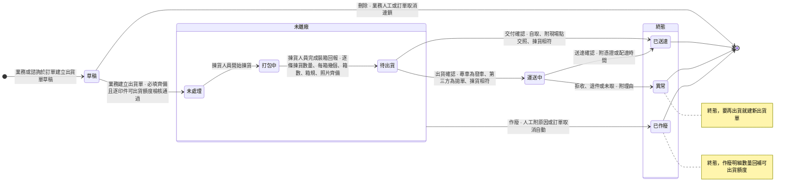

# 中台 - 品檢與出貨 Linear 交付草稿 v1

狀態：草稿，尚未稽核、尚未寫入 Linear。依 Linear 交付規範撰寫。
撰寫日：2026-10-14。新 project，沒有既有票。
取材版本：
- Prototype：erp repo 分支 prototype/production-stage，基準提交 6c728709，只讀。
- 情境目錄：Sens repo `erp-prototype-tests/docs/scenario-catalog.md` 工作區現行版（第十一章、第十二章、14.8、14.36 至 14.40、第十六章）。
- wiki：Sens repo 工作區現行版（品檢紀錄、出貨單、出貨單狀態、品檢通過入庫、出貨與送達、QC不通過補生產、齊套邏輯、單據存取範圍、各角色卡）。
範圍：project 描述、兩個 milestone、五張 Feature 票、十張 Task 票、出貨單狀態機。
不交付：物流商串接與拋單失敗處置、出貨單改派與代理的處置、單條出貨明細移除、計入完成度任務報廢後的待驗量，寫在 project 與 Feature 的另案處理，不寫內部問題編號。
寫入原則：新 project、新 Feature 票、新 Task 票。Feature 票與 Task 票在 PM team 建立，Task 票再轉入 FE 或 BE team。識別碼寫入後回填，本稿以「待回填」標記。
貼進 Linear 前：下列區塊外層是四個反引號，內層程式碼區塊沒有零寬字元，可直接貼。

---

## 一、Scope 清單（一條一張 Feature 票）

| # | Feature 票 | 做完後使用者能做到什麼 | Milestone |
|---|-----------|---------------------|-----------|
| 1 | 品檢驗收與修正 | 品檢人員看待驗清單、分次記錄驗收並附照片、修正記錯的紀錄；業務與印務查閱歷次品檢紀錄 | 品檢驗收與缺口處置 |
| 2 | 品檢缺口處置 | 印務與印務主管對驗出的缺口決定補不補與瑕疵品去向，並修正誤記的處置 | 品檢驗收與缺口處置 |
| 3 | 出貨單建立與管理 | 業務與諮詢先建草稿排出貨計畫，額度足夠時建立出貨單，貨未離廠前改明細數量或作廢，並查看出貨進度 | 出貨單與出貨作業 |
| 4 | 揀貨與裝箱回報 | 揀貨人員開始揀貨、逐條回報裝箱內容，並在貨離廠前修正填錯的裝箱回報 | 出貨單與出貨作業 |
| 5 | 出貨交運與送達 | 出貨人員依出貨方式確認出貨，下載物流單，確認送達，或把送不到的單轉異常 | 出貨單與出貨作業 |

## 二、全票功能節名表（一條規則只在一節）

| Feature | 功能節（受詞加動詞，一節一個動作） | 本節獨有的規則 |
|---------|----------------------------------|---------------|
| 品檢驗收與修正 | 待驗清單檢視 | 待驗清單列出條件；待驗量算式；不良品不進待驗量；打樣週期；外發與不需轉交的任務同一條路 |
| 品檢驗收與修正 | 品檢驗收 | 品檢紀錄結構；單筆驗收不得超過待驗量；不通過原因；照片必附；品檢類併發寫入 |
| 品檢驗收與修正 | 品檢修正 | 可修正欄位；修正紀錄；三條品檢修正界線；修正原因；照片至少留一張 |
| 品檢驗收與修正 | 品檢紀錄檢視 | 歷次品檢紀錄的查閱；只有品檢人員能寫入 |
| 品檢缺口處置 | 品檢缺口處置 | 處置掛印件；兩個決策各自獨立；客戶照收不消減缺口；缺口算式 |
| 品檢缺口處置 | 處置修正 | 可修正欄位；處置修正紀錄；處置修正界線 |
| 出貨單建立與管理 | 出貨單草稿儲存 | 草稿內容；預設帶入；草稿不佔額度；儲存只驗預計出貨日 |
| 出貨單建立與管理 | 出貨單建立 | 草稿轉出貨明細；必填；額度檢核與整張擋下；棄用印件移除；額度算式；出貨類併發寫入 |
| 出貨單建立與管理 | 出貨明細數量修改 | 未離廠修改數量；增量檢核；欄位分工 |
| 出貨單建立與管理 | 出貨單作廢 | 作廢條件與理由；額度回補；訂單取消連鎖作廢 |
| 出貨單建立與管理 | 草稿刪除 | 草稿以刪除收掉；訂單取消連鎖刪除 |
| 出貨單建立與管理 | 出貨單檢視 | 寄件資訊；包裝與裝箱資料；歷程；草稿不給現場人員 |
| 揀貨與裝箱回報 | 開始揀貨 | 開始揀貨的狀態條件 |
| 揀貨與裝箱回報 | 裝箱回報 | 逐條回報；必填；揀貨不符判準；揀貨類併發寫入 |
| 揀貨與裝箱回報 | 裝箱回報修正 | 待出貨期間修正；修正紀錄 |
| 出貨交運與送達 | 出貨確認 | 三種出貨方式分流；揀貨不符擋下；實際出貨日；確認類併發寫入 |
| 出貨交運與送達 | 物流單下載 | 物流單來源與可下載條件 |
| 出貨交運與送達 | 送達確認 | 三種憑證；第三方手動補登；同時到時先寫入者成立 |
| 出貨交運與送達 | 出貨單轉異常 | 異常為終態；理由必填；額度回補 |

規則歸屬檢查：揀貨不符的判準只在「裝箱回報」，擋下只在「出貨確認」，解除動作分別在「出貨明細數量修改」與「裝箱回報修正」，各節不重述。可出貨額度算式只在「出貨單建立」。寄件資訊只在「出貨單檢視」。待驗量算式只在「待驗清單檢視」。處置修正界線只在「處置修正」。併發寫入依 Miles 2026-10-13 裁決，各 Feature 只寫自己那類寫入，各寫一次。

---

## 三、project 描述（新建，整段）

寫入時 `save_project` 帶 FE、BE、PM 三個 team（`addTeams`），名稱「中台 - 品檢與出貨」。

````markdown
## 概述

品檢與出貨承接生產完成之後的最後一段：品檢人員驗收做出來的貨，通過的量成為可出貨額度，業務依額度安排出貨，揀貨人員裝箱，出貨人員把貨交運並確認送達。

現行品檢回報與裝箱回報混在一起發出，出問題時難以定位是哪一段錯。通過多少、裝了幾箱、哪天離廠，要靠人工對帳。業務談定的出貨日期散在通訊軟體，品檢結果出來後要重填一次。揀貨發現數量對不上時，沒有一條固定的處理路徑，貨離廠後帳就回不正。

---

## 使用情境

### Use Case

1. 品檢人員對送到品檢站的貨分次驗收，每次附品檢照片。通過的量隨驗隨成為可出貨額度。
2. 品檢人員記錯時修正原紀錄。已被出貨單佔用的量，業務先改出貨明細，品檢人員才修正得動。
3. 驗出缺口時，印務決定補不補，以及瑕疵品報廢或客戶照收。印務誤記報廢時，先修正處置，品檢人員再把不通過改為通過。
4. 業務與客戶談定出貨日期後，先建出貨單草稿。品檢通過、額度足夠後，業務把草稿建立為出貨單。
5. 揀貨人員開始揀貨，逐條回報揀貨數量與每箱幾個，並回報箱數、箱規與裝箱照片。數字與明細不符時，揀貨人員照實填並現場通知業務。
6. 業務改出貨明細數量，或揀貨人員修正揀貨數量。兩數相符後出貨單才放行。
7. 出貨人員依出貨方式交運：第三方物流拋單、專車配送出貨確認、自取交付確認。第三方的物流單號由物流商回傳。
8. 貨送到客戶手上後，出貨人員做送達確認。拒收、退件或超商未取時轉異常，額度回補，要再出就建新出貨單。
9. 貨未離廠前建錯單或客戶取消，業務作廢出貨單。

### Scope（功能票清單）

1. **品檢驗收與修正**：品檢人員看待驗清單、分次記錄驗收並附照片、修正記錯的紀錄；業務與印務查閱歷次品檢紀錄。　待回填
2. **品檢缺口處置**：印務與印務主管對驗出的缺口決定補不補與瑕疵品去向，並修正誤記的處置。　待回填
3. **出貨單建立與管理**：業務與諮詢先建草稿排出貨計畫，額度足夠時建立出貨單，貨未離廠前改明細數量或作廢，並查看出貨進度。　待回填
4. **揀貨與裝箱回報**：揀貨人員開始揀貨、逐條回報裝箱內容，並在貨離廠前修正填錯的裝箱回報。　待回填
5. **出貨交運與送達**：出貨人員依出貨方式確認出貨，下載物流單，確認送達，或把送不到的單轉異常。　待回填

**Out of Scope**

* 報工、報工修正、報工作廢與場內轉交點收：歸 <project id="9d055ea4-9212-4711-a0d6-22870079b450" href="https://linear.app/sensationdeveloper/project/%E4%B8%AD%E5%8F%B0-%E7%94%9F%E7%94%A2%E7%AE%A1%E7%90%86-148ecc50024f/overview">中台 - 生產管理</project>。
* 訂單詳情頁與印件詳情頁本體、取消訂單的動作、印件印製狀態與訂單狀態的推進：歸 <project id="4927231b-7fe3-407e-8d1f-94eddc3f0a84" href="https://linear.app/sensationdeveloper/project/%E4%B8%AD%E5%8F%B0-%E8%A8%82%E5%96%AE%E7%AE%A1%E7%90%86-414a81747028/overview">中台 - 訂單管理</project>。
* 印件準時交貨率的判定：後續批次。
* 缺口補做的發起（在原工單加開補做生產任務）與印件短出結案：後續批次。
* 第三方物流串接（物流商回報配達、物流商狀態對映）：延後批次。本批 Prototype 不模擬串接。
* 運費與物流對帳：後續批次。箱數與箱規只留存。
* 成品入庫成為獨立交易、成品倉庫存：後續批次。
* 品檢完成品移到暫存區的現場留痕：延後批次，隨廠務 Slack 表單回報一起。
* 退回實物的場內處理：不進系統，現場人工處理。
* 貨不回台的海外直發訂單：本輪範圍外。

### 範圍用詞

| 用詞 | 定義 |
|------|------|
| 全公司 | 該模組全部單據 |
| 自己負責 | 該單據的負責欄位是本人。訂單與出貨單看接單業務，工單看負責人 |
| 被分享（檢視） | 以檢視層級分享給本人且未撤銷的單據 |
| 被分享（編輯） | 以編輯層級分享給本人且未撤銷的單據 |

---

## 另案處理（來源尚未定案，暫不實作）

* 第三方物流拋單失敗時出貨單停在哪一態、由誰重拋，物流商狀態是否納入出貨單狀態，每日輪詢延遲下送達與異常如何判定：待裁。本批拋單由系統即時生成物流單號，不模擬失敗。
* 訂單改派接單業務、原業務離職或請假代理時，既有出貨單由誰編輯與作廢：待裁。本批依單據存取範圍，所屬訂單的接單業務與被分享（編輯）者處置。
* 未離廠的出貨單能否移除單條明細，揀貨數量能否填 0：待裁。本批整張單不符時，業務改明細數量，或作廢整張單重建。
* 計入完成度的生產任務報廢後，待驗量變負數：待裁。本批依待驗量不得為負的檢核擋下，驗收被擋下時提示先確認上游報工。
* 印件詳情品檢頁籤對各角色的欄位層級可見性：待裁。本批以單據存取範圍為準。

---

## 狀態機

>>> ### 出貨單狀態機



* 作廢自未離廠邊界出發，涵蓋人工作廢與訂單取消觸發的自動作廢。
* 草稿不屬未離廠。草稿的出口是刪除。
* 揀貨不符不是狀態。它擋下出貨確認與交付確認，見出貨交運與送達。

>>>
````

---

## 四、Milestone

```text
名稱：品檢驗收與缺口處置
描述：品檢人員分次驗收與修正，印務對驗出的缺口做處置與修正。
```

```text
名稱：出貨單與出貨作業
描述：業務建出貨單，揀貨人員裝箱回報，出貨人員交運與確認送達。
```

Feature 票掛法：Feature 1、2 掛「品檢驗收與缺口處置」；Feature 3、4、5 掛「出貨單與出貨作業」。

---

## 五、Feature 票

標題、Label（Type/Feature、Role/PM、Product/ERP）、Milestone 依下列各票。識別碼寫入後回填。

### 5-1 [ Feature ] - 品檢驗收與修正

````markdown
## 概述

這張票做完，品檢人員能在 <project id="待回填" href="待回填">中台 - 品檢與出貨</project> 看待驗清單、分次記錄驗收並附照片、修正記錯的紀錄。業務與印務能查閱歷次品檢紀錄。

## 權限

| 動作 | 可執行角色 | 資料範圍 |
|------|-----------|---------|
| 檢視待驗清單 | 品檢人員、印務主管、Supervisor | 全公司 |
| 檢視待驗清單 | 印務 | 自己負責 |
| 檢視待驗清單 | 所有角色 | 被分享（檢視） |
| 檢視待驗清單 | 所有角色 | 被分享（編輯） |
| 檢視品檢紀錄 | 品檢人員、印務主管、揀貨人員、出貨人員、Supervisor | 全公司 |
| 檢視品檢紀錄 | 業務、諮詢、印務 | 自己負責 |
| 檢視品檢紀錄 | 所有角色 | 被分享（檢視） |
| 檢視品檢紀錄 | 所有角色 | 被分享（編輯） |
| 品檢驗收 | 品檢人員 | 全公司 |
| 品檢修正 | 品檢人員 | 全公司 |

>>> ## 待驗清單檢視

身為品檢人員，我要看到哪些印件還有做出來的良品沒驗，以決定先驗哪一批。

**實體關係**

1. 待驗清單一列一件印件，依印件做出來的良品列出，不依轉交單與點收。
2. 末道生產任務標為不需轉交的印件，與外發任務報工後的印件，同樣列出。
3. 打樣印件與大貨印件用同一套算法。打樣印件重打後，只算本打樣週期的任務與品檢紀錄。
4. 不良品留在原站處置，不進待驗量。
5. 每列帶出內部完成日、預計交期與急件標籤，三者取自訂單模組的印件，唯讀。

**驗證規則**

1. 待驗量大於 0，或本打樣週期內已有品檢紀錄的印件，才列出。
2. 已棄用的印件不列出。

**算式**

```
待驗量 ＝ 各計入完成度生產任務的良品數取最小值 － 已驗量
已驗量 ＝ 該印件各筆品檢紀錄（取修正後的值）通過數量與不通過數量的加總
```

**驗收**

1. 假設 PI-2026-0601 完成數 5,000、良品 5,000、已驗 5,000，PI-2026-0820 的精裝裝訂已報工良品 500、尚無轉交單、完成數 500，當品檢人員打開品檢站，則兩件印件都列出，PI-2026-0601 待驗量 0，PI-2026-0820 待驗量 500。
2. 假設 PI-2026-0820 尚無轉交單、待驗量 500，當生管對該印件建一張到品檢站的轉交單，廠務搬運並抵達，品檢人員點收，則品檢站上 PI-2026-0820 的待驗量仍是 500。
3. 假設禮盒印件的盒身裁切與內襯裁切兩筆任務都計入完成度，盒身良品 1,000，內襯良品 590、不良品 10，當取該印件的待驗量，則待驗量為 590；內襯累計良品補到 990 後，待驗量為 990。
4. 假設一件印件底下只有一筆計入完成度的裁切任務，報工良品 1,000、不良品 3，當取該印件的待驗量，則待驗量為 1,000。
5. 假設 PI-2026-0601 為一般件，內部完成日 2026-06-18、預計交期 2026-06-22；PI-2026-0820 為三天急件，內部完成日 2026-09-04、預計交期 2026-09-07，當品檢人員打開品檢站，則兩列各帶出內部完成日與預計交期，PI-2026-0820 的急件欄有標籤，PI-2026-0601 的急件欄顯示「－」。

>>>

>>> ## 品檢驗收

身為品檢人員，我要對送到品檢站的貨分次記錄通過與不通過的數量並附照片，以讓通過的量隨驗隨成為可出貨額度，不通過的量留給印務處置。

**實體關係**

1. 一次驗收記一筆品檢紀錄，掛在印件上。一件印件有多筆。
2. 每筆記錄通過數量、不通過數量、不通過原因、品檢照片、品檢人員與驗收時間。
3. 各筆通過數量逐筆累計成印件的完工良品數，可出貨額度隨之放大。
4. 一筆紀錄記一個不通過原因。同一批貨有多種不良時，分批各記一筆。

**驗證規則**

1. 一筆驗收的通過數量加不通過數量，不得超過按下送出那一刻的待驗量。
2. 超過時整筆擋下並顯示當下待驗量，不做部分成立，不自動改數。
3. 不通過數量大於 0 時，必須從固定選項選一個不通過原因。
4. 每筆至少附一張品檢照片，通過與不通過都要拍。
5. 品檢驗收與品檢修正，會與報工修正、報工作廢（見 PM-1357）寫入同一印件的待驗量。兩筆同時寫入時，先寫入者成立，後到者以寫入當下的數字重新檢核。

**驗收**

1. 假設 PI-2026-0820 的待驗量 500，不需先建轉交單也不需點收，當品檢人員先記一批通過與不通過並選原因，再對同一列記第二批，則不通過大於 0 而未選原因時被擋下；第一次驗完待驗量下降，第二次驗完待驗量歸零；印件的完工良品數與可出貨額度隨通過數量增加。
2. 假設 PI-2026-0820 的待驗量 500，當品檢人員不附品檢照片送出一筆驗收，則整筆擋下並提示品檢照片至少一張，紀錄不新增；附一張照片後送出，則紀錄成立。
3. 假設 PI-2026-0820 的待驗量 500，當品檢人員在通過數量填 600 送出，則整筆擋下並顯示當下待驗量 500，兩個欄位都不進帳；改成合計不超過待驗量的組合後送出，則紀錄成立。
4. 假設 PI-2026-0820 的待驗量 500，當品檢人員驗完全部待驗量，則該列顯示「0（已驗完）」，驗收鈕停用，修正的入口仍可用。

>>>

>>> ## 品檢修正

身為品檢人員，我要把驗錯的通過數量、不通過數量、不通過原因或照片改成正確的值，以讓完工良品數與缺口回到真數。

**實體關係**

1. 修正直接改原品檢紀錄，不新增反向紀錄。
2. 可修正通過數量、不通過數量、不通過原因與品檢照片。
3. 每次修正，每個被改的欄位新增一筆品檢修正紀錄。紀錄記修正前後值、修正人、修正時間與修正原因。換掉的照片留在修正前照片。
4. 印件的完工良品數與缺口，取各筆修正後的值累計。
5. 不通過數量修正為 0 時，不通過原因清空。

**驗證規則**

1. 修正原因必填，未填無法修正。
2. 修正後至少留一張品檢照片。
3. 修正後本筆通過數量加不通過數量，不得大於本筆原通過數量加原不通過數量。新到的量另按驗收。
4. 修正後該印件的通過累計，不得小於該印件未作廢、非異常出貨單的出貨明細數量合計，含尚未離廠的單。擋下時列出佔用的出貨單編號與數量。
5. 修正後該印件的不通過累計，不得小於報廢類處置數量合計。擋下時列出報廢類處置紀錄。
6. 違反上列任一條，整筆擋下，原紀錄不改，不新增修正紀錄。

**驗收**

1. 假設 PI-2026-0820 的待驗量 500，品檢人員驗了一筆通過 500、不通過 0，當品檢人員對那一筆修正為通過 480、不通過 20、不通過原因色差／偏色，修正原因填「複驗發現色差」並附品檢照片，則原紀錄就地改為 480／20；紀錄下有品檢修正紀錄，含通過數量、不通過數量與不通過原因三個欄位的修正前後、修正人、修正時間、修正原因；印件的完工良品數 480、不通過累計 20、未處置品檢缺口 20。
2. 假設 PI-2026-0820 的待驗量 500，品檢人員驗了一筆通過 400、不通過 0，待驗量剩 100，當品檢人員對那一筆把通過數量改成 450，則整筆擋下，訊息說明修正後合計 450 超過本筆原合計 400、新到的量請另按驗收；原紀錄仍為 400，不新增修正紀錄，待驗量仍是 100。
3. 假設 PI-2026-0820 品檢通過 500，業務在 ORD-2026-0820 建立出貨單 SH-2026-0820，明細 500，當品檢人員把通過改為 400、不通過改為 100，則整筆擋下並列出佔用的出貨單 SH-2026-0820 與數量 500，原紀錄不改；業務把出貨明細改為 400 之後，同一筆修正成立，通過累計 400、缺口 100。
4. 假設 PI-2026-0820 品檢人員驗通過 480、不通過 20，印務主管對 20 件缺口處置為補做、瑕疵品報廢，當品檢人員把不通過 20 改為通過，則整筆擋下，訊息列出報廢類處置紀錄與數量 20。
5. 假設品檢人員剛為 PI-2026-0820 記了一筆附品檢照片的驗收，當品檢人員對那一筆修正並把照片全部移除，則整筆擋下；保留一張後送出，則修正成立，換掉的照片留在品檢修正紀錄的修正前照片。

>>>

>>> ## 品檢紀錄檢視

身為業務，我要在印件詳情看到歷次品檢紀錄與品檢照片，以回答客戶貨驗得怎樣，不必請印務截圖。

**實體關係**

1. 印件詳情的品檢頁籤列出該印件歷次品檢紀錄，含品檢照片。
2. 品檢紀錄只讀角色沒有修正入口。

**驗證規則**

1. 只有品檢人員能新增與修正品檢紀錄，其他角色只檢視。

**驗收**

1. 假設 PI-2026-0601 有一筆品檢紀錄 QC-2026-0601-01，通過 5,000，品檢照片檔名「品檢照-QC0601-01.jpg」，當有檢視權限的角色在印件列表點印件名稱進詳情，切到「品檢紀錄與品檢缺口處置」頁籤，則歷次品檢紀錄列出該筆，品檢照片欄顯示「品檢照-QC0601-01.jpg」。
2. 假設 PI-2026-0601 有品檢紀錄 QC-2026-0601-01，當業務打開 PI-2026-0601 印件詳情，則看得到「品檢紀錄與品檢缺口處置」頁籤與品檢照片縮圖，沒有品檢修正與處置修正的操作鈕；印務在同一頁籤有處置修正的操作欄。

>>>

````

### 5-2 [ Feature ] - 品檢缺口處置

````markdown
## 概述

這張票做完，印務與印務主管能在 <project id="待回填" href="待回填">中台 - 品檢與出貨</project> 對品檢驗出的缺口決定補不補與瑕疵品去向，並修正誤記的處置。

## 權限

| 動作 | 可執行角色 | 資料範圍 |
|------|-----------|---------|
| 品檢缺口處置 | 印務、印務主管 | 全公司 |
| 處置修正 | 印務、印務主管 | 全公司 |
| 檢視品檢缺口處置 | 印務、印務主管、Supervisor | 全公司 |
| 檢視品檢缺口處置 | 業務、諮詢 | 自己負責 |
| 檢視品檢缺口處置 | 所有角色 | 被分享（檢視） |
| 檢視品檢缺口處置 | 所有角色 | 被分享（編輯） |

>>> ## 品檢缺口處置

身為印務，我要對品檢驗出的缺口決定補不補、瑕疵品怎麼去，以讓每個缺口有人負責、有紀錄。

**實體關係**

1. 處置掛在印件上，不掛單筆品檢紀錄。一件印件可有多筆處置，分次驗就可分次處置。
2. 一筆處置記缺口是否補做（補做或不補）、瑕疵品去向（報廢或客戶照收）、處置數量、決策者、決策時間與處置備註。
3. 缺口是否補做與瑕疵品去向各自獨立，四種組合都成立。
4. 處置記下它承接的不通過品檢紀錄，供追溯，並防止同一缺口被重複承接。
5. 瑕疵品去向為報廢的處置數量，累計成印件的報廢數。
6. 客戶照收不消減缺口。品檢人員修正品檢紀錄，把不通過改為通過時，缺口才消滅。
7. 品檢人員只記錄品質事實，不做處置決策。

**驗證規則**

1. 缺口要先由品檢人員記錄，印務才有缺口可處置。
2. 處置數量大於 0。

**算式**

```
不通過累計 ＝ 各筆品檢紀錄不通過數量（取修正後的值）的加總
未處置缺口 ＝ 不通過累計 － 報廢類處置數量合計
```

1. 客戶照收的處置數量不列入報廢類處置數量合計。

**驗收**

1. 假設 PI-2026-0820 品檢人員驗通過 480、不通過 20，當印務主管對 20 件缺口處置為補做、瑕疵品報廢，則該印件多一筆處置紀錄，處置數量 20、瑕疵品去向報廢，報廢數 20，報廢類處置數量合計 20。

>>>

>>> ## 處置修正

身為印務，我要在處置誤記時改正處置數量或瑕疵品去向，以讓報廢數與未處置缺口回到真數。

**實體關係**

1. 修正直接改原處置紀錄。可修正處置數量與瑕疵品去向。缺口是否補做與處置備註不可修正。
2. 每次修正，每個被改的欄位在該筆處置下新增一筆處置修正紀錄。紀錄記修正前後值、修正人、修正時間與修正原因。
3. 不設補做限制：已補做的處置同樣可修正。

**驗證規則**

1. 修正原因必填，未填無法修正。
2. 修正後報廢類處置數量合計，不得大於不通過累計，未處置缺口因此不為負。違反時整筆擋下，原處置不改。
3. 誤記報廢要改為客戶照收時，印務先修正瑕疵品去向，品檢人員才修正得動把不通過改為通過。

**驗收**

1. 假設 PI-2026-0820 品檢人員驗通過 480、不通過 20，印務主管對 20 件缺口處置為補做、瑕疵品報廢，品檢人員第一次把不通過改為通過被擋下，當印務主管在印件詳情的品檢紀錄頁籤對那筆處置修正，瑕疵品去向由報廢改為客戶照收並填修正原因，則處置紀錄下留一筆處置修正紀錄，修正欄位瑕疵品去向、修正前報廢、修正後客戶照收，報廢數歸 0；品檢人員再修正一次把不通過改為通過，則修正成立，完工良品數 500、不通過累計 0、未處置缺口 0。

>>>

````

### 5-3 [ Feature ] - 出貨單建立與管理

````markdown
## 概述

這張票做完，業務與諮詢能在 <project id="待回填" href="待回填">中台 - 品檢與出貨</project> 先建出貨單草稿排出貨計畫，額度足夠時建立出貨單，貨未離廠前改明細數量或作廢，並查看每一批貨的出貨進度。

出貨單的狀態流轉見 <project id="待回填" href="待回填">中台 - 品檢與出貨</project> 的出貨單狀態機。

## 權限

| 動作 | 可執行角色 | 資料範圍 |
|------|-----------|---------|
| 儲存出貨單草稿 | 業務、諮詢 | 自己負責 |
| 儲存出貨單草稿 | 所有角色 | 被分享（編輯） |
| 建立出貨單 | 業務、諮詢 | 自己負責 |
| 建立出貨單 | 所有角色 | 被分享（編輯） |
| 修改出貨明細數量 | 業務、諮詢 | 自己負責 |
| 修改出貨明細數量 | 所有角色 | 被分享（編輯） |
| 作廢出貨單 | 業務、諮詢 | 自己負責 |
| 作廢出貨單 | 所有角色 | 被分享（編輯） |
| 刪除出貨單草稿 | 業務、諮詢 | 自己負責 |
| 刪除出貨單草稿 | 所有角色 | 被分享（編輯） |
| 檢視出貨單 | 揀貨人員、出貨人員、業務主管、Supervisor | 全公司 |
| 檢視出貨單 | 業務、諮詢 | 自己負責 |
| 檢視出貨單 | 所有角色 | 被分享（檢視） |
| 檢視出貨單 | 所有角色 | 被分享（編輯） |

>>> ## 出貨單草稿儲存

身為業務，我要在品檢結果出來之前先記下這一批預計哪天出、送到哪，以免客戶談定的出貨計畫散在通訊軟體裡。

**實體關係**

1. 草稿屬於一張訂單，不可跨訂單。草稿只有單頭與預計出貨印件，沒有出貨明細。
2. 新草稿預設帶入所屬訂單全部未棄用的印件。每件預設數量為購買數量扣掉其他出貨單已佔用的量。
3. 已佔用的量排除異常與已作廢的出貨單。已送達、運送中與未離廠的單都算。
4. 業務可移除預計出貨印件，也可加回。
5. 收件人、收件人電話、收件地址預設帶所屬訂單窗口聯絡人的資料，可修改。草稿儲存後不隨訂單窗口聯絡人變動，手改值保留。
6. 出貨方式不帶預設，由業務或諮詢自選。
7. 草稿不佔可出貨額度，不進揀貨人員與出貨人員的清單，不推進印件與訂單的狀態，也不產生實際出貨日。

**驗證規則**

1. 儲存草稿只驗出貨單預計出貨日已填，未填無法儲存。
2. 草稿的預計數量不檢核可出貨額度。
3. 訂單在任何狀態，含終態，都可建立草稿。
4. 建立草稿的入口只在所屬訂單的出貨單頁籤，並鎖定該訂單。

**驗收**

1. 假設業務在 ORD-2026-0820 詳情的出貨單頁籤按「建立出貨單草稿」，當只填出貨單預計出貨日就按「儲存草稿」，則列表多一張草稿，草稿沒有實際出貨日，PI-2026-0820 維持未出貨。
2. 假設 PI-2026-0820 已取得可出貨額度 500，業務已存一張數量 500 的草稿，當業務再開一張草稿同樣填 500 並儲存，則 PI-2026-0820 的可出貨額度不變。
3. 假設 ORD-2026-0820 的聯絡人為周雅文、02-2790-6611、台北市內湖區文德路 168 號 3 樓，當業務開建單對話框，則收件人、收件人電話、收件地址三欄帶入這組資料；業務改掉收件人後儲存草稿，再到訂單資訊切換窗口聯絡人，回頭開同一張草稿，則三欄仍是草稿上的值。
4. 假設 ORD-2026-0601 的訂單出貨方式為專車配送，當業務在該訂單詳情的出貨單頁籤按「建立出貨單草稿」，則出貨方式留空並顯示「選擇出貨方式」，收件人與收件地址帶訂單聯絡人資料。
5. 假設 ORD-2026-0820 的接單業務洪嘉駿把它以編輯（代理）分享給張惠雯，張惠雯在 ORD-2026-0710 為檢視層級分享成員，當張惠雯以諮詢身分在 ORD-2026-0820 的出貨單頁籤只填出貨單預計出貨日並儲存草稿，則草稿存下，建單人記張惠雯；在 ORD-2026-0710 的出貨單頁籤沒有「建立出貨單草稿」入口。

>>>

>>> ## 出貨單建立

身為業務，我要在品檢通過、可出貨額度足夠後把草稿建立為出貨單，以讓揀貨人員依單清點裝箱。

**實體關係**

1. 建立出貨單時，預計出貨印件轉為出貨明細。
2. 每條出貨明細指向同一訂單的一件印件。同一訂單的多種印件可合在一張單。
3. 一件印件可開多張出貨單。分批出貨不設專屬流程。
4. 在新建對話框直接按「建立出貨單」時，系統先落一張草稿，同一個動作立刻建立出貨單。
5. 建立出貨單時，印製維度已棄用的印件由系統自動移除並提示。

**驗證規則**

1. 出貨單在草稿才可建立。
2. 下列必填未齊，無法建立，系統列出缺的欄位與所在位置：
   * 出貨單預計出貨日。
   * 出貨方式。
   * 收件人。
   * 收件地址。
   * 至少一條數量大於 0 的預計出貨印件。
3. 每條明細的數量不得超過該印件的可出貨額度。額度以按下建立的那一刻為準。
4. 額度不足時整張單擋下，不做部分成立，不自動砍數量。系統只告知可出貨額度不足、出貨單未成立。
5. 移除棄用印件後，沒有任何一條數量大於 0 時，以必填檢核擋下。
6. 出貨單建立、出貨明細增減與出貨單作廢，會與其他出貨單的同類寫入搶同一印件的可出貨額度。兩筆同時寫入時，先寫入者成立，後到者以寫入當下的額度重新檢核。

**算式**

```
可出貨額度 ＝ 完工良品數 － 累計已出貨數量 ＋ 出貨單回補
累計已出貨數量 ＝ 排除異常與已作廢的出貨單之後，各張單的明細數量加總，含尚未離廠的單
出貨單回補 ＝ 出貨單轉異常或已作廢時，該單明細數量逐印件回補
```

**驗收**

1. 假設 ORD-2026-0820 的草稿必填未齊，當業務按「建立出貨單」，則頂端列出缺的欄位與所在位置，出貨明細頁籤標「缺 N」，出貨單不成立。
2. 假設 PI-2026-0820 的可出貨額度 500，業務在草稿把印件數量填 600，當按「建立出貨單」，則整張擋下，訊息只有「可出貨額度不足，出貨單未成立」，數量不自動砍，不部分成立。
3. 假設接上一條，當業務把數量改回 500 再按「建立出貨單」，則出貨單成立，狀態轉未處理，預計出貨印件成為出貨明細。
4. 假設 ORD-2026-0820 的出貨單頁籤，當業務在新建對話框一次填齊並直接按「建立出貨單」，則出貨管理列表只多一張未處理的單，沒有留下半張草稿。
5. 假設業務為 ORD-2026-0820 存了一張含 PI-2026-0820 的草稿，之後該印件被「取消製作」，當業務點草稿列上的編輯鈕開對話框，則出貨明細頁籤警示列出已棄用的印件；按「建立出貨單」時整張擋下，提示請至少留一條出貨印件。

>>>

>>> ## 出貨明細數量修改

身為業務，我要在貨未離廠前改出貨明細的數量，以在揀貨不符時讓出貨數量對齊現場的貨。

**實體關係**

1. 出貨明細的數量歸業務修改。揀貨數量與每箱幾個歸揀貨人員修正。各角色只改自己負責的欄位。
2. 每次修改，系統在出貨單歷程記前後值。

**驗證規則**

1. 出貨單在未處理、打包中、待出貨才可修改明細數量。
2. 建立出貨單之後，只能修改出貨明細的數量，其他欄位不可改。
3. 修改後的數量大於 0，並重跑可出貨額度檢核。額度不足時整筆擋下，明細數量不更新。
4. 檢核基準是當下額度加本單該條明細原已佔用的量。往下改數量時，不被本單自己的佔用擋下。

**算式**

```
可修改的數量上限 ＝ 當下可出貨額度 ＋ 本單該條明細原數量
```

**驗收**

1. 假設 ORD-2026-0820 的出貨單在未處理，當業務按列上的「編輯」，則只有出貨明細的數量可改，單頭欄位唯讀。
2. 假設兩張新竹物流出貨單各出 100，揀貨人員已各回報揀貨數量 80、每箱 40、箱數 2，當業務把第一張的出貨明細數量從 100 改為 80，則該張兩數相符，列表上的「揀貨不符」標籤消失。

>>>

>>> ## 出貨單作廢

身為業務，我要在貨未離廠前作廢建錯或客戶取消的出貨單，以讓可出貨額度回補、不留無效單據。

**實體關係**

1. 作廢記錄理由與轉入時間。
2. 作廢後，該單明細數量逐印件回補可出貨額度。
3. 所屬訂單轉已取消時，系統自動作廢該訂單未離廠的出貨單，原因自動記「訂單取消」，不要求人工填理由。
4. 運送中與已送達的出貨單，不因訂單取消而改動。

**驗證規則**

1. 出貨單在未處理、打包中、待出貨才可作廢。草稿不作廢，走刪除。
2. 人工作廢必填理由，未填無法作廢。

**驗收**

1. 假設 ORD-2026-0820 旗下有一張承品檢驗收建立、狀態為未處理的出貨單，當業務取消 ORD-2026-0820 並填原因確認，則該張出貨單轉已作廢，作廢原因記「訂單取消」，額度回補。
2. 假設一張出貨單處於未處理，當業務按列上的「作廢」，則對話框要求填作廢理由，未填無法作廢。

>>>

>>> ## 草稿刪除

身為業務，我要刪除不再需要的草稿，以免清單上留著無效的出貨計畫。

**實體關係**

1. 草稿以刪除收掉，不走作廢。草稿沒有出貨明細，沒佔額度，沒有要回補的量。
2. 刪除後草稿不再出現在清單，紀錄留存供追溯。
3. 所屬訂單轉已取消時，系統自動刪除該訂單的草稿，不要求人工填理由。

**驗證規則**

1. 出貨單在草稿才可刪除。
2. 刪除不要求填理由。

**驗收**

1. 假設 SH-2026-0820 為草稿，當業務在出貨管理按該張草稿列上的「刪除」並確認，則確認視窗沒有理由輸入欄；確認後該張草稿自列表消失，不落已作廢。
2. 假設 ORD-2026-0820 旗下有草稿 SH-2026-0820，當業務取消 ORD-2026-0820 並填原因確認，則連鎖摘要寫明草稿已刪除，SH-2026-0820 自列表消失。

>>>

>>> ## 出貨單檢視

身為業務，我要在一處看到每一批貨的出貨進度、揀貨結果與歷程，以回答客戶貨到哪了。

**實體關係**

1. 每條出貨明細記揀貨數量與每箱幾個。出貨單記箱數、箱規與裝箱照片。出貨單沒有重量。
2. 寄件資訊依所屬訂單的帳務公司帶出品牌名稱、電話與地址，唯讀。建立出貨單時記下當時的帳務公司，之後訂單改帳務公司，已成立的單不變。品牌名稱、電話與地址仍取帳務公司主檔現值。
3. 出貨單歷程記下建立出貨單、編輯、開始揀貨、裝箱回報、裝箱回報修正、拋單或出貨確認、交付確認、送達確認、異常、作廢與每次狀態變化。每筆帶時間、操作人、前後值與附件。歷程只讀。

**驗證規則**

1. 揀貨人員與出貨人員的清單不列草稿，狀態篩選也沒有草稿。

**驗收**

1. 假設 SH-2026-0601、SH-2026-0602 已送達，SH-2026-0820 為草稿且出貨單預計出貨日 2026-09-10，當業務查看出貨單列表，則 SH-2026-0820 的明細數量標「（預計）」，實際出貨日顯示「－」；當揀貨人員與出貨人員查看列表，則都不列 SH-2026-0820，狀態篩選也沒有草稿。
2. 假設 SH-2026-0601 已送達，明細 PI-2026-0601 × 3,000、揀貨數量 3,000、每箱 500、箱數 6、裝箱照片「裝箱照-SH0601.jpg」，歷程五筆，當業務按「檢視」開出貨單，則出貨明細顯示出貨數量 3,000、揀貨數量 3,000、每箱幾個 500，包裝資料顯示箱數 6 與裝箱照片，沒有重量；歷程為新到舊，含建立出貨單、開始揀貨、裝箱回報、出貨確認、送達確認五筆。
3. 假設 ORD-2026-0820 的帳務公司為 SSP，當業務開建單對話框，再開已成立的那張單，則兩處的寄件資訊都顯示品牌名稱感官文化印刷與其電話、地址，無編輯入口；帳務公司為 BRO 時顯示品牌名稱理想印制。

>>>

````

### 5-4 [ Feature ] - 揀貨與裝箱回報

````markdown
## 概述

這張票做完，揀貨人員能在 <project id="待回填" href="待回填">中台 - 品檢與出貨</project> 依出貨單開始揀貨、逐條回報裝箱內容，並在貨離廠前修正填錯的裝箱回報。

出貨單的狀態流轉見 <project id="待回填" href="待回填">中台 - 品檢與出貨</project> 的出貨單狀態機。

## 權限

| 動作 | 可執行角色 | 資料範圍 |
|------|-----------|---------|
| 開始揀貨 | 揀貨人員 | 全公司 |
| 裝箱回報 | 揀貨人員 | 全公司 |
| 修正裝箱回報 | 揀貨人員 | 全公司 |

>>> ## 開始揀貨

身為揀貨人員，我要按開始揀貨，以讓業務看得到倉庫已在處理這張單。

**實體關係**

1. 出貨單即揀貨指令。揀貨人員依單清點入庫的成品。
2. 開始揀貨寫入出貨單歷程。

**驗證規則**

1. 出貨單在未處理才可開始揀貨。

**驗收**

1. 假設承品檢驗收建立的 ORD-2026-0820 出貨單處於未處理，當揀貨人員在列上按「開始揀貨」並確認，則狀態由未處理轉打包中，歷程多一筆「開始揀貨」。

>>>

>>> ## 裝箱回報

身為揀貨人員，我要逐條回報實際裝進箱內的數量並附裝箱證據，以讓出貨人員接手時，裝箱結果已留在單上。

**實體關係**

1. 揀貨數量與每箱幾個逐條記在出貨明細，不預填。
2. 箱數、箱規與裝箱照片記在出貨單。一箱可合裝多件印件，照片可多張。
3. 揀貨數量與出貨明細數量不符時，揀貨人員照實填並現場通知業務，不自行改明細。系統不發通知，也不設異常回報。
4. 裝箱時發現瑕疵或找不到貨，揀貨數量填實際裝入箱內的數。瑕疵品取出不裝箱。
5. 任一條出貨明細的揀貨數量不等於出貨數量，即為揀貨不符。列表在狀態旁標示揀貨不符。

**驗證規則**

1. 出貨單在打包中才可裝箱回報。
2. 每條明細的揀貨數量與每箱幾個必填。箱數、箱規與裝箱照片必填。漏填時不受理，出貨單不推進。
3. 揀貨不符不擋裝箱回報。出貨單照常轉待出貨。
4. 裝箱回報與裝箱回報修正，會與出貨明細數量修改搶同一張出貨單的揀貨不符判定。兩筆同時寫入時，先寫入者成立，後到者以寫入當下的數字重新判定。

**驗收**

1. 假設承品檢驗收建立、已開始揀貨的 ORD-2026-0820 出貨單，當揀貨人員在「裝箱回報」逐條填揀貨數量與每箱幾個，再填箱數、箱規與裝箱照後送出，則出貨單轉待出貨；每條明細有揀貨數量與每箱幾個，出貨單有箱數、箱規與裝箱照片，沒有重量；歷程多「開始揀貨」與「裝箱回報」兩筆。
2. 假設承品檢驗收建立的出貨單已開始揀貨，當揀貨人員漏填每箱幾個就送出，則對話框不關閉，出貨單不推進；補填後送出，則轉待出貨。
3. 假設承品檢驗收建立、已開始揀貨的出貨單明細 500，當揀貨人員把該條明細的揀貨數量填 470 並送出，則出貨單照轉待出貨，警示訊息列出該條明細的揀貨與出貨差異，並說明不符未解除前不能拋單、出貨確認或交付確認；列表在狀態旁標「揀貨不符」。

>>>

>>> ## 裝箱回報修正

身為揀貨人員，我要在貨還沒離廠時修正填錯的裝箱回報，以讓出貨單的裝箱資料與現場一致。

**實體關係**

1. 修正直接改原值，不改出貨單狀態。
2. 可修正揀貨數量、每箱幾個、箱數、箱規與裝箱照片。
3. 每次修正，每個被改的欄位新增一筆裝箱回報修正紀錄。紀錄記修正前後值、修正人、修正時間與修正原因。修正裝箱照片時，被換掉的照片留在紀錄。
4. 修正寫入出貨單歷程，帶前後值與原因。

**驗證規則**

1. 出貨單在待出貨才可修正。運送中以後不可修正。
2. 修正原因必填，未填無法修正，不改任何欄位。

**驗收**

1. 假設承品檢驗收自建一張新竹物流出貨單，出貨數量 500，揀貨人員已回報揀貨數量 480、每箱 48、箱數 10，單在待出貨，當揀貨人員按「修正」把揀貨數量改為 500、箱數改為 11，先不填修正原因送出，則對話框不關閉，不改任何欄位；填「清點後找到 20 張」再送出，則揀貨數量與箱數更新，兩個被改的欄位各留一筆裝箱回報修正紀錄，歷程多一筆「裝箱回報修正」帶前後值與原因；出貨人員拋單之後，揀貨人員在同一張單的列上沒有「修正」。
2. 假設兩張新竹物流出貨單各出 100，揀貨人員已各回報揀貨數量 80，業務已把第一張的明細數量改為 80，當揀貨人員把第二張的揀貨數量修正為 100，則第二張兩數相符，「揀貨不符」標籤消失。

>>>

````

### 5-5 [ Feature ] - 出貨交運與送達

````markdown
## 概述

這張票做完，出貨人員能在 <project id="待回填" href="待回填">中台 - 品檢與出貨</project> 依出貨方式確認出貨，下載物流單，確認送達，或把送不到的單轉異常。

出貨單的狀態流轉見 <project id="待回填" href="待回填">中台 - 品檢與出貨</project> 的出貨單狀態機。

## 權限

| 動作 | 可執行角色 | 資料範圍 |
|------|-----------|---------|
| 出貨確認 | 出貨人員 | 全公司 |
| 下載物流單 | 出貨人員 | 全公司 |
| 送達確認 | 出貨人員 | 全公司 |
| 轉異常 | 出貨人員 | 全公司 |

>>> ## 出貨確認

身為出貨人員，我要依出貨方式確認貨離廠，以留下實際出貨日與誰確認的紀錄。

**實體關係**

1. 出貨方式不同，動作與結果不同：

| 出貨方式 | 動作 | 結果 |
|---------|------|------|
| 第三方物流 | 拋單，把出貨資料送給物流商 | 單轉運送中。物流單號與物流單由物流商回傳寫入 |
| 專車配送 | 出貨確認，即發車 | 單轉運送中 |
| 自取 | 交付確認，客戶到廠 | 不經運送中，一次完成出貨與送達，附現場點交照 |

2. 出貨確認記時間與操作人。
3. 出貨人員不手填物流單號。
4. 實際出貨日取本單首次進入運送中或已送達的日期。自取與各種出貨方式同一套取法。草稿、異常與已作廢的單沒有實際出貨日。

**驗證規則**

1. 出貨單在待出貨才可出貨確認。
2. 任一條出貨明細的揀貨數量不等於出貨數量時，不受理拋單、出貨確認與交付確認，直到兩數相符。兩數相符即放行，不另設確認關卡。
3. 自取的交付確認必附現場點交照。
4. 拋單與出貨確認，會與出貨明細數量修改、裝箱回報修正搶同一張出貨單的揀貨不符判定。兩筆同時寫入時，先寫入者成立，後到者以寫入當下的數字重新判定。

**驗收**

1. 假設兩張新竹物流出貨單各出 100，揀貨人員各回報揀貨數量 80、每箱 40、箱數 2，當出貨人員查看這兩張單列上的鈕，則只有「檢視」，沒有「拋單」；業務把第一張明細改為 80、揀貨人員把第二張揀貨數量修正為 100 之後，兩張都放行，出貨人員列上長出「拋單」。
2. 假設承品檢驗收建立並走完揀貨的一張自取單，當出貨人員在列上按「交付確認」並附點交照，則一次完成出貨與送達，不經運送中。
3. 假設承品檢驗收建立並走完揀貨的一張第三方物流單，當出貨人員在列上按「拋單」，則對話框沒有物流單號輸入欄、沒有重量欄；送出後單轉運送中，物流單號（HCT 開頭加數字）出現在列表的物流單號欄與對話框單頭，歷程多一筆「拋單」。
4. 假設 SH-2026-0601 為 PI-2026-0601 的首張出貨單 3,000，出貨確認日 2026-06-18，SH-2026-0602 為第二批 2,000，出貨確認日 2026-06-22，當業務查看兩張單，則 SH-2026-0601 的實際出貨日為 2026-06-18，SH-2026-0602 的實際出貨日為 2026-06-22。

>>>

>>> ## 物流單下載

身為出貨人員，我要下載物流商回傳的物流單，以列印後張貼在箱上。

**實體關係**

1. 物流單由物流商於拋單成功時回傳，歸在出貨單。
2. 專車配送與自取沒有物流單。

**驗證規則**

1. 只有已拋單的第三方出貨單可下載物流單。運送中、已送達、異常都可下載。

**驗收**

1. 假設承品檢驗收的一張新竹物流單已拋單，當出貨人員看該張單的列，則有「下載物流單」，點擊下載的檔案內容含出貨單編號與物流單號；專車配送單與自取單的列沒有「下載物流單」。

>>>

>>> ## 送達確認

身為出貨人員，我要在貨到客戶手上時確認送達並留下憑證，以讓每張單收尾都查得到誰確認、何時、憑什麼。

**實體關係**

1. 送達憑證依出貨方式不同：專車配送為司機交付照，自取為現場點交照，第三方物流為物流商的配達時間。
2. 送達確認記時間、操作人與憑證。憑證可補附。
3. 第三方物流的送達，由出貨人員查得配達資訊後手動補登配達時間。

**驗證規則**

1. 出貨單在運送中才可送達確認。
2. 專車配送的送達確認必附司機交付照。第三方物流的送達確認必填配達時間。
3. 兩筆送達確認同時到時，先寫入者成立，後到者不改任何欄位，並提示重新整理。

**驗收**

1. 假設承品檢驗收的一張新竹物流單已拋單，當出貨人員在列上按「送達確認」並回填物流商配達時間，則單離開運送中，列上只剩「檢視」與「下載物流單」；後到的第二次送達確認不改任何欄位，操作者看到「此單已收尾，請重新整理」。
2. 假設承品檢驗收的一張專車配送單已出貨確認，當出貨人員依序按「出貨確認」與「送達確認」，則專車配送只有送達確認這一條路，且必附司機交付照；自取單則在交付確認時一次完成。

>>>

>>> ## 出貨單轉異常

身為出貨人員，我要把拒收、退件或超商未取的出貨單轉異常，以讓這次出貨明確收掉、額度回補。

**實體關係**

1. 異常是終態，不回流。要再出貨就建新出貨單。
2. 轉異常記理由與轉入時間。原因不細分，理由用自由文字。
3. 轉異常後，該單明細數量逐印件回補可出貨額度。

**驗證規則**

1. 出貨單在運送中才可轉異常。
2. 轉異常必填理由，未填無法轉異常。

**驗收**

1. 假設一張第三方物流出貨單處於運送中，當出貨人員看該張單的列，則有「送達確認」與「異常」；按「異常」時，對話框要求填異常理由，未填無法轉異常。

>>>

````

---

## 六、Task 票（十張）

標籤：後端 Type/Task、Role/Backend、Product/ERP；前端 Type/Task、Role/Frontend、Product/ERP。Parent 為各 Feature 票。識別碼寫入後回填。阻擋順序（Task 層）：同一張 Feature 下後端先、前端後。

### 6-1 [ Task ] - 品檢驗收與修正的資料操作

````markdown
## 要做什麼

提供待驗清單、品檢驗收與品檢修正的資料操作，讓品檢人員分次驗收並修正記錯的紀錄。

## 要開的 API

1. 待驗清單讀取
2. 品檢紀錄讀取
3. 品檢驗收
4. 品檢修正

## 不用自己做

* 報工、報工修正與報工作廢的資料操作：由 BE-425 提供。
* 印件、訂單與出貨單的讀取：由 <project id="4927231b-7fe3-407e-8d1f-94eddc3f0a84" href="https://linear.app/sensationdeveloper/project/%E4%B8%AD%E5%8F%B0-%E8%A8%82%E5%96%AE%E7%AE%A1%E7%90%86-414a81747028/overview">中台 - 訂單管理</project> 與本 project 的出貨單建立與管理後端 Task 提供。
````

### 6-2 [ Task ] - 品檢驗收與修正的頁面

````markdown
## 要做什麼

讓品檢人員在品檢站驗收與修正，讓業務與印務在印件詳情查閱歷次品檢紀錄。

## 頁面與控制元件

* 品檢站頁
  * 動作按鈕：驗收、修正
  * 對話框：驗收、修正品檢紀錄
* 印件詳情頁
  * 頁籤：品檢紀錄與品檢缺口處置

## 不用自己做

* 印件詳情頁本體：由 <project id="4927231b-7fe3-407e-8d1f-94eddc3f0a84" href="https://linear.app/sensationdeveloper/project/%E4%B8%AD%E5%8F%B0-%E8%A8%82%E5%96%AE%E7%AE%A1%E7%90%86-414a81747028/overview">中台 - 訂單管理</project> 提供。
* 品檢缺口處置的按鈕與對話框：由品檢缺口處置的前端 Task 提供。
````

### 6-3 [ Task ] - 品檢缺口處置的資料操作

````markdown
## 要做什麼

提供品檢缺口處置與處置修正的資料操作，讓印務對驗出的缺口留下處置決策並修正誤記。

## 要開的 API

1. 品檢缺口處置紀錄讀取
2. 品檢缺口處置
3. 處置修正

## 不用自己做

* 品檢紀錄的讀取與修正：由品檢驗收與修正的後端 Task 提供。
````

### 6-4 [ Task ] - 品檢缺口處置的頁面

````markdown
## 要做什麼

讓印務與印務主管在印件詳情與印件列表對缺口做處置，並修正誤記的處置。

## 頁面與控制元件

* 印件詳情頁
  * 動作按鈕：品檢缺口處置、修正處置
  * 對話框：品檢缺口處置、修正處置
* 印件列表頁
  * 動作按鈕：品檢缺口處置

## 不用自己做

* 印件詳情頁的品檢紀錄與品檢缺口處置頁籤本體：由品檢驗收與修正的前端 Task 提供。
* 印件列表頁本體：由 <project id="4927231b-7fe3-407e-8d1f-94eddc3f0a84" href="https://linear.app/sensationdeveloper/project/%E4%B8%AD%E5%8F%B0-%E8%A8%82%E5%96%AE%E7%AE%A1%E7%90%86-414a81747028/overview">中台 - 訂單管理</project> 提供。
````

### 6-5 [ Task ] - 出貨單建立與管理的資料操作

````markdown
## 要做什麼

提供出貨單草稿、建立、明細數量修改、作廢、刪除與檢視的資料操作，讓業務與諮詢管理每一批出貨。

## 要開的 API

1. 出貨單列表讀取
2. 出貨單讀取
3. 出貨單歷程讀取
4. 草稿預設帶入讀取
5. 可出貨額度讀取
6. 儲存出貨單草稿
7. 建立出貨單
8. 修改出貨明細數量
9. 作廢出貨單
10. 刪除出貨單草稿
11. 訂單取消的出貨單連鎖處理

## 不用自己做

* 取消訂單的動作與印件、訂單狀態的推進：由 <project id="4927231b-7fe3-407e-8d1f-94eddc3f0a84" href="https://linear.app/sensationdeveloper/project/%E4%B8%AD%E5%8F%B0-%E8%A8%82%E5%96%AE%E7%AE%A1%E7%90%86-414a81747028/overview">中台 - 訂單管理</project> 提供。
* 完工良品數的累計：由品檢驗收與修正的後端 Task 提供。
````

### 6-6 [ Task ] - 出貨單建立與管理的頁面

````markdown
## 要做什麼

讓業務與諮詢在訂單詳情與出貨管理建立、編輯、作廢與檢視出貨單。

## 頁面與控制元件

* 出貨管理頁
  * 動作按鈕：檢視、編輯、刪除、作廢
  * 對話框：出貨單、刪除出貨單草稿、作廢出貨單
  * 頁籤：出貨明細、歷程
* 訂單詳情頁
  * 頁籤：出貨單
  * 動作按鈕：建立出貨單草稿、檢視、編輯、刪除、作廢
  * 對話框：出貨單（底部動作按鈕：儲存草稿、建立出貨單）

## 不用自己做

* 訂單詳情頁本體：由 <project id="4927231b-7fe3-407e-8d1f-94eddc3f0a84" href="https://linear.app/sensationdeveloper/project/%E4%B8%AD%E5%8F%B0-%E8%A8%82%E5%96%AE%E7%AE%A1%E7%90%86-414a81747028/overview">中台 - 訂單管理</project> 提供。
* 揀貨相關的按鈕與對話框：由揀貨與裝箱回報的前端 Task 提供。
* 出貨確認、送達確認、異常與下載物流單的按鈕與對話框：由出貨交運與送達的前端 Task 提供。
````

### 6-7 [ Task ] - 揀貨與裝箱回報的資料操作

````markdown
## 要做什麼

提供開始揀貨、裝箱回報與裝箱回報修正的資料操作，讓揀貨人員把裝箱結果留在出貨單上。

## 要開的 API

1. 開始揀貨
2. 裝箱回報
3. 修正裝箱回報
4. 裝箱回報修正紀錄讀取

## 不用自己做

* 出貨單與出貨單歷程的讀取：由出貨單建立與管理的後端 Task 提供。
````

### 6-8 [ Task ] - 揀貨與裝箱回報的頁面

````markdown
## 要做什麼

讓揀貨人員在出貨管理開始揀貨、裝箱回報並修正裝箱回報。

## 頁面與控制元件

* 出貨管理頁
  * 動作按鈕：開始揀貨、裝箱回報、修正
  * 對話框：開始揀貨、裝箱回報、修正裝箱回報

## 不用自己做

* 出貨管理頁本體與出貨單對話框：由出貨單建立與管理的前端 Task 提供。
````

### 6-9 [ Task ] - 出貨交運與送達的資料操作

````markdown
## 要做什麼

提供拋單、出貨確認、交付確認、送達確認、轉異常與物流單下載的資料操作，讓出貨人員交運並確認送達。

## 要開的 API

1. 拋單
2. 出貨確認
3. 交付確認
4. 送達確認
5. 轉異常
6. 物流單下載

## 不用自己做

* 出貨單與出貨單歷程的讀取：由出貨單建立與管理的後端 Task 提供。
* 物流商回傳物流單號與物流單：Prototype 由系統生成示意資料，串接另案。
````

### 6-10 [ Task ] - 出貨交運與送達的頁面

````markdown
## 要做什麼

讓出貨人員在出貨管理確認出貨與送達、轉異常並下載物流單。

## 頁面與控制元件

* 出貨管理頁
  * 動作按鈕：出貨確認、拋單、交付確認、送達確認、異常、下載物流單
  * 對話框：出貨確認、交付確認、送達確認、轉異常

## 不用自己做

* 出貨管理頁本體與出貨單對話框：由出貨單建立與管理的前端 Task 提供。
````

---

## 七、送審前自掃結果（SKILL 步驟 3）

| 掃什麼 | 結果 | 說明 |
|-------|------|------|
| 一條一件事 | 通過 | 實體關係與驗證規則逐條掃過。出貨確認的分流用表格，其餘各寫一條。五張 Feature 的併發寫入各只寫自己那類：品檢類在品檢驗收，出貨單建立類在出貨單建立，裝箱回報類在裝箱回報，拋單與出貨確認類在出貨確認。 |
| 句法 | 部分通過 | 規則句在 30 字內。使用者故事與驗收句照規範格式，部分超過 30 字。送審前由撰寫者再拆句。 |
| 數量詞 | 通過 | 列舉前沒有寫死數量詞。驗收裡的筆數屬案例資料，保留。 |
| 具名案例回情境目錄核對 | 部分通過 | 單號、品名、人名、數值逐一回目錄第十一章、第十二章、14.8、14.36 至 14.40 查到原文。目錄對下列情境只寫「承 11.2 取得額度後建立的出貨單」，沒有單號，驗收照目錄的起點寫：揀貨與裝箱、拋單、自取、專車、送達、異常、轉異常、人工作廢。見第八節第 10 項。 |
| 沿用規則不寫 | 通過 | 印件印製狀態、訂單狀態的推進與印件準時交貨率判定，寫在 Out of Scope。報工類規則歸生產管理，只在品檢驗收併發寫入引用一次。 |
| 改規則前列出全部出現處 | 通過 | 揀貨不符：判準在裝箱回報，擋下在出貨確認，解除在出貨明細數量修改與裝箱回報修正，Use Case 與狀態機註記各有一句。處置修正界線只在處置修正。寄件資訊只在出貨單檢視。 |
| 驗收對得到規則 | 部分通過 | 每條驗收在同節找得到規則。目錄缺具名案例而驗收缺口見第八節第 5、6、7 項。 |
| 實體關係不越界 | 通過 | 不複寫狀態轉換，不寫畫面排序與欄位清單。 |
| 權限表 | 通過 | 三欄、一列一個動作、一格一個範圍。角色照角色卡，範圍用詞照單據存取範圍。與 Prototype 不一致處見第八節第 1 至 4 項。 |
| Task 清單 | 通過 | 只寫名稱，不寫規則、出處、新增標記。對話框與頁籤名稱取自 Prototype。 |
| 來源標記 | 通過 | 票文沒有情境編號、情境目錄、測試檔名、wiki 卡名、內部問題編號。 |
| 提及與編號 | 部分通過 | project 用原生提及。新 project 與新票的識別碼待寫入後回填。段內編號各自從 1 起。 |
| 收合 | 通過 | 全部功能節整節收合，project 的狀態機收合。 |

功能節統計：品檢驗收與修正 4 節（驗收 5、4、5、2 條）；品檢缺口處置 2 節（1、1 條）；出貨單建立與管理 6 節（5、5、2、2、2、3 條）；揀貨與裝箱回報 3 節（1、3、2 條）；出貨交運與送達 4 節（4、1、2、1 條）。每節驗收不超過 5 條。

## 八、停下待裁決清單

| # | 問題 | 上游現況 | 草稿處置 |
|---|------|---------|---------|
| 1 | 品檢待驗清單的可見角色不一致 | wiki 單據存取範圍：全公司為品檢人員、印務主管、Supervisor，印務經工單延伸，生管與業務沒有。目錄 11.7 寫生管與印務主管進品檢站看得到清單。Prototype 選單：業務、生管、印務、印務主管都有品檢站 | 權限表照 wiki。待裁：改目錄與 Prototype，或改 wiki |
| 2 | 出貨單的可見角色不一致 | wiki 單據存取範圍：全公司為揀貨人員、出貨人員、業務主管、Supervisor。印務主管角色卡寫不接觸出貨單。Prototype 選單：業務主管沒有出貨管理，印務、印務主管、生管有出貨管理，且列表不依範圍過濾 | 權限表照 wiki |
| 3 | 建立、編輯、作廢出貨單的角色與範圍不一致 | wiki 業務卡與諮詢卡負責出貨單，範圍依單據存取範圍與分享卡，被分享（編輯）者對所有角色適用。Prototype 與目錄 12.17 限業務與諮詢角色，且須為接單業務或編輯分享成員。另案 OQ 所述「限建單人」在 wiki 卡查不到 | 權限表照 wiki（業務、諮詢自己負責，所有角色被分享（編輯）） |
| 4 | 轉異常與作廢的執行角色不一致 | wiki 狀態機：轉異常由出貨人員，作廢由業務與系統。目錄 16.12 寫業務轉異常，16.17 寫業務或出貨人員。Prototype：異常限出貨人員，作廢限業務與諮詢 | 權限表照 wiki 與 Prototype |
| 5 | 目錄第十六章標待辦的品檢與出貨逆流程（見下方清單） | 只有情境描述，沒有具名案例與畫面測試。其中 16.4、16.6、16.14 為缺口處置，16.5、16.12、16.17 為出貨單作廢與轉異常的額度回補 | 規則寫入各功能節。這幾條驗收缺具名案例：缺口處置的分次處置與客戶照收、人工作廢與轉異常的額度回補。待 Miles 裁決補目錄或接受 |
| 6 | 處置修正界線沒有具名案例 | 目錄 11.18 只涵蓋品檢修正三條界線，11.27 只涵蓋誤記報廢改照收 | 規則寫入處置修正驗證規則 2，驗收只用 11.27 |
| 7 | 品檢缺口處置建立的驗收 | 目錄只在 11.27 把「補做、瑕疵品報廢 20 件」當前置資料。「報廢數 20」取自該情境的後續擋下訊息 | 驗收 1 條，照 11.27 前置與擋下訊息寫 |
| 8 | 可出貨額度算式重複計算回補 | 印件卡寫「完工良品數 − 累計已出貨數量 ＋ 出貨單回補」，同卡的累計已出貨數量已排除異常與已作廢的單，回補被算兩次 | 票上照抄 wiki，不自行改算式。待裁定算式正本 |
| 9 | 不通過數量大於 0 必選原因 | wiki 品檢紀錄欄位表沒寫必填。品檢人員角色卡寫不通過時從固定選項選擇原因。目錄 11.2、Prototype 擋下 | 驗證規則照角色卡與目錄寫 |
| 10 | 目錄的出貨情境缺單號 | 目錄 12.3 至 12.7、12.15、12.19 至 12.21 的起點寫「承 11.2 取得額度後建立」，沒有單號 | 驗收照目錄的起點寫，不自編單號 |
| 11 | 品檢頁籤與欄位層級的可見性 | 單據存取範圍把欄位與頁籤層級的可見性列為未定案 | 本批以單據存取範圍為準，寫在 project 另案處理 |
| 12 | 出貨人員角色卡來源欄殘留「重量選填」 | 出貨單卡與目錄 12.3 都是沒有重量 | 不構成問題，票文寫出貨單沒有重量 |
| 13 | 目錄 12.1、12.14 標「待補畫面測試」，12.7 後到者提示只有純函式測試 | 畫面測試未補 | 驗收照目錄原文寫，不構成上游矛盾 |

### 目錄第十六章標待辦的品檢與出貨逆流程

| 編號 | 內容 | 本稿處理 |
|------|------|---------|
| 16.4 | 印務對有品檢缺口的印件按缺口處置，品檢人員看不到此按鈕 | 寫入品檢缺口處置的規則，缺具名案例（停下第 5 項） |
| 16.5 | 在途出貨單轉異常、未出貨單作廢，額度加回 | 寫入出貨單作廢、出貨單轉異常，缺具名案例（停下第 5 項） |
| 16.6 | 印務對同一件印件分次處置，報廢累計逐次累加 | 寫入實體關係 1，缺具名案例 |
| 16.12 | 運送中轉異常、未處理作廢，額度即時回補 | 同 16.5 |
| 16.14 | 分次處置，兩軸任意組合，客戶照收缺口不下降 | 寫入品檢缺口處置實體關係 3 與 6，缺具名案例 |
| 16.15 | 一鍵補做 | 缺口補做的發起列為 Out of Scope（後續批次） |
| 16.16 | 短出結案 | 印件短出結案列為 Out of Scope（後續批次） |
| 16.17 | 轉異常或作廢理由必填、額度回補、補跑送達收尾 | 理由必填與回補寫入；送達收尾判定屬訂單狀態，列為 Out of Scope |
| 16.18 | 訂單取消五層連鎖 | 出貨單那一層寫入出貨單作廢與草稿刪除，其餘各層歸訂單管理 |
