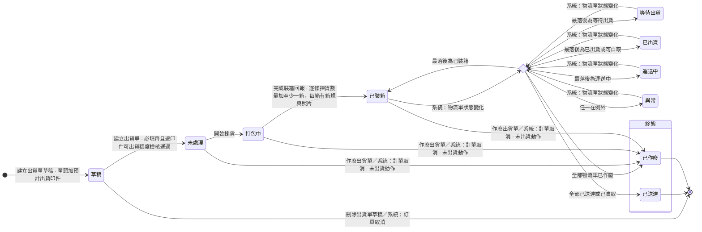
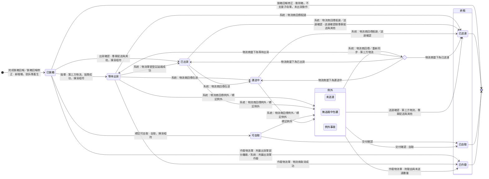

# 中台 - 品檢與出貨 Linear 交付草稿 v3

狀態：已寫入 Linear（2026-10-21）。project 描述、四張 Feature、七張 Task 已覆寫，十一則訂正紀錄留言已發出。本次交付到 Prototype 提交 `c7c4388c`，下次迭代從此起算。寫入版另在各票概述段後加參考留言連結。
撰寫日：2026-10-20。以 v2（已寫入 Linear 的現況）為底改寫。
範圍：project P-PM-246 描述；Feature PM-1397、PM-1399、PM-1400、PM-1401；Task BE-441、BE-443、BE-444、BE-445、FE-609、FE-610、FE-611。不新開 Feature，不新開 Task。
不改：PM-1398、BE-442、FE-607、FE-608，以及兩個 milestone。核對結果見第七節。
取材版本：
- wiki：Sens repo master 提交 `0f4fd1e`。權限取出貨活動清單、輸出活動清單、出貨與售後檢視活動清單、品檢活動清單。規則取出貨單、物流單、出貨單狀態、物流單狀態、印件、品檢紀錄、齊套邏輯、出貨與送達、訂單取消與各角色卡。
- Prototype：erp repo 分支 prototype/production-stage，提交 `faa76db7`，只讀。
- 情境目錄：Sens repo `erp-prototype-tests/docs/scenario-catalog.md` 現行版（第十一章、第十二章 12.3 至 12.39、14.37）。
v3 變動摘要：

| 項目 | 變動 |
|------|------|
| 出貨單結構 | 出貨單拆成三層：出貨單、裝箱資料（逐箱）、物流單（一筆托運）。揀貨回報不再填箱數、箱規、每箱幾個，改為逐箱記箱規、照片與備註 |
| 狀態 | 出貨單已裝箱之後的狀態由未作廢物流單計算。新增物流單狀態機。出貨單狀態機重畫 |
| 集合詞 | 未出貨動作、部分離廠、全數離廠、出貨動作四個用詞取代「未離廠」。未出貨動作與部分離廠改依物流單離廠時間判定，拋單失敗不算離廠 |
| 出貨動作 | 第三方物流拋單、專車配送與其他出貨確認、自取標記可自取。只在物流單列上逐筆執行，出貨單上沒有入口。拋單失敗時物流單不推進，不存失敗原因，再拋一次即重拋，沒有單筆重試 |
| 送達 | 送達、交付與補附送達憑證改掛物流單。送達確認與交付確認可逐印件填未送達數量 |
| 例外與作廢 | 出貨單的人工標記異常刪除，改為物流單標記例外，出貨單異常由物流單計算。業務新增作廢物流單 |
| 額度 | 累計已出貨數量改為各單佔用量加總，異常出貨單仍佔用。品檢修正的通過下限改取累計已出貨數量 |
| 實際出貨日 | 改取全部未作廢物流單最晚的離廠時間 |
| 新增 | 保密代寄與寄件資訊三欄；下載全部物流單檔案 |
| 另案處理 | 新增三項：已送達後少送與誤報配達、實際出貨日事後變動、保密代寄在各出貨方式能否生效 |

不交付：物流商串接本身（歸 Out of Scope）、單條出貨明細移除、保密代寄在各出貨方式能否生效、已送達後少送與誤報配達、實際出貨日事後變動（後四項之中，後三項寫在 Feature 的另案處理，不寫內部問題編號）。
寫入原則：既有票只傳 `id` 與 `description`。BE-441 與 BE-443 進行中，照樣改寫。識別碼已存在，不需回填。每張改寫的票另寫一則訂正紀錄留言。
貼進 Linear 前：下列區塊外層是四個反引號，內層程式碼區塊沒有零寬字元，可直接貼。

---

## 一、全票功能節名表（一條規則只在一節）

| Feature | 功能節（受詞加動詞，一節一個動作） | 本節獨有的規則 | 本次 |
|---------|----------------------------------|---------------|------|
| 品檢驗收與修正 | 待驗清單檢視 | 待驗清單列出條件；待驗量算式；不良品不進待驗量；外發與不需轉交的任務同一條路 | 不變 |
| 品檢驗收與修正 | 新增品檢紀錄 | 品檢紀錄結構；單筆驗收不得超過待驗量；不通過原因；照片必附；品檢類併發寫入 | 不變 |
| 品檢驗收與修正 | 修正品檢紀錄 | 可修正欄位；修正紀錄；三條品檢修正界線；修正原因；照片至少留一張 | 通過下限改取累計已出貨數量 |
| 品檢驗收與修正 | 品檢紀錄檢視 | 歷次品檢紀錄的查閱；只有品檢人員能寫入 | 不變 |
| 品檢缺口處置 | 記錄缺口處置、修正缺口處置 | 見 PM-1398 | 不改 |
| 出貨單建立與管理 | 出貨單草稿維護 | 草稿內容；預設帶入；預設數量；草稿不佔額度；儲存只驗預計出貨日 | 預設數量改取累計已出貨數量 |
| 出貨單建立與管理 | 保密代寄設定 | 保密代寄；寄件資訊取值；三欄必填；建立後唯讀 | 新增節，並收入原寄件資訊規則 |
| 出貨單建立與管理 | 出貨單建立 | 草稿轉出貨明細；出貨方式與兩個屬性；必填；額度檢核與整張擋下；棄用印件不可選與自動移除；額度算式；出貨類併發寫入 | 額度算式改寫；新增出貨方式屬性表 |
| 出貨單建立與管理 | 出貨明細數量修改 | 未出貨動作期間修改數量；增量檢核；欄位分工；改後重新判定揀貨不符 | 時點改為未出貨動作 |
| 出貨單建立與管理 | 出貨單作廢 | 作廢條件與理由；底下物流單一併作廢；額度回補；訂單取消連鎖 | 條件改為未出貨動作；連鎖依集合詞分流 |
| 出貨單建立與管理 | 草稿刪除 | 草稿以刪除收掉；訂單取消連鎖刪除 | 不變 |
| 出貨單建立與管理 | 出貨單檢視 | 出貨明細、裝箱明細、物流單與歷程；出貨單歷程事件；箱數；草稿不給現場人員 | 改寫 |
| 揀貨與裝箱回報 | 開始揀貨 | 開始揀貨的狀態條件 | 不變 |
| 揀貨與裝箱回報 | 完成裝箱回報 | 逐條揀貨數量；逐箱裝箱資料；箱規依出貨方式；拆單與物流單編號；揀貨不符判準；揀貨類併發寫入 | 改寫 |
| 揀貨與裝箱回報 | 裝箱回報修正 | 物流單離廠前修正；逐箱新增、修改、刪除；刪箱時物流單調整；修正紀錄；任一筆物流單離廠後鎖住 | 改寫 |
| 出貨交運與送達 | 出貨動作執行 | 出貨方式對應動作；離廠時間；實際出貨日；拋單失敗不推進與重拋；揀貨不符擋下；訂單已取消擋下；確認類併發寫入 | 改寫，取代出貨確認；逐筆物流單執行 |
| 出貨交運與送達 | 物流單貨況同步 | 物流商回傳推進規則；重新同步；離開例外 | 新增節 |
| 出貨交運與送達 | 物流單例外標記 | 例外種類；理由；例外來源；不回補額度 | 新增節，取代標記異常 |
| 出貨交運與送達 | 送達確認 | 憑證依出貨方式；人工備援；自取交付確認；送達數量；先寫入者成立 | 改寫 |
| 出貨交運與送達 | 送達憑證補附 | 補附條件與歷程 | 改寫，改掛物流單 |
| 出貨交運與送達 | 物流單作廢 | 作廢開放狀態；未送達數量填法、上限與回補；其餘物流單都已作廢時預填；物流商取消 | 新增節 |
| 出貨交運與送達 | 物流單檔案下載 | 檔案來源；單筆與全部下載條件 | 改寫 |

規則歸屬檢查：
- 揀貨不符的判準只在「完成裝箱回報」。擋下只在「出貨動作執行」。「出貨明細數量修改」與「裝箱回報修正」只寫修改後重新判定。
- 出貨方式與兩個屬性只在「出貨單建立」。拆單與箱規只在「完成裝箱回報」。出貨動作的對應只在「出貨動作執行」。
- 可出貨額度與累計已出貨數量的算式只在「出貨單建立」。未送達數量的填法、上限與回補只在「物流單作廢」。
- 寄件資訊的全部規則只在「保密代寄設定」。
- 離廠時間與實際出貨日只在「出貨動作執行」。送達數量算式只在「送達確認」。
- 出貨單狀態與集合詞的定義只在 project 的狀態機。票內只寫狀態條件。
- 併發寫入各 Feature 只寫自己那類寫入，各寫一次。

---
## 二、project 描述（整段覆寫）

寫入時 `save_project` 帶現行狀態抑制自動跳轉，FE、BE、PM 三個 team 已在 project。名稱「中台 - 品檢與出貨」不變。

````markdown
## 概述

品檢與出貨承接生產完成之後的最後一段。品檢人員驗收做出來的貨，通過的量成為可出貨額度。業務依額度安排出貨，揀貨人員逐箱裝箱，出貨人員把每一筆物流單交運並確認送達。

現行品檢回報與裝箱回報混在一起發出，出問題時難以定位。業務與客戶談定的出貨日期，現行散在通訊軟體裡。一張出貨單常裝成多箱，一箱被退時其他箱照常送達，單頭只放得下一組物流單號與一個狀態，表達不了。

---

## 使用情境

### Use Case

1. 品檢人員對送到品檢站的貨分次驗收，每次附品檢照片。通過的量隨驗隨成為可出貨額度。
2. 品檢人員記錯時修正原紀錄。已被出貨單佔用的量，業務先改出貨明細，品檢人員才修正得動。
3. 驗出缺口時，印務決定補不補，以及瑕疵品報廢或客戶照收。印務誤記報廢時，先修正處置，品檢人員再把不通過改為通過。
4. 業務與客戶談定出貨日期後，先建出貨單草稿。品檢通過、額度足夠後，業務把草稿建立為出貨單。
5. 揀貨人員開始揀貨，逐條回報揀貨數量，逐箱回報箱規、裝箱照片與備註。系統依出貨方式把裝好的箱拆成物流單。
6. 揀貨數字與明細不符時，揀貨人員照實填，並現場通知業務。
7. 業務改出貨明細數量，或揀貨人員修正揀貨數量與裝箱資料。兩數相符後才可做出貨動作。任一筆物流單離廠後，裝箱資料鎖住。
8. 出貨人員逐筆對物流單做出貨動作。第三方物流拋單，專車配送與其他出貨確認，自取標記可自取。第三方的物流單號由物流商回傳。
9. 拋單失敗時，物流單不推進，畫面顯示物流商回傳的錯誤訊息。出貨人員排除原因後再拋一次。
10. 第三方物流的物流單依物流商回傳推進。回傳沒進來時，出貨人員重新同步，或做送達確認補上。專車配送與其他做送達確認，自取做交付確認。
11. 物流商回傳例外，或貨況不明時，出貨人員標記例外並向物流商確認貨況。確定送不到的那一筆，業務作廢物流單並填沒送到的量，額度回補。要再出就建新出貨單。
12. 物流單都還沒離廠就建錯單或客戶取消，業務作廢出貨單。

### Scope（功能票清單）

1. **品檢驗收與修正**：品檢人員看待驗清單、分次記錄驗收並附照片、修正記錯的紀錄。業務與印務查閱歷次品檢紀錄。　PM-1397
2. **品檢缺口處置**：印務與印務主管對驗出的缺口決定補不補與瑕疵品去向，並修正誤記的處置。　PM-1398
3. **出貨單建立與管理**：業務與諮詢先建草稿排出貨計畫，額度足夠時建立出貨單。物流單離廠前可改明細數量或作廢，並查看出貨單、裝箱明細與物流單。　PM-1399
4. **揀貨與裝箱回報**：揀貨人員開始揀貨、逐條回報揀貨數量、逐箱回報裝箱資料，並在物流單離廠前修正填錯的裝箱回報。　PM-1400
5. **出貨交運與送達**：出貨人員逐筆對物流單做出貨動作、同步貨況、標記例外、確認送達並下載物流單檔案。業務作廢送不出或送不到的物流單。　PM-1401

**Out of Scope**

* 報工、報工修正、報工作廢與場內轉交點收：歸 <project id="9d055ea4-9212-4711-a0d6-22870079b450" href="https://linear.app/sensationdeveloper/project/%E4%B8%AD%E5%8F%B0-%E7%94%9F%E7%94%A2%E7%AE%A1%E7%90%86-148ecc50024f/overview">中台 - 生產管理</project>。
* 訂單詳情頁與印件詳情頁本體：歸 <project id="4927231b-7fe3-407e-8d1f-94eddc3f0a84" href="https://linear.app/sensationdeveloper/project/%E4%B8%AD%E5%8F%B0-%E8%A8%82%E5%96%AE%E7%AE%A1%E7%90%86-414a81747028/overview">中台 - 訂單管理</project>。
* 取消訂單的動作，以及印件印製狀態與訂單狀態的推進：歸 <project id="4927231b-7fe3-407e-8d1f-94eddc3f0a84" href="https://linear.app/sensationdeveloper/project/%E4%B8%AD%E5%8F%B0-%E8%A8%82%E5%96%AE%E7%AE%A1%E7%90%86-414a81747028/overview">中台 - 訂單管理</project>。
* 計入完成度、打樣週期界線，以及重打換週期後的歸零（產出數量、良品數、不良品數、完工良品數、累計已出貨數量、累計送達數、已驗量、不通過累計、報廢數、未處置缺口按週期歸零重算；待驗量與可出貨額度由上列欄位推導，隨之只算本週期；生產數量不歸零）：沿用 <project id="9d055ea4-9212-4711-a0d6-22870079b450" href="https://linear.app/sensationdeveloper/project/%E4%B8%AD%E5%8F%B0-%E7%94%9F%E7%94%A2%E7%AE%A1%E7%90%86-148ecc50024f/overview">中台 - 生產管理</project>。
* 印件準時交貨率的判定：後續批次。
* 缺口補做的發起（在原工單加開補做生產任務）：後續批次。
* 印件短出結案：後續批次。
* 物流商串接（拋單、物流單號與物流單檔案的回傳、狀態與配達回傳、取消）：由線上編輯器後端既有的物流串接模組提供。
* 出貨方式與箱規的維護：屬系統設定，不開維護功能。
* 運費與物流對帳：後續批次。箱數與箱規只留存。
* 成品入庫成為獨立交易、成品倉庫存：後續批次。
* 品檢完成品移到暫存區的現場留痕：延後批次，隨廠務 Slack 表單回報一起。
* 退回實物的場內處理：不進系統，現場人工處理。
* 貨不回台的海外直發訂單：本輪範圍外。

### 範圍用詞

| 用詞 | 定義 |
|------|------|
| 全公司 | 該模組全部單據 |
| 自己負責 | 該單據的人員欄是本人（看哪一欄由活動清單卡的依據欄位寫明） |
| 被分享（檢視） | 以檢視層級分享給本人且未撤銷的單據 |
| 被分享（編輯） | 以編輯（代理）層級分享給本人且未撤銷的單據 |

* 印件有多張工單時，以工單判定範圍的操作與檢視，看任一張工單的負責人或分享成員都算，不因那張工單已進終態失去資格。

---

## 另案處理（來源尚未定案，暫不實作）

* 詳情頁頁籤與欄位對各角色的可見性：待裁。本批以各 Feature 票的權限表為準。

---

## 狀態機

>>> ### 出貨單狀態機



* 已裝箱之後的推進是歸納型轉換：物流單一有變化就重算，畫成選擇節點。
* 草稿不是出貨指令，出口是刪除。
* 揀貨不符不是狀態。它擋下出貨動作，見 PM-1401。
* 異常不是終態。

出貨單依物流單計算：

| 規則 | 內容 |
|------|------|
| 計算來源 | 只看未作廢的物流單。已作廢的物流單保留可查，不參與計算 |
| 最落後 | 取未作廢物流單在「已裝箱、等待出貨、已出貨、運送中、已送達」順序上最落後的狀態。可自取視同已出貨，已自取視同已送達 |
| 異常優先 | 任一未作廢物流單在例外，出貨單為異常，不論其他物流單在哪一格。例外解除或該物流單作廢後重算 |
| 已送達 | 至少一筆未作廢物流單，且全部未作廢物流單已送達或已自取。轉入後為終態，不重算 |
| 全部作廢 | 未作廢物流單筆數歸零時，出貨單轉已作廢 |

出貨動作是拋單、出貨確認或標記可自取，逐筆物流單執行。出貨動作成功才寫入離廠時間，拋單失敗不寫入。出貨單的集合詞依物流單離廠時間判定，不依狀態名。離廠後又被作廢的物流單，仍算有離廠時間。各集合詞互斥，涵蓋草稿以外的全部未作廢出貨單：

| 集合詞 | 定義 |
|-------|------|
| 未出貨動作 | 本單的物流單都沒有離廠時間。含未處理、打包中，以及已裝箱且沒有任何一筆物流單離廠，拋單失敗而未推進者也屬此類 |
| 部分離廠 | 至少一筆物流單有離廠時間，但仍有未作廢物流單沒有離廠時間 |
| 全數離廠 | 全部未作廢物流單都有離廠時間，本單有實際出貨日 |

>>>

>>> ### 物流單狀態機



* 物流單在完成裝箱回報時產生，初始為已裝箱。所有出貨方式都有物流單。拋單失敗時物流單不推進，仍在已裝箱。
* 各出貨方式經過的狀態：第三方物流為已裝箱、等待出貨、已出貨、運送中、已送達。專車配送與其他為已裝箱、已出貨、已送達。自取為已裝箱、可自取、已自取。
* 離開例外回到物流商當下狀態的弧，落入哪一格看同步結果。
* 所屬出貨單作廢時，已裝箱的物流單一併作廢。

>>>
````

---
## 三、Feature 票

標題、Label（Type/Feature、Role/PM、Product/ERP）、Milestone 不動。PM-1398 不改，核對見第七節。

### 3-1 [ Feature ] - 品檢驗收與修正（PM-1397，改寫「修正品檢紀錄」節）

````markdown
## 概述

這張票做完，品檢人員能在 <project id="2ba2439d-73c6-426c-a384-af08eafb815d" href="https://linear.app/sensationdeveloper/project/%E4%B8%AD%E5%8F%B0-%E5%93%81%E6%AA%A2%E8%88%87%E5%87%BA%E8%B2%A8-555eb8966074/overview">中台 - 品檢與出貨</project> 看待驗清單、分次記錄驗收並附照片、修正記錯的紀錄。業務與印務能查閱歷次品檢紀錄。

## 權限

| 動作 | 可執行角色 | 資料範圍 |
|------|-----------|---------|
| 檢視待驗清單 | 品檢人員、印務主管、Supervisor | 全公司 |
| 檢視待驗清單 | 印務 | 自己負責 |
| 檢視待驗清單 | 所有角色 | 被分享（檢視） |
| 檢視待驗清單 | 所有角色 | 被分享（編輯） |
| 檢視品檢紀錄 | 品檢人員、印務主管、揀貨人員、出貨人員、Supervisor | 全公司 |
| 檢視品檢紀錄 | 業務、諮詢 | 自己負責 |
| 檢視品檢紀錄 | 印務 | 自己負責 |
| 檢視品檢紀錄 | 所有角色 | 被分享（檢視） |
| 檢視品檢紀錄 | 所有角色 | 被分享（編輯） |
| 新增品檢紀錄 | 品檢人員 | 全公司 |
| 修正品檢紀錄 | 品檢人員 | 全公司 |

資料範圍的依據：待驗清單的自己負責與被分享，看所屬工單的負責人與分享成員。品檢紀錄的業務與諮詢看所屬訂單的接單業務，印務看所屬工單的負責人。品檢紀錄的被分享，看所屬訂單或所屬工單的分享成員。

>>> ## 待驗清單檢視

身為品檢人員，我要看到哪些印件還有做出來的良品沒驗，以決定先驗哪一批。

**實體關係**

1. 待驗清單一列一件印件。清單依印件做出來的良品列出，不依轉交單與點收。
2. 末道生產任務標為不需轉交的印件，同樣列出。
3. 外發任務報工後的印件，同樣列出。
4. 打樣印件與大貨印件用同一套算法。
5. 不良品留在原站處置，不進待驗量。

**驗證規則**

1. 待驗量大於 0 的印件才列出。
2. 本打樣週期內已有品檢紀錄的印件也列出。
3. 已棄用的印件不列出。

**算式**

```
待驗量 ＝ 各計入完成度生產任務的良品數取最小值 － 已驗量
已驗量 ＝ 該印件各筆品檢紀錄（取修正後的值）通過數量與不通過數量的加總
```

**驗收**

1. 假設 PI-2026-0601 完成數 5,000、良品 5,000、已驗 5,000。PI-2026-0820 的精裝裝訂已報工良品 500、尚無轉交單、完成數 500。當品檢人員打開品檢站，則兩件印件都列出。PI-2026-0601 待驗量 0，PI-2026-0820 待驗量 500。
2. 假設 PI-2026-0820 尚無轉交單、待驗量 500。當生管對該印件建一張到品檢站的轉交單，廠務搬運並抵達，品檢人員點收，則品檢站上 PI-2026-0820 的待驗量仍是 500。
3. 假設禮盒印件的盒身裁切與內襯裁切兩筆任務都計入完成度，盒身良品 1,000，內襯良品 590、不良品 10。當取該印件的待驗量，則待驗量為 590。內襯累計良品補到 990 後，待驗量為 990。
4. 假設一件印件底下只有一筆計入完成度的裁切任務，報工良品 1,000、不良品 3。當取該印件的待驗量，則待驗量為 1,000。

>>>

>>> ## 新增品檢紀錄

身為品檢人員，我要對送到品檢站的貨分次記錄通過與不通過的數量並附照片，以讓通過的量隨驗隨成為可出貨額度，不通過的量留給印務處置。

**實體關係**

1. 一次驗收記一筆品檢紀錄，掛在印件上。一件印件有多筆。
2. 每筆記錄通過數量、不通過數量與不通過原因。
3. 每筆另記品檢照片、品檢人員與驗收時間。
4. 各筆通過數量逐筆累計成印件的完工良品數。可出貨額度隨之放大。
5. 新增品檢紀錄後，完工良品數、不通過累計、未處置缺口、可出貨額度隨之變動。
6. 印件列表的「品檢缺口」標籤依未處置缺口。
7. 一筆紀錄記一個不通過原因。同一批貨有多種不良時，分批各記一筆。

**驗證規則**

1. 一筆驗收的通過加不通過數量，不得超過按下送出那一刻的待驗量。
2. 超過時整筆擋下並顯示當下待驗量。系統不做部分成立，不自動改數。
3. 不通過數量大於 0 時，必須從固定選項選一個不通過原因。
4. 每筆至少附一張品檢照片，通過與不通過都要拍。
5. 品檢驗收與修正，會與報工修正、報工作廢（見 PM-1357）搶同一印件的待驗量。
6. 品檢驗收與修正，也會與記錄缺口處置、修正缺口處置搶同一印件的不通過累計與報廢類處置合計。
7. 兩筆同時寫入時，先寫入者成立。後到者以寫入當下的數字重新檢核。

**驗收**

1. 假設 PI-2026-0820 的待驗量 500，不需先建轉交單也不需點收。當品檢人員先記一批通過與不通過並選原因，再對同一列記第二批，則不通過大於 0 而未選原因時被擋下。第一次驗完待驗量下降，第二次驗完待驗量歸零。印件的完工良品數與可出貨額度隨通過數量增加。
2. 假設 PI-2026-0820 的待驗量 500。當品檢人員不附品檢照片送出一筆驗收，則整筆擋下並提示品檢照片至少一張，紀錄不新增。附一張照片後送出，則紀錄成立。
3. 假設 PI-2026-0820 的待驗量 500。當品檢人員在通過數量填 600 送出，則整筆擋下並顯示當下待驗量 500，兩個欄位都不進帳。改成合計不超過待驗量的組合後送出，則紀錄成立。
4. 假設 PI-2026-0820 的待驗量 500。當品檢人員驗完全部待驗量，則該列顯示「0（已驗完）」，驗收鈕停用，修正的入口仍可用。

>>>

>>> ## 修正品檢紀錄

身為品檢人員，我要把驗錯的通過數量、不通過數量、不通過原因或照片改成正確的值，以讓完工良品數與缺口回到真數。

**實體關係**

1. 修正直接改原品檢紀錄，不新增反向紀錄。
2. 可修正通過數量、不通過數量、不通過原因與品檢照片。
3. 每次修正，每個被改的欄位新增一筆品檢修正紀錄。
4. 紀錄記修正前後值、修正人、修正時間與修正原因。換掉的照片留在修正前照片。
5. 印件的完工良品數與缺口，取各筆修正後的值累計。
6. 不通過數量修正為 0 時，不通過原因清空。

**驗證規則**

1. 修正原因必填，未填無法修正。
2. 修正後至少留一張品檢照片。
3. 修正後本筆通過加不通過的合計，不得大於本筆原合計。新到的量另按驗收。
4. 修正後該印件的通過累計，不得小於該印件的累計已出貨數量。
5. 擋下時列出佔用該印件的出貨單編號與數量。
6. 修正後該印件的不通過累計，不得小於報廢類處置數量合計。擋下時列出報廢類處置紀錄。
7. 違反上列任一條，整筆擋下。原紀錄不改，不新增修正紀錄。

**驗收**

1. 假設 PI-2026-0820 的待驗量 500，品檢人員驗了一筆通過 500、不通過 0。當品檢人員對那一筆修正為通過 480、不通過 20、不通過原因色差／偏色，修正原因填「複驗發現色差」並附品檢照片，則原紀錄就地改為 480／20。紀錄下有品檢修正紀錄，含三個欄位的修正前後、修正人、修正時間、修正原因。印件的完工良品數 480、不通過累計 20、未處置品檢缺口 20。
2. 假設 PI-2026-0820 的待驗量 500，品檢人員驗了一筆通過 400、不通過 0，待驗量剩 100。當品檢人員對那一筆把通過數量改成 450，則整筆擋下。訊息說明修正後合計 450 超過本筆原合計 400，新到的量請另按驗收。原紀錄仍為 400，不新增修正紀錄，待驗量仍是 100。
3. 假設 PI-2026-0820 品檢通過 500，業務在 ORD-2026-0820 建立出貨單 SH-2026-0820，明細 500。當品檢人員把通過改為 400、不通過改為 100，則整筆擋下並列出佔用的出貨單 SH-2026-0820 與數量 500，原紀錄不改。業務把出貨明細改為 400 之後，同一筆修正成立，通過累計 400、缺口 100。
4. 假設 PI-2026-0820 品檢人員驗通過 480、不通過 20，印務主管對 20 件缺口處置為補做、瑕疵品報廢。當品檢人員把不通過 20 改為通過，則整筆擋下，訊息列出報廢類處置紀錄與數量 20。
5. 假設品檢人員剛為 PI-2026-0820 記了一筆附品檢照片的驗收。當品檢人員對那一筆修正並把照片全部移除，則整筆擋下。保留一張後送出，則修正成立，換掉的照片留在品檢修正紀錄的修正前照片。

>>>

>>> ## 品檢紀錄檢視

身為業務，我要在印件詳情看到歷次品檢紀錄與品檢照片，以回答客戶貨驗得怎樣，不必請印務截圖。

**實體關係**

1. 歷次品檢紀錄含品檢照片。

**驗證規則**

1. 檢視不改動品檢紀錄與品檢照片。

**驗收**

1. 假設 PI-2026-0601 有一筆品檢紀錄 QC-2026-0601-01，通過 5,000。當業務在印件列表點印件名稱進詳情，切到「品檢紀錄與品檢缺口處置」頁籤，則歷次品檢紀錄列出該筆。品檢照片以縮圖呈現，不顯示檔名。
2. 假設 PI-2026-0601 有品檢紀錄 QC-2026-0601-01。當業務打開 PI-2026-0601 印件詳情，則看得到「品檢紀錄與品檢缺口處置」頁籤與品檢照片縮圖，沒有品檢修正與處置修正的操作鈕。

>>>

>>> ## 另案處理（來源尚未定案，暫不實作）

* 計入完成度的生產任務報廢後，待驗量變負數：待裁。本批依待驗量不得為負的檢核擋下，驗收被擋下時提示先確認上游報工。

>>>

````

### 3-2 [ Feature ] - 出貨單建立與管理（PM-1399，整張改寫）

````markdown
## 概述

這張票做完，業務與諮詢能在 <project id="2ba2439d-73c6-426c-a384-af08eafb815d" href="https://linear.app/sensationdeveloper/project/%E4%B8%AD%E5%8F%B0-%E5%93%81%E6%AA%A2%E8%88%87%E5%87%BA%E8%B2%A8-555eb8966074/overview">中台 - 品檢與出貨</project> 先建出貨單草稿排出貨計畫，額度足夠時建立出貨單。物流單離廠前可改明細數量或作廢，並查看每一批貨的出貨單、裝箱明細與物流單。

出貨單的狀態流轉見 <project id="2ba2439d-73c6-426c-a384-af08eafb815d" href="https://linear.app/sensationdeveloper/project/%E4%B8%AD%E5%8F%B0-%E5%93%81%E6%AA%A2%E8%88%87%E5%87%BA%E8%B2%A8-555eb8966074/overview">中台 - 品檢與出貨</project> 的出貨單狀態機。

## 權限

| 動作 | 可執行角色 | 資料範圍 |
|------|-----------|---------|
| 建立出貨單草稿 | 業務、諮詢 | 自己負責 |
| 建立出貨單草稿 | 所有角色 | 被分享（編輯） |
| 建立出貨單草稿 | 業務主管、訂單管理人、印務主管、印務、審稿主管、Supervisor | 全公司 |
| 編輯出貨單 | 業務、諮詢 | 自己負責 |
| 編輯出貨單 | 所有角色 | 被分享（編輯） |
| 編輯出貨單 | 業務主管、訂單管理人、印務主管、印務、審稿主管、Supervisor | 全公司 |
| 建立出貨單 | 業務、諮詢 | 自己負責 |
| 建立出貨單 | 所有角色 | 被分享（編輯） |
| 建立出貨單 | 業務主管、訂單管理人、印務主管、印務、審稿主管、Supervisor | 全公司 |
| 修改出貨明細數量 | 業務、諮詢 | 自己負責 |
| 修改出貨明細數量 | 所有角色 | 被分享（編輯） |
| 修改出貨明細數量 | 業務主管、訂單管理人、印務主管、印務、審稿主管、Supervisor | 全公司 |
| 作廢出貨單 | 業務、諮詢 | 自己負責 |
| 作廢出貨單 | 所有角色 | 被分享（編輯） |
| 作廢出貨單 | 業務主管、訂單管理人、印務主管、印務、審稿主管、Supervisor | 全公司 |
| 刪除出貨單草稿 | 業務、諮詢 | 自己負責 |
| 刪除出貨單草稿 | 所有角色 | 被分享（編輯） |
| 刪除出貨單草稿 | 業務主管、訂單管理人、印務主管、印務、審稿主管、Supervisor | 全公司 |
| 檢視出貨單 | 揀貨人員、出貨人員、業務主管、訂單管理人、印務主管、印務、審稿主管、Supervisor | 全公司 |
| 檢視出貨單 | 業務、諮詢 | 自己負責 |
| 檢視出貨單 | 所有角色 | 被分享（檢視） |
| 檢視出貨單 | 所有角色 | 被分享（編輯） |

資料範圍的依據：出貨單的自己負責與被分享，看所屬訂單的接單業務與分享成員。「編輯出貨單」在草稿階段調整單頭與預計出貨印件。「修改出貨明細數量」在未出貨動作期間只改明細數量。訂單改派後看現任接單業務，不看建單人。

>>> ## 出貨單草稿維護

身為業務，我要在品檢結果出來之前先記下這一批預計哪天出、送到哪，以免客戶談定的出貨計畫散在通訊軟體裡。

**實體關係**

1. 草稿屬於一張訂單，不可跨訂單。
2. 草稿只有單頭與預計出貨印件，沒有出貨明細。
3. 新草稿預設帶入所屬訂單全部未棄用的印件。
4. 每件預設數量為購買數量扣掉該印件的累計已出貨數量。
5. 業務可移除預計出貨印件，也可加回。
6. 收件人、電話與地址預設帶訂單窗口聯絡人的資料，可修改。
7. 草稿儲存後，手改值保留，不隨訂單窗口聯絡人變動。
8. 出貨方式不帶預設，由業務或諮詢自選。
9. 草稿不佔可出貨額度，不進揀貨人員與出貨人員的清單。
10. 草稿不推進印件與訂單的狀態，也不產生實際出貨日。

**驗證規則**

1. 儲存草稿只驗出貨單預計出貨日已填，未填無法儲存。
2. 草稿的預計數量不檢核可出貨額度。
3. 訂單在任何狀態，含終態，都可建立草稿。
4. 加回預計出貨印件時，印製維度已棄用的印件不出現在可選清單。

**驗收**

1. 假設業務在 ORD-2026-0820 詳情的出貨單頁籤按「建立出貨單草稿」。當只填出貨單預計出貨日就按「儲存草稿」，則列表多一張草稿，草稿沒有實際出貨日，PI-2026-0820 維持未出貨。
2. 假設 PI-2026-0820 已取得可出貨額度 500，業務已存一張數量 500 的草稿。當業務再開一張草稿同樣填 500 並儲存，則 PI-2026-0820 的可出貨額度不變。
3. 假設 ORD-2026-0820 的聯絡人為周雅文、02-2790-6611、台北市內湖區文德路 168 號 3 樓。當業務開建單對話框，則收件人、收件人電話、收件地址三欄帶入這組資料。業務改掉收件人後儲存草稿，再到訂單資訊切換窗口聯絡人，回頭開同一張草稿，則三欄仍是草稿上的值。
4. 假設 ORD-2026-0601 的訂單出貨方式為專車配送。當業務在該訂單詳情的出貨單頁籤按「建立出貨單草稿」，則出貨方式留空並顯示「選擇出貨方式」。收件人與收件地址帶訂單聯絡人資料。
5. 假設 ORD-2026-0820 的接單業務洪嘉駿把它以編輯（代理）分享給張惠雯，張惠雯在 ORD-2026-0710 為檢視層級分享成員。當張惠雯以諮詢身分在 ORD-2026-0820 的出貨單頁籤只填出貨單預計出貨日並儲存草稿，則草稿存下，建單人記張惠雯。她在 ORD-2026-0710 的出貨單頁籤沒有「建立出貨單草稿」入口。

>>>

>>> ## 保密代寄設定

身為業務，我要在客戶不希望用感官、理想的名義寄出時，改用客戶指定的寄件人名義，以讓包裹上的寄件人符合客戶要求。

**實體關係**

1. 出貨單有保密代寄選項，預設為否。
2. 保密代寄為否時，寄件資訊取所屬訂單的帳務公司。
3. 草稿階段，寄件資訊依訂單當下的帳務公司顯示。
4. 建立出貨單時記下當時的帳務公司。之後訂單改帳務公司，已成立的單不變。
5. 寄件資訊的品牌名稱、電話與地址，仍取帳務公司主檔現值。
6. 保密代寄為是時，寄件資訊的三欄存在出貨單上。三欄是品牌名稱、電話與地址。
7. 勾選保密代寄時，三欄預填帳務公司現值，業務可改。
8. 取消勾選時，寄件資訊回到帳務公司的值，不保留改過的值。
9. 物流單不另存寄件資訊。物流單顯示與拋單時，讀出貨單的寄件資訊。
10. 帳務公司照常記錄，保密代寄不影響帳務用途。

**驗證規則**

1. 保密代寄為是時，三欄必填。缺任一欄無法建立出貨單，系統列出缺的欄位。
2. 建立出貨單之前，保密代寄與三欄可修改。
3. 建立出貨單之後，保密代寄與三欄不可修改。
4. 保密代寄為否時，寄件資訊不可修改。

**驗收**

1. 假設 ORD-2026-0820 的帳務公司為 SSP。當業務開建單對話框，則寄件資訊唯讀顯示感官文化印刷｜02 2736 6566｜新北市中和區建康路 168 號 3 樓，保密代寄未勾選，沒有輸入框。帳務公司為 BRO 時，品牌名稱顯示理想印制。
2. 假設業務開 ORD-2026-0820 的建單對話框。當業務勾選保密代寄，改品牌名稱後取消勾選，則回到帳務公司唯讀顯示。再勾選時，三欄變輸入框並預填帳務公司現值，不保留改過的值。
3. 假設業務勾選保密代寄，品牌名稱清空，其餘欄位都填妥。當業務按「建立出貨單」，則整張被擋下，缺項清單列出品牌名稱。補齊三欄後再按，則出貨單成立。
4. 假設保密代寄的出貨單已建立並已拋單。當業務開檢視，則寄件資訊後標「（保密代寄）」，沒有勾選框與輸入框。物流單表格上方的寄件人取出貨單上的三欄。拋單時送出的寄件資訊取出貨單上的三欄。
5. 假設 SH-2026-0820 為保密代寄的草稿，寄件資訊為晴禾選物｜02-2755-0123｜台北市大安區復興南路一段 200 號 5 樓。當業務開檢視，則顯示這組寄件資訊並標「（保密代寄）」。業務開編輯，則勾選框已勾，三欄帶草稿上的值。

>>>

>>> ## 出貨單建立

身為業務，我要在品檢通過、可出貨額度足夠後把草稿建立為出貨單，以讓揀貨人員依單清點裝箱。

**實體關係**

1. 建立出貨單時，預計出貨印件轉為出貨明細。
2. 每條出貨明細指向同一訂單的一件印件。同一訂單的多種印件可合在一張單。
3. 一件印件可開多張出貨單。分批出貨不設專屬流程。
4. 在新建對話框直接按「建立出貨單」時，系統先落一張草稿。同一個動作立刻建立出貨單。
5. 建立那一刻才轉已棄用的印件，由系統自動移除並提示。
6. 一張出貨單只用一種出貨方式。要混用就開兩張。
7. 出貨方式從下表選一個。「支援子母單」決定拆單，「有外部物流單號」決定出貨動作：

| 出貨方式 | 支援子母單 | 有外部物流單號 |
|---------|-----------|---------------|
| 順豐 | 是 | 是 |
| 新竹物流 | 否 | 是 |
| 7-11 交貨便 | 否 | 是 |
| 全家 | 否 | 是 |
| 自取 | 是 | 否 |
| 專車配送 | 是 | 否 |
| 其他 | 是 | 否 |

**驗證規則**

1. 出貨單在草稿才可建立。
2. 下列必填未齊，無法建立。系統列出缺的欄位與所在位置：
   * 出貨單預計出貨日。
   * 出貨方式。
   * 收件人。
   * 收件地址。
   * 至少一條數量大於 0 的預計出貨印件。
3. 每條明細的數量不得超過該印件的可出貨額度。額度以按下建立的那一刻為準。
4. 額度不足時整張單擋下，不做部分成立，不自動砍數量。
5. 擋下時系統只告知可出貨額度不足、出貨單未成立。
6. 移除棄用印件後，沒有任何一條數量大於 0 時，以必填檢核擋下。
7. 建立、明細增減與作廢，會與其他出貨單搶同一印件的額度。
8. 兩筆同時寫入時，先寫入者成立。後到者以寫入當下的額度重新檢核。

**算式**

```
可出貨額度 ＝ 完工良品數 － 累計已出貨數量
累計已出貨數量 ＝ 各張未作廢出貨單的單張佔用量加總，含異常與尚未離廠的單
單張佔用量 ＝ 該單該印件的明細數量 － 該單全部物流單的該印件未送達數量合計，不為負
```

```
已出貨（顯示值）＝ 全數離廠且未作廢的出貨單，其單張佔用量加總
```

1. 已作廢的出貨單整張不計佔用。
2. 可出貨額度只在佔用量變少時回補，算式不另加回補項。
3. 「已出貨」顯示值是已離廠量。累計已出貨數量是佔用量，含尚未離廠的單。
4. 兩個數算法不同，都是推導值，印件層都不另存欄位。
5. 「已出貨」顯示在印件頁面。

**驗收**

1. 假設 ORD-2026-0820 的草稿必填未齊。當業務按「建立出貨單」，則頂端列出缺的欄位與所在位置，出貨明細頁籤標「缺 N」，出貨單不成立。
2. 假設 PI-2026-0820 的可出貨額度 500，業務在草稿把印件數量填 600。當按「建立出貨單」，則整張擋下。訊息只有「可出貨額度不足，出貨單未成立」，數量不自動砍，不部分成立。
3. 假設接上一條。當業務把數量改回 500 再按「建立出貨單」，則出貨單成立，狀態轉未處理，預計出貨印件成為出貨明細。
4. 假設在 ORD-2026-0820 的出貨單頁籤。當業務在新建對話框一次填齊並直接按「建立出貨單」，則出貨管理列表只多一張未處理的單，沒有留下半張草稿。
5. 假設業務為 ORD-2026-0820 存了一張含 PI-2026-0820 的草稿，之後該印件被「取消製作」。當業務點草稿列上的編輯鈕開對話框，則出貨明細頁籤警示列出已棄用的印件。按「建立出貨單」時整張擋下，提示請至少留一條出貨印件。

>>>

>>> ## 出貨明細數量修改

身為業務，我要在物流單離廠前改出貨明細的數量，以在揀貨不符時讓出貨數量對齊現場的貨。

**實體關係**

1. 出貨明細的數量歸業務修改。揀貨數量歸揀貨人員修正。
2. 各角色只改自己負責的欄位。
3. 每次修改，系統在出貨單歷程記前後值。

**驗證規則**

1. 出貨單在未出貨動作期間才可修改明細數量。
2. 建立出貨單之後，單頭不可修改，只能修改出貨明細的數量。
3. 修改後重跑可出貨額度檢核。
4. 額度不足時整筆擋下，明細數量不更新。
5. 檢核基準是當下額度加本單該條明細原已佔用的量。往下改數量時，不被本單自己的佔用擋下。
6. 修改後，系統重新判定本單的揀貨不符。

**算式**

```
可修改的數量上限 ＝ 當下可出貨額度 ＋ 本單該條明細原數量
```

**驗收**

1. 假設 ORD-2026-0820 的出貨單在未處理。當業務按列上的「編輯」，則只有出貨明細的數量可改，單頭欄位唯讀。
2. 假設兩張新竹物流出貨單各出 100，揀貨人員已各回報揀貨數量 80、裝箱 2 箱。當業務把第一張的出貨明細數量從 100 改為 80，則該張兩數相符，列表上的「揀貨不符」標籤消失。

>>>

>>> ## 出貨單作廢

身為業務，我要在物流單離廠前作廢建錯或客戶取消的出貨單，以讓可出貨額度回補、不留無效單據。

**實體關係**

1. 作廢記錄理由與轉入時間。
2. 作廢時，底下全部物流單一併作廢，不填未送達數量。
3. 作廢後，該單不計入累計已出貨數量。可出貨額度逐印件回補整張明細數量。
4. 所屬訂單轉已取消時，系統自動作廢屬於未出貨動作的出貨單。
5. 自動作廢的原因記「訂單取消」，不要求人工填理由。
6. 已有物流單離廠的出貨單，不因訂單取消而自動作廢。含部分離廠與全數離廠。

**驗證規則**

1. 出貨單在未出貨動作才可作廢。草稿不作廢，走刪除。
2. 人工作廢必填理由，未填無法作廢。

**驗收**

1. 假設 ORD-2026-0820 旗下有一張承品檢驗收建立、狀態為未處理的出貨單。當業務取消 ORD-2026-0820 並填原因確認，則該張出貨單轉已作廢，底下物流單一併作廢，作廢原因記「訂單取消」，額度回補。
2. 假設承品檢驗收建立一張專車出貨單，狀態未處理，出貨數量 100。當業務按列上「作廢」，不填理由送出，則單不變。填「客戶改期」送出，則單轉已作廢，底下物流單一併作廢，單上記作廢理由與轉入時間，歷程多一筆「作廢出貨單」，可出貨額度加回 100。
3. 假設有一張已裝箱、物流單都沒有離廠時間的順豐單，另有一張已出貨的專車單。當業務比較兩張單的列，則已裝箱的單同樣有「作廢」。已出貨的單列上沒有「作廢」也沒有「編輯」，直接呼叫也不寫入任何東西。
4. 假設訂單底下有未處理、打包中與已裝箱且物流單都沒有離廠時間的出貨單，另有部分離廠與全數離廠的出貨單。當所屬訂單轉已取消，則前三張由系統作廢，作廢原因記「訂單取消」。部分離廠與全數離廠的兩張不動。

>>>

>>> ## 草稿刪除

身為業務，我要刪除不再需要的草稿，以免清單上留著無效的出貨計畫。

**實體關係**

1. 草稿以刪除收掉，不走作廢。
2. 草稿沒有出貨明細，沒佔額度，沒有要回補的量。
3. 刪除後草稿不出現在清單，紀錄留存供追溯。
4. 所屬訂單轉已取消時，系統自動刪除該訂單的草稿。系統不要求人工填理由。

**驗證規則**

1. 出貨單在草稿才可刪除。
2. 刪除不要求填理由。

**驗收**

1. 假設 SH-2026-0820 為草稿。當業務在出貨管理按該張草稿列上的「刪除」並確認，則確認視窗沒有理由輸入欄。確認後該張草稿自列表消失，不落已作廢。
2. 假設 ORD-2026-0820 旗下有草稿 SH-2026-0820。當業務取消 ORD-2026-0820 並填原因確認，則連鎖摘要寫明草稿已刪除，SH-2026-0820 自列表消失。

>>>

>>> ## 出貨單檢視

身為業務，我要在一處看到每一批貨的出貨進度、裝箱明細、物流單與歷程，以回答客戶貨到哪了。

**實體關係**

1. 出貨單檢視顯示本單的出貨明細、裝箱明細、物流單與歷程。
2. 出貨單的箱數是裝箱明細的筆數，含已作廢物流單的箱。
3. 出貨單歷程記下出貨單層級的每一次動作與狀態變化：
   * 建立、編輯、開始揀貨。
   * 裝箱回報與裝箱回報修正。
   * 作廢。
   * 出貨單狀態的每一次變化。
4. 物流單歷程記下該筆物流單的每一次動作與狀態變化：
   * 出貨動作與物流商回傳。
   * 重新同步與例外。
   * 送達與補附送達憑證。
   * 作廢。
   * 物流單狀態的每一次變化。
5. 每筆歷程帶時間、操作人、前後值與附件。歷程只讀。

**驗證規則**

1. 揀貨人員與出貨人員的清單不列草稿，狀態篩選也沒有草稿。

**驗收**

1. 假設 SH-2026-0601、SH-2026-0602 已送達，SH-2026-0820 為草稿且出貨單預計出貨日 2026-09-10。當業務查看出貨單列表，則 SH-2026-0820 的明細數量標「（預計）」，實際出貨日顯示「－」。當揀貨人員與出貨人員查看列表，則都不列 SH-2026-0820，狀態篩選也沒有草稿。
2. 假設 SH-2026-0601 為順豐，已送達，明細 PI-2026-0601 × 3,000、揀貨數量 3,000，裝箱 5 箱，一筆物流單 SH-2026-0601-001，物流單號 SF1400020601。當業務按「檢視」開出貨單，則出貨明細顯示出貨數量 3,000 與揀貨數量 3,000。裝箱明細列出五箱，所屬物流單都是 SH-2026-0601-001。物流單表格列出 SH-2026-0601-001 與物流單號 SF1400020601。
3. 假設 SH-2026-0601 已送達。當業務在出貨單對話框切到「歷程」頁籤，則歷程為新到舊，出貨單與物流單的事件併成一條時間軸，共九筆，每筆帶時間、操作人與前後值，含建立出貨單、開始揀貨、裝箱回報。

>>>

>>> ## 另案處理（來源尚未定案，暫不實作）

* 未出貨動作的出貨單能否移除單條明細：待裁。本批整張單不符時，業務改明細數量，或作廢整張單重建。
* 保密代寄在各出貨方式拋單時能否生效：待裁。本批出貨單保存保密代寄與三欄寄件資訊，拋單時送出這三欄，物流商端是否照此顯示不在驗收內。

>>>

````

---
### 3-3 [ Feature ] - 揀貨與裝箱回報（PM-1400，整張改寫）

````markdown
## 概述

這張票做完，揀貨人員能在 <project id="2ba2439d-73c6-426c-a384-af08eafb815d" href="https://linear.app/sensationdeveloper/project/%E4%B8%AD%E5%8F%B0-%E5%93%81%E6%AA%A2%E8%88%87%E5%87%BA%E8%B2%A8-555eb8966074/overview">中台 - 品檢與出貨</project> 依出貨單開始揀貨、逐條回報揀貨數量、逐箱回報裝箱資料，並在出貨動作前修正填錯的裝箱回報。

出貨單的狀態流轉見 <project id="2ba2439d-73c6-426c-a384-af08eafb815d" href="https://linear.app/sensationdeveloper/project/%E4%B8%AD%E5%8F%B0-%E5%93%81%E6%AA%A2%E8%88%87%E5%87%BA%E8%B2%A8-555eb8966074/overview">中台 - 品檢與出貨</project> 的出貨單狀態機。

## 權限

| 動作 | 可執行角色 | 資料範圍 |
|------|-----------|---------|
| 開始揀貨 | 揀貨人員 | 全公司 |
| 完成裝箱回報 | 揀貨人員 | 全公司 |
| 裝箱回報修正 | 揀貨人員 | 全公司 |

>>> ## 開始揀貨

身為揀貨人員，我要按開始揀貨，以讓業務看得到倉庫已在處理這張單。

**實體關係**

1. 出貨單即揀貨指令。揀貨人員依單清點入庫的成品。
2. 開始揀貨寫入出貨單歷程。

**驗證規則**

1. 出貨單在未處理才可開始揀貨。

**驗收**

1. 假設承品檢驗收建立的 ORD-2026-0820 出貨單處於未處理。當揀貨人員在列上按「開始揀貨」並確認，則狀態由未處理轉打包中，歷程多一筆「開始揀貨」。

>>>

>>> ## 完成裝箱回報

身為揀貨人員，我要逐條回報實際揀貨數量、逐箱回報箱規與裝箱照片，以讓出貨人員接手時，裝箱結果已留在單上。

**實體關係**

1. 揀貨數量逐條記在出貨明細，不預填。
2. 裝箱資料逐箱記錄，一箱一筆，記箱規、裝箱照片與裝箱備註。
3. 一箱可有多張裝箱照片。裝箱備註選填。
4. 裝箱資料不記每箱裝了哪些印件與各幾個。
5. 箱序為三位數，不重排。
6. 一箱只能選本單出貨方式的箱規。
7. 順豐、新竹物流、7-11 交貨便、全家各有自己的箱規。自取、專車配送與其他共用公司自有箱規。
8. 完成裝箱回報時，系統依「支援子母單」屬性產生物流單：

| 支援子母單 | 產生物流單的方式 |
|-----------|-----------------|
| 是 | 全部箱子合成一筆物流單 |
| 否 | 一箱一筆物流單 |

9. 物流單編號是出貨單編號加三位序號。一張出貨單至多 999 筆物流單。
10. 揀貨數量與出貨明細數量不符時，揀貨人員照實填，並現場通知業務。
11. 揀貨人員不自行改明細。系統不發通知，也不設異常回報。
12. 瑕疵或找不到的量，照實填揀貨數量。處置在系統外協調。
13. 任一條出貨明細的揀貨數量不等於出貨數量，即為揀貨不符。

**驗證規則**

1. 出貨單在打包中才可完成裝箱回報。
2. 每條明細的揀貨數量必填。
3. 至少一箱。每箱的箱規必填，至少一張裝箱照片。
4. 漏填時不受理，出貨單不推進。
5. 揀貨不符不擋裝箱回報。出貨單照常轉已裝箱。
6. 裝箱回報、其修正與明細數量修改，會搶同一張單的揀貨不符判定。
7. 兩筆同時寫入時，先寫入者成立。後到者以寫入當下的數字重新判定。

**驗收**

1. 假設承品檢驗收建立、已開始揀貨的 ORD-2026-0820 順豐出貨單。當揀貨人員在「裝箱回報」逐條填揀貨數量，再按三次「新增一箱」，每箱選箱規並各附一張照片後送出，則出貨單轉已裝箱。每條明細有揀貨數量，裝箱明細有三箱，三箱合成一筆物流單。歷程多一筆「裝箱回報」。
2. 假設承品檢驗收建立、已開始揀貨的順豐出貨單。當揀貨人員漏填揀貨數量就送出，則對話框不關閉，單不推進。補填後把裝箱明細全部移除送出，則提示「至少要有一箱」。新增一箱只選箱規、不附照片送出，則提示「至少要附一張裝箱照片」。三種情形單都留在打包中。補齊後送出，則轉已裝箱。
3. 假設承品檢驗收建立、已開始揀貨的出貨單明細 500。當揀貨人員把該條明細的揀貨數量填 470 並送出，則出貨單照轉已裝箱。警示訊息列出該條明細的揀貨與出貨差異，並說明不符未解除前不能執行出貨動作。列表在狀態旁標「揀貨不符」。
4. 假設承品檢驗收各建一張順豐單與 7-11 交貨便單，各出 100。當揀貨人員各逐箱新增三箱送出，則順豐三箱合成一筆物流單，編號為出貨單編號加 -001，三箱同屬這一筆。7-11 交貨便三箱各成一筆物流單，編號加 -001、-002、-003，每箱各屬自己的物流單。另開一張 7-11 單的裝箱回報，則箱規下拉只有 7-11 的材積級距，沒有順豐箱規與公司自有箱規。
5. 假設承品檢驗收建一張全家單，出 100，已開始揀貨。當揀貨人員按四次「新增一箱」，每箱選箱規並各附一張照片，再移除一箱，填妥送出，則剩三箱。全家不支援子母單，三箱各成一筆物流單，箱序 001 至 003。對話框沒有一次新增多箱的入口。

>>>

>>> ## 裝箱回報修正

身為揀貨人員，我要在物流單離廠前修正填錯的裝箱回報，以讓出貨單的裝箱資料與現場一致。

**實體關係**

1. 修正直接改原值，不改出貨單狀態。
2. 可修正明細的揀貨數量，以及逐箱新增、修改與刪除。修改箱時可改箱規、裝箱照片與裝箱備註。
3. 修正後至少保留一箱。
4. 新增或刪除箱時，系統依拆單規則調整物流單：

| 支援子母單 | 新增箱 | 刪除箱 |
|-----------|-------|-------|
| 是 | 併入該筆物流單 | 從該筆物流單移除這一箱 |
| 否 | 產生一筆新物流單，序號接在最大值之後，不重用 | 系統直接刪除該箱的物流單，不走作廢 |

5. 每次修正，每個被改的欄位新增一筆裝箱回報修正紀錄。
6. 紀錄記修正前後值、修正人、修正時間與修正原因。修正裝箱照片或刪除箱時，被換掉或刪掉的照片留在紀錄。
7. 修正寫入出貨單歷程，帶前後值與原因。

**驗證規則**

1. 出貨單在已裝箱，且沒有任何一筆物流單有離廠時間，才可修正。
2. 任一筆物流單有離廠時間後，揀貨數量與全部裝箱資料鎖住。含尚未離廠的物流單與已作廢物流單的箱。
3. 拋單失敗不算離廠，裝箱資料仍可修正。
4. 修正原因必填，未填無法修正，不改任何欄位。
5. 修正後，系統重新判定本單的揀貨不符。

**驗收**

1. 假設承品檢驗收自建一張新竹物流出貨單，出貨數量 500。揀貨人員已回報揀貨數量 480、裝箱 2 箱，單在已裝箱、物流單都沒有離廠時間。當揀貨人員按「修正」，把揀貨數量改為 500、新增一箱並選箱規、附照片，先不填修正原因送出，則對話框不關閉，不改任何欄位。填修正原因再送出，則揀貨數量與裝箱明細更新，每個被改的欄位各留一筆裝箱回報修正紀錄。歷程多一筆「裝箱回報修正」帶前後值與原因。新增的箱產生一筆新物流單，序號接在最大值之後。出貨人員對其中一筆物流單拋單成功後，揀貨人員在同一張單的列上沒有「修正」。
2. 假設兩張新竹物流出貨單各出 100，揀貨人員已各回報揀貨數量 80，業務已把第一張的明細數量改為 80。當揀貨人員把第二張的揀貨數量修正為 100，則第二張兩數相符，「揀貨不符」標籤消失。
3. 假設承品檢驗收建立一張順豐單，揀貨人員用會被物流商拒收的箱規裝 2 箱。當出貨人員按「拋單」失敗，則揀貨人員列上仍有「修正」。揀貨人員把兩箱箱規改成順豐標準箱，出貨人員再拋單成功，則揀貨人員列上沒有「修正」。

>>>

>>> ## 另案處理（來源尚未定案，暫不實作）

* 揀貨數量能否填 0：待裁。

>>>

````

### 3-4 [ Feature ] - 出貨交運與送達（PM-1401，整張改寫）

````markdown
## 概述

這張票做完，出貨人員能在 <project id="2ba2439d-73c6-426c-a384-af08eafb815d" href="https://linear.app/sensationdeveloper/project/%E4%B8%AD%E5%8F%B0-%E5%93%81%E6%AA%A2%E8%88%87%E5%87%BA%E8%B2%A8-555eb8966074/overview">中台 - 品檢與出貨</project> 逐筆對物流單做出貨動作、同步貨況、標記例外、確認送達並下載物流單檔案，業務能作廢送不出或送不到的物流單。

出貨單與物流單的狀態流轉見 <project id="2ba2439d-73c6-426c-a384-af08eafb815d" href="https://linear.app/sensationdeveloper/project/%E4%B8%AD%E5%8F%B0-%E5%93%81%E6%AA%A2%E8%88%87%E5%87%BA%E8%B2%A8-555eb8966074/overview">中台 - 品檢與出貨</project> 的出貨單狀態機與物流單狀態機。

## 權限

| 動作 | 可執行角色 | 資料範圍 |
|------|-----------|---------|
| 拋單 | 出貨人員 | 全公司 |
| 出貨確認 | 出貨人員 | 全公司 |
| 標記可自取 | 出貨人員 | 全公司 |
| 重新同步 | 出貨人員 | 全公司 |
| 標記例外 | 出貨人員 | 全公司 |
| 送達確認 | 出貨人員 | 全公司 |
| 交付確認 | 出貨人員 | 全公司 |
| 補附送達憑證 | 出貨人員 | 全公司 |
| 作廢物流單 | 業務、諮詢 | 自己負責 |
| 作廢物流單 | 所有角色 | 被分享（編輯） |
| 作廢物流單 | 業務主管、訂單管理人、印務主管、印務、審稿主管、Supervisor | 全公司 |
| 下載物流單檔案 | 出貨人員 | 全公司 |
| 下載全部物流單檔案 | 出貨人員 | 全公司 |

資料範圍的依據：作廢物流單的自己負責與被分享，看所屬訂單的接單業務與分享成員。

>>> ## 出貨動作執行

身為出貨人員，我要逐筆對物流單做出貨動作，以留下離廠時間與誰交出去的紀錄。

**實體關係**

1. 出貨動作依出貨方式不同，對每一筆物流單的動作不同：

| 出貨方式 | 出貨動作 |
|---------|---------|
| 順豐、新竹物流、7-11 交貨便、全家 | 拋單 |
| 專車配送、其他 | 出貨確認 |
| 自取 | 標記可自取 |

2. 出貨動作只在物流單上逐筆執行。出貨單上沒有出貨動作。
3. 拋單把出貨資料送給物流商。物流單號與物流單檔案由物流商於拋單成功時回傳，寫入物流單。
4. 支援子母單的物流單，物流商另回傳每一箱的子單號。子單號記在該箱的裝箱資料。
5. 出貨人員不手填物流單號。
6. 出貨動作成功時，系統寫入該筆物流單的離廠時間與操作人。
7. 各筆物流單的出貨動作各自獨立。一筆失敗，不影響其他筆。
8. 出貨單為異常時，其他仍在已裝箱的物流單照常可做出貨動作。
9. 拋單失敗時，畫面顯示物流商回傳的錯誤訊息。物流單不存失敗原因與嘗試次數。
10. 排除原因後，對同一筆物流單再執行一次拋單即重拋。不設單筆重試。
11. 出貨單的實際出貨日取全部未作廢物流單離廠時間中最晚的一筆。
12. 任一筆未作廢物流單沒有離廠時間時，出貨單沒有實際出貨日。

**驗證規則**

1. 物流單在已裝箱，才可做出貨動作。
2. 拋單失敗時，物流單狀態不推進，不寫入離廠時間。
3. 任一條明細的揀貨數量不等於出貨數量時，不受理本單的出貨動作。兩數相符才放行。
4. 兩數相符即放行，不另設確認關卡。
5. 所屬訂單已取消時，不受理出貨動作。
6. 出貨動作會搶同一張單的揀貨不符判定。對手是明細數量修改與裝箱回報修正。
7. 兩筆同時寫入時，先寫入者成立。後到者以寫入當下的數字重新檢核。

**驗收**

1. 假設兩張新竹物流出貨單各出 100，揀貨人員各回報揀貨數量 80、裝箱 2 箱。當出貨人員查看這兩張單，則列上只有「檢視」，物流單列內沒有「拋單」。業務把第一張明細改為 80、揀貨人員把第二張揀貨數量修正為 100 之後，兩張都放行，物流單列內每一列長出「拋單」。
2. 假設承品檢驗收建立並走完揀貨的一張順豐單，裝 3 箱。當出貨人員開出貨單對話框，在物流單列上按「拋單」，則確認框沒有任何欄位。送出後物流單轉等待出貨，物流單號有值，三箱各有一個子單號，出貨單轉等待出貨，單頭實際出貨日寫入，歷程多一筆「拋單成功」。
3. 假設承品檢驗收各建一張自取單與一張新竹物流單，各 2 箱，並走完揀貨。當出貨人員看兩張單的列，則列上沒有任何出貨動作鈕。在自取單的物流單列上按「標記可自取」，則物流單轉可自取，出貨單轉已出貨。在新竹物流單兩筆物流單的列上各按一次「拋單」，則各生成一個物流單號。只拋第一筆時出貨單仍取最落後的已裝箱，兩筆都拋完才轉等待出貨。
4. 假設承品檢驗收建立一張順豐單，揀貨人員用會被物流商拒收的箱規裝 2 箱。當出貨人員在物流單列上按「拋單」確認，連按兩次，則每次都以訊息顯示物流商回傳的錯誤，確認框不關。物流單留在已裝箱，沒有離廠時間，物流單列內沒有「單筆重試」，仍有「拋單」，出貨單仍是已裝箱。揀貨人員把兩箱箱規改成順豐標準箱，出貨人員再按「拋單」，則物流單轉等待出貨，寫入物流單號與離廠時間，出貨單轉等待出貨。
5. 假設 SH-2026-0601 為 PI-2026-0601 的首張出貨單 3,000，物流單離廠日 2026-06-18。SH-2026-0602 為第二批 2,000，物流單離廠日 2026-06-22。當業務查看兩張單，則 SH-2026-0601 的實際出貨日為 2026-06-18，SH-2026-0602 的實際出貨日為 2026-06-22。

>>>

>>> ## 物流單貨況同步

身為出貨人員，我要讓第三方物流的物流單跟著物流商回傳走，回傳沒進來時重新同步，以讓客戶問到哪了答得出來。

**實體關係**

1. 有外部物流單號的物流單，狀態依物流商回傳推進。
2. 物流商回傳只讓狀態往前走。順序是已裝箱、等待出貨、已出貨、運送中、已送達。
3. 倒退的回傳不改狀態，只寫歷程。
4. 已送達、已自取、已作廢的物流單收到任何回傳，都只寫歷程。
5. 配達只認簽收或取件完成。7-11 交貨便與全家的到店算運送中，取貨算已送達。
6. 支援子母單的物流單，狀態只看主單。子單不回傳狀態。
7. 例外中的物流單，回傳或重新同步可讓它回到物流商當下的狀態。
8. 人工標記例外進入的例外，自動同步不改狀態。只有重新同步能離開。
9. 重新同步取回物流商當下的貨況，物流單依結果更新。
10. 狀態以最近一次同步結果為準。同步延遲以重新同步處理，不另設延遲顯示。
11. 物流商狀態與物流單狀態、三種例外的對照，由物流串接模組提供。ERP 只接收對應後的值。

**驗證規則**

1. 重新同步只用於有外部物流單號、已拋單且未進終態的物流單。

**驗收**

1. 假設承品檢驗收建立的 7-11 交貨便單裝 3 箱，成三筆物流單，已拋單。當出貨人員只對其中一筆按「重新同步」往前推，則出貨單仍取最落後的等待出貨。把其餘兩筆推到已出貨，則出貨單轉已出貨。三筆都推到運送中，則出貨單轉運送中。
2. 假設接上一條。當出貨人員對其中一筆標記例外，選「無追蹤中包裹」，則出貨單轉異常。再對這筆按「重新同步」，則這一筆回到已出貨，出貨單依物流單重算，最落後為已出貨。
3. 假設承品檢驗收建一張順豐單，出 500，裝 10 箱，已拋單。當出貨人員對那筆物流單按三次「重新同步」，物流商回傳依序為已出貨、運送中、已送達，則物流單依序轉已出貨、運送中、已送達，出貨單轉已送達。

>>>

>>> ## 物流單例外標記

身為出貨人員，我要在貨況有問題時先把物流單停在例外，以便向物流商問清楚再決定作廢或送達。

**實體關係**

1. 例外分為下列種類：未送達、無追蹤中包裹、例外事故。
2. 標記例外時選一種，並填理由。
3. 物流單記錄例外理由與例外來源。例外來源是人工標記或物流商回傳。
4. 標記例外不回補可出貨額度，物流單照常佔用。

**驗證規則**

1. 物流單在等待出貨、已出貨、可自取或運送中，才可標記例外。
2. 標記例外必選一種例外並填理由，未填無法標記。

**驗收**

1. 假設承品檢驗收建立一張專車出貨單並走到已出貨，出貨數量 100，裝 2 箱，一筆物流單。當業務看這張單，則物流單列內沒有「標記例外」。出貨人員在物流單列內按「標記例外」，不選種類也不填理由送出，則單不變。選「例外事故」、填「客戶拒收」送出，則物流單轉例外事故，記理由與來源（人工標記），出貨單轉異常，歷程各多一筆。
2. 假設接上一條。當回印件列表看已出貨與可出貨額度，則已出貨仍 100，可出貨額度仍 400。

>>>

>>> ## 送達確認

身為出貨人員，我要在貨到客戶手上時確認送達並留下憑證，以讓每一筆物流單收尾都查得到誰確認、何時、憑什麼。

**實體關係**

1. 送達確認用於第三方物流、專車配送與其他。自取的同一件事叫交付確認。
2. 送達憑證依出貨方式不同。專車配送與其他的憑證是司機交付照。自取的憑證是現場點交照。第三方物流的憑證是物流商的配達時間。
3. 送達確認與交付確認記時間、操作人與憑證。
4. 第三方物流的人工送達確認是備援。回傳沒進來時，出貨人員查得配達資訊後回填配達時間。
5. 自取先標記可自取。客戶到廠後，出貨人員做交付確認，物流單轉已自取。
6. 送達確認與交付確認時，可選填逐印件的未送達數量。未送達數量不預填，預設 0。上限與回補同作廢物流單。
7. 出貨單轉已送達時，系統寫入各出貨明細的送達數量。

**驗證規則**

1. 第三方物流的物流單在運送中或例外，才可送達確認。
2. 專車配送與其他的物流單在已出貨或例外，才可送達確認。
3. 自取的物流單在可自取或例外，才可交付確認。
4. 專車配送與其他的送達確認必附司機交付照。
5. 自取的交付確認必附現場點交照。
6. 第三方物流的人工送達確認必填配達時間。
7. 人工確認與物流商回傳同時到時，先寫入者成立。後到者只寫歷程，不改任何欄位，並提示重新整理。

**算式**

```
送達數量 ＝ 揀貨數量 － 本單全部物流單的該印件未送達數量合計
```

**驗收**

1. 假設承品檢驗收的一張新竹物流單已拋單並同步到運送中，物流商配達回傳沒進來。當出貨人員在物流單列內按「送達確認」並回填物流商配達時間，則物流單轉已送達。後到的第二次送達確認不改任何欄位，操作者看到「此單已收尾，請重新整理」。
2. 假設承品檢驗收的一張專車配送單已走完揀貨並出貨確認。當出貨人員在物流單列內按「送達確認」並附司機交付照，則物流單轉已送達。專車配送只有送達確認這一條路收尾。
3. 假設承品檢驗收的一張自取單已標記可自取。當出貨人員在物流單列內按「交付確認」，沒附現場點交照，則提示「請附現場點交照」。附照後送出，則物流單轉已自取，出貨單轉已送達。
4. 假設承品檢驗收取得可出貨額度 500 後，建一張自取單，出 100，裝 2 箱，已標記可自取。當出貨人員按「交付確認」，附現場點交照，未送達數量填 30，則物流單轉已自取，出貨單轉已送達，送達數量 70。單張佔用量 70，可出貨額度 500 － 70 ＝ 430。

>>>

>>> ## 送達憑證補附

身為出貨人員，我要在送達確認漏附憑證時事後補上，以讓已送達的單查得到憑證。

**實體關係**

1. 補附送達憑證補上送達確認時漏附的憑證。
2. 補附的是照片。各出貨方式都可補附。第三方物流補附的照片，是配達時間以外的憑證。
3. 要不要補由出貨人員決定。
4. 補附不改送達確認的時間與操作人，單上原有的憑證保留。
5. 補附寫入物流單歷程，帶補附人與時間。

**驗證規則**

1. 物流單在已送達或已自取才可補附送達憑證。

**驗收**

1. 假設 SH-2026-0601 為順豐，物流單已送達，憑證為物流商配達時間 2026-06-19 09:00。當出貨人員在物流單列內按「補附送達憑證」，不選檔送出，則對話框不關閉。選一張照片送出，則物流單仍為已送達，送達時間與操作人不變，配達時間保留，歷程多一筆「補附送達憑證」帶新照片。
2. 假設 SH-2026-0602 為自取，物流單已自取 2026-06-23 10:20。當出貨人員同樣補附一張照片，則物流單仍為已自取，送達時間與操作人不變，歷程多一筆「補附送達憑證」帶新照片。
3. 假設承品檢驗收建立一張專車出貨單，物流單處於已出貨。當出貨人員看該筆物流單，則沒有「補附送達憑證」。業務看 SH-2026-0601 的物流單列，也沒有這顆鈕。

>>>

>>> ## 物流單作廢

身為業務，我要把確定送不出或送不到的物流單作廢並填沒送到的量，以讓這一筆收掉、額度回補，其他物流單照常送達。

**實體關係**

1. 作廢物流單記錄理由與未送達數量。未送達數量逐印件填，印件必須是所屬出貨單出貨明細上的印件。
2. 未送達數量回補該印件的可出貨額度。
3. 其餘物流單尚有未作廢者時，未送達數量預設 0，由業務逐印件填。
4. 其餘物流單都已作廢時，未送達數量由系統預填，不可改。預填值是明細數量扣掉已填的未送達合計。
5. 已填的未送達合計，含本出貨單全部物流單已填的量。含已作廢與已送達的物流單。
6. 其餘物流單都已作廢時，這一筆仍須填作廢理由。出貨單隨之轉已作廢，出貨單不另填理由。
7. 出貨單轉已作廢後整張不計佔用，底下物流單的未送達數量不另扣。額度共回補一次，不重複回補。
8. 所屬訂單已取消，且出貨單部分離廠時，仍在已裝箱的物流單由業務作廢。業務並填未送達數量。
9. 等待出貨的物流單作廢時，系統同步向物流商取消。取消失敗則不作廢，畫面顯示物流商回傳的錯誤訊息。
10. 例外中的物流單作廢時，系統不通知物流商。作廢前由出貨人員在系統外向物流商確認貨況。

**驗證規則**

1. 物流單在等待出貨、例外，或已裝箱且出貨單部分離廠，才可作廢。
2. 出貨單屬未出貨動作時，已裝箱的物流單不單筆作廢。改以刪箱或作廢出貨單處理。
3. 已出貨、可自取、運送中的物流單，先標記例外才可作廢。
4. 已送達、已自取的物流單不可作廢。
5. 作廢必填理由，未填無法作廢。
6. 同一張出貨單的同一件印件，未送達數量合計不得大於明細數量。

**驗收**

1. 假設承品檢驗收建立的 7-11 交貨便單，明細 100，裝 3 箱成三筆物流單，出貨人員已逐筆拋單，印件可出貨額度 400。當業務作廢第一筆物流單，填理由，未送達 30，則單張佔用量 70，可出貨額度 430。作廢第二筆，未送達 40，則單張佔用量 30，可出貨額度 470，出貨單仍依剩下的物流單計算。作廢第三筆，其餘兩筆都已作廢，系統預填未送達 100 － 70 ＝ 30，欄位不可改，則出貨單轉已作廢，整張不計佔用，額度共回補 100。
2. 假設承品檢驗收建立一張專車出貨單並走到已出貨，出貨數量 100，一筆物流單，印件可出貨額度 400，出貨人員已標記例外事故。當業務對這筆物流單按「作廢物流單」，未送達數量由系統預填 100，則出貨單轉已作廢，已出貨歸 0，可出貨額度加回 100，印件詳情同時變。
3. 假設 7-11 交貨便單的一筆物流單在運送中。當業務看這筆物流單，則沒有「作廢物流單」。出貨人員標記例外後，業務對這筆才有「作廢物流單」。已送達的物流單沒有「作廢物流單」。
4. 假設承品檢驗收建立一張 7-11 交貨便單，裝 3 箱成三筆物流單，一筆拋單成功，其餘兩筆仍在已裝箱，出貨單屬部分離廠。當業務看該張單，則整張列上沒有「作廢」，仍在已裝箱的物流單列內有「作廢物流單」。

>>>

>>> ## 物流單檔案下載

身為出貨人員，我要下載物流商回傳的物流單檔案，以列印後張貼在箱上。

**實體關係**

1. 物流單檔案由物流商於拋單成功時回傳，歸在物流單。
2. 專車配送、自取與其他沒有物流單檔案。
3. 出貨單可一次下載本單全部有物流單檔案的物流單。

**驗證規則**

1. 只有已拋單的物流單有物流單檔案，才可下載。

**驗收**

1. 假設承品檢驗收建立的順豐單已拋單，另有一張專車單與一張自取單。當出貨人員看順豐單的列，則有「下載全部物流單」，物流單列內有「下載物流單」，下載的是拋單成功時物流商回傳的物流單檔案。專車單與自取單的列沒有這兩顆鈕，出貨動作之後仍沒有。
2. 假設 SH-2026-0601 為順豐，已送達。當出貨人員看 SH-2026-0601，則列上有「下載全部物流單」，物流單列內有「下載物流單」。SH-2026-0602 為自取，列上沒有下載鈕。

>>>

>>> ## 另案處理（來源尚未定案，暫不實作）

* 第三方物流已送達後才發現少送，或物流商誤報配達，以及物流單作廢後物流商又回傳已送達：待裁。本批已送達的物流單不可作廢，已作廢為終態，回傳只寫歷程。
* 實際出貨日因拋單失敗後再拋成功，或物流單作廢而事後變動時，印件準時判定是否重算：待裁。本批實際出貨日依物流單離廠時間隨時計算。

>>>

````

---
## 四、Task 票

標籤：後端 Type/Task、Role/Backend、Product/ERP；前端 Type/Task、Role/Frontend、Product/ERP。Parent 與阻擋關係不動。Task 票只列名稱，不寫規則、出處與新增標記。BE-442、FE-607、FE-608 不改，核對見第七節。

### 4-1 [ Task ] - 品檢驗收與修正的資料操作（BE-441）

````markdown
## 要做什麼

提供待驗清單、品檢驗收、品檢修正與印件品質帳的資料操作（品質帳讀取併入印件詳情或另開 API，由後端決定），讓品檢人員分次驗收並修正記錯的紀錄。

## 要開的 API

1. 待驗清單讀取
2. 品檢紀錄讀取
3. 品檢修正紀錄讀取
4. 印件品質帳讀取
5. 新增品檢紀錄
6. 修正品檢紀錄

## 不用自己做

* 報工、報工修正與報工作廢的資料操作：由 BE-425 提供。
* 印件與訂單的讀取：由 <project id="4927231b-7fe3-407e-8d1f-94eddc3f0a84" href="https://linear.app/sensationdeveloper/project/%E4%B8%AD%E5%8F%B0-%E8%A8%82%E5%96%AE%E7%AE%A1%E7%90%86-414a81747028/overview">中台 - 訂單管理</project> 提供。
* 出貨單與物流單的讀取：由 BE-443 提供。
````

### 4-2 [ Task ] - 出貨單建立與管理的資料操作（BE-443）

````markdown
## 要做什麼

提供出貨單草稿、保密代寄、建立、明細數量修改、作廢、刪除與檢視的資料操作，讓業務與諮詢管理每一批出貨。

## 要開的 API

1. 出貨單列表讀取
2. 出貨單讀取
3. 出貨單歷程讀取
4. 裝箱明細讀取
5. 物流單讀取
6. 物流單歷程讀取
7. 草稿預設帶入讀取
8. 出貨方式讀取
9. 建立出貨單草稿
10. 編輯出貨單
11. 建立出貨單
12. 修改出貨明細數量
13. 作廢出貨單
14. 刪除出貨單草稿
15. 訂單取消的出貨單連鎖處理

## 不用自己做

* 取消訂單的動作：由 <project id="4927231b-7fe3-407e-8d1f-94eddc3f0a84" href="https://linear.app/sensationdeveloper/project/%E4%B8%AD%E5%8F%B0-%E8%A8%82%E5%96%AE%E7%AE%A1%E7%90%86-414a81747028/overview">中台 - 訂單管理</project> 提供。
* 印件與訂單狀態的推進：由 <project id="4927231b-7fe3-407e-8d1f-94eddc3f0a84" href="https://linear.app/sensationdeveloper/project/%E4%B8%AD%E5%8F%B0-%E8%A8%82%E5%96%AE%E7%AE%A1%E7%90%86-414a81747028/overview">中台 - 訂單管理</project> 提供。
* 可出貨額度與完工良品數的累計：由 BE-441 的印件品質帳讀取提供。
* 物流單的產生：由 BE-444 在完成裝箱回報時提供。
* 物流單的出貨動作與狀態推進：由 BE-445 提供。
````

### 4-3 [ Task ] - 出貨單建立與管理的頁面（FE-609）

````markdown
## 要做什麼

讓業務與諮詢在訂單詳情與出貨管理建立、編輯、作廢與檢視出貨單，並在出貨單對話框看到裝箱明細與物流單。

## 頁面與控制元件

* 出貨管理頁
  * 動作按鈕：檢視、編輯、刪除、作廢
  * 對話框：出貨單、刪除出貨單草稿、作廢出貨單
* 訂單詳情頁
  * 頁籤：出貨單
  * 動作按鈕：建立出貨單草稿、檢視、編輯、刪除、作廢
  * 對話框：出貨單、刪除出貨單草稿、作廢出貨單
* 出貨單對話框
  * 動作按鈕：儲存草稿、建立出貨單
  * 頁籤：出貨明細、歷程

## 不用自己做

* 訂單詳情頁本體：由 <project id="4927231b-7fe3-407e-8d1f-94eddc3f0a84" href="https://linear.app/sensationdeveloper/project/%E4%B8%AD%E5%8F%B0-%E8%A8%82%E5%96%AE%E7%AE%A1%E7%90%86-414a81747028/overview">中台 - 訂單管理</project> 提供。
* 揀貨相關的按鈕與對話框：由 FE-610 提供。
* 物流單的出貨動作、貨況同步、送達與作廢物流單相關的按鈕與對話框，含物流單列的動作按鈕：由 FE-611 提供。
````

### 4-4 [ Task ] - 揀貨與裝箱回報的資料操作（BE-444）

````markdown
## 要做什麼

提供開始揀貨、完成裝箱回報與裝箱回報修正的資料操作，讓揀貨人員把裝箱結果留在出貨單上，並由系統依出貨方式產生物流單。

## 要開的 API

1. 開始揀貨
2. 完成裝箱回報
3. 裝箱回報修正
4. 裝箱回報修正紀錄讀取
5. 箱規讀取

## 不用自己做

* 出貨單、裝箱明細與出貨單歷程的讀取：由 BE-443 提供。
````

### 4-5 [ Task ] - 揀貨與裝箱回報的頁面（FE-610）

````markdown
## 要做什麼

讓揀貨人員在出貨管理開始揀貨、逐條回報揀貨數量、逐箱回報裝箱資料並修正裝箱回報。

## 頁面與控制元件

* 出貨管理頁
  * 動作按鈕：開始揀貨、裝箱回報、修正
  * 對話框：開始揀貨、裝箱回報、修正裝箱回報
* 裝箱回報對話框
  * 動作按鈕：新增一箱、移除這一箱
* 修正裝箱回報對話框
  * 動作按鈕：新增一箱、移除這一箱

## 不用自己做

* 出貨管理頁本體與出貨單對話框：由 FE-609 提供。
````

### 4-6 [ Task ] - 出貨交運與送達的資料操作（BE-445）

````markdown
## 要做什麼

提供出貨動作、貨況同步、標記例外、送達確認、交付確認、補附送達憑證、作廢物流單與物流單檔案下載的資料操作，讓出貨人員交運並確認送達，讓業務收掉送不出或送不到的物流單。

## 要開的 API

1. 拋單
2. 出貨確認
3. 標記可自取
4. 重新同步
5. 物流商回傳的狀態推進
6. 標記例外
7. 送達確認
8. 交付確認
9. 補附送達憑證
10. 作廢物流單
11. 物流單檔案下載
12. 全部物流單檔案下載

## 不用自己做

* 出貨單、裝箱明細、物流單與歷程的讀取：由 BE-443 提供。
* 物流單的產生：由 BE-444 提供。
* 拋單、物流單號、物流單檔案、狀態與配達回傳、取消，以及物流商狀態對應到物流單狀態與三種例外的對照：由線上編輯器後端既有的物流串接模組提供。
````

### 4-7 [ Task ] - 出貨交運與送達的頁面（FE-611）

````markdown
## 要做什麼

讓出貨人員在出貨管理逐筆對物流單做出貨動作、同步貨況、標記例外、確認送達並下載物流單檔案，讓業務作廢送不出或送不到的物流單。

## 頁面與控制元件

* 出貨管理頁
  * 動作按鈕：下載全部物流單
  * 對話框：拋單、出貨確認、標記可自取、標記例外、送達確認、交付確認、補附送達憑證、作廢物流單
* 出貨單對話框的物流單列
  * 動作按鈕：拋單、出貨確認、標記可自取、重新同步、標記例外、送達確認、交付確認、補附送達憑證、下載物流單、作廢物流單

## 不用自己做

* 出貨管理頁本體、出貨單對話框與物流單列本體：由 FE-609 提供。
````

---
## 五、訂正紀錄留言草稿

每張改寫的票各一則，標題「票主體訂正的內容」。留言只寫對照表，不寫依據、日期與拍板人。各票主體改寫的段落後，寫入後加「（[參考留言](<票網址>#comment-<留言 id 前 8 碼>)）」。BE-441 與 BE-443 進行中，留言照寫。

### 5-1 PM-1397

````markdown
## 票主體訂正的內容

| 項目 | 原本 | 現行 |
|------|------|------|
| 修正品檢紀錄的通過下限 | 修正後通過累計，不得小於出貨明細數量合計，不計入異常的出貨單 | 通過下限改取累計已出貨數量，異常出貨單照常佔用 |
````

### 5-2 BE-441

````markdown
## 票主體訂正的內容

| 項目 | 原本 | 現行 |
|------|------|------|
| 不用自己做 | 出貨單的讀取：由 BE-443 提供 | 出貨單與物流單的讀取：由 BE-443 提供 |
````

### 5-3 PM-1399

````markdown
## 票主體訂正的內容

| 項目 | 原本 | 現行 |
|------|------|------|
| 概述與範圍 | 貨未離廠前可改明細數量或作廢，並查看出貨進度 | 物流單離廠前可改明細數量或作廢，並查看出貨單、裝箱明細與物流單 |
| 離廠後被作廢的物流單（新增） | 無 | project 集合詞寫明：離廠後又被作廢的物流單，仍算有離廠時間 |
| 時點用詞 | 未離廠（未處理、打包中、待出貨） | 未出貨動作：未處理、打包中，以及已裝箱且物流單都沒有離廠時間 |
| 草稿預設數量 | 購買數量扣掉其他出貨單已佔用的量，已佔用的量排除異常與已作廢的單 | 購買數量扣掉該印件的累計已出貨數量，異常的單照算，已作廢的單不計 |
| 寄件資訊 | 在「出貨單檢視」節，依帳務公司帶出，唯讀 | 全部寄件資訊規則收進新節「保密代寄設定」 |
| 保密代寄選項（新增） | 無 | 保密代寄選項預設為否 |
| 保密代寄為是的寄件資訊（新增） | 無 | 品牌名稱、電話、地址三欄存在出貨單上，勾選時預填帳務公司現值，三欄必填 |
| 取消勾選（新增） | 無 | 回到帳務公司的值，不保留改過的值 |
| 建立出貨單之後（新增） | 無 | 保密代寄與三欄唯讀 |
| 物流單的寄件資訊（新增） | 無 | 物流單不另存，顯示與拋單時讀出貨單的寄件資訊 |
| 出貨方式（新增） | 無出貨方式與屬性的對照 | 「出貨單建立」節新增七個出貨方式，及各自的「支援子母單」「有外部物流單號」屬性 |
| 累計已出貨數量 | 排除異常與已作廢的出貨單後，各張單明細數量加總，含尚未離廠的單 | 各張未作廢出貨單的單張佔用量加總，含異常與尚未離廠的單。單張佔用量是明細數量扣掉該單全部物流單的未送達數量合計 |
| 額度回補 | 出貨單轉異常或已作廢後不計入，額度回補 | 已作廢的出貨單整張不計。異常的單仍佔用，不回補。額度只在佔用量變少時回補 |
| 已出貨（顯示值） | 運送中與已送達的出貨單，明細數量加總 | 全數離廠且未作廢的出貨單，單張佔用量加總 |
| 明細數量修改的時點 | 出貨單在未處理、打包中、待出貨 | 出貨單在未出貨動作期間 |
| 出貨單建立後的單頭 | 建立出貨單之後，只能修改出貨明細的數量，其他欄位不可改 | 建立後單頭不可修改，只能修改明細數量 |
| 明細數量修改的欄位分工 | 揀貨數量與每箱幾個歸揀貨人員修正 | 揀貨數量歸揀貨人員修正，沒有每箱幾個 |
| 出貨單作廢的條件 | 出貨單在未處理、打包中、待出貨才可作廢 | 出貨單屬未出貨動作才可作廢，底下物流單一併作廢，不填未送達數量 |
| 訂單取消連鎖 | 運送中與已送達的出貨單不改動 | 未出貨動作的單由系統作廢。已有物流單離廠的單，含部分離廠與全數離廠，不自動作廢 |
| 出貨單歷程 | 記建立、編輯、開始揀貨、裝箱回報、拋單、出貨確認、交付確認、送達確認、補附送達憑證、異常、作廢 | 出貨單歷程記建立、編輯、開始揀貨、裝箱回報、裝箱回報修正、作廢與出貨單狀態的每一次變化。出貨動作、物流商回傳、例外、送達與作廢物流單記在物流單歷程 |
| 出貨單檢視 | 顯示出貨明細、包裝資料與歷程 | 顯示出貨明細、裝箱明細、物流單與歷程。箱數是裝箱明細的筆數 |
| 驗收：檢視 SH-2026-0601 | 明細 3,000、揀貨數量 3,000、每箱 500、箱數 6，歷程五筆 | 順豐、裝箱 5 箱、一筆物流單 SH-2026-0601-001、物流單號 SF1400020601。歷程新到舊，含建立出貨單、開始揀貨、裝箱回報 |
| 驗收：明細數量修改 | 揀貨數量 80、每箱 40、箱數 2 | 揀貨數量 80、裝箱 2 箱 |
| 驗收：出貨單作廢 | 運送中與已送達的單沒有作廢動作 | 已裝箱且物流單都沒有離廠時間的單可作廢，已出貨的單沒有作廢與編輯。新增訂單取消連鎖的集合詞驗收 |
| 另案處理 | 未離廠的出貨單能否移除單條明細 | 改稱未出貨動作。新增保密代寄在各出貨方式拋單時能否生效 |
````

### 5-4 BE-443

````markdown
## 票主體訂正的內容

| 項目 | 原本 | 現行 |
|------|------|------|
| 要做什麼 | 草稿、建立、明細數量修改、作廢、刪除與檢視 | 加入保密代寄 |
| 要開的 API | 出貨單列表讀取、出貨單讀取、出貨單歷程讀取、草稿預設帶入讀取，及六個寫入操作與訂單取消連鎖處理 | 新增裝箱明細讀取、物流單讀取、物流單歷程讀取 |
| 不用自己做 | 取消訂單、印件與訂單狀態推進、額度與完工良品數累計 | 新增：物流單的產生由 BE-444 提供，物流單的出貨動作與狀態推進由 BE-445 提供 |
````

### 5-5 FE-609

````markdown
## 票主體訂正的內容

| 項目 | 原本 | 現行 |
|------|------|------|
| 要做什麼 | 建立、編輯、作廢與檢視出貨單 | 加入在出貨單對話框看到裝箱明細與物流單 |
| 出貨單對話框 | 對話框內有底部動作按鈕：儲存草稿、建立出貨單 | 獨立列出出貨單對話框：動作按鈕儲存草稿、建立出貨單，頁籤出貨明細、歷程 |
| 不用自己做 | 交運與送達相關的按鈕與對話框由 FE-611 提供 | 改為出貨動作、貨況同步、送達與作廢物流單相關的按鈕與對話框，含物流單列的動作按鈕，由 FE-611 提供 |
````

### 5-6 PM-1400

````markdown
## 票主體訂正的內容

| 項目 | 原本 | 現行 |
|------|------|------|
| 概述與範圍 | 逐條回報裝箱內容，並在貨離廠前修正 | 逐條回報揀貨數量、逐箱回報裝箱資料，並在物流單離廠前修正 |
| 揀貨回報內容 | 逐條填揀貨數量與每箱幾個。出貨單記箱數、箱規與裝箱照片各一份 | 逐條填揀貨數量。逐箱記箱規、至少一張裝箱照片與裝箱備註。沒有每箱幾個 |
| 箱數 | 揀貨人員填寫 | 系統由裝箱明細的筆數算出 |
| 箱規 | 無限制 | 只能選本單出貨方式的箱規 |
| 拆單（新增） | 無 | 完成裝箱回報時，系統依出貨方式的「支援子母單」屬性產生物流單：是則全部箱合成一筆，否則一箱一筆。物流單編號是出貨單編號加三位序號 |
| 完成裝箱回報的結果 | 出貨單轉待出貨 | 出貨單轉已裝箱 |
| 必填 | 每條明細的揀貨數量與每箱幾個，箱數、箱規與裝箱照片 | 每條明細的揀貨數量。至少一箱，每箱的箱規與至少一張裝箱照片 |
| 修正的時點 | 出貨單在待出貨，運送中以後不可修正 | 出貨單已裝箱且沒有任何一筆物流單有離廠時間。任一筆物流單離廠後，揀貨數量與裝箱資料鎖住。拋單失敗不算離廠，仍可修正 |
| 修正的範圍 | 揀貨數量、每箱幾個、箱數、箱規與裝箱照片 | 揀貨數量，以及逐箱新增、修改（箱規、裝箱照片、裝箱備註）、刪除。至少保留一箱 |
| 新增或刪除箱（新增） | 無 | 支援子母單：新增併入該筆物流單，刪除從該筆物流單移除。不支援子母單：新增產生一筆新物流單，刪除時系統直接刪除該箱的物流單 |
| 修正紀錄 | 被改欄位的前後值與換掉的照片 | 每個被改的欄位一筆。刪箱時刪掉的照片也留在紀錄 |
| 驗收 | 新竹物流單揀貨 480、每箱 48、箱數 10 | 揀貨 480、裝箱 2 箱。新增一箱，產生一筆新物流單。新增拆單、逐箱與全家單的驗收，及拋單失敗後仍可修正、拋單成功後鎖住的驗收 |
````

### 5-7 BE-444

````markdown
## 票主體訂正的內容

| 項目 | 原本 | 現行 |
|------|------|------|
| 要做什麼 | 把裝箱結果留在出貨單上 | 加入由系統依出貨方式產生物流單 |
| 不用自己做 | 出貨單與出貨單歷程的讀取：由 BE-443 提供 | 出貨單、裝箱明細與出貨單歷程的讀取：由 BE-443 提供 |
````

### 5-8 FE-610

````markdown
## 票主體訂正的內容

| 項目 | 原本 | 現行 |
|------|------|------|
| 要做什麼 | 開始揀貨、裝箱回報並修正裝箱回報 | 加入逐條回報揀貨數量、逐箱回報裝箱資料 |
| 裝箱回報與修正裝箱回報對話框 | 無 | 新增動作按鈕：新增一箱、移除這一箱 |
````

### 5-9 PM-1401

````markdown
## 票主體訂正的內容

| 項目 | 原本 | 現行 |
|------|------|------|
| 功能節 | 出貨確認、物流單下載、送達確認、補附送達憑證、標記異常 | 出貨動作執行、物流單貨況同步、物流單例外標記、送達確認、送達憑證補附、物流單作廢、物流單檔案下載 |
| 出貨動作 | 出貨人員對待出貨的單做出貨確認：第三方物流拋單、專車配送出貨確認、自取交付確認 | 出貨人員逐筆對物流單做出貨動作：第三方物流拋單，專車配送與其他出貨確認，自取標記可自取。出貨單上沒有出貨動作 |
| 自取 | 交付確認即出貨與送達一次完成 | 先標記可自取，客戶到廠後做交付確認，物流單轉已自取 |
| 子單號（新增） | 無 | 支援子母單的物流單，物流商另回傳每一箱的子單號，記在該箱的裝箱資料 |
| 拋單失敗（新增） | 無 | 物流單狀態不推進，畫面顯示物流商回傳的錯誤訊息，不存失敗原因與嘗試次數。對同一筆再拋一次即重拋，沒有單筆重試 |
| 出貨單為異常時的出貨動作（新增） | 無 | 其他仍在已裝箱的物流單照常可做出貨動作，每筆物流單獨立 |
| 離廠時間與實際出貨日 | 實際出貨日取本單首次進入運送中或已送達的日期 | 出貨動作成功時，系統寫入該筆物流單的離廠時間。實際出貨日取全部未作廢物流單離廠時間中最晚的一筆，任一筆沒有離廠時間時沒有值 |
| 擋下條件 | 揀貨不符時不受理拋單、出貨確認、交付確認 | 揀貨不符或所屬訂單已取消時，不受理物流單的出貨動作 |
| 物流單檔案下載 | 只有已拋單的第三方出貨單可下載。運送中、已送達、異常都可下載 | 只有已拋單的物流單有檔案才可下載。出貨單可一次下載全部有檔案的物流單 |
| 物流商狀態對照（新增） | 無 | 物流商狀態對應到物流單狀態與三種例外的對照，由物流串接模組提供 |
| 貨況同步（新增） | 第三方物流依回傳自動推進為已送達 | 物流商回傳讓狀態只往前走，終態只寫歷程。例外中可回到物流商當下的狀態。出貨人員可重新同步 |
| 送達確認的條件 | 出貨單在運送中 | 第三方物流的物流單在運送中或例外。專車配送與其他在已出貨或例外。自取的交付確認並入本節，在可自取或例外 |
| 未送達數量 | 無 | 送達確認與交付確認可選填逐印件未送達數量，不預填，預設 0，回補可出貨額度 |
| 送達數量（新增） | 無 | 送達數量等於揀貨數量扣掉本單全部物流單的該印件未送達數量合計 |
| 補附送達憑證 | 出貨單在已送達，寫入出貨單歷程 | 物流單在已送達或已自取，寫入物流單歷程 |
| 標記異常 | 出貨人員在運送中把單轉異常，理由必填，額度回補 | 刪除。改為標記例外：物流單在等待出貨、已出貨、可自取或運送中，選一種例外並填理由。出貨單異常由物流單計算，不回補額度 |
| 作廢物流單（新增） | 無 | 業務逐印件填未送達數量，回補額度。其餘物流單都已作廢時，未送達數量由系統預填，預填值扣掉本出貨單全部物流單已填的未送達數量，出貨單隨之作廢 |
| 作廢物流單的理由（新增） | 無 | 其餘物流單都已作廢時，這一筆仍須填作廢理由，出貨單隨之作廢且不另填理由 |
| 訂單取消後的部分離廠（新增） | 無 | 出貨單部分離廠時，仍在已裝箱的物流單由業務作廢並填未送達數量 |
| 作廢物流單的開放狀態（新增） | 無 | 等待出貨、例外，或已裝箱且所屬出貨單屬部分離廠。已出貨、可自取、運送中先標記例外。已送達與已自取不可作廢 |
| 權限表 | 拋單、出貨確認、交付確認、下載物流單、送達確認、補附送達憑證、標記異常 | 拋單、出貨確認、標記可自取、重新同步、標記例外、送達確認、交付確認、補附送達憑證、作廢物流單、下載物流單檔案、下載全部物流單檔案 |
| 驗收的具名案例 | SH-2026-0602 為新竹物流，物流單號 HCT-902100002 | SH-2026-0601 為順豐，SH-2026-0602 為自取 |
| 另案處理 | 拋單失敗的停留狀態、物流商狀態是否納入出貨單狀態、每日輪詢延遲 | 已送達後少送與誤報配達、實際出貨日事後變動對準時判定的影響 |
````

### 5-10 BE-445

````markdown
## 票主體訂正的內容

| 項目 | 原本 | 現行 |
|------|------|------|
| 要做什麼 | 拋單、出貨確認、交付確認、送達確認、配達回傳推進、補附送達憑證、標記異常與物流單下載 | 出貨動作、貨況同步、標記例外、送達確認、交付確認、補附送達憑證、作廢物流單與物流單檔案下載 |
| 要開的 API | 拋單、出貨確認、交付確認、送達確認、物流商回傳配達的送達推進、補附送達憑證、標記異常、物流單下載 | 拋單、出貨確認、標記可自取、重新同步、物流商回傳的狀態推進、標記例外、送達確認、交付確認、補附送達憑證、作廢物流單、物流單檔案下載、全部物流單檔案下載 |
| 不用自己做 | 出貨單與出貨單歷程的讀取：由 BE-443 提供 | 出貨單、裝箱明細、物流單與歷程的讀取：由 BE-443 提供。新增：物流單的產生由 BE-444 提供，物流商狀態對照由物流串接模組提供 |
````

### 5-11 FE-611

````markdown
## 票主體訂正的內容

| 項目 | 原本 | 現行 |
|------|------|------|
| 要做什麼 | 確認出貨與送達、轉異常並下載物流單 | 逐筆對物流單做出貨動作、同步貨況、標記例外、確認送達並下載物流單檔案，業務作廢物流單 |
| 出貨管理頁的動作按鈕 | 出貨確認、拋單、交付確認、送達確認、異常、下載物流單、補附送達憑證 | 下載全部物流單。出貨單上沒有出貨動作鈕 |
| 對話框 | 拋單、出貨確認、交付確認、送達確認、轉異常、補附送達憑證 | 拋單、出貨確認、標記可自取、標記例外、送達確認、交付確認、補附送達憑證、作廢物流單 |
| 物流單列（新增） | 無 | 出貨單對話框的物流單列，動作按鈕：拋單、出貨確認、標記可自取、重新同步、標記例外、送達確認、交付確認、補附送達憑證、下載物流單、作廢物流單 |
| 不用自己做 | 出貨管理頁本體與出貨單對話框：由 FE-609 提供 | 出貨管理頁本體、出貨單對話框與物流單列本體：由 FE-609 提供 |
````

---
## 六、送審前自掃結果（SKILL 步驟 3）

| 掃什麼 | 結果 | 說明 |
|-------|------|------|
| 一條一件事 | 通過 | 實體關係與驗證規則逐條掃過。出貨動作（含拋單失敗）、貨況同步、例外、送達各拆為獨立一條 |
| 句法 | 部分通過 | 實體關係與驗證規則的句子都在 30 字內，另有三處未動：PM-1397 的「新增品檢紀錄」實體關係 5、驗證規則 5 與 6。這三句取自 v2，不在本次改寫的節內 |
| 數量詞 | 通過 | 列舉前不寫死數量詞。例外種類改寫為「下列種類」。驗收裡的箱數與筆數屬案例資料，保留 |
| 具名案例回情境目錄核對 | 通過 | 單號、品名、人名、數值、地址、品牌名稱逐一回目錄查到原文。人名洪嘉駿與張惠雯的角色與 mock 相符。歷程類驗收照 14.37 現行內容寫 |
| 沿用規則不寫 | 通過 | 印件印製狀態、訂單狀態的推進與準時交貨率判定只在 Out of Scope。各票沒有訂單管理的規則 |
| 改規則前列出全部出現處 | 通過 | 見下表 |
| 驗收對得到規則 | 通過 | 每條驗收都在同節找到規則。沒有規則的驗收：無。沒有驗收的規則：見第八節第 4 項 |
| 實體關係不越界 | 通過 | 不複寫狀態轉換、不寫畫面排序與顯示方式。狀態條件只在驗證規則 |
| 權限表 | 通過 | 三欄、一列一個動作、一格一個範圍。角色與範圍照抄活動清單卡。動作照抄實體卡操作名稱。保密代寄與草稿維護沒有獨立操作，見第八節第 5 項 |
| Task 清單 | 通過 | 只寫名稱，不寫規則、出處與新增標記。每張至少一項 |
| 來源標記 | 通過 | 票文沒有情境編號、情境目錄、測試檔名、wiki 卡名、內部問題編號 |
| 提及與編號 | 通過 | issue 寫識別碼，project 用原生提及。段內編號各自從 1 起。「算式」小標題底下的兩組清單各自從 1 起，沿用 v2 寫法 |
| 收合 | 通過 | 全部功能節整節收合，project 的兩張狀態機收合。project 的 Use Case 為 12 條敘事，不屬規則清單，不收合 |
| EC 現況 | 通過 | 票文沒有 EC 現行實作與 EC 物流串接約束的內容。物流商回傳以「物流商回傳」描述。新竹物流的子母單屬性寫為否，不寫物流商支援、系統尚未串接 |

改規則前的出現處清單（一次改完）：

| 規則 | 出現處 |
|------|-------|
| 集合詞與時點（未出貨動作、部分離廠改依物流單離廠時間；出貨動作前改物流單離廠前） | project Use Case、Scope、狀態機集合詞；PM-1399 概述、權限表依據、明細數量修改、出貨單作廢；PM-1400 概述與裝箱回報修正；PM-1401 概述 |
| 累計已出貨數量與額度 | PM-1397 修正品檢紀錄；PM-1399 草稿預設數量、出貨單建立算式；PM-1401 物流單作廢 |
| 出貨方式與屬性 | PM-1399 出貨單建立（選項與屬性）；PM-1400 完成裝箱回報（拆單與箱規）；PM-1401 出貨動作執行（動作對應） |
| 寄件資訊 | 只在 PM-1399 保密代寄設定；出貨單檢視不再寫寄件資訊 |
| 揀貨不符 | 判準在 PM-1400 完成裝箱回報；擋下在 PM-1401 出貨動作執行；PM-1399 與 PM-1400 的修改節只寫重新判定 |
| 出貨動作只在物流單 | project Use Case 8、9 與狀態機弧；PM-1401 權限表與出貨動作執行；BE-445、FE-609、FE-611 |
| 拋單失敗 | project Use Case 9 與狀態機註記；PM-1401 出貨動作執行與物流單作廢（取消失敗的錯誤訊息）；PM-1400 裝箱回報修正 |
| 裝箱資料鎖住時點 | PM-1400 裝箱回報修正驗證規則 1 至 3 與驗收；PM-1401 物流單作廢驗證規則 1、2 |
| 其餘物流單都已作廢時 | 只在 PM-1401 物流單作廢實體關係 3 至 6 與驗收 1 |
| 異常 | project 狀態機（計算規則）；PM-1401 物流單例外標記（不回補）；原標記異常刪除 |
| 實際出貨日 | 只在 PM-1401 出貨動作執行 |
| 送達數量 | 只在 PM-1401 送達確認 |
| 未送達數量 | 填法、上限、預填與回補只在 PM-1401 物流單作廢；送達確認只寫可選填 |
| 出貨單歷程與物流單歷程 | 只在 PM-1399 出貨單檢視 |
| 另案處理 | 保密代寄在 PM-1399；已送達後少送與實際出貨日變動在 PM-1401；project 只留頁籤可見性 |

## 七、不改的票核對結果

| 票 | 結果 |
|----|------|
| PM-1398 品檢缺口處置 | 不受影響。全文沒有引用出貨單異常回補、累計已出貨數量或物流單。報廢類處置合計上限與修正順序，與新規則一致 |
| BE-442 品檢缺口處置的資料操作 | 不受影響。「不用自己做」只指向 BE-441 的品檢紀錄讀取與修正 |
| FE-607 品檢驗收與修正的頁面 | 不受影響。控制元件名稱在 Prototype 與 v2 相同。印件詳情頁「數量與進度」區塊的欄位取值口徑改變，名稱不變 |
| FE-608 品檢缺口處置的頁面 | 不受影響。頁面與控制元件名稱在 Prototype 沒有變動 |
| 兩個 milestone | 不改。「出貨單與出貨作業」描述「業務建出貨單，揀貨人員裝箱回報，出貨人員交運與確認送達」與新結構一致 |

## 八、停下呈報事項

以下各項草稿已照上游現有內容寫到最小共通範圍，不自行補。請 Miles 裁決是否先修上游。

| # | 位置 | 問題 | 草稿處置 |
|---|------|------|---------|
| 1 | 情境目錄缺具名案例（已確認） | 12.38、12.34 末句、12.11 的 BRO，以及 12.3、12.6、12.7、12.33 的「承 11.2」起點沒有單號 | 已確認：照目錄起點寫，不自編單號。涉及 PM-1399 出貨單作廢驗收 4、保密代寄設定驗收 1，PM-1401 物流單作廢驗收 3 與 4 |
| 2 | 情境目錄 12.36 | 起點用示意箱規「順豐特大箱（示意：拋單失敗）」模擬物流商拒收，正式環境沒有這種箱規 | 驗收寫成「會被物流商拒收的箱規」，不寫示意箱規名稱 |
| 3 | 保密代寄與草稿維護 | wiki 沒有保密代寄的獨立操作，活動清單只有建立出貨單草稿與編輯出貨單。票上以功能節「保密代寄設定」承載，權限表沿用這兩個動作，不另列「設定保密代寄」 | 如要權限表另列一列，請先在 wiki 實體卡補操作 |
| 4 | wiki 出貨明細數量欄 | 欄位寫「調低時不得小於本單該印件的未送達數量合計」。未出貨動作期間未送達數量恆為 0，這條規則沒有可驗收的情境 | PM-1399 出貨明細數量修改沒有寫這條 |
| 5 | Task 的物流商串接歸屬 | BE-445 與 project Out of Scope 沿用 v2 寫法「由線上編輯器後端既有的物流串接模組提供」。這句只標歸屬，不含 EC 現行實作內容 | 如要改成不點名模組，請告知 |
| 6 | BE-441 | 本次只改「不用自己做」一行（出貨單的讀取改為出貨單與物流單的讀取）。修正品檢紀錄的通過下限是規則，屬 PM-1397，Task 不寫 | 若後端已依舊口徑實作，需由 Miles 另行說明 |

寫入前還需 Miles 做一件事：在 Linear 開頁面，確認 project 描述裡兩張狀態機渲染成圖。
