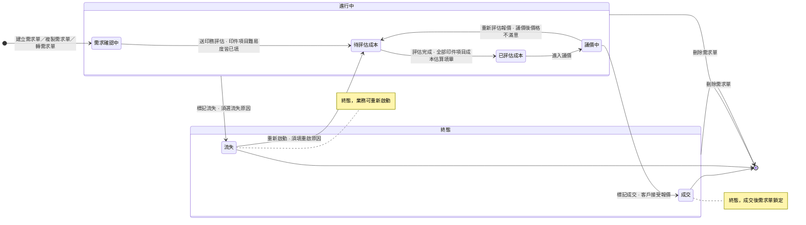

標題：中台 - 需求單管理模組（project P-PM-34，名稱不變）
說明：以下為 project 描述全文。本檔不含 Linear 欄位設定。

=== 描述全文開始 ===

## 概述

需求單讓客戶還在談、尚未成交的印刷需求有一張獨立的單據承載。談成時業務一鍵轉出訂單，談不成時留下流失原因。

現行報價靠業務與印務主管在 Slack 討論，客戶的參考檔散在對話裡，印務主管估價常漏看或回頭問。談不成的需求沒有收尾出口，管理層看不出輸單輸在哪。

---

## 使用情境

### Use Case

1. 業務接到詢價，建立需求單，逐筆登記印件項目與難易度，掛上參考檔。
2. 業務指定印務主管送出成本評估。
3. 印務主管填妥各筆成本。
4. 業務按評估完成，與客戶逐件談單價。
5. 客戶接受時業務標記成交並轉出草稿訂單；不接受時標記流失並選原因。
6. 客戶回頭時業務重新啟動已流失的需求單。
7. 老客戶要印規格相近的東西時，業務複製過往需求單起手。
8. 業務請假時把需求單分享給同事代理；人員異動時由業務主管或 Supervisor 改派接單業務。
9. 諮詢把付費諮詢轉成需求單並成為接單業務（轉入動作歸 <project id="9fd00109-9eb8-4c5e-95c7-7e2f2698f303" href="https://linear.app/sensationdeveloper/project/%E4%B8%AD%E5%8F%B0-%E8%AB%AE%E8%A9%A2%E5%96%AE%E7%AE%A1%E7%90%86-22b742656b48/overview">中台 - 諮詢單管理</project>）。

### Scope（功能票清單）

1. **需求單建立**：業務把客戶要印的東西登記成一張需求單並送出成本評估。　PM-1207
2. **成本評估與報價**：印務主管填成本、業務拿到報價依據、與客戶談定單價並標記成交。　PM-1215
3. **需求單結案與轉單**：業務把已成交的需求單轉成訂單，談不成的標記流失，客戶回頭時重新啟動，不要的刪掉。　PM-1338
4. **需求單複製、分享與改派**：業務從過往需求單起手並把需求單分享給同事，業務主管與 Supervisor 在人員異動時換接單業務。　PM-1216

**Out of Scope**

* 成交轉訂單後各欄位在訂單上的行為：歸 <project id="4927231b-7fe3-407e-8d1f-94eddc3f0a84" href="https://linear.app/sensationdeveloper/project/%E4%B8%AD%E5%8F%B0-%E8%A8%82%E5%96%AE%E7%AE%A1%E7%90%86-414a81747028/overview">中台 - 訂單管理</project>。
* 諮詢轉入建立需求單的動作與諮詢費收尾：歸 <project id="9fd00109-9eb8-4c5e-95c7-7e2f2698f303" href="https://linear.app/sensationdeveloper/project/%E4%B8%AD%E5%8F%B0-%E8%AB%AE%E8%A9%A2%E5%96%AE%E7%AE%A1%E7%90%86-22b742656b48/overview">中台 - 諮詢單管理</project>。
* 審稿人員分派與稿件審查：歸 <project id="6cdc708c-7619-4ade-abbc-6d89977d1a11" href="https://linear.app/sensationdeveloper/project/%E4%B8%AD%E5%8F%B0-%E5%AF%A9%E7%A8%BF%E7%AE%A1%E7%90%86-1d734eb71219/overview">中台 - 審稿管理</project>。
* 電商規格品的定價：歸 EC 平台。
* 產線主檔的維護：另案處理。
* 單據分享的層級與代理行為、接單業務改派的理由分類與分享成員處置：沿用 PM-1086。

---

## 範圍用詞

各 Feature 票權限表的資料範圍只用下列用詞。

| 用詞 | 定義 |
|------|------|
| 全公司 | 該模組全部單據 |
| 自己負責 | 該單據的人員欄是本人。需求單看接單業務 |
| 被分享（檢視） | 以檢視層級分享給本人且未撤銷的單據 |
| 被分享（編輯） | 以編輯（代理）層級分享給本人且未撤銷的單據 |

權限表被分享列的「所有角色」，指對需求單至少有一列不靠分享權限的角色：業務、諮詢、印務主管、業務主管、Supervisor。

---

## 另案處理（來源尚未定案，暫不實作）

* 新增分享成員時，候選名單是否排除已在清單的人與接單業務本人：待裁，目前依 Prototype 排除。

---

## 狀態機

>>> ### 需求單狀態機

* 流失與刪除為群組型轉換：自複合狀態邊界出發，適用框內全部子狀態。
* 刪除為軟刪除：資料保留，單據不再出現在清單。

>>>
