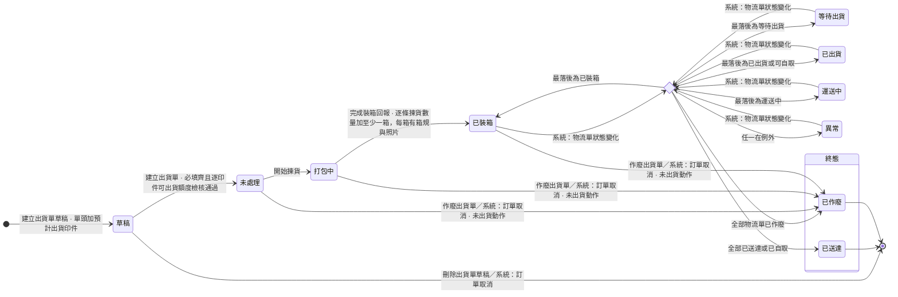
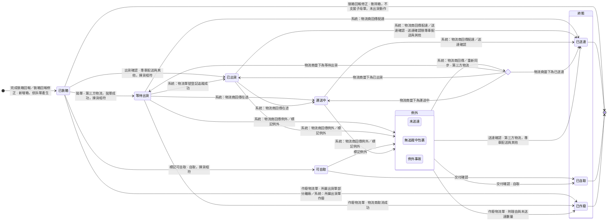

## 概述

品檢與出貨承接生產完成之後的最後一段。品檢人員驗收做出來的貨，通過的量成為可出貨額度。業務依額度安排出貨，揀貨人員逐箱裝箱，出貨人員把每一筆物流單交運並確認送達。

現行品檢回報與裝箱回報混在一起發出，出問題時難以定位。業務與客戶談定的出貨日期，現行散在通訊軟體裡。一張出貨單常裝成多箱，一箱被退時其他箱照常送達，單頭只放得下一組物流單號與一個狀態，表達不了。

---

## 使用情境

### Use Case

 1. 品檢人員對送到品檢站的貨分次驗收，每次附品檢照片。通過的量隨驗隨成為可出貨額度。
 2. 品檢人員記錯時修正原紀錄。已被出貨單佔用的量，業務先改出貨明細，品檢人員才修正得動。
 3. 驗出缺口時，印務決定補不補，以及瑕疵品報廢或客戶照收。印務誤記報廢時，先修正處置，品檢人員再把不通過改為通過。
 4. 業務與客戶談定出貨日期後，先建出貨單草稿。品檢通過、額度足夠後，業務把草稿建立為出貨單。
 5. 揀貨人員開始揀貨，逐條回報揀貨數量，逐箱回報箱規、長寬高、裝箱照片與備註。系統依出貨方式把裝好的箱拆成物流單。
 6. 揀貨數字與明細不符時，揀貨人員照實填，並現場通知業務。
 7. 業務改出貨明細數量，或揀貨人員修正揀貨數量與裝箱資料。兩數相符後才可做出貨動作。已交出的箱不再修正。
 8. 出貨人員對物流單做出貨動作。第三方物流拋單，可從出貨單一次拋出全部已裝箱的物流單，也可逐筆拋單。專車配送與其他逐筆出貨確認，自取逐筆標記可自取。第三方的物流單號由物流商回傳。
 9. 拋單失敗或逾時，物流單都不推進。拋單處理結束時，畫面逐筆顯示物流商回傳的錯誤訊息。原因在箱子時，揀貨人員先修正那一箱，出貨人員再拋一次。
10. 第三方物流的物流單依物流商回傳推進。回傳沒進來時，出貨人員重新同步，或做送達確認補上。專車配送與其他做送達確認，自取做交付確認。
11. 物流商回傳例外，或貨況不明時，出貨人員標記例外並向物流商確認貨況。確定送不到的那一筆，業務作廢物流單並填沒送到的量，額度回補。要再出就建新出貨單。
12. 物流單都還沒離廠就建錯單或客戶取消，業務作廢出貨單。

### Scope（功能票清單）

1. **品檢驗收與修正**：品檢人員看待驗清單、分次記錄驗收並附照片、修正記錯的紀錄。業務與印務查閱歷次品檢紀錄。　<issue id="a4aadd99-fa0c-4a28-ab20-64d667077913" href="https://linear.app/sensationdeveloper/issue/PM-1397/feature-品檢驗收與修正">PM-1397</issue>
2. **品檢缺口處置**：印務與印務主管對驗出的缺口決定補不補與瑕疵品去向，並修正誤記的處置。　<issue id="375917e0-9f90-4cea-ac50-64ca3ece0482" href="https://linear.app/sensationdeveloper/issue/PM-1398/feature-品檢缺口處置">PM-1398</issue>
3. **出貨單建立與管理**：業務與諮詢先建草稿排出貨計畫，額度足夠時建立出貨單。物流單都還沒離廠時可改明細數量或作廢，並查看出貨單、裝箱明細與物流單。　<issue id="9a41ec74-9133-4e8e-b7ab-fb14712153c7" href="https://linear.app/sensationdeveloper/issue/PM-1399/feature-出貨單建立與管理">PM-1399</issue>
4. **揀貨與裝箱回報**：揀貨人員開始揀貨、逐條回報揀貨數量、逐箱回報裝箱資料，並修正填錯的裝箱回報。　<issue id="95674851-df70-449a-ab05-0fb7e99ce068" href="https://linear.app/sensationdeveloper/issue/PM-1400/feature-揀貨與裝箱回報">PM-1400</issue>
5. **出貨交運與送達**：出貨人員對物流單做出貨動作、從出貨單批次拋單、同步貨況、標記例外、確認送達並下載物流單檔案。業務作廢送不出或送不到的物流單。　<issue id="ce13f397-c990-4c83-8287-07d541ba440a" href="https://linear.app/sensationdeveloper/issue/PM-1401/feature-出貨交運與送達">PM-1401</issue>

**Out of Scope**

* 報工、報工修正、報工作廢與場內轉交點收：歸 <project id="9d055ea4-9212-4711-a0d6-22870079b450" href="https://linear.app/sensationdeveloper/project/%E4%B8%AD%E5%8F%B0-%E7%94%9F%E7%94%A2%E7%AE%A1%E7%90%86-148ecc50024f/overview">中台 - 生產管理</project>。
* 訂單詳情頁與印件詳情頁本體：歸 <project id="4927231b-7fe3-407e-8d1f-94eddc3f0a84" href="https://linear.app/sensationdeveloper/project/%E4%B8%AD%E5%8F%B0-%E8%A8%82%E5%96%AE%E7%AE%A1%E7%90%86-414a81747028/overview">中台 - 訂單管理</project>。
* 取消訂單的動作，以及印件印製狀態與訂單狀態的推進：歸 <project id="4927231b-7fe3-407e-8d1f-94eddc3f0a84" href="https://linear.app/sensationdeveloper/project/%E4%B8%AD%E5%8F%B0-%E8%A8%82%E5%96%AE%E7%AE%A1%E7%90%86-414a81747028/overview">中台 - 訂單管理</project>。
* 計入完成度、打樣週期界線，以及重打換週期後的歸零（產出數量、良品數、不良品數、完工良品數、累計已出貨數量、累計送達數、已驗量、不通過累計、報廢數、未處置缺口按週期歸零重算；待驗量與可出貨額度由上列欄位推導，隨之只算本週期；生產數量不歸零）：沿用 <project id="9d055ea4-9212-4711-a0d6-22870079b450" href="https://linear.app/sensationdeveloper/project/%E4%B8%AD%E5%8F%B0-%E7%94%9F%E7%94%A2%E7%AE%A1%E7%90%86-148ecc50024f/overview">中台 - 生產管理</project>。
* 印件準時交貨率的判定：後續批次。
* 缺口補做的發起（在原工單加開補做生產任務）：後續批次。
* 印件短出結案：後續批次。
* 物流商串接（拋單、物流單號與物流單檔案的回傳、狀態與配達回傳、取消）：由線上編輯器後端既有的物流串接模組提供。
* 物流商端多建的托運單：系統外處理。拋單逾時，或等待回應期間單據被他人作廢，物流商端仍可能已建單。系統不防重複建單，也不向物流商取消。多出的托運單，物流商到場不收件，也不計價。重拋被物流商以重複為由拒絕時，出貨人員通知後端人員。後端人員到物流商後台查出物流單號後補登。
* 一次對多張出貨單拋單：不做。批次拋單只對一張出貨單底下的物流單。
* 自取、專車配送與其他一次對多筆出貨確認或標記可自取：不做。這些出貨方式一張出貨單只有一筆物流單。
* 出貨方式與箱規的維護：屬系統設定，不開維護功能。箱規不做停用與刪除。
* 運費與物流對帳：後續批次。箱數、箱規與長寬高只留存。
* 長寬高送給物流商：不做，只留在出貨單。
* 各物流商收得下的箱子尺寸上限：不記，系統不擋也不提示。超過上限由物流商拒收。
* 成品入庫成為獨立交易、成品倉庫存：後續批次。
* 品檢完成品移到暫存區的現場留痕：延後批次，隨廠務 Slack 表單回報一起。
* 退回實物的場內處理：不進系統，現場人工處理。
* 貨不回台的海外直發訂單：本輪範圍外。

### 範圍用詞

| 用詞 | 定義 |
| -- | -- |
| 全公司 | 該模組全部單據 |
| 自己負責 | 該單據的人員欄是本人（看哪一欄由活動清單卡的依據欄位寫明） |
| 被分享（檢視） | 以檢視層級分享給本人且未撤銷的單據 |
| 被分享（編輯） | 以編輯（代理）層級分享給本人且未撤銷的單據 |

* 印件有多張工單時，以工單判定範圍的操作與檢視，看任一張工單的負責人或分享成員都算，不因那張工單已進終態失去資格。

---

## 另案處理（來源尚未定案，暫不實作）

* 詳情頁頁籤與欄位對各角色的可見性：待裁。本批以各 Feature 票的權限表為準。

---

## 狀態機

>>> ### 出貨單狀態機

* 已裝箱之後的推進是歸納型轉換：物流單一有變化就重算，畫成選擇節點。
* 草稿不是出貨指令，出口是刪除。
* 揀貨不符不是狀態。它擋下出貨動作，見 <issue id="ce13f397-c990-4c83-8287-07d541ba440a" href="https://linear.app/sensationdeveloper/issue/PM-1401/feature-出貨交運與送達">PM-1401</issue>。
* 異常不是終態。

出貨單依物流單計算：

| 規則 | 內容 |
| -- | -- |
| 計算來源 | 只看未作廢的物流單。已作廢的物流單保留可查，不參與計算 |
| 最落後 | 取未作廢物流單在「已裝箱、等待出貨、已出貨、運送中、已送達」順序上最落後的狀態。可自取視同已出貨，已自取視同已送達 |
| 異常優先 | 任一未作廢物流單在例外，出貨單為異常，不論其他物流單在哪一格。例外解除或該物流單作廢後重算 |
| 已送達 | 至少一筆未作廢物流單，且全部未作廢物流單已送達或已自取。轉入後為終態，不重算 |
| 全部作廢 | 未作廢物流單筆數歸零時，出貨單轉已作廢 |

出貨動作是拋單、出貨確認或標記可自取，對物流單執行。拋單可從出貨單一次對多筆物流單執行。出貨動作成功才寫入離廠時間，見 PM-1401。出貨單的集合詞依物流單離廠時間判定，不依狀態名。離廠後又被作廢的物流單，仍算有離廠時間。各集合詞互斥，涵蓋草稿以外的全部未作廢出貨單：

| 集合詞 | 定義 |
| -- | -- |
| 未出貨動作 | 本單的物流單都沒有離廠時間。含未處理、打包中，以及已裝箱且沒有任何一筆物流單離廠，拋單失敗而未推進者也屬此類 |
| 部分離廠 | 至少一筆物流單有離廠時間，但仍有未作廢物流單沒有離廠時間 |
| 全數離廠 | 全部未作廢物流單都有離廠時間，本單有實際出貨日 |

>>>

>>> ### 物流單狀態機

* 物流單在完成裝箱回報時產生，初始為已裝箱。所有出貨方式都有物流單。拋單失敗或逾時，物流單都不推進，仍在已裝箱。
* 各出貨方式經過的狀態：第三方物流為已裝箱、等待出貨、已出貨、運送中、已送達。專車配送與其他為已裝箱、已出貨、已送達。自取為已裝箱、可自取、已自取。
* 離開例外回到物流商當下狀態的弧，落入哪一格看同步結果。
* 所屬出貨單作廢時，已裝箱的物流單一併作廢。

>>>
